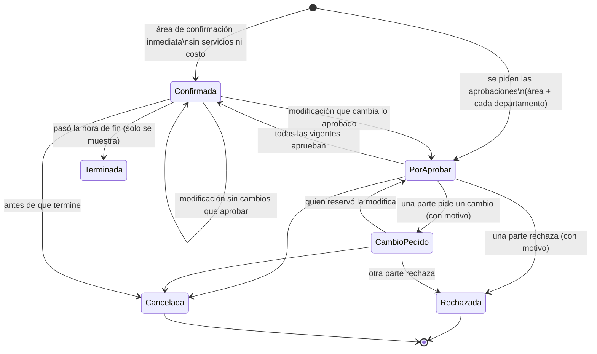

# Reservas de áreas

Módulo nuevo (decisiones del dueño, 2026-10-15): reservar salones, salas y terrazas de la sede, con servicios atendidos por departamentos, aprobaciones en paralelo, órdenes de servicio, cotización e informes. Manual: [reservas-de-areas.md](../usuario/reservas-de-areas.md), [reservas-aprobar.md](../usuario/reservas-aprobar.md), [reservas-departamentos.md](../usuario/reservas-departamentos.md), [reservas-configuracion.md](../usuario/reservas-configuracion.md). Curso: [lección 60](../cursos/leccion-60-reservas-de-areas.md).

## Decisiones

- **Las áreas salen de Zonas y edificios.** `reserva_areas` es la configuración de reserva de un `espacio` existente (1 a 1, `espacio_id` único), no otro catálogo de lugares. Se reservan los niveles edificio, área, área específica y subárea (`CatalogosReservas::NIVELES`; el nivel elemento no). La pantalla de Zonas y edificios no cambió: se agrega desde Reservas (ficha «Agregar área reservable» en las fichas de la sede y en Configuración).
- **Menú:** Operación → sección nueva **«Reservas»** (al final de Operación, `MenuSeeder` idempotente: solo acomoda módulos sin menú). Las pestañas internas (Calendario, Mis reservas, Por aprobar, Órdenes de servicio, Informes, Configuración) no son módulos: un solo `reservas` en el catálogo. Área del catálogo nueva **«Servicios»** (`servicios`), para que las reglas generales de Seguridad y RR. HH. no le apliquen.
- **Aprobar es por designación, no por permiso:** responde quien es responsable/suplente del área (o el responsable general y su suplente si el área no tiene), responsable/suplente del departamento (Responsables por departamento, los mismos de las visitas), su delegado con «No molestar», o a quien se avisó por recordatorio/escalamiento. Además, `reservas.aprobar` en la sede permite responder cualquiera (el gerente cuando el responsable falta). La designación la hace quien configura.
- **«Listo»** en las órdenes de servicio es el texto que pidió el dueño (excepción aprobada a los diez verbos del criterio 4).
- **IVA:** la empresa no tenía IVA propio; se configura aquí (`preferencias.reservas.iva_aplica/iva_porcentaje`, por omisión 16 % cobrado). Moneda: `empresas.moneda`.
- **Reservas recurrentes (semanal): siguiente paso.** Complica aprobaciones y avisos (una serie de N reservas con N aprobaciones por departamento); se propone como mejora: «Repetir cada semana hasta…» creando la serie con `serie_id` y una sola aprobación por parte para toda la serie.
- **Choques (bloqueo cruzado, decisión del dueño 2026-10-16):** una reserva choca con las del mismo espacio **y** con las de los espacios que lo contienen o que tiene dentro en Zonas y edificios (por la ruta materializada). Reservar una zona completa ocupa sus espacios interiores en ese horario y reservar un espacio interior impide reservar la zona completa a esa hora, contando el montaje y desmontaje de cada reserva (`bloqueo_desde`/`bloqueo_hasta`). Ver «Espacios interiores».
- **Una reserva es de un solo día** (inicio y fin el mismo día local) cuando el área tiene horario.

## Espacios interiores (niveles) y agregar / quitar áreas

Decisiones del dueño (2026-10-16), solo dentro de Reservas, sin tocar ni borrar nada en Zonas y edificios:

- **Modo de una zona** (`reserva_areas.modo`, migración `2026_11_06_000100_modo_de_areas_reservables`, `down()` quita la columna): `completa` (por omisión; la zona se reserva como un solo espacio) o `interiores` (la zona solo agrupa; no se reserva ni sale en el calendario y `Disponibilidad::validar` lo rechaza con «Esta zona se reserva por sus espacios interiores: elige uno de ellos.»). Una zona sin espacios interiores de nivel permitido siempre queda `completa`.
- **Marcar «por sus espacios interiores»** (`CatalogosReservas::marcarReservable($actor, $espacio, 'interiores')`): marca de una vez sus espacios interiores (`NivelesReservas::interioresFinales`): las **áreas específicas** (habitaciones, salas) a cualquier profundidad; si no tiene, sus hijos directos de nivel permitido (los pisos de una zona sin habitaciones o las subáreas de una habitación). No marca los pisos intermedios ni las áreas internas de una habitación (baño, recámara). Cada uno **hereda** de la zona como valores iniciales `ReservaArea::HEREDABLES` (aforo, confirmación inmediata, minutos de montaje y desmontaje, horario, tarifas, responsable y suplente) y sus montajes con aforo (`heredar`); se editan después por separado. En la configuración de la zona, «Copiar esta configuración a sus N espacios interiores» (`copiar_interiores`) reemplaza la de cada uno (`copiarAInteriores`, auditado por área).
- **Jerarquía de fichas** (`NivelesReservas::padres`): el «padre» de un área es el área reservable más cercana que la contiene en el árbol de espacios. `GET /reservas?sede=` muestra el primer nivel; una zona con áreas dentro es **ficha contenedora** («N espacios reservables», `btn-entrar` «Entrar a sus espacios» → `GET /reservas?sede=&zona={area}`), con migas Reservas de áreas › Sede › Zona… y las fichas agrupadas por el camino intermedio (piso). Una zona `completa` con espacios dentro muestra además «Reservar toda la zona».
- **Formulario en cascada**: «Zona o área» (primer nivel, sin nombre de campo) → «Espacio» (`reserva_area_id`, opciones con `data-zona`; «Piso 1 › Sala 101» o «Toda la zona»). `public/js/reservas.js` filtra; sin JavaScript se ven todas. `?zona=` preselecciona.
- **Bloqueo cruzado** (`Disponibilidad::choques` / `espaciosRelacionados`): `reservas.espacio_id IN (el espacio, sus ancestros y sus descendientes)`. El JSON de disponibilidad trae `otro` (nombre del espacio que ocupa) y el mensaje dice «… comparte lugar con esta área…». `AdministradorReservas` bloquea con `lockForUpdate` todas las áreas relacionadas (orden por id) dentro de la transacción.
- **Agregar** (`POST /reservas/configuracion/areas`, `espacios[]` + `modo` + `sede` opcional; `espacio_id` sigue sirviendo): cada espacio pide `reservas.configurar` en su sede («Elige un espacio de tu sede.»). El diálogo (`_dialogo-agregar`) lista el árbol con sangría (`CatalogosReservas::opcionesParaAgregar`), buscador, filtro de sede, casillas («Ya se reserva», «Se quitó · vuelve con su configuración») y el modo. Volver a agregar una quitada la **reactiva conservando su configuración**. **La lista se pide al abrir el diálogo** (`GET /reservas/configuracion/opciones-agregar[?sede=]`, ruta `reservas.configuracion.opciones`, `reservas.configurar`; la sede debe estar en su alcance, si no 403): el diálogo solo trae `data-cargar-url` y `plataforma.js` (`cargarBajoDemanda`) la inserta una vez. Con miles de habitaciones la lista pesaba ~2.7 MB y se mandaba en cada visita a las fichas y a Configuración; solo viene ya armada cuando el formulario regresa con error de `espacio_id`. Los espacios interiores de cada opción se cuentan en una sola pasada sobre los ancestros (antes se comparaba cada espacio contra todos: ~70 s con 3,000 habitaciones).
- **Eliminar de reservas** (antes «Quitar de reservas»; `DELETE /reservas/configuracion/areas/{area}`, ruta `reservas.configuracion.area.quitar`, `CatalogosReservas::quitar`): con reservas próximas (`Reserva::OCUPAN` con `fin` futuro) **no se elimina** («No se eliminó «…» de reservas: tiene N reservas próximas; cancélalas o reprográmalas primero.» + siguiente paso «Ver su calendario»; se eligió bloquear por ser lo más seguro); con reservas pasadas (cualquier estado) se **archiva**: `reservable = false` con su configuración e historial, y deja de verse (ver «Editar, eliminar y ocultar»); sin reservas se borra su configuración (y su foto). Una zona `interiores` se elimina junto con sus espacios. Nunca toca `espacios`. Auditoría: `reservas.area_reservable`, `reservas.area_modo`, `reservas.area_quitada` («Área eliminada de reservas»), `reservas.area_configurada`.

## Editar, eliminar y ocultar (decisión del dueño, 2026-10-16)

El dueño reportó que las fichas de áreas «no se ven editables ni eliminables»: los íconos deslizadores (Configurar) y círculo tachado (Quitar) no se reconocían. Se igualaron a **Zonas y edificios** (`organizacion/espacios/partes/acciones`):

- **Editar** = `btn-icono editar` con `bi-pencil` y `title`/`aria-label` «Editar …» en todas las vistas de reservas: fichas de áreas en Configuración y por sede/zona (lleva a `GET /reservas/configuracion/areas/{area}`), fichas de catálogos (`_acciones-catalogo`, antes `bi-pencil-square`), título del diálogo de edición y «Modificar» en Mis reservas.
- **Eliminar de reservas** = `btn-icono eliminar` con `bi-trash3` (parcial `_acciones-area`, compartido por `configuracion` y `sede`). Reemplaza al tachado «Quitar»: un solo botón. Su `data-confirmar` dice qué pasará con **esa** área según `CatalogosReservas::resumenParaEliminar($areas)` (tres consultas para todas; una zona `interiores` cuenta sus espacios): sin reservas («se borra su configuración»), solo pasadas («dejará de verse… guardamos su historial»), próximas («todavía no se puede eliminar»; el servidor bloquea igual). Las tres terminan diciendo «El espacio sigue en Zonas y edificios.». Un área archivada muestra Editar y **Reactivar** (no bote). Al editar un área archivada, la pantalla avisa que no se ofrece; al guardarla, el aviso agrega «Sigue quitada de reservas: no se ofrece hasta que la reactives.» y el siguiente paso es «Ver áreas quitadas para reactivarla» (no «Reservar esta área», que solo se ofrece si el área es reservable, no es una zona por sus espacios interiores y su espacio está activo).
- **Ocultar lo quitado / dado de baja**: `GET /reservas/configuracion` muestra solo lo activo por sección. La píldora `btn-pill-tipo` (parcial `_ver-ocultas`, mismo patrón de píldoras con enlace que Mis reservas) «Mostrar quitadas (N)» / «Mostrar dados de baja (N)» aparece si hay algo oculto y recarga con `?ver[]=areas|montajes|tipos|servicios` (cada sección por separado; `ConfiguracionReservasController::urlVer` conserva las demás; valores desconocidos se ignoran). Se eligió servidor y no un filtro en JavaScript para que lo oculto ni siquiera se pinte y funcione sin JS. Las fichas por sede/zona nunca mostraron áreas archivadas.
- **Catálogos — Eliminar** (`DELETE /reservas/configuracion/catalogo/{catalogo}/{id}`, `reservas.configuracion.catalogo.eliminar`, `CatalogosReservas::eliminarCatalogo`): borrado físico **solo si nunca se usó**: montajes sin `reservas.montaje_id` ni `reserva_area_montajes`; tipos sin `reservas.tipo_uso_id`; servicios sin `reserva_servicio_items.servicio_id` (cualquier estado de reserva, también canceladas). Si se usó responde «No se eliminó «…»: ya se usó en N reservas [y en la configuración de N áreas]. Para conservar ese historial no se elimina: dalo de baja…». En pantalla (`CatalogosReservas::usados()`, tres consultas), lo nunca usado tiene bote con `DELETE`; lo usado y activo tiene un bote que explica por qué y envía la **baja** (`PATCH …/estado`, `activo=0`); lo usado y de baja no tiene bote. Permiso `reservas.configurar` con alcance de empresa (`exigirEmpresa`, 403 si no); el registro se busca con el scope de tenant (otra empresa: 404). Auditoría `reservas.catalogo_eliminado` («Eliminación en el catálogo»). No se usó el borrado genérico (`componentes.borrar`, `docs/tecnico/borrado.md`) porque pide la acción `reservas.borrar`, que no existe; el dueño pidió que baste `reservas.configurar`.
- **Catálogos iniciales una sola vez**: `asegurar()` marca `empresas.preferencias.reservas_catalogos_iniciales` (`CatalogosReservas::INICIALES`); si la empresa elimina todos sus montajes o tipos, ya no vuelven a aparecer.
- **Verbo «Eliminar»** (fuera de los diez del criterio 4): texto aprobado por el dueño, igual que «Eliminar definitivamente» del borrado controlado.

## Orden de evento (decisión del dueño, 2026-10-16)

El dueño usa una hoja de «orden de evento» de hotel (lugar, núm. de pax, fecha, solicitado por + departamento, horario, «TENER MONTAJE LISTO 30 MIN ANTES» y secciones por departamento con casillas y notas). Se cubrieron solo los huecos; lo demás ya existía y se reutilizó.

**Ya existía:** `titulo` (nombre del evento), área y espacio, `inicio`/`fin`, `asistentes` con aforo del área y por montaje (`reserva_area_montajes.aforo`), `montaje_id`, `bloqueo_desde/hasta` con los minutos del área, `solicitante_id` y `created_at`, servicios del catálogo con `departamento_id` y `requiere_aprobacion`, renglones con `notas`, renglones sin `servicio_id` (tabla), aprobaciones y órdenes por departamento, tarifas (incluida `tarifa_dia`) y la hoja impresa.

**Se agregó** (migración `2026_11_07_000100_orden_de_evento_en_reservas`, solo columnas opcionales en `reservas`; `down()` quita la llave foránea y las columnas, probado en `ReservasOrdenDeEventoTest`):

| Columna | Para qué |
|---|---|
| `departamento_solicitante_id` (FK `departamentos`, `nullOnDelete`) | Departamento que pide. Se propone con el del colaborador del usuario (`AdministradorReservas::departamentoDe`: `users.colaborador_id` → `colaboradores.departamento_id`, solo si es de la empresa). Editable; se valida con el scope de tenant («Elige un departamento de tu empresa.»). Al modificar sin el campo se conserva. `Reserva::solicitadoPorTexto()` = «Nombre — Departamento». |
| `excede_aforo`, `motivo_excepcion_aforo` | Pasar el aforo **ya no es error**: `Disponibilidad::aforo()` da [aforo, excede, «del montaje X» / «del área»]; si excede sin motivo (≥ 3 caracteres) → error en `motivo_excepcion_aforo` «Son N personas y el aforo … es de M: escribe el motivo de la excepción (lo verá quien aprueba).». Con motivo se guarda y `Disponibilidad::validar(..., excepcionAforo: true)` no bloquea. Dentro del aforo el motivo se descarta. |
| `dia_completo` | `Disponibilidad::diaCompleto($area, $fecha)`: ventana más larga del horario del área ese día; sin horario 00:00–23:59; día cerrado → «Ese día el área no se reserva: elige otro día.». Las horas del formulario se ignoran. Si es para cliente sin tarifa elegida y el área tiene `tarifa_dia`, se usa `dia`. |
| `montaje_minutos`, `desmontaje_minutos` (null = los del área) | El formulario propone los del área; si llegan **iguales** a los del área se guarda `null` (así una modificación sin cambios no altera huellas). `Disponibilidad::bloqueo()` y `validar()` reciben los de la reserva; `Reserva::minutosMontaje()/minutosDesmontaje()` resuelven el valor. El bloqueo cruzado por niveles usa `bloqueo_desde/hasta` ya calculados, así que respeta los minutos de cada reserva. 0–1440. |
| `indicaciones_montaje` (255) | Texto corto resaltado en la ficha y la hoja. **Decisión:** columna propia y no `notas`, porque `notas` es «para quien aprueba» y no se imprime resaltado; las indicaciones son para quien monta. |

**Aprobaciones y órdenes:**
- `FlujoReservas::requeridas`: una reserva con `excede_aforo` siempre pide la parte **área** (aunque el área sea de confirmación inmediata).
- Huellas: se agregan datos **solo si se usan** (excepción de aforo y minutos propios en la del área; minutos propios e indicaciones en la de cada departamento), para que las reservas de antes conserven su huella y no se vuelvan a pedir aprobaciones por la migración. La nota de un renglón ya era parte de la huella del departamento.
- «+ Otro servicio» = renglón con `servicio_id` null y el departamento de su tarjeta (en «Otros» se elige o queda sin departamento). Al no tener servicio, `requiere_aprobacion` se toma como `true` (comportamiento existente): su departamento aprueba y recibe orden. Sin departamento solo se anota en la hoja.
- **Departamento que hace el montaje** (`preferencias.reservas.departamento_montaje_id`, `AjustesReservas`; validado contra la empresa; si el formulario no lo trae se conserva): en el formulario el `<select name="montaje_id">` se pinta dentro de su tarjeta (`_campo-montaje`) y `FlujoReservas::departamentoMontaje()` lo suma a las órdenes cuando la reserva tiene `montaje_id` (orden «Montaje Tipo U» aunque no tenga renglones). No pide aprobación propia: el montaje ya lo aprueba el área.

**Formulario** (`formulario.blade.php`, `_campo-montaje`, `_otro-servicio`, `public/js/reservas.js`, sin JS en línea): «Día completo» (interruptor), minutos de montaje/desmontaje e indicaciones en «¿Dónde y cuándo?»; departamento que solicita y «N de M permitidos» en vivo en «¿Para qué?» con el bloque de excepción (visible sin JS si hay error o motivo); **Servicios por departamento** = `fieldset.res-depto` por departamento (`ReservaController::gruposPorDepartamento`: el que monta primero, luego por nombre sin acentos, «Otros» al final con los sin departamento o de departamentos inactivos), cada servicio con casilla `servicios[id][usar]` y, al marcarla, cantidad (sugerida por unidad) y nota; `<template>` por tarjeta para «+ Otro servicio» (`otros[n][departamento_id|nombre|notas|cantidad]`). El servidor acepta un servicio marcado con `usar` **o** con cantidad > 0 (compatibilidad); sin cantidad la sugiere (persona → personas, hora → horas, otro → 1). Rejilla `auto-fill minmax(280px)` (2–3 columnas en escritorio, una en celular).

**Hoja impresa** (`imprimir.blade.php`, `ReservaController::seccionesHoja`): encabezado en rejilla (lugar con su ruta, pax «de N permitidos», fecha y horario —«Día completo»—, solicitado por + departamento, fecha de solicitud, montaje/desmontaje, ocupación, tipo de uso, para quién), indicaciones resaltadas, excepción de aforo, rejilla de 3 columnas de secciones por departamento con ☒ y nota (cantidad cuando no es 1 o es por persona); por omisión solo departamentos con algo pedido; `?completa=1` agrega los servicios activos sin marcar (☐), los montajes del área y «Otro servicio: ____». Carta (`@page letter`); la hoja de ejemplo cabe en una página. Cotización, aprobaciones y firmas se conservan.

**Ficha, Por aprobar y Mis reservas:** «Solicitado por», «Fecha de solicitud», «20 de 25 permitidos», montaje y desmontaje, indicaciones, servicios agrupados por departamento (`ReservaController::porDepartamento`); insignia **Excede aforo** con el motivo en Por aprobar y Mis reservas; el resumen de los avisos dice «(excede el aforo: motivo)».

**Lista sugerida de hotel** (`POST /reservas/configuracion/sugeridos-hotel`, ruta `reservas.configuracion.sugeridos`, `reservas.configurar` con alcance de empresa; `CatalogosReservas::cargarSugeridosHotel`, constantes `SUGERIDOS_HOTEL` y `MONTAJES_HOTEL`): solo al pulsar el botón (no en `asegurar()`, para respetar los catálogos iniciales que no vuelven); idempotente por nombre normalizado (`CatalogosReservas::clave`, sin acentos ni mayúsculas, incluye dados de baja); sin costo; asigna el departamento con nombre (o alias) coincidente y **no crea departamentos**; montajes «Tipo U/Escuela/Auditorio/Banquete» solo si no hay uno equivalente (p. ej. «Herradura (U)», «Escuela»). Auditoría `reservas.sugeridos_hotel` («Carga de servicios sugeridos de hotel»).

**Criterios de experiencia de uso:** (2) el departamento y los minutos se proponen, la cantidad se sugiere; (4) verbos existentes («Guardar», «Imprimir»); «+ Otro servicio», «Mostrar hoja completa», «Solo lo pedido» y «Cargar servicios sugeridos de hotel» son textos pedidos por el dueño; (5) el aviso de la lista sugerida ofrece «Ver los servicios» y «Configurar las áreas»; (7) cantidad y nota aparecen solo al marcar; la hoja completa es opcional; (8) lo indispensable sigue siendo área, día, horario, nombre y personas.

## Tablas (migración `2026_11_05_000100_crear_reservas_de_areas`)

| Tabla | Para qué |
|---|---|
| `reserva_montajes`, `reserva_tipos_uso` | Catálogos por empresa (`nombre`, `orden`, `activo`); nacen con los de `DEFECTO` la primera vez (`CatalogosReservas::asegurar`, marca `preferencias.reservas_catalogos_iniciales`). |
| `reserva_servicios` | Catálogo: `categoria`, `unidad` (pieza, persona, hora, evento), `costo` opcional, `departamento_id`, `requiere_aprobacion`. |
| `reserva_areas` | `sede_id`, `espacio_id` (único), `reservable`, `modo` (`completa` / `interiores`, migración `2026_11_06_000100`), `aforo_maximo`, `confirmacion_inmediata`, `montaje_minutos`, `desmontaje_minutos`, `horario` JSON (`{"1":[["08:00","22:00"]],…,"7":[]}`; null = cualquier hora), `tarifa_hora/medio_dia/dia/evento`, `descripcion`, `foto` (disco privado), `responsable_id`, `suplente_id`. |
| `reserva_area_montajes` | Montajes del área con su `aforo`. |
| `reservas` | `folio` (RES-000123), área y espacio, `titulo`, `tipo_uso_id`, `montaje_id`, `asistentes`, `inicio`/`fin` y `bloqueo_desde`/`bloqueo_hasta` (UTC; bloqueo = inicio − montaje, fin + desmontaje), `estado`, `solicitante_id`, `para_cliente` + datos del cliente, `tarifa`, `importe_area`, `importe_area_manual`, `importe_servicios`, `descuento`, `cortesia`, `ajuste_motivo`, `iva_porcentaje`, `iva`, `total`, `moneda`, `notas`, confirmación y cancelación. |
| `reserva_servicio_items` | Renglones con copia de nombre, unidad, costo y departamento (si el catálogo cambia, la reserva conserva lo pedido). |
| `reserva_aprobaciones` | Una por parte (`tipo` area/departamento): `estado`, `vigente`, `huella` (sha256 de lo aprobado), `solicitada_en`, respuesta, `avisados`, `recordatorio_en`, `escalado_en`, `escalado_a`. |
| `reserva_ordenes` | Orden de servicio por departamento (`pendiente`, `lista`, `cancelada`, `huella`, `lista_en/por`, `comentario`); única por reserva y departamento. |
| `reserva_eventos` | Historial visible de la reserva. La Bitácora de auditoría guarda además antes y después (`reservas.*`). |

Todas con `empresa_id` (scope de tenant) y `creado_por`/`actualizado_por`. `down()` borra las tablas de hijas a madres; no toca tablas existentes. `2026_11_06_000100_modo_de_areas_reservables` solo agrega `reserva_areas.modo` (default `completa`); su `down()` la quita (probado en `ReservasPorNivelesTest`).

## Estados

Ocupan el horario: Por aprobar, Cambio pedido y Confirmada (`Reserva::OCUPAN`).

## Reglas

- **Disponibilidad** (`Disponibilidad::validar`): área reservable, que no sea zona `interiores`, y espacio activo; inicio en el futuro; dentro del horario del día (hora local de la sede); montaje disponible en el área; asistentes ≤ aforo del montaje (o del área) **salvo excepción con motivo** (ver «Orden de evento»); sin cruce de bloqueos con otras reservas que ocupan el mismo espacio, la zona que lo contiene o sus espacios interiores. Se guarda dentro de una transacción con `lockForUpdate` sobre esas áreas.
- **Costo** (`Cotizador`): uso interno = todo en cero. Cliente = tarifa (hora: cada hora o fracción; medio día; día; evento; o `importe_area_manual`) + Σ cantidad × costo − descuento (cortesía = todo) + IVA de la empresa. Ajustar costo (`PUT /reservas/{r}/costo`) pide `reservas.aprobar` y motivo; no vuelve a pedir aprobación; una modificación conserva el ajuste mientras siga siendo para cliente.
- **Aprobaciones** (`FlujoReservas::requeridas/sincronizar`): parte «área» salvo confirmación inmediata sin servicios ni cliente; una parte por departamento de los servicios con `requiere_aprobacion`. Huella del área: espacio, inicio, fin, montaje, asistentes, para cliente, tarifa. Huella del departamento: espacio, inicio, fin, montaje y sus renglones. Al modificar, una parte aprobada o pendiente con la misma huella se conserva (sin aviso nuevo); las demás se retiran (`vigente = false`, pendientes → `cancelada`) y se piden de nuevo. Responder: el primero gana (`UPDATE … WHERE estado = pendiente`); rechazar o pedir cambio exigen motivo (en pantalla el campo es `required`: el navegador frena el envío; el servidor responde «Escribe el motivo del rechazo.»). Al aprobar la última, `confirmada`.
- **Ficha tras rechazar o cancelar** (`ReservaController::aprobacionesParaMostrar`): el bloque «Aprobaciones» muestra las vigentes y, si la reserva está `rechazada` o `cancelada`, también las que se retiraron en ese momento (`cancelada`, `vigente = false`, `updated_at` ≥ respuesta del rechazo o `cancelada_en`, sin vigente de la misma clave) con «Ya no aplica» y sin botones; las reemplazadas por una modificación no se muestran.
- **Servicios dados de baja** (`AdministradorReservas::items`): un servicio con `activo = false` ya no se ofrece en reservas nuevas, pero al **modificar** una reserva que ya lo tenía se conserva el renglón tal como se pidió (nombre, departamento, unidad y costo del renglón guardado); el formulario lo sigue mostrando marcado con «Dado de baja: se conserva en esta reserva…». Así, guardar sin cambios deja las huellas iguales: no quita el servicio, no cancela la orden del departamento ni pide aprobaciones o avisa. Si se desmarca, se quita y ya no se puede volver a pedir. Igual con el tipo de uso dado de baja que la reserva ya tenía (se sigue listando para no perderlo).
- **Órdenes** (`FlujoReservas::sincronizarOrdenes`): al confirmarse, una por departamento con renglones (aprueben o no). Si cambia la huella del departamento, vuelve a `pendiente` con aviso «Cambió la orden»; sin renglones, `cancelada`. Al cancelar la reserva, todas se cancelan con aviso.
- **Modificar**: quien reservó (con `reservas.crear`) o `reservas.configurar`, antes de que empiece. **Cancelar**: quien reservó antes de que empiece; `reservas.aprobar`/`configurar` hasta que termine; con motivo.

## Avisos (criterios 1 y 3)

- Campana (`CentroNotificaciones::TIPOS`): `reserva_por_aprobar` (botones **Aprobar** y **Ver y responder**), `reserva_recordatorio`, `reserva_escalada`, `reserva_confirmada`, `reserva_rechazada`, `reserva_cambio`, `reserva_cancelada`, `reserva_orden`, `reserva_orden_lista`; todos silenciables en Mi cuenta (`PreferenciasAvisos::CAMPANA`). Al responder se quitan los botones (`resolver('reserva_aprobacion', id)`).
- Correo (`Empresa::AVISOS`, grupo «Reservas de áreas», encendidos): `reserva_aprobacion`, `reserva_resultado`, `reserva_orden`.
- **Mis pendientes** (`PendientesReservas::para`: ninguna consulta si la empresa nunca marcó un área reservable —marca `empresas.preferencias.reservas_en_uso`—; si no, 6 sin relaciones): «Reservas por aprobar» (con el color de la más atrasada), «Órdenes de servicio por atender», «Reservas con cambio pedido».
- **Reloj y color**: `RelojVoBo` con las horas de la empresa (`recordar_horas` 4 → ámbar, `escalar_horas` 24 → rojo). **Recordatorio** a los avisados + suplente del área; **escalamiento** al responsable general y su suplente (si ya estaban avisados, a `reservas.configurar` de la sede). Un aviso por nivel (`recordatorio_en`, `escalado_en`). Tarea `plataforma:reservas-pendientes --si-toca` en `despliegue/desplegar.sh` (en proceso, sin exec) y, por si el cron no corre, al abrir Calendario o Por aprobar (`EsperaReservas::escalarSiToca`, una vez por minuto por empresa).
- «No molestar»: los avisos de un responsable con delegación activa van a su delegado, que también puede responder y marcar «Listo».

## Permisos

Módulo `reservas` (área Servicios): `ver`, `crear`, `aprobar`, `configurar`, `exportar`, `imprimir`. Alcance: `ver` limita el calendario y las fichas a sus sedes (o a las propias); `crear` dónde puede reservar; catálogos y ajustes piden `configurar` con alcance de empresa; las áreas, el de su sede. Plantillas (`RolesPlantillaSeeder::RESERVAS` y la migración `2026_11_05_000200_modulo_y_permisos_de_reservas`, que las aplica por nombre de rol a plantillas y copias): Administrador todo (empresa); Director ver (empresa); Jefe de departamento ver, crear, imprimir y aprobar (sede); Solicitante ver, crear, imprimir (propios); Recursos Humanos, Jefe de seguridad, Asistente de seguridad, Supervisor y Agente ver, crear, imprimir (sede). La migración activa el módulo en todas las empresas existentes. El catálogo comercial no lo incluye en ningún producto: para clientes con suscripción se agrega como «módulo agregado» (siguiente paso: producto «Reservas»).

Calendario: quien puede reservar ve los horarios ocupados de otros como «Ocupado» sin abrirlos.

## Formato de fichas y botones (decisiones del dueño: «conservar el formato de FICHAS»; 2026-10-16: «botones iguales al resto de los módulos»)

Las pantallas usan los componentes de la plataforma, sin estilos propios para botones, filtros, navegación ni listas:

- **Entrada** (`GET /reservas`): tarjetas de **sedes** como Zonas y edificios (`fichas-grid` + `ficha-card` + `btn-entrar`, buscador `data-filtro-texto`). Con una sola sede visible se entra directo. `GET /reservas?sede=[&zona=]` = fichas por niveles con la estructura de Zonas y edificios: título `h5` con los botones de ícono **arriba a la derecha** (`btn-icono ver` Calendario del área, `reactivar` Reservar toda la zona, `editar` Editar con `bi-pencil`, `eliminar` Eliminar de reservas con `bi-trash3` y `data-confirmar`), línea de ubicación con la insignia «Hoy: N» / «Libre hoy», datos y el botón principal **abajo** (`btn-entrar`: «Reservar», «Entrar a sus espacios» o «Ver calendario»). Fichas `ficha-create` «Nueva reserva» y, con `reservas.configurar` en la sede, «Agregar área reservable». Migas `migas migas-espacios`.
- **Tema verde**: `.tema-verde .btn-entrar` y `.tema-verde .opcion-asignar:has(input:checked)` en `plataforma.css` (y modo noche en `modos-pantalla.css`), igual que las variantes del tema rojo. `.ficha-footer a.btn-icono` conserva el tamaño del ícono (antes la regla `.ficha-footer a` lo achicaba a 0.8rem en los enlaces de ícono).
- **Botones de página**: principal `btn-verde btn-accion-rh` (Guardar, Guardar reserva, Aprobar, «Listo», Ver, Imprimir), peligro `btn-rojo btn-accion-rh` (Cancelar reserva, Rechazar), secundario `btn-secundario-rh` (Modificar, Imprimir, Ajustar costo, Cancelar, Descargar en Excel, Reservar aquí, Hoy y flechas del calendario); en diálogos `dialogo-acciones` con `btn-cancelar` + `btn-verde`. Filtros en `filtros-rh` con `filtro-fecha` y `filtro-select`; vistas Día/Semana/Mes como los botones `btn-dark`/`btn-outline-dark` de Zonas y edificios. Se eliminaron de `reservas.css` `.res-boton`, `.res-acciones`, `.res-filtros`, `.res-vistas`, `.res-navegar` y `.res-titulo-periodo`.
- **Calendario**: vista secundaria, `GET /reservas/calendario` (los enlaces anteriores `/reservas?vista=|fecha=|area=` siguen abriendo el calendario). No ofrece zonas `interiores`.
- **Mis reservas, Por aprobar y Órdenes de servicio**: `fichas-grid` con insignia `etiqueta-estado` (y `reloj-vobo`), botones de ícono en el pie (`btn-icono` ver / editar / imprimir-hoja / reactivar / eliminar), píldoras `pildoras-tipo` + `btn-pill-tipo` y buscador de fichas.
- **Navegación entre vistas**: componente `.pestanas` con el número de pendientes en `badge`.
- **Configuración**: fichas de áreas (ubicación «Sede · Torre A › Piso 1», insignia RESERVABLE / QUITADA, historial, Editar, Eliminar de reservas / Reactivar; las quitadas solo con «Mostrar quitadas») con `ficha-create` «Agregar área reservable»; montajes, tipos de uso y servicios en fichas como Departamentos, con diálogos (`data-accion="editar-registro"`).
- `public/css/reservas.css` conserva solo lo propio del calendario, el formulario, la ficha de la reserva y la hoja impresa (más `.res-foto-ficha`).

## Pantallas y rutas (`routes/reservas.php`)

| Ruta | Permiso | Qué |
|---|---|---|
| `GET /reservas` · `GET /reservas?sede=` · `?sede=&zona=` | ver o crear | Tarjetas de sedes · fichas de primer nivel · fichas de los espacios de una zona |
| `GET /reservas/calendario?vista=dia|semana|mes&fecha=&sede=&area=` | ver o crear | Calendario (vista secundaria) |
| `GET /reservas/mis-reservas` | crear o ver | Mis reservas |
| `GET /reservas/nueva` · `POST /reservas` | crear (en la sede del área) | Reservar |
| `GET /reservas/disponibilidad?area=&fecha=&excepto=` | crear o ver | JSON de bloques ocupados y horario del día |
| `GET /reservas/{r}` | quien reservó, ver con alcance, quien aprueba o atiende | Ficha |
| `GET /reservas/{r}/editar` · `PUT /reservas/{r}` | quien reservó o configurar | Modificar |
| `POST /reservas/{r}/cancelar` | ver arriba | Cancelar |
| `PUT /reservas/{r}/costo` | aprobar | Descuento, cortesía, importe del área |
| `GET /reservas/{r}/imprimir[?completa=1]` | imprimir | Orden de evento por departamento / cotización (hoja completa con casillas vacías) |
| `GET /reservas/por-aprobar` · `POST /reservas/aprobaciones/{a}/responder` | designación o aprobar | Bandeja y respuesta (`respuesta` = aprobar, rechazar, cambio; `comentario`) |
| `GET /reservas/ordenes` · `POST /reservas/ordenes/{o}/listo` | responsable del departamento o configurar | Órdenes y «Listo» |
| `GET /reservas/informes` · `/informes/exportar` | ver · exportar | Ocupación, por tipo, ingresos; CSV |
| `GET /reservas/configuracion` y `/configuracion/areas/{area}` | configurar | Áreas, catálogos, ajustes |
| `POST /reservas/configuracion/areas` | configurar (en la sede de cada espacio) | Agregar uno o varios espacios (`espacios[]`, `modo`, `sede`) |
| `DELETE /reservas/configuracion/areas/{area}` | configurar (sede del área) | Eliminar de reservas (`volver=sede` regresa a las fichas) |
| `GET /reservas/configuracion?ver[]=…` | configurar | Mostrar también lo quitado / dado de baja de esa sección |
| `DELETE /reservas/configuracion/catalogo/{catalogo}/{id}` | configurar (empresa) | Eliminar un montaje, tipo de uso o servicio que nunca se usó |
| `POST /reservas/configuracion/sugeridos-hotel` | configurar (empresa) | Cargar servicios sugeridos de hotel (idempotente) |
| `PUT /reservas/ajustes` | configurar (empresa) | Ajustes (también desde Configuración → Reservas de áreas, `desde=configuracion`) |
| `GET /reservas/areas/{area}/foto` | ver, crear o configurar | Foto del área (disco privado) |

Los identificadores se cargan dentro de la empresa de trabajo (otra empresa o sin empresa elegida: 404).

## Piezas

- Vistas parciales nuevas: `_campo-montaje`, `_otro-servicio`.
- Modelos: `Reserva`, `ReservaArea`, `ReservaMontaje`, `ReservaTipoUso`, `ReservaServicio`, `ReservaServicioItem`, `ReservaAprobacion`, `ReservaOrden`, `ReservaEvento`.
- Servicios (`app/Services/Reservas`): `AjustesReservas`, `CatalogosReservas`, `NivelesReservas` (jerarquía de áreas por la ruta de espacios, espacios relacionados e interiores), `Disponibilidad`, `Cotizador`, `ResponsablesReservas`, `FlujoReservas`, `AdministradorReservas`, `EsperaReservas`, `PendientesReservas`, `InformesReservas`, `TextosReservas`.
- Controladores (`app/Http/Controllers/Operacion/Reservas`), vistas (`resources/views/operacion/reservas`), `public/css/reservas.css`, `public/js/reservas.js` (formulario; sin JS en línea).
- Comando `plataforma:reservas-pendientes`. Datos demo: `CrearDatosDemo::reservasDemo` y `reservasNivelesDemo`.
- Archivos compartidos tocados (cambios localizados): `CatalogoSeeder`, `MenuSeeder`, `RolesPlantillaSeeder`, `MisPendientes`, `CentroNotificaciones`, `PreferenciasAvisos`, `Empresa::AVISOS`, `GruposAvisos`, `LectorAuditoria`, `routes/web.php` (un `require`), `configuracion/index.blade.php` (sección al final del índice), `despliegue/desplegar.sh`.
- Pruebas: `tests/Feature/Reservas/ReservasOrdenDeEventoTest.php` (departamento que solicita, excepción de aforo, día completo, montaje por reserva y choques entre niveles, servicios por departamento y otro servicio con aprobación y orden, departamento que monta, lista sugerida, hoja impresa, migración con `down()`), `ReservasDeAreasTest.php`, `ReservasEditarEliminarTest.php` (lápiz y bote en Configuración y por sede, confirmación por caso, eliminar sin reservas / con pasadas / con próximas, mostrar quitadas y reactivar, catálogos con eliminar solo si nunca se usó, catálogos iniciales que no vuelven, permisos por sede y otra empresa) y `ReservasPorNivelesTest.php` (modo y herencia, bloqueo cruzado con montaje, fichas por niveles y cascada, agregar varias, quitar con y sin reservas, permisos por sede y otra empresa, migración con `down()`); las matrices de seguridad (`EscenarioAuditoria`, `RecorridoPantallasTest`) ya resuelven los parámetros `reserva`, `aprobacion`, `orden`, `area` y `catalogo`.
- Quien usa Reservas pero ya no es responsable (lo quitaron con la pantalla abierta) recibe «Ya no te toca responder…» / «Ya no atiendes este departamento…» en lugar de 403; sin acceso a Reservas, 403.

## Datos demo (Hotel Demo Centro)

Torre A › Planta baja › **Salón Maya** (120 personas; auditorio 120, escuela 60, herradura 30, banquete 80, cóctel 120; 60/30 min; 8:00–23:00; tarifas hora 1,500, medio día 5,000, día 9,000, evento 12,000) y **Sala de juntas Ceiba** (12 personas, confirmación inmediata, lunes a viernes 8:00–20:00). Responsable general: Julieta (jefedepto.demo), suplente Ana (admin.demo). Departamentos: Cocina (Sergio, supervisor.demo, en Centro), Sistemas y Mantenimiento (Julia, jefe.demo), Alimentos y Bebidas (Diego, director.demo, delegado a Ana). Diez servicios. Además, **Centro de negocios** › Nivel 1 › salas Cozumel, Holbox y Bacalar, reservado **por sus espacios interiores** (cada sala: 10 personas, confirmación inmediata, lunes a viernes 8:00–20:00, heredado de la zona). Reservas: junta de Recepción en la sala (confirmada al momento, solicitante.demo), capacitación de RR. HH. por aprobar (área, Cocina y Sistemas; rh.demo) y congreso para un cliente confirmado con sus órdenes (Sistemas «Listo»).

## Criterios de experiencia de uso

1. Campana y Mis pendientes para quien aprueba, quien atiende y quien reservó (resultado y cambio pedido).
2. El área, las personas y la duración no se repiten: la cantidad de los servicios por persona u hora se sugiere; los datos del departamento salen de Departamentos.
3. Reloj, color, recordatorio y escalamiento configurables por empresa; suplente del área y «No molestar».
4. Verbos: Guardar, Aprobar, Rechazar, Imprimir, Dar de baja, Reactivar; «Agregar área reservable», «Eliminar de reservas» y «Eliminar» en catálogos con el texto que pidió el dueño (excepción aprobada); «Cancelar reserva» como en Pases de salida; «Listo» por decisión del dueño.
5. Avisos de éxito con siguiente paso (Imprimir la hoja, Hacer otra reserva, Ver lo que falta por aprobar…).
7. Servicios y notas en apartados plegados; tarifas y foto del área plegadas.
8. Alta corta: área, día, horas, nombre y personas.
