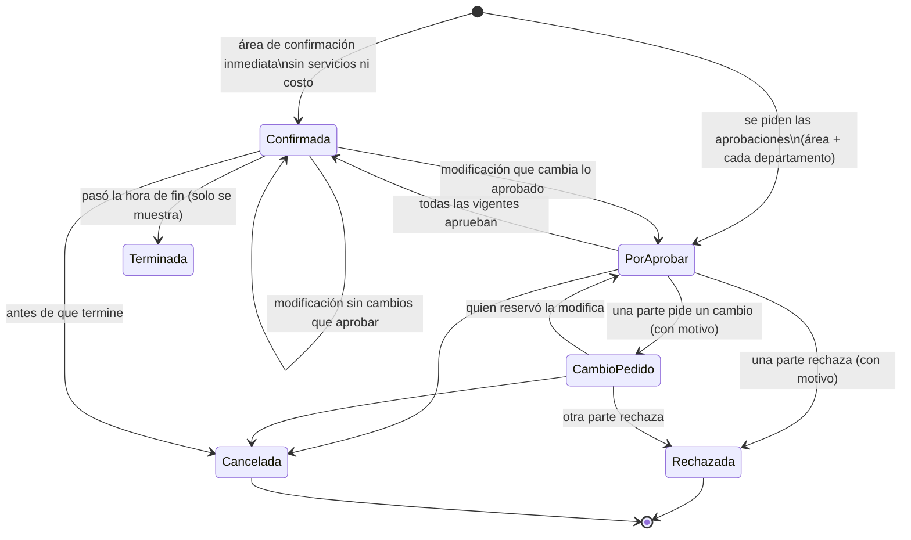

# Reservas de áreas

Módulo nuevo (decisiones del dueño, 2026-10-15): reservar salones, salas y terrazas de la sede, con servicios atendidos por departamentos, aprobaciones en paralelo, órdenes de servicio, cotización e informes. Manual: [reservas-de-areas.md](../usuario/reservas-de-areas.md), [reservas-aprobar.md](../usuario/reservas-aprobar.md), [reservas-departamentos.md](../usuario/reservas-departamentos.md), [reservas-configuracion.md](../usuario/reservas-configuracion.md). Curso: [lección 60](../cursos/leccion-60-reservas-de-areas.md).

## Decisiones

- **Las áreas salen de Zonas y edificios.** `reserva_areas` es la configuración de reserva de un `espacio` existente (1 a 1, `espacio_id` único), no otro catálogo de lugares. Se reservan los niveles edificio, área, área específica y subárea (`CatalogosReservas::NIVELES`). La pantalla de Zonas y edificios no cambió: se marca «Reservable» desde Reservas → Configuración.
- **Menú:** Operación → sección nueva **«Reservas»** (al final de Operación, `MenuSeeder` idempotente: solo acomoda módulos sin menú). Las pestañas internas (Calendario, Mis reservas, Por aprobar, Órdenes de servicio, Informes, Configuración) no son módulos: un solo `reservas` en el catálogo. Área del catálogo nueva **«Servicios»** (`servicios`), para que las reglas generales de Seguridad y RR. HH. no le apliquen.
- **Aprobar es por designación, no por permiso:** responde quien es responsable/suplente del área (o el responsable general y su suplente si el área no tiene), responsable/suplente del departamento (Responsables por departamento, los mismos de las visitas), su delegado con «No molestar», o a quien se avisó por recordatorio/escalamiento. Además, `reservas.aprobar` en la sede permite responder cualquiera (el gerente cuando el responsable falta). La designación la hace quien configura.
- **«Listo»** en las órdenes de servicio es el texto que pidió el dueño (excepción aprobada a los diez verbos del criterio 4).
- **IVA:** la empresa no tenía IVA propio; se configura aquí (`preferencias.reservas.iva_aplica/iva_porcentaje`, por omisión 16 % cobrado). Moneda: `empresas.moneda`.
- **Reservas recurrentes (semanal): siguiente paso.** Complica aprobaciones y avisos (una serie de N reservas con N aprobaciones por departamento); se propone como mejora: «Repetir cada semana hasta…» creando la serie con `serie_id` y una sola aprobación por parte para toda la serie.
- **Choques:** solo entre reservas del mismo espacio. Un salón y una sala que estén uno dentro del otro en Zonas y edificios no se bloquean entre sí (siguiente paso si el dueño lo pide).
- **Una reserva es de un solo día** (inicio y fin el mismo día local) cuando el área tiene horario.

## Tablas (migración `2026_11_04_000100_crear_reservas_de_areas`)

| Tabla | Para qué |
|---|---|
| `reserva_montajes`, `reserva_tipos_uso` | Catálogos por empresa (`nombre`, `orden`, `activo`); nacen con los de `DEFECTO` la primera vez (`CatalogosReservas::asegurar`). |
| `reserva_servicios` | Catálogo: `categoria`, `unidad` (pieza, persona, hora, evento), `costo` opcional, `departamento_id`, `requiere_aprobacion`. |
| `reserva_areas` | `sede_id`, `espacio_id` (único), `reservable`, `aforo_maximo`, `confirmacion_inmediata`, `montaje_minutos`, `desmontaje_minutos`, `horario` JSON (`{"1":[["08:00","22:00"]],…,"7":[]}`; null = cualquier hora), `tarifa_hora/medio_dia/dia/evento`, `descripcion`, `foto` (disco privado), `responsable_id`, `suplente_id`. |
| `reserva_area_montajes` | Montajes del área con su `aforo`. |
| `reservas` | `folio` (RES-000123), área y espacio, `titulo`, `tipo_uso_id`, `montaje_id`, `asistentes`, `inicio`/`fin` y `bloqueo_desde`/`bloqueo_hasta` (UTC; bloqueo = inicio − montaje, fin + desmontaje), `estado`, `solicitante_id`, `para_cliente` + datos del cliente, `tarifa`, `importe_area`, `importe_area_manual`, `importe_servicios`, `descuento`, `cortesia`, `ajuste_motivo`, `iva_porcentaje`, `iva`, `total`, `moneda`, `notas`, confirmación y cancelación. |
| `reserva_servicio_items` | Renglones con copia de nombre, unidad, costo y departamento (si el catálogo cambia, la reserva conserva lo pedido). |
| `reserva_aprobaciones` | Una por parte (`tipo` area/departamento): `estado`, `vigente`, `huella` (sha256 de lo aprobado), `solicitada_en`, respuesta, `avisados`, `recordatorio_en`, `escalado_en`, `escalado_a`. |
| `reserva_ordenes` | Orden de servicio por departamento (`pendiente`, `lista`, `cancelada`, `huella`, `lista_en/por`, `comentario`); única por reserva y departamento. |
| `reserva_eventos` | Historial visible de la reserva. La Bitácora de auditoría guarda además antes y después (`reservas.*`). |

Todas con `empresa_id` (scope de tenant) y `creado_por`/`actualizado_por`. `down()` borra las tablas de hijas a madres; no toca tablas existentes.

## Estados

Ocupan el horario: Por aprobar, Cambio pedido y Confirmada (`Reserva::OCUPAN`).

## Reglas

- **Disponibilidad** (`Disponibilidad::validar`): área reservable y espacio activo; inicio en el futuro; dentro del horario del día (hora local de la sede); montaje disponible en el área; asistentes ≤ aforo del montaje (o del área); sin cruce de bloqueos con otras reservas que ocupan el mismo espacio. Se guarda dentro de una transacción con `lockForUpdate` sobre el área.
- **Costo** (`Cotizador`): uso interno = todo en cero. Cliente = tarifa (hora: cada hora o fracción; medio día; día; evento; o `importe_area_manual`) + Σ cantidad × costo − descuento (cortesía = todo) + IVA de la empresa. Ajustar costo (`PUT /reservas/{r}/costo`) pide `reservas.aprobar` y motivo; no vuelve a pedir aprobación; una modificación conserva el ajuste mientras siga siendo para cliente.
- **Aprobaciones** (`FlujoReservas::requeridas/sincronizar`): parte «área» salvo confirmación inmediata sin servicios ni cliente; una parte por departamento de los servicios con `requiere_aprobacion`. Huella del área: espacio, inicio, fin, montaje, asistentes, para cliente, tarifa. Huella del departamento: espacio, inicio, fin, montaje y sus renglones. Al modificar, una parte aprobada o pendiente con la misma huella se conserva (sin aviso nuevo); las demás se retiran (`vigente = false`, pendientes → `cancelada`) y se piden de nuevo. Responder: el primero gana (`UPDATE … WHERE estado = pendiente`); rechazar o pedir cambio exigen motivo. Al aprobar la última, `confirmada`.
- **Órdenes** (`FlujoReservas::sincronizarOrdenes`): al confirmarse, una por departamento con renglones (aprueben o no). Si cambia la huella del departamento, vuelve a `pendiente` con aviso «Cambió la orden»; sin renglones, `cancelada`. Al cancelar la reserva, todas se cancelan con aviso.
- **Modificar**: quien reservó (con `reservas.crear`) o `reservas.configurar`, antes de que empiece. **Cancelar**: quien reservó antes de que empiece; `reservas.aprobar`/`configurar` hasta que termine; con motivo.

## Avisos (criterios 1 y 3)

- Campana (`CentroNotificaciones::TIPOS`): `reserva_por_aprobar` (botones **Aprobar** y **Ver y responder**), `reserva_recordatorio`, `reserva_escalada`, `reserva_confirmada`, `reserva_rechazada`, `reserva_cambio`, `reserva_cancelada`, `reserva_orden`, `reserva_orden_lista`; todos silenciables en Mi cuenta (`PreferenciasAvisos::CAMPANA`). Al responder se quitan los botones (`resolver('reserva_aprobacion', id)`).
- Correo (`Empresa::AVISOS`, grupo «Reservas de áreas», encendidos): `reserva_aprobacion`, `reserva_resultado`, `reserva_orden`.
- **Mis pendientes** (`PendientesReservas::para`, 6 consultas sin relaciones): «Reservas por aprobar» (con el color de la más atrasada), «Órdenes de servicio por atender», «Reservas con cambio pedido».
- **Reloj y color**: `RelojVoBo` con las horas de la empresa (`recordar_horas` 4 → ámbar, `escalar_horas` 24 → rojo). **Recordatorio** a los avisados + suplente del área; **escalamiento** al responsable general y su suplente (si ya estaban avisados, a `reservas.configurar` de la sede). Un aviso por nivel (`recordatorio_en`, `escalado_en`). Tarea `plataforma:reservas-pendientes --si-toca` en `despliegue/desplegar.sh` (en proceso, sin exec) y, por si el cron no corre, al abrir Calendario o Por aprobar (`EsperaReservas::escalarSiToca`, una vez por minuto por empresa).
- «No molestar»: los avisos de un responsable con delegación activa van a su delegado, que también puede responder y marcar «Listo».

## Permisos

Módulo `reservas` (área Servicios): `ver`, `crear`, `aprobar`, `configurar`, `exportar`, `imprimir`. Alcance: `ver` limita el calendario y las fichas a sus sedes (o a las propias); `crear` dónde puede reservar; catálogos y ajustes piden `configurar` con alcance de empresa; las áreas, el de su sede. Plantillas (`RolesPlantillaSeeder::RESERVAS` y la migración `2026_11_04_000200_modulo_y_permisos_de_reservas`, que las aplica por nombre de rol a plantillas y copias): Administrador todo (empresa); Director ver (empresa); Jefe de departamento ver, crear, imprimir y aprobar (sede); Solicitante ver, crear, imprimir (propios); Recursos Humanos, Jefe de seguridad, Asistente de seguridad, Supervisor y Agente ver, crear, imprimir (sede). La migración activa el módulo en todas las empresas existentes. El catálogo comercial no lo incluye en ningún producto: para clientes con suscripción se agrega como «módulo agregado» (siguiente paso: producto «Reservas»).

Calendario: quien puede reservar ve los horarios ocupados de otros como «Ocupado» sin abrirlos.

## Pantallas y rutas (`routes/reservas.php`)

| Ruta | Permiso | Qué |
|---|---|---|
| `GET /reservas?vista=dia|semana|mes&fecha=&sede=&area=` | ver o crear | Calendario |
| `GET /reservas/mis-reservas` | crear o ver | Mis reservas |
| `GET /reservas/nueva` · `POST /reservas` | crear (en la sede del área) | Reservar |
| `GET /reservas/disponibilidad?area=&fecha=&excepto=` | crear o ver | JSON de bloques ocupados y horario del día |
| `GET /reservas/{r}` | quien reservó, ver con alcance, quien aprueba o atiende | Ficha |
| `GET /reservas/{r}/editar` · `PUT /reservas/{r}` | quien reservó o configurar | Modificar |
| `POST /reservas/{r}/cancelar` | ver arriba | Cancelar |
| `PUT /reservas/{r}/costo` | aprobar | Descuento, cortesía, importe del área |
| `GET /reservas/{r}/imprimir` | imprimir | Orden de evento / cotización |
| `GET /reservas/por-aprobar` · `POST /reservas/aprobaciones/{a}/responder` | designación o aprobar | Bandeja y respuesta (`respuesta` = aprobar, rechazar, cambio; `comentario`) |
| `GET /reservas/ordenes` · `POST /reservas/ordenes/{o}/listo` | responsable del departamento o configurar | Órdenes y «Listo» |
| `GET /reservas/informes` · `/informes/exportar` | ver · exportar | Ocupación, por tipo, ingresos; CSV |
| `GET /reservas/configuracion` y `/configuracion/areas/{area}` | configurar | Áreas, catálogos, ajustes |
| `PUT /reservas/ajustes` | configurar (empresa) | Ajustes (también desde Configuración → Reservas de áreas, `desde=configuracion`) |
| `GET /reservas/areas/{area}/foto` | ver, crear o configurar | Foto del área (disco privado) |

Los identificadores se cargan dentro de la empresa de trabajo (otra empresa o sin empresa elegida: 404).

## Piezas

- Modelos: `Reserva`, `ReservaArea`, `ReservaMontaje`, `ReservaTipoUso`, `ReservaServicio`, `ReservaServicioItem`, `ReservaAprobacion`, `ReservaOrden`, `ReservaEvento`.
- Servicios (`app/Services/Reservas`): `AjustesReservas`, `CatalogosReservas`, `Disponibilidad`, `Cotizador`, `ResponsablesReservas`, `FlujoReservas`, `AdministradorReservas`, `EsperaReservas`, `PendientesReservas`, `InformesReservas`, `TextosReservas`.
- Controladores (`app/Http/Controllers/Operacion/Reservas`), vistas (`resources/views/operacion/reservas`), `public/css/reservas.css`, `public/js/reservas.js` (formulario; sin JS en línea).
- Comando `plataforma:reservas-pendientes`. Datos demo: `CrearDatosDemo::reservasDemo`.
- Archivos compartidos tocados (cambios localizados): `CatalogoSeeder`, `MenuSeeder`, `RolesPlantillaSeeder`, `MisPendientes`, `CentroNotificaciones`, `PreferenciasAvisos`, `Empresa::AVISOS`, `GruposAvisos`, `LectorAuditoria`, `routes/web.php` (un `require`), `configuracion/index.blade.php` (sección al final del índice), `despliegue/desplegar.sh`.
- Pruebas: `tests/Feature/Reservas/ReservasDeAreasTest.php`; las matrices de seguridad (`EscenarioAuditoria`, `RecorridoPantallasTest`) ya resuelven los parámetros `reserva`, `aprobacion`, `orden`, `area` y `catalogo`.
- Quien usa Reservas pero ya no es responsable (lo quitaron con la pantalla abierta) recibe «Ya no te toca responder…» / «Ya no atiendes este departamento…» en lugar de 403; sin acceso a Reservas, 403.

## Datos demo (Hotel Demo Centro)

Torre A › Planta baja › **Salón Maya** (120 personas; auditorio 120, escuela 60, herradura 30, banquete 80, cóctel 120; 60/30 min; 8:00–23:00; tarifas hora 1,500, medio día 5,000, día 9,000, evento 12,000) y **Sala de juntas Ceiba** (12 personas, confirmación inmediata, lunes a viernes 8:00–20:00). Responsable general: Julieta (jefedepto.demo), suplente Ana (admin.demo). Departamentos: Cocina (Sergio, supervisor.demo, en Centro), Sistemas y Mantenimiento (Julia, jefe.demo), Alimentos y Bebidas (Diego, director.demo, delegado a Ana). Diez servicios. Reservas: junta de Recepción en la sala (confirmada al momento, solicitante.demo), capacitación de RR. HH. por aprobar (área, Cocina y Sistemas; rh.demo) y congreso para un cliente confirmado con sus órdenes (Sistemas «Listo»).

## Criterios de experiencia de uso

1. Campana y Mis pendientes para quien aprueba, quien atiende y quien reservó (resultado y cambio pedido).
2. El área, las personas y la duración no se repiten: la cantidad de los servicios por persona u hora se sugiere; los datos del departamento salen de Departamentos.
3. Reloj, color, recordatorio y escalamiento configurables por empresa; suplente del área y «No molestar».
4. Verbos: Guardar, Aprobar, Rechazar, Imprimir, Dar de baja, Reactivar; «Cancelar reserva» como en Pases de salida; «Listo» por decisión del dueño.
5. Avisos de éxito con siguiente paso (Imprimir la hoja, Hacer otra reserva, Ver lo que falta por aprobar…).
7. Servicios y notas en apartados plegados; tarifas y foto del área plegadas.
8. Alta corta: área, día, horas, nombre y personas.
