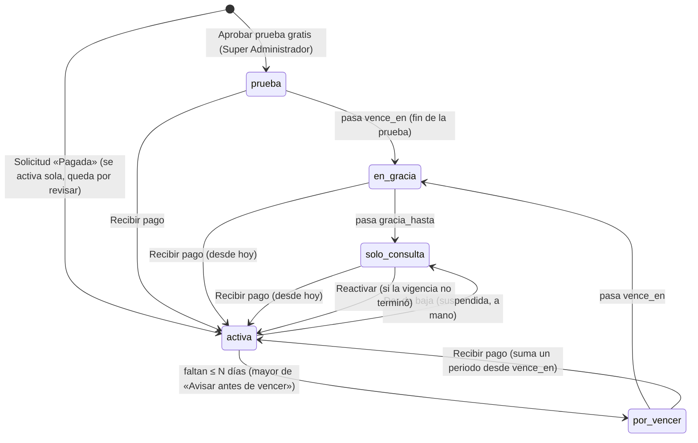

# Suscripciones de los clientes

Decisiones del dueño (aprobadas): prueba gratis (días configurables, 14 por omisión); al vencer, gracia (15 días, configurable) y luego **solo consulta** hasta pagar; al pagar se activa **automáticamente** pero cada cliente nuevo queda para **revisión** del Super Administrador; la **prueba gratis no se activa sola** (la aprueba el Super Administrador); cobro **mensual y anual** (descuento anual configurable); **excepciones** por cliente y **promociones**.

Se construye sobre el [Catálogo comercial](catalogo-comercial.md) (productos → módulos, planes, paquetes, solicitudes, `PasarelaPago`) y sobre `empresa_modulos`, que ya respetan el motor de permisos (`Autorizador`) y el menú (`ConstructorMenu`).

## Legado: empresas sin suscripción

Una empresa **sin fila en `suscripciones`** (todas las que existían, como la empresa de prueba) **no tiene límites ni vencimiento**: `Limites::de()` devuelve `null`, `SoloConsulta` la deja pasar, la franja no aparece, la tarea diaria no la toca y «Empresas» no muestra «Tu suscripción». Sus módulos siguen administrándose a mano (Empresas → Módulos contratados). Para pasarla a suscripción hay que crearle una (hoy, desde una solicitud pagada de esa empresa o con `Aprovisionamiento`; no hay pantalla para convertir una empresa existente).

## Estados y transiciones

El estado **efectivo** se calcula con las fechas en cada petición (`Suscripcion::estadoEfectivo()`, fecha local de `America/Mexico_City`); la tarea diaria solo lo **guarda** y manda los avisos, así que un día sin cron no deja a nadie operando de más ni de menos. `cancelada` y `suspendida` (manuales) no cambian con las fechas.

| Estado | Opera | Fechas |
|---|---|---|
| `prueba` | Sí | `vence_en` = hoy + días de prueba − 1 |
| `activa` | Sí | `vence_en` = inicio + 1 mes (o 12) − 1 día (`addMonthsNoOverflow`) |
| `por_vencer` | Sí | `vence_en − hoy ≤ max(avisos_dias_antes)` |
| `en_gracia` | Sí (franja ámbar) | `vence_en < hoy ≤ gracia_hasta` (`gracia_hasta` = `vence_en` + días de gracia, congelado al activar o renovar) |
| `solo_consulta` | Solo lectura (franja roja) | `hoy > gracia_hasta`, o `suspendida = 1` |
| `cancelada` | Solo lectura | Reservado (no hay botón; «Dar de baja» suspende) |

## Datos

Migración `2026_10_31_000300_crear_suscripciones` (InnoDB, auditoría `creado_por` / `actualizado_por`, timestamps; `down()` probado).

| Tabla | Contenido |
|---|---|
| `suscripciones` | `empresa_id` (único, FK), `plan_id`, `solicitud_compra_id`, `sedes_contratadas`, `periodicidad` (`mensual`/`anual`), precio pactado congelado por periodo (`moneda`, `iva_porcentaje`, `precio_subtotal/iva/total`, `detalle` JSON: renglones, descuentos, promoción, `periodo_regular`, `usuarios_por_sede` congelado, `meses`), `promocion_id`, `promocion_hasta`, `estado`, `es_prueba`, `suspendida`, `inicio_en`, `vence_en`, `gracia_hasta`, `avisos_enviados` (JSON), `revisado_en/por`, `notas` |
| `suscripcion_paquete` | Paquetes contratados |
| `suscripcion_excepciones` | `tipo` (`usuarios`, `sedes`, `modulo_agregado`, `modulo_quitado`), `cantidad` (con signo), `modulo_id`, `motivo`, `activo`, `dado_de_baja_en/por`, autor |
| `suscripcion_historial` | `evento`, `estado_antes`, `estado_despues`, `descripcion`, `datos`, `user_id` (nulo = automático) |
| `promociones` / `promocion_plan` | `codigo` (único, nulo = solo a mano), `tipo` (`porcentaje`/`monto`), `valor` (% o pesos al mes), `periodicidad` (`ambas`/`mensual`/`anual`), `meses` (primeros N; nulo = siempre), `vigente_desde/hasta`, `usos_maximos`, `usos`, `activo`; planes (vacío = todos) |
| `solicitudes_compra` (+) | `tipo` (`compra`, `prueba`, `renovacion`, `ampliacion`), `periodicidad`, `periodo_subtotal/iva/total`, `descuento`, `codigo_promocion`, `promocion_id`, `empresa_id` (cliente que renueva o la empresa creada), `activada_en`; estado nuevo `en_prueba` |

**Tenant:** `Suscripcion` no usa el scope de empresa (como `Empresa`): es un dato de la **plataforma** sobre el cliente que solo administra el Super Administrador. Toda lectura para un usuario de empresa filtra explícitamente por su `empresa_id` (`EstadoCliente`, `Limites`, `EmpresaController`, `MiSuscripcionController`).

**Ajustes** (`AjustesComerciales`, clave `comercial`): `prueba_habilitada` (sí), `dias_prueba` (14), `dias_gracia` (15), `descuento_anual_porcentaje` (10), `avisos_dias_antes` ([7, 1]), `contacto_suscripciones` (vacío → correos de solicitudes → «quien administra la plataforma»).

## Un solo punto de entrada: `App\Services\Suscripciones\Aprovisionamiento`

| Método | Qué hace |
|---|---|
| `confirmarPago(solicitud, ?actor, ?referencia)` | **Lo usan «Pagada» (Atender) y el webhook** (`PagoWebhookController` tras `PasarelaPago::confirmar()`). Con candado (`lockForUpdate`) e idempotente (`activada_en`). Cliente nuevo → `activarCliente()`; cliente existente → `renovacion`: `registrarPago()`; `ampliacion`: aplica plan/sedes/paquetes con el precio de la solicitud (y registra pago si estaba vencida o en prueba). |
| `activarPrueba(solicitud, actor)` | Solo `tipo = prueba`; idempotente. Revisada al momento (la aprobó el Super Administrador). |
| `activarCliente()` (privado) | `ProvisionarEmpresa::crear()` con rubro hotel (o el primero activo) sin módulos → `Suscripcion` con el precio congelado de la solicitud → paquetes → uso de la promoción → `ModulosEfectivos::sincronizar()` → «Sede principal» (S1) → Administrador (correo de la solicitud, usuario derivado del correo, rol «Administrador», todas las sedes, contraseña aleatoria, `debe_cambiar_contrasena`, enlace de bienvenida) → historial, auditoría y campana `cliente_por_revisar`. Si el correo ya tiene cuenta, no crea usuario y lo anota en el historial. |
| `cambiarPlan()` | Recalcula con la `Calculadora` (precios de hoy, promoción vigente) y resincroniza módulos; no mueve fechas. |
| `registrarPago()` | Un periodo desde `vence_en + 1` (o desde hoy si venció o era prueba); sale de prueba/gracia/solo consulta/suspensión; limpia `avisos_enviados`; al pasar `promocion_hasta` congela el `periodo_regular`. |
| `suspender()` / `reactivar()` | «Dar de baja» = solo consulta a mano; «Reactivar» la quita, salvo que por fechas ya esté en solo consulta (pide pago). |
| `marcarRevisado()`, `agregarExcepcion()`, `quitarExcepcion()`, `aplicarPromocion()`, `sincronizarEstado()` | Lo que dicen; todo con historial y Bitácora de auditoría (`suscripciones.*`, `catalogo_comercial.promocion_*`). |

### Módulos efectivos (`ModulosEfectivos`)

`módulos de los productos del plan + de los productos de sus paquetes + excepciones «módulo agregado» − excepciones «módulo quitado»`, más **siempre** los del área Dirección y los submódulos de cada módulo incluido. Se escriben en `empresa_modulos` con `activo = 0/1` **sin borrar filas** (lo apagado solo se oculta; datos y permisos se conservan). Los módulos de Dirección no se pueden quitar. Ojo: en una empresa con suscripción, cambiar a mano «Módulos contratados» en Empresas se sobrescribe en el siguiente cambio de plan o excepción: usar Excepciones.

## Límites (`Limites`)

- Sedes: `sedes_contratadas + Σ excepciones «sedes»` contra sedes **activas** (sin borrar). Se revisa al dar de alta (`SedeController@store`) y al reactivar (`@estado`).
- Usuarios: `usuarios_por_sede` congelado × `sedes_contratadas` + Σ excepciones «usuarios» contra usuarios **activos**; plan con usuarios ilimitados = sin límite. Se revisa en `AdministradorUsuarios::crear()`, `actualizar()` (de inactivo a activo) y `cambiarEstado()` (reactivar).
- Mensajes (`ValidationException`, campo `limite`): «Tu plan incluye N sedes y ya tienes N activas. Para agregar otra, amplía tu plan en Empresas → Tu suscripción, o da de baja una sede que ya no uses.» / «Tu plan incluye N usuarios activos y ya tienes N. Da de baja a quien ya no use la plataforma o amplía tu plan en Empresas → Tu suscripción.»
- El Super Administrador también respeta el límite al dar de alta para el cliente (la salida es una excepción).

## Solo consulta (`App\Http\Middleware\SoloConsulta`)

En el grupo `web` después de `ExigirCambioContrasena`. Para un usuario **de empresa** (no Super Administrador) cuya suscripción `soloConsulta()`: toda petición que no sea segura (POST, PUT, PATCH, DELETE) se rechaza — redirección atrás con `error` (franja) o JSON **423** `{ok: false, mensaje}`. Permitidas: `logout`, `sesion.*`, `mi-cuenta.contrasena`, `mi-cuenta.avisos`, `notificaciones.leer-todas|abrir|resumen` y `mi-suscripcion.solicitar` (para poder renovar). Ver y exportar (GET) siguen. Las tareas automáticas no pasan por el middleware.

Consultas: `EstablecerEmpresa` trae en la misma consulta de la empresa una subconsulta `suscripcion_id`; una empresa sin suscripción no gasta ninguna consulta extra (franja ni middleware).

Franja: `componentes/franja-suscripcion` (incluida en `layouts/app` antes del contenido) con `EstadoCliente::franja()`: roja en solo consulta («Tu suscripción venció el …; tienes acceso de solo consulta: puedes ver y exportar, pero no registrar ni cambiar nada. Contacta a …»), ámbar en gracia, con enlace «Ver mi suscripción» si puede ver Empresas.

## Tarea diaria

`php artisan plataforma:suscripciones [--si-toca]` (`RevisarSuscripciones` → `RevisionDiaria`), lanzada desde `despliegue/desplegar.sh` como las demás («solo si el comando existe»), **en proceso**, sin `exec`/`proc_open`. `--si-toca`: después de las 8:00 (México) y una vez al día (marca en `configuracion_plataforma`, clave `suscripciones_revision`). Por suscripción (no canceladas): guarda el estado efectivo (historial `estado_cambiado`) y manda **un** aviso si toca, a los administradores del cliente (permiso `empresas.editar`; campana `suscripcion_aviso` + correo `AvisoSuscripcion`) y al Super Administrador (aviso de plataforma):

| Clave en `avisos_enviados` | Cuándo | Título al cliente |
|---|---|---|
| `antes-{d}-{vence}` | `0 ≤ días para vencer ≤ d` (d en `avisos_dias_antes`; si se saltó uno, solo el más cercano) | «Tu suscripción vence en 7 días / mañana / hoy» |
| `vencio-{vence}` | primer día en gracia | «Tu suscripción venció» / «Terminó tu prueba gratis» |
| `mitad-{vence}` | `hoy ≥ vence_en + ⌈gracia/2⌉` | «… venció: quedan días de gracia» |
| `solo-{vence}` | en solo consulta por fechas | «… pasó a solo consulta» |

Las claves llevan la fecha de vencimiento: al renovar se reinicia el ciclo. Una suspensión manual no manda estos avisos (avisa `suspender()`).

## Pantallas y rutas

| Ruta | Quién | Qué |
|---|---|---|
| `GET /catalogo-comercial?pestana=clientes|revisar|promociones` | Super Administrador (`catalogo_comercial.ver`) | Pestañas nuevas: Clientes (filtros por estado efectivo y búsqueda), Por revisar (reloj desde la activación), Promociones |
| `GET /catalogo-comercial/clientes/{id}` | ídem | Ficha: suscripción, uso de sedes y usuarios, precio y descuentos, módulos activos, excepciones, historial; acciones |
| `PUT …/clientes/{id}/plan`, `POST …/pago`, `PUT …/revision`, `PATCH …/estado`, `POST …/excepciones`, `PATCH …/excepciones/{excepcion}/baja`, `PUT …/promocion` | `catalogo_comercial.editar` | Guardar plan; Recibir pago; Guardar como revisado; Dar de baja / Reactivar; excepciones; promoción |
| `POST /catalogo-comercial/solicitudes/{id}/aprobar-prueba` | `catalogo_comercial.editar` | Aprobar prueba gratis |
| `GET|POST /catalogo-comercial/promociones…`, `PATCH …/{id}/estado` | `catalogo_comercial.editar` | Alta, edición, Dar de baja / Reactivar |
| `PUT /catalogo-comercial/solicitudes/{id}` con `estado=pagada` | `catalogo_comercial.editar` | `confirmarPago()` y redirige a la ficha |
| `GET /empresas` | Administrador del cliente | Bloque «Tu suscripción» (`administracion/empresas/_tu-suscripcion`) |
| `POST /mi-suscripcion/solicitar` | `empresas.editar` con alcance de empresa, empresa con suscripción | Solicitud `renovacion`/`ampliacion` ligada a la empresa (misma pasarela y desglose congelado; campana del Super Administrador) |
| `GET /contratar?prueba=1&periodicidad=anual&codigo=X` | Público | Prueba gratis, pago anual y código validado por el servidor |

Permisos: todo lo del Super Administrador vive en el módulo de plataforma `catalogo_comercial` (no se contrata ni sale en la Matriz). Sin permisos nuevos.

## Cálculo anual y promociones (servidor = navegador)

`Calculadora::periodo()` y `CalculoPlanes.calcular(…, periodicidad, promocion)` en `public/js/landing-calculo.js`, en centavos:

1. `mes = mensual − redondeo(mensual × % anual)` (solo anual); `regular = mes × meses` (1 o 12).
2. Promoción por mes: porcentaje `redondeo(mes × %)`; monto `min(monto, mes)`; meses con promoción = `min(meses, N)` (todos si no tiene límite).
3. `periodo = regular − promoción × meses con promoción`; IVA sobre el periodo. Nunca sobre el pago único.

La solicitud y la suscripción congelan `periodo_*`, `descuento` y el `detalle`. El navegador solo aplica una promoción que el servidor ya validó (`data-promocion`, con sus planes y periodicidad); si el visitante cambia el código, el descuento se confirma al enviar. Prueba `test_la_calculadora_anual_y_con_promocion_del_navegador_da_lo_mismo_que_el_servidor` (Node, 400 combinaciones).

Promociones: «primeros N meses» corre desde la activación pagada (o desde el primer pago de una prueba) hasta `promocion_hasta`; al renovar después de esa fecha se cobra `periodo_regular`. Un **uso** se cuenta al activar (no al enviar la solicitud): si se agota en medio, la solicitud conserva lo cotizado.

## Criterios de experiencia de uso

| Regla | Cómo se cumple |
|---|---|
| 1. Campana | Cliente activado al pagar → `cliente_por_revisar` al Super Administrador; prueba por aprobar → `solicitud_compra` («Prueba gratis por aprobar…»); avisos de vencimiento al cliente y al Super Administrador; «Recibimos tu pago» al cliente; renovación pedida → campana del Super Administrador. Misma excepción que el Catálogo comercial: el Super Administrador no tiene «Mis pendientes»; los números rojos de las pestañas Por revisar y Pruebas por aprobar hacen ese papel. |
| 2. Un dato una vez | El Administrador se crea con el nombre y correo de la solicitud; la renovación toma el plan, sedes y paquetes actuales. |
| 3. Reloj y color | «Sin revisar hace …» (verde / ámbar / rojo, `RelojVoBo`) en Clientes, Por revisar y la ficha; vencimiento en rojo/ámbar. Sin suplente: un solo rol atiende. |
| 4. Verbos | Guardar, Guardar como revisado, Recibir pago, Aprobar prueba gratis, Dar de baja, Reactivar, Atender, Guardar solicitud. Página pública: «Probar gratis N días» y «Solicitar mi prueba gratis» (vocabulario del visitante, como «Contratar»). |
| 5. Siguiente paso | Pagada → abre la ficha del cliente; revisado → «Revisar el siguiente cliente nuevo»; promoción → «Dar de alta otra promoción». |
| 7. Avanzado | Vigencia, usos, planes y periodicidad de la promoción; avisos y contacto en Ajustes; código y comentarios en «Tu suscripción». |
| 8. Alta corta | Promoción: nombre y descuento; cliente nuevo: una sola sede, el Administrador completa los datos de la empresa (RFC, razón social) después. |

## Datos de ejemplo

`plataforma:demo` (paso `suscripcionesDemo`, una sola vez si no existe `SC-DEMO-0003`; Hotel Demo sigue **sin** suscripción): Hotel Laguna (`laguna.demo`, Profesional, 2 sedes, activa, por revisar), Plaza Norte (`plaza.demo`, prueba vencida en gracia), Torre Centro (`centro.demo`, solo consulta, revisada), solicitud `SC-DEMO-0006` de prueba por aprobar (Grupo Sol) y la promoción `BIENVENIDA15`. Las cuentas usan la contraseña del demo y correos `@cliente.demo.local`; no se envía bienvenida.

## Riesgos y pendientes

- Pagos en línea: siguen apagados; el webhook ya llama a `confirmarPago()`. Para cobros recurrentes, cada aviso mensual debe llegar como una solicitud `renovacion` pagada (o llamar `registrarPago()`).
- Una solicitud «Cotizar» marcada pagada activa con precio 0: ajustar el plan en la ficha.
- Rubro del cliente nuevo: hotel por omisión (el Super Administrador lo cambia en Empresas).

## Pruebas

`tests/Feature/Administracion/SuscripcionesTest.php`: activación al pagar y por revisar; idempotencia (doble clic, reintento de la pasarela, usos de la promoción); prueba gratis requiere aprobación; módulos efectivos con paquetes y excepciones sin borrar filas; límites de sedes y usuarios con excepciones y reactivaciones; empresa sin suscripción intacta; ciclo prueba → avisos → gracia → mitad → solo consulta → pago → activa (con viaje en el tiempo y `flushSession`); `--si-toca`; solo consulta bloquea escritura y permite ver, exportar, contraseña y renovar; Dar de baja / Reactivar; promociones (vigencia, usos, %/monto, primeros N meses, planes, periodicidad, a mano); pago anual en la página; calculadora del navegador = servidor; permisos (solo Super Administrador; Agente no pide cambios); ampliación pagada; datos de ejemplo; `down()`/`up()`. Ajustadas: `CatalogoComercialTest` («Pagada» abre la ficha), `RecorridoPantallasTest` y `EscenarioAuditoria` (rutas nuevas).
