# Bitácora de accesos

<!-- solo: hotel -->
**¿Para qué sirve?** Es la pantalla principal de la caseta. Aquí registras a **todas las personas que entran** a la sede (colaboradores, huéspedes, visitas, proveedores, contratistas y servicios de emergencia), ves **quién sigue dentro** y registras su **salida**.
<!-- fin -->
<!-- solo: corporativo -->
**¿Para qué sirve?** Es la pantalla principal de la caseta. Aquí registras a **todas las personas que entran** a la sede (colaboradores, visitantes, proveedores, contratistas y servicios de emergencia), ves **quién sigue dentro** y registras su **salida**.
<!-- fin -->
<!-- solo: condominio, fraccionamiento -->
**¿Para qué sirve?** Es la pantalla principal de la caseta. Aquí registras a **todas las personas que entran** a la sede (residentes, sus visitas, servicios como limpieza o proveedores, contratistas y servicios de emergencia), ves **quién sigue dentro** y registras su **salida**.
<!-- fin -->

**Antes de empezar:** necesitas que tu rol pueda **ver** y **crear** en Accesos. Si no ves el botón rojo **Nuevo Ingreso**, pide a tu administrador que revise tu rol. Para autorizar proveedores y contratistas (o dejarlos pasar **por excepción**) se necesita además el permiso **Aprobar** (normalmente supervisores y jefes de seguridad).

## Cómo leer la pantalla

1. Entra a **Operación → Caseta → Bitácora de accesos** (en el celular, el botón **Accesos** de abajo).
2. Arriba están los botones **Nuevo Ingreso** y **Dar salida**, el campo **Escanea el gafete o escribe nombre, placas o habitación** (siempre a la vista, para dar salida sin abrir nada), el buscador y los filtros de **tipo** y **sede**.
3. Abajo hay tres pestañas:

| Pestaña | Qué muestra |
|---|---|
| **Pendientes de Autorización** | Visitas, proveedores y contratistas que esperan la autorización de su departamento, quien espera a Recursos Humanos y, si tu empresa no lo pide al departamento, proveedores y contratistas que esperan la confirmación de quien los citó. |
| **Gente en Sitio** | Todos los que están dentro ahora. |
| **Historial Finalizados** | Los que ya salieron, con filtro de fechas. |

<!-- solo: hotel, corporativo -->
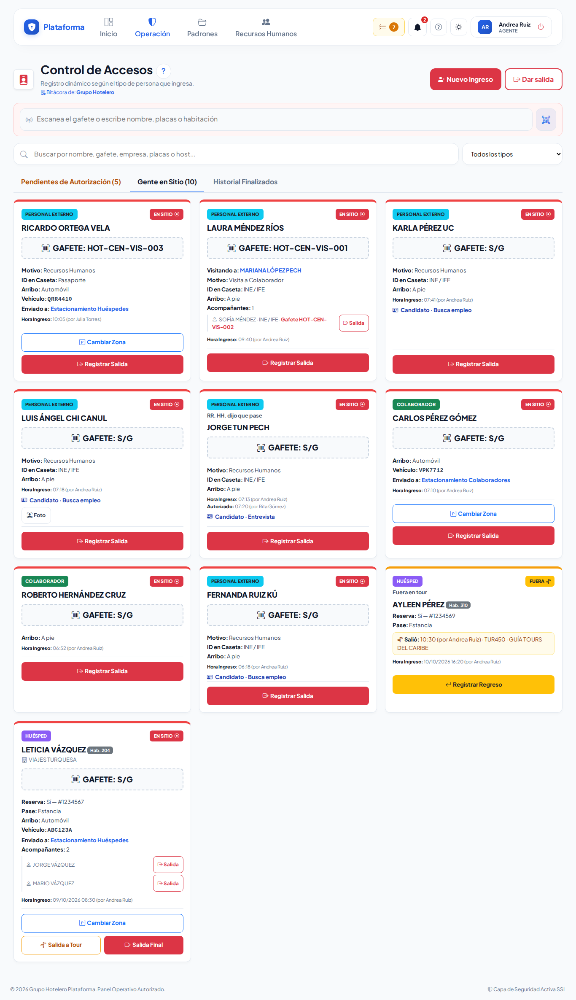
<!-- fin -->
<!-- solo: condominio, fraccionamiento -->
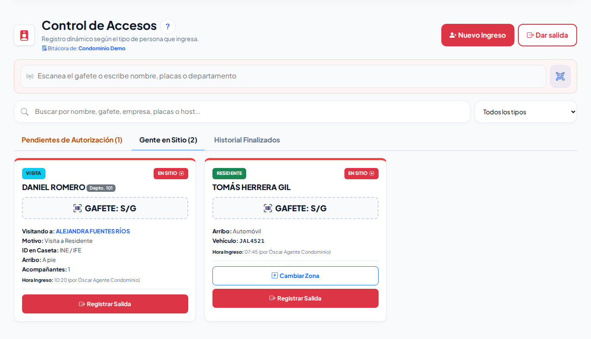
<!-- fin -->

**Qué debes ver:** una tarjeta por persona con su tipo (color), nombre, sede, **gafete** (o **S/G** si no lleva), motivo, identificación que dejó, cómo llegó y a qué hora entró y quién la registró.

Cada tarjeta lleva arriba a la derecha una **pastilla con su estado** y, debajo, un renglón chico con el detalle:

| Pastilla | Qué significa | El renglón de abajo dice, por ejemplo |
|---|---|---|
| **PENDIENTE** (ámbar) | Todavía no puede pasar: espera a alguien. | «Espera a: Julieta Ramos (Mantenimiento) · 12 min», «Espera a: Recursos Humanos · 4 min», «RR. HH. pide que espere», «Sin quien autorice en Recepción: espera al supervisor o al jefe de seguridad», «Sin quien autorice en Mantenimiento: el supervisor lo autoriza por excepción», «Confirma con quien lo citó: Carlos Pérez», «Espera a: Carlos Pérez (suplente: Finanzas)». |
| **EN SITIO** (rojo) | Está dentro. | «Autorizado por Mantenimiento», «RR. HH. dijo que pase», «Autorizado por excepción (Urgencia operativa, Sergio Díaz)», «Autorizó por teléfono (llamó Ana López)». |
| **FUERA** (ámbar) | Salió un rato y va a regresar. | «Fuera en tour», «Fuera temporal». |
| **FINALIZADO** (gris) | Ya salió, o no ingresó. | «Regreso de tour», «Salida temporal», «No autorizado por Seguridad: no ingresó», «Se llamó y no autorizó: no ingresó». |

## Cómo registrar un ingreso

1. Toca **Nuevo Ingreso**. Se abre **Registro Inteligente de Ingreso**.
2. Revisa la **Sede**. Si solo trabajas en una, ya viene elegida.
<!-- solo: hotel -->
3. Toca el **Tipo de Persona**: Colaborador, Huésped, Personal Externo / Visita, Proveedor, Contratista (Obra) o Servicio de Emergencia. La ventana solo pide lo que hace falta para ese tipo.
<!-- fin -->
<!-- solo: corporativo -->
3. Toca el **Tipo de Persona**: Colaborador, Visitante, Proveedor, Contratista (Obra) o Servicio de Emergencia. La ventana solo pide lo que hace falta para ese tipo.
<!-- fin -->
<!-- solo: condominio, fraccionamiento -->
3. Toca el **Tipo de Persona**: Residente o personal, Visita, Servicio / Proveedor, Contratista (Obra) o Servicio de Emergencia. La ventana solo pide lo que hace falta para ese tipo.
<!-- fin -->
4. Llena los datos (ver abajo por tipo).
5. Elige la **Forma de Llegada**: **A Pie** o **Vehículo Propio / Moto**. Con vehículo, escribe o escanea las **placas** y, si aplica, elige la zona de estacionamiento.
6. Si llega con más personas, usa **+** en **Acompañantes** y llena una fila por persona.
7. Toca el botón grande de abajo. **Dice lo que va a pasar** según el tipo y el motivo que elegiste:
   - **Registrar y dejar pasar**: la persona entra de inmediato y aparece en **Gente en Sitio**.
   - **Registrar · queda pendiente de autorización**: la persona espera en caseta (proveedores y contratistas, visitas a una persona con cuenta o a un departamento con responsable, o quien viene a Recursos Humanos si tu empresa pide que RR. HH. dé el paso) y aparece en **Pendientes de Autorización**.
   - **Llamé y autorizó · dejar pasar**: viene con un residente, a una vivienda o con un huésped. Llámale antes; al tocarlo queda la constancia de que autorizó por teléfono, con tu nombre y la hora. Si no autorizó, toca **No autorizó**: la persona no entra y también queda la constancia.
   Si viene más gente detrás, toca **Guardar y capturar siguiente**: guarda y deja la ventana lista con la misma sede y tipo.

<!-- solo: hotel -->
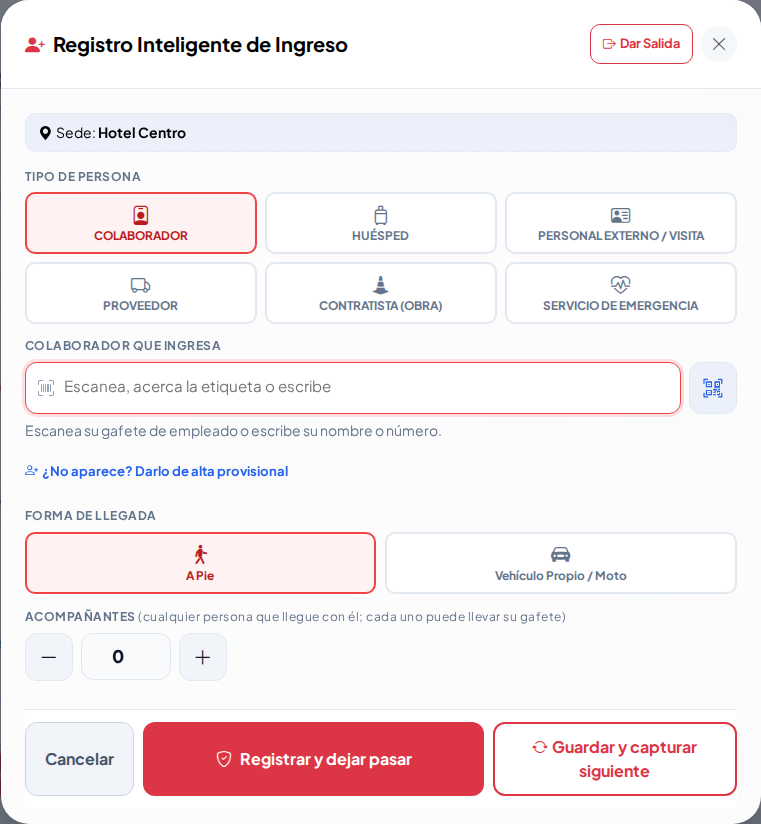
<!-- fin -->
<!-- solo: corporativo -->
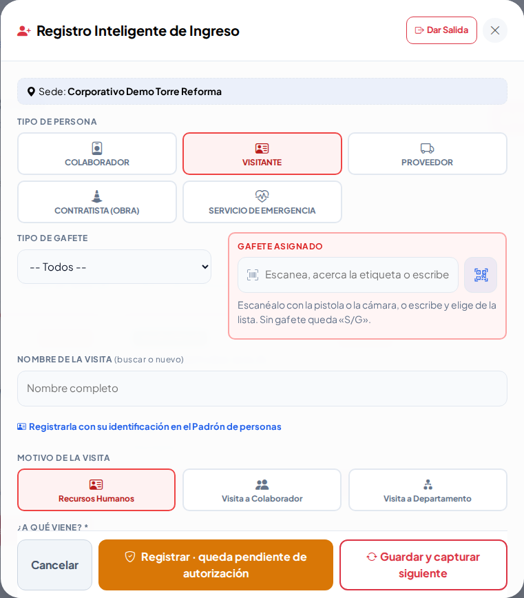
<!-- fin -->
<!-- solo: condominio, fraccionamiento -->
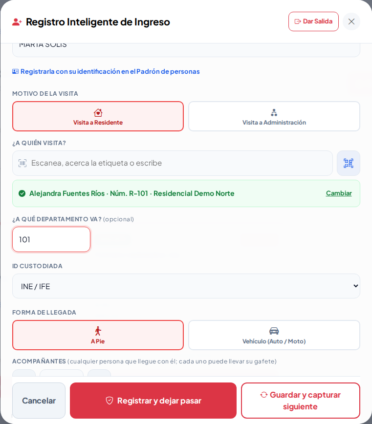
<!-- fin -->
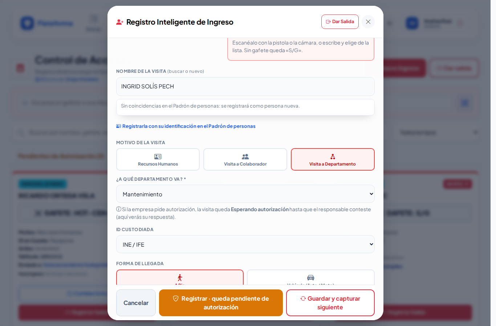

**Qué debes ver:** la ventana se cierra (o se limpia, si elegiste capturar siguiente) y arriba sale el mensaje verde con el **siguiente paso**: «Registrado y en sitio: … ¿Otro ingreso? Toca Nuevo Ingreso», «Registrado: … espera la autorización de Julieta Ramos (Mantenimiento). Ya se avisó; esta tarjeta cambia sola con su respuesta», «… espera a Recursos Humanos», «… queda pendiente. Mantenimiento no tiene quien autorice en esta sede: confirma con quien lo citó y toca Autorizar por excepción», «… Recepción no tiene quien autorice en esta sede: ya se avisó a tu supervisor…» o, si tu empresa no pide la autorización del departamento para ese tipo, «… queda pendiente de autorización. Confirma con quien lo citó (…) y toca Confirmar Autorización». Si llamaste a un residente o a una habitación: «Registrado y en sitio: … Quedó la constancia de que … autorizó por teléfono».

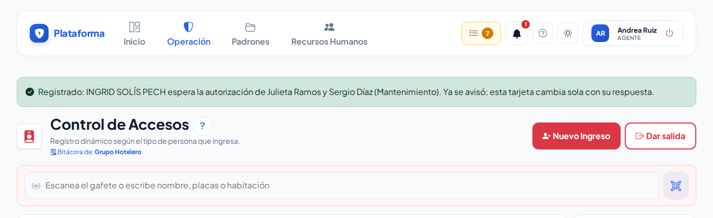

Lo que pide cada tipo:

- **Colaborador:** escanea su gafete de empleado o escribe su nombre o número y elígelo. No lleva gafete de visita. Si no aparece, toca **¿No aparece? Darlo de alta provisional**: se registra y después lo verifica Recursos Humanos (si tu plan no lo incluye, el administrador).
<!-- solo: hotel, corporativo -->
- **Personal Externo / Visita:** gafete (escanéalo o elígelo; solo salen gafetes **libres**), nombre (elígelo del Padrón de personas o escribe uno nuevo), **ID Custodiada** (la identificación que deja) y **Motivo de la Visita**. **Ningún motivo viene marcado**: elige siempre uno (tu empresa puede dejar uno marcado en Configuración).
  - **Visita general:** escribe **¿A quién o a qué viene?** (por ejemplo «Mensajería» o «Entrega de documentos»).
<!-- solo: hotel -->
  - **Visita a huésped:** en **¿A quién viene?** escribe el nombre del huésped o su habitación y elígelo de la lista (salen los huéspedes en sitio y las habitaciones). Llama a la habitación y toca **Llamé y autorizó · dejar pasar** (o **No autorizó**).
<!-- fin -->
  - **Visita a persona o área:** en **¿A quién viene?** escribe el nombre de la persona o del área y elígelo de la lista. Si la persona tiene cuenta en la plataforma, le llega el aviso para autorizar (si no contesta, pasa al responsable de su departamento). Si eliges un área, autoriza su responsable.
  - **Recursos Humanos** (solo si tu plan incluye Recursos Humanos): elige además **¿A qué viene?** (ver abajo «Cómo registrar a quien viene a Recursos Humanos»).
<!-- fin -->
<!-- solo: condominio, fraccionamiento -->
- **Visita:** gafete (escanéalo o elígelo; solo salen gafetes **libres**), nombre (elígelo del Padrón de personas o escribe uno nuevo), **ID Custodiada** (la identificación que deja) y **¿A quién viene?**: escribe el nombre del residente o el número de la vivienda (o casa) y elígelo de la lista; la vivienda sale sola del residente. Llámale y toca **Llamé y autorizó · dejar pasar** (o **No autorizó**). Si la vivienda no está en la lista, deja lo que escribiste: queda marcada «sin catálogo». Si viene a un área de la administración, elige el área: su responsable recibe el aviso.
<!-- fin -->
- **Proveedor y Contratista (Obra):** además, la **Empresa / Procedencia** y **¿A quién viene?**: la persona que lo citó o el área (el departamento sale solo de la persona). Quedan en **Pendientes de Autorización**: si la persona tiene cuenta, ella autoriza; si no, el responsable de su departamento (ver abajo «Cómo autorizar a un proveedor o contratista»). En **Más detalles**, el **Área de Trabajo** se elige de la lista de Zonas y edificios (si no está, se queda lo escrito).
<!-- solo: condominio, fraccionamiento -->
  Si el servicio viene con un residente (gas, plomero, entrega), elige al residente o su vivienda, llámale y toca **Llamé y autorizó · dejar pasar**.
<!-- fin -->
<!-- solo: hotel -->
- **Huésped:** nombre y, en **Más detalles**, **Número de Habitación** (escribe y elígela de la lista; si no está, se queda lo escrito, marcado «sin catálogo») y **¿Tiene Reserva?** (con su **Número de Reserva**). No lleva gafete.
<!-- fin -->
- **Servicio de Emergencia:** solo lo mínimo para no hacer esperar: unidad, tipo de emergencia y observaciones.

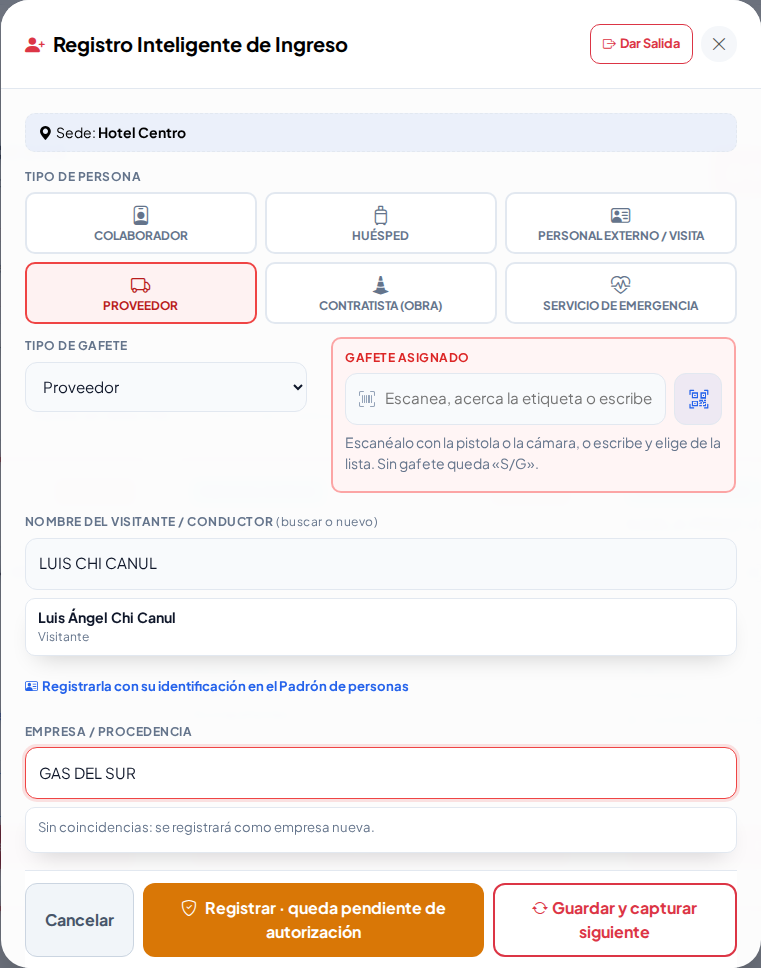

Si escribes a mano un nombre que ya existe en el Padrón de personas, al guardar sale el aviso rojo «Ya existe una persona registrada con este nombre…»: toca **Sí, es la misma** para usar su registro, o **No, es alguien distinto** para crear otra persona.

<!-- solo: hotel, corporativo -->
## Cómo registrar a quien viene a Recursos Humanos

La caseta solo anota **a qué viene** la persona y avisa. Recursos Humanos decide si pasa y se encarga de lo demás (su solicitud, su puesto y su departamento).

1. En **Nuevo Ingreso** toca **Personal Externo / Visita** y llena su nombre, gafete e identificación como siempre.
2. En **Motivo de la Visita** toca **Recursos Humanos**.
3. En **¿A qué viene?** elige una opción:

| Opción | Cuándo usarla | Qué pasa |
|---|---|---|
| **Busca empleo** | Viene a pedir trabajo o a dejar su solicitud. | Si hay vacantes publicadas aparece **¿A qué vacante?**: elige la vacante o **-- No sabe / otra --**. |
| **Ya tiene cita** | Ya vino antes (o se postuló por internet) y hoy tiene cita: entrevista, entrega de papeles o firma de contrato. | La plataforma busca su ficha y anota sola a qué viene; no tienes que preguntarle. |
| **Otro trámite de RR. HH.** | Cualquier otro asunto con Recursos Humanos. | No se le abre ficha. |

Si solo pregunta qué vacantes hay, no registres nada: toca **Ver las vacantes publicadas** (aparece debajo de la lista cuando hay vacantes y tu rol puede verlas) y enséñaselas.

4. Toca **Registrar · queda pendiente de autorización** (o **Registrar y dejar pasar**, si tu empresa no pide que Recursos Humanos dé el paso).

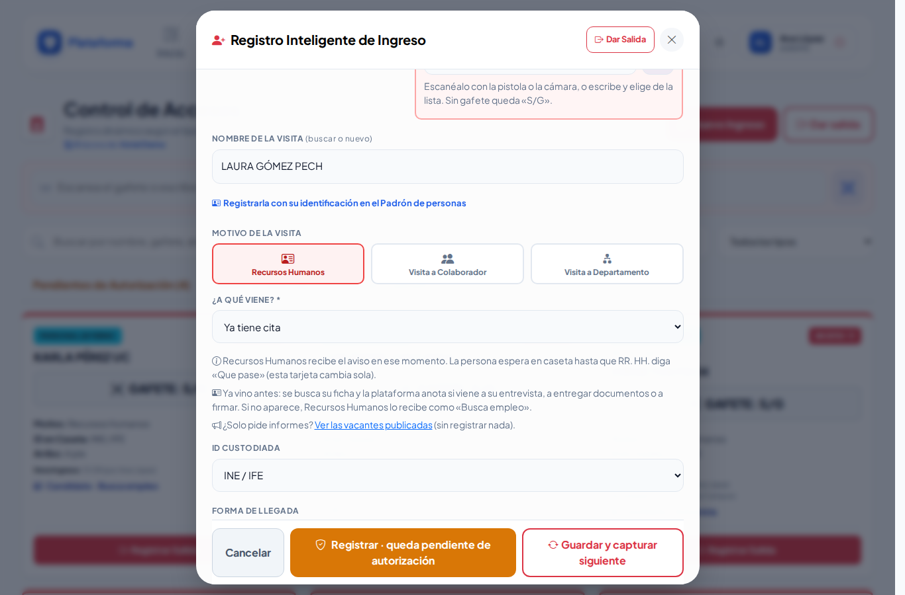

**Qué debes ver:** si tu empresa pide que Recursos Humanos dé el paso, el mensaje «Registrado: … espera a Recursos Humanos. Ya se avisó; aquí verás cuándo puede pasar» y la tarjeta en **Pendientes de Autorización** con **PENDIENTE** y «Espera a: Recursos Humanos · 0 min». Si tu empresa no lo pide, la persona pasa directo a **Gente en Sitio**.

La tarjeta **cambia sola** cuando Recursos Humanos contesta:

| La tarjeta dice | Qué hacer |
|---|---|
| **PENDIENTE** · «Espera a: Recursos Humanos · 5 min» | Pide a la persona que espere en caseta. |
| **PENDIENTE** · «RR. HH. pide que espere» | Recursos Humanos ya sabe que llegó, pero aún no puede recibirla. Que siga esperando. |
| **EN SITIO** · «RR. HH. dijo que pase» | Indícale cómo llegar a la oficina de Recursos Humanos. |
| **FINALIZADO** · «No autorizado por Recursos Humanos: no ingresó» (en el historial) | No puede pasar. Devuélvele su identificación. |

En la tarjeta verás, por ejemplo, **Candidato · Entrevista** o **Candidato · Firma de contrato** (lo que la plataforma dedujo de su cita). La caseta nunca ve la solicitud de empleo ni en qué paso va el proceso: eso solo lo ve Recursos Humanos.

> Si Recursos Humanos avisa por teléfono que puede pasar, el supervisor usa **Confirmar Autorización** en la tarjeta, como con cualquier visita.

<!-- fin -->
## Qué pasa mientras alguien espera: reloj, color y escalamiento

Todo lo que espera tiene **reloj, color y suplente**. No tienes que vigilar nada: la plataforma avisa sola.

1. En **Pendientes de Autorización**, el renglón bajo la pastilla dice **a quién espera** y **cuántos minutos lleva**; el reloj avanza solo.
2. El color cambia con el tiempo de espera que configuró tu empresa (de fábrica, 10 y 20 minutos): **verde** al principio, **ámbar** cuando ya tardó y **rojo** cuando nadie ha contestado.
3. En ámbar, la plataforma **vuelve a avisar** a quien debe responder (campana y correo).
4. En rojo, **escala**: avisa a los suplentes del departamento (o a quien los cubre porque delegó sus aprobaciones) y al Jefe de seguridad de la sede; si la persona espera a Recursos Humanos, al resto del equipo de RR. HH. y al Jefe de seguridad. La tarjeta agrega **«Se escaló a: …»** y a ti te llega el aviso a la campana.
5. Cada aviso se manda **una sola vez**; todo queda en la Bitácora de auditoría y en el historial de la autorización.

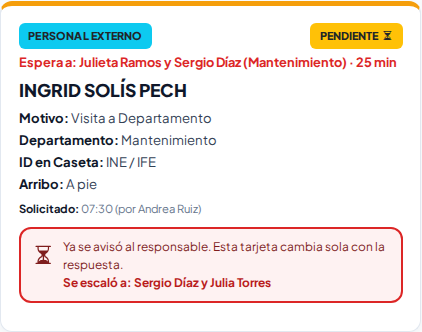

**Qué debes ver:** el renglón pasa de verde a ámbar y a rojo, y, cuando se escaló, la caja de abajo dice «Se escaló a: Sergio Díaz y Julia Torres».

> Si te confirman por teléfono o en persona que puede pasar, tu supervisor (o el Jefe de seguridad) usa **Confirmar Autorización** en la tarjeta de la visita; en la de un proveedor o contratista, **Autorizar por excepción**. Los minutos se cambian en **Estructura → Autorizaciones → Responsables por departamento** (con Recursos Humanos, también en **Recursos Humanos → Recepción → Ajustes**) (ver [Autorizaciones](autorizaciones.md)).

## Cómo canalizar al supervisor para que autorice (caseta de noche)

Si eres agente, no puedes **Confirmar Autorización**. Cuando alguien espera y no puede esperar más (la pipa de gas, el técnico de urgencia), pídeselo al supervisor desde la tarjeta:

1. Abre la pestaña **Pendientes de Autorización**.
2. En la tarjeta de la persona, toca **Canalizar al supervisor**.
3. Al supervisor de tu sede le llega el aviso a la campana y a **Mis pendientes → Esperan tu autorización en caseta**, con su reloj.

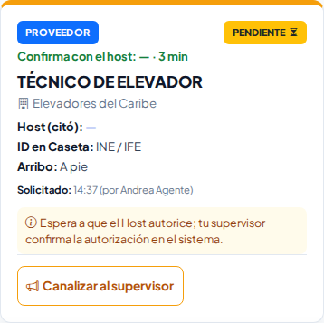

**Qué debes ver:** el mensaje «Le avisamos al supervisor…» y, en la tarjeta, «Se canalizó al supervisor a las …». Cuando el supervisor lo autoriza, a tu campana llega «Autorizado: …» (o «Autorizado por excepción: …») y la tarjeta pasa a **Gente en Sitio**. Si no responde en los minutos de la caseta, pasa al **jefe de seguridad** y a ti te llega «Nadie ha respondido: … Ya avisamos a …».

**Si tu empresa lo permite** (**Configuración → Caseta y accesos → Noche sin supervisor**) y nadie respondió a tiempo, en la tarjeta aparece **Aprobar por excepción**:

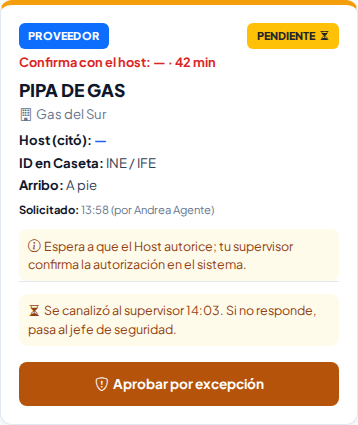

1. Toca **Aprobar por excepción**.
2. Escribe el **Motivo** (por ejemplo «Fuga de gas, la pipa no puede esperar»).
3. Toca el recuadro **Foto de la persona** y tómale la foto. Si ya la tomaste al registrarla, esa sirve.
4. Toca **Aprobar por excepción** y confirma.

**Qué debes ver:** la persona pasa a **Gente en Sitio** con «Autorizado por excepción (Agente sin supervisor: …)». Al supervisor y al jefe de seguridad les llega el aviso de inmediato y el caso queda **por revisar**: el supervisor lo abre en **Mis pendientes → Excepciones de la caseta por revisar** y toca **Atender**.

## Cómo ver quién rebasó su tiempo en sitio

1. Abre la pestaña **Gente en Sitio**.
2. Toca el filtro **Rebasaron su tiempo**.

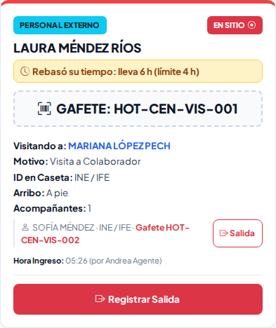

**Qué debes ver:** las visitas con más de 4 horas, los proveedores y contratistas con más de 8, los huéspedes con daypass después de la hora de cierre y quien salió temporalmente hace más de 2 horas (los tiempos los elige tu empresa). Cada tarjeta dice «Rebasó su tiempo: lleva …» en ámbar y, al doble, en rojo. Al supervisor le llega un aviso y, al doble, al jefe de seguridad; también los ve en **Mis pendientes → Rebasaron su tiempo en sitio** y **Mis pendientes → Salidas temporales sin regresar**. Úsalo al cambiar de turno: si ya salió, dale salida; si no, búscalo.

## Cuando el departamento no tiene quien autorice en la sede

Si la visita va a un departamento (o a una persona sin cuenta de un departamento) que **no tiene quien autorice en tu sede** (nadie nombrado, su cuenta está dada de baja, no tiene el permiso o no entra a esta sede), tu forma de registrar no cambia: los mismos datos y el mismo botón. Lo que cambia es lo que pasa al guardar:

1. La tarjeta queda **PENDIENTE** con «Sin quien autorice en (departamento): espera al supervisor o al jefe de seguridad» y el reloj corriendo.
2. Al supervisor y al jefe de seguridad de la sede les llega el aviso «Espera tu autorización: …» a la **campana** y a **Mis pendientes** («Esperan tu autorización en caseta»).
3. Quien puede autorizar confirma con quien recibe a la persona y toca **Confirmar Autorización**. Si tú no puedes, la tarjeta dice «espera a tu supervisor o al jefe de seguridad (ya se les avisó)».

**Qué debes ver:** al guardar, «Registrado: … queda pendiente. Recepción no tiene quien autorice en esta sede: ya se avisó a tu supervisor…». Si tu empresa eligió **La visita pasa sin esperar** (ver [Autorizaciones](autorizaciones.md)), la visita entra directo, como antes.

## Cómo autorizar a un proveedor o contratista

El proveedor o contratista **espera la autorización de la persona que lo citó** (si tiene cuenta en la plataforma) o, si tu empresa lo pide (de fábrica, sí), **del responsable del departamento** al que viene. La caseta no tiene que llamar a nadie.

1. Al registrarlo, elige en **¿A quién viene?** a la persona que lo citó o el área.
2. Le llega el aviso a su **campana** y a su **correo** con **Autorizar ingreso** y **Rechazar**. La tarjeta dice «Espera a: … (suplente: departamento)» o «Espera a: … (departamento)» con su reloj. Si la persona no contesta, el aviso pasa al responsable de su departamento.
3. Cuando responde, **la tarjeta cambia sola**: pasa a **Gente en Sitio** («Autorizado por …») o al historial («No autorizado por …: no ingresó»; devuélvele su identificación). También te llega el aviso a la campana.

**Qué debes ver:** la tarjeta en **Pendientes de Autorización** con «Espera a: …» y, al responder el departamento, la persona en **Gente en Sitio**.

### Si no puede esperar: Autorizar por excepción

Solo quien tiene el permiso **Aprobar** (supervisor o Jefe de seguridad). Siempre se pide el motivo y queda anotado con tu nombre.

1. En la tarjeta, toca **Autorizar por excepción**.
2. Elige el **Motivo**. La lista solo trae los que aplican:
   - **El departamento no tiene responsable en esta sede** (no se pudo avisar a nadie).
   - **El responsable no contestó a tiempo** (ya se escaló o pasó el tiempo de espera de tu empresa).
   - **El responsable autorizó por teléfono**, **Urgencia operativa** u **Otro** (siempre disponibles).
3. Escribe el **Detalle** si ayuda (por ejemplo, «lo autorizó Juan Pérez a las 10:15»). Con **Otro** es obligatorio.
4. Toca **Autorizar por excepción** y confirma.

**Qué debes ver:** el mensaje verde «Autorizado por excepción — … ya puede ingresar (motivo)». La tarjeta pasa a **Gente en Sitio** con «Autorizado por excepción (motivo, tu nombre)». El responsable del departamento recibe el aviso en su campana y la solicitud se cierra para él.

### Si tu empresa no pide la autorización del departamento

Si en tu empresa la casilla **Proveedor** o **Contratista** no está marcada (ver [Autorizaciones](autorizaciones.md)), funciona como antes:

1. Abre la pestaña **Pendientes de Autorización**.
2. Confirma con quien lo citó que lo espera.
3. Toca **Confirmar Autorización** en su tarjeta.

**Qué debes ver:** la tarjeta pasa a **Gente en Sitio** con la hora de autorización. Si no tienes el permiso, la tarjeta dice que tu supervisor confirma la autorización.

## Cómo dar salida

La forma más rápida es con el campo que está **siempre a la vista**, arriba de las tarjetas:

1. Cuando te devuelvan el gafete, **escanéalo** con la pistola, con la cámara (botón del código QR) o acércalo si es etiqueta NFC; o escribe el **nombre, las placas, el gafete o la habitación**.
2. Aparece la tarjeta de la persona con el botón **Dar salida**. Tócalo y confirma. Si la persona está fuera un rato (tour o salida temporal), el botón dice **Registrar regreso**.
3. El botón **Dar salida** de arriba (junto a **Nuevo Ingreso**) solo pone el cursor en ese campo; en el celular funciona igual.

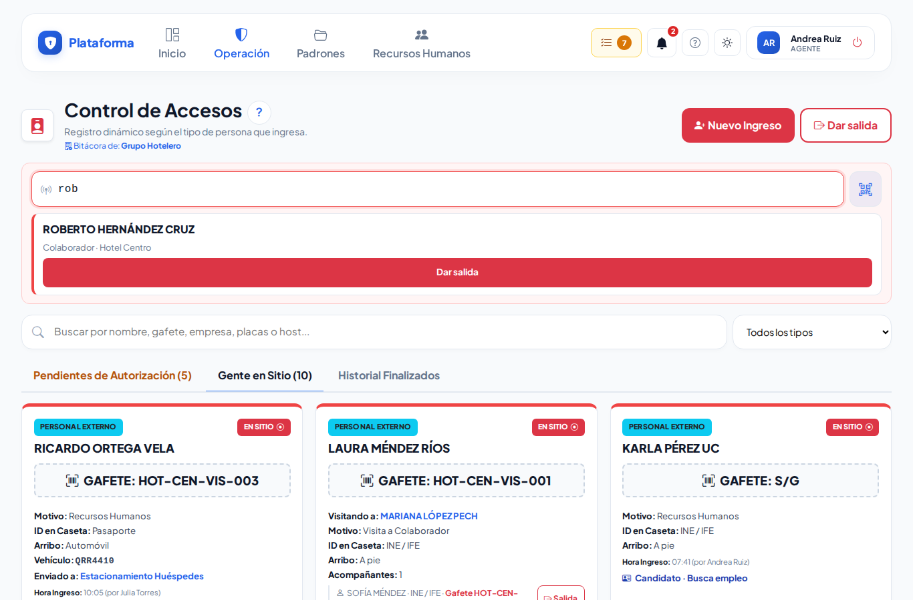

También puedes dar salida desde la tarjeta: toca **Registrar Salida** y confirma. Y sigue existiendo el camino anterior: dentro de **Nuevo Ingreso** toca **Dar Salida** y busca a la persona.
<!-- solo: hotel -->
En huéspedes el botón de la tarjeta dice **Salida Final**.
<!-- fin -->

**Qué debes ver:** la persona pasa a **Historial Finalizados** con la pastilla **FINALIZADO**. Sus acompañantes salen con ella, su gafete queda libre y su lugar de estacionamiento se libera.

### Gafete e identificación al dar salida

Si la persona traía gafete o dejó su identificación, la confirmación de **Dar salida** trae casillas **ya marcadas**:

- **Devolvió el gafete …** (una por cada gafete, también los de sus acompañantes).
- **Le devolví su identificación.**

Si todo está en orden, solo confirmas: es igual de rápido que antes. Si el gafete **no** lo devolvió, **quita la marca**: la salida se registra igual, el gafete queda **NO REGRESÓ** (ya no se puede volver a entregar) y le llega un aviso a tu supervisor para que levante el voucher de reposición. En el historial la tarjeta dice «Gafete no devuelto» o «Identificación no devuelta».

Un acompañante puede salir antes con el botón **Salida** de su renglón.

## Cómo registrar una salida temporal o a tour

<!-- solo: hotel -->
1. En huéspedes toca **Salida a Tour**; en proveedores y contratistas autorizados, **Salida Temporal**.
<!-- fin -->
<!-- solo: corporativo, condominio, fraccionamiento -->
1. En proveedores y contratistas autorizados toca **Salida Temporal** (por ejemplo, cuando salen por material).
<!-- fin -->
2. Si quieres, anota placas, marca y conductor. Guarda.
3. Cuando regrese, toca **Registrar Regreso**.

Si se va con su vehículo y no volverá a ocupar el mismo lugar, marca **Libera su lugar de estacionamiento (el auto se va)**: el cajón queda libre para otro.

**Qué debes ver:** mientras está fuera, la pastilla dice **FUERA** con el detalle «Fuera en tour» o «Fuera temporal», y su gafete sigue reservado. En el historial, la pastilla **FINALIZADO** lleva el detalle «Salida a tour», «Salida temporal», «Regreso de tour» o «Regreso».

## Cómo cambiar la zona de estacionamiento

1. En una persona con vehículo toca **Cambiar Zona**.
2. Elige otra zona de la sede, o **Sin asignar (liberar)**. Guarda.

Si la zona elegida ya está llena, la plataforma te avisa «La zona … está llena». Si de todos modos lo mandas ahí (por ejemplo, porque sabes que alguien acaba de salir), marca **Enviar aunque esté llena** (al cambiar zona) o toca **Enviar de todos modos** (en el ingreso).

**Qué debes ver:** la tarjeta muestra la zona nueva en **Enviado a**.

## Si la persona o la empresa tiene el acceso restringido

Al registrar un ingreso, la plataforma revisa el Padrón de personas, el Padrón de vehículos y Proveedores:

- **Acceso restringido:** si la persona, el vehículo o la empresa tiene el acceso restringido, no se puede registrar. El mensaje dice el motivo y hasta cuándo.
- **Nombre parecido:** si la empresa se escribe distinto a una restringida (por ejemplo, «Elevadores Sur» y «Elevadores del Sur S.A.»), sale la pregunta **¿Es la misma?**. Si contestas **Sí, es la misma**, no puede pasar. Si contestas **No, es otra**, puede pasar y la tarjeta queda marcada para que tu supervisor lo vea.
- **Dada de baja:** si la persona, el vehículo o la empresa estaban dados de baja (ya no se usaban), sale **Reactivar y continuar**: tócalo y el registro vuelve a estar activo.
- **Empresa nueva:** si la empresa no existe todavía, la tarjeta dice «Empresa nueva, pendiente de verificar» para que la revisen después.

## Cómo buscar y exportar el historial

1. Abre **Historial Finalizados**.
2. Escribe en el buscador (nombre, gafete, empresa, placas, a quién viene o el nombre de un **acompañante**) y elige tipo, sede y fechas **Desde / Hasta**.
3. Si tienes permiso, toca **Exportar a Excel** para bajar exactamente lo filtrado.

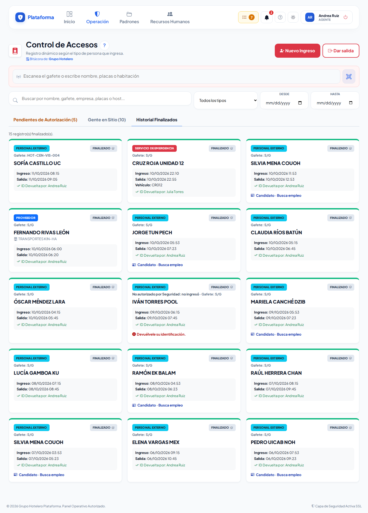

**Qué debes ver:** solo los registros que coinciden. Si buscas a un acompañante, la tarjeta dice «Coincide con …, acompañante de …».

## En el celular y en los modos Sol y Noche

Todo funciona igual en el celular: el botón **Nuevo Ingreso** ocupa todo el ancho y los botones de la ventana quedan abajo, a la mano.

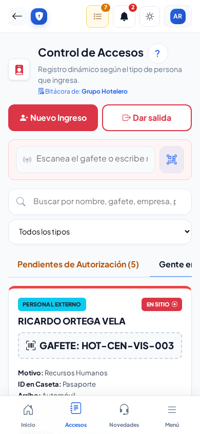
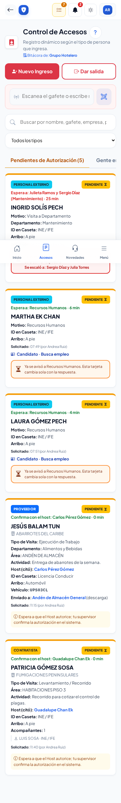
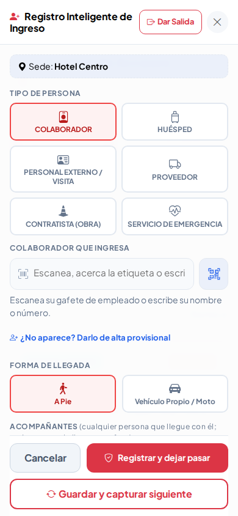
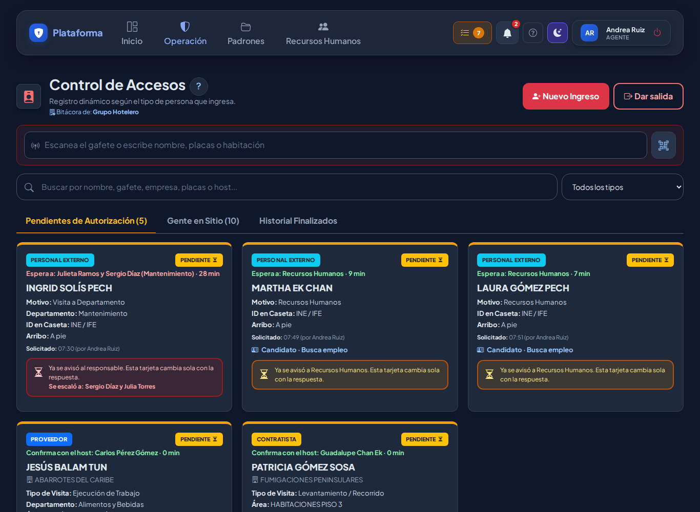
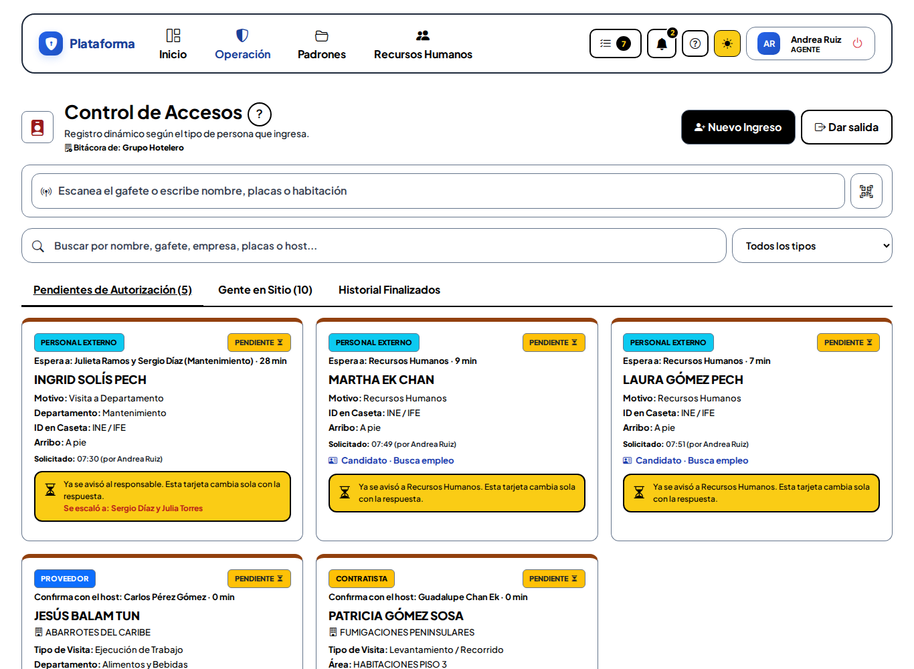

## Si algo sale mal

| Mensaje o síntoma | Qué significa | Qué hacer |
|---|---|---|
| «El gafete … ya está en uso (EN SITIO). Pide que lo devuelvan o elige otro.» | Ese gafete lo tiene alguien que sigue dentro. | Usa otro gafete o da salida a quien lo tiene. |
| «El gafete … está dado de baja.» | El gafete ya no se usa. | Elige otro. |
| «Indica a quién viene: la persona que lo citó o el área.» | No elegiste a nadie en **¿A quién viene?**. | Escribe el nombre de la persona o del área y elígelo de la lista. |
| «Elige de la lista a quién viene (una persona o un área)…» | Escribiste un nombre pero no lo elegiste de la lista. | Toca el nombre en la lista que aparece debajo; si no sale, prueba con otra palabra. |
| «Indica a qué departamento viene.» | Tu empresa pide la autorización del departamento y la persona elegida no tiene departamento. | Elige el área en **¿A quién viene?**. |
| «Este acceso espera la autorización del departamento. Si no puede esperar, toca «Autorizar por excepción» y elige el motivo.» | El proveedor o contratista espera a su departamento. | Espera la respuesta o usa **Autorizar por excepción**. |
| «Elige el motivo de la excepción.» / «Con «Otro» escribe el motivo de la excepción.» | Falta el motivo o su detalle. | Elige un motivo; con **Otro**, escribe cuál. |
| «Ese motivo no aplica a este acceso: elige uno de la lista.» | Por ejemplo, el departamento sí tiene responsable o aún no pasa el tiempo de espera. | Elige otro motivo de la lista. |
| «La empresa «…» no puede ingresar: Acceso restringido …» (o la persona, o el vehículo) | Tiene prohibido el acceso. | No lo dejes pasar; avisa a tu supervisor. |
| Sale **¿Es la misma?** | La empresa se parece a una con acceso restringido. | Pregunta y contesta; si es la misma, no puede pasar. |
| Sale **Reactivar y continuar** | La persona, el vehículo o la empresa estaba dado de baja. | Tócalo si es correcto que vuelva. |
| «La zona … está llena.» | Ya no hay lugares en esa zona. | Elige otra o marca **Enviar de todos modos**. |
| Quité la marca **Devolvió el gafete** | El gafete quedó **NO REGRESÓ** y tu supervisor recibió un aviso. | Si después aparece, recíbelo en **Gafetes**. |
| «El colaborador elegido no existe, está dado de baja o no pertenece a esta sede.» | El colaborador no trabaja en esa sede. | Revisa la sede o usa el alta provisional. |
| «Las placas solo llevan letras y números (de 2 a 20).» | Las placas tienen símbolos o están incompletas. | Escríbelas sin guiones ni espacios. |
| «Este acceso ya no está pendiente de autorización (alguien más lo atendió).» | Otro compañero ya lo autorizó. | Revisa **Gente en Sitio**. |
| No sale el botón **Confirmar Autorización** | Tu rol no puede aprobar. | Pide a tu supervisor que lo autorice. |
| «Elige a qué viene de la lista.» | La opción de **¿A qué viene?** no es válida. | Vuelve a elegirla de la lista. |
| «Elige el motivo de la visita.» | No elegiste el **Motivo de la Visita** (ninguno viene marcado). | Toca el motivo que corresponde. |
| «Escribe a quién o a qué viene.» / «Escribe a qué huésped visita.» | Elegiste **Visita general** o **Visita a huésped** y falta el dato. | Escríbelo en el campo que aparece debajo del motivo. |
| «Elige el motivo de la visita de la lista.» | Ese motivo no aplica en tu empresa (por ejemplo, Recursos Humanos sin ese módulo). | Elige otro motivo. |
| «Elige una vacante publicada de esta sede.» | Esa vacante ya no está publicada o es de otra sede. | Elige otra o **-- No sabe / otra --**. |
| La tarjeta **PENDIENTE** se pone en rojo | Nadie ha contestado en el tiempo que configuró tu empresa. | La plataforma ya escaló a los suplentes y al Jefe de seguridad (la tarjeta dice «Se escaló a: …»). Si te confirman por teléfono, tu supervisor usa **Confirmar Autorización**. |
| Escaneo el gafete para dar salida y no sale nadie | Ese gafete no lo tiene nadie en sitio, o la persona está en otra sede. | Busca por nombre o placas; revisa el filtro de sede. |
| Al dar salida el botón dice **Registrar regreso** | La persona está fuera en tour o en salida temporal. | Tócalo para registrar su regreso; después podrás dar la salida final. |

## Preguntas frecuentes

- **¿Por qué el proveedor no aparece en Gente en Sitio?** Está en **Pendientes de Autorización** hasta que lo autorice su departamento (o tu supervisor por excepción).
- **El jefe del departamento me autorizó por teléfono, ¿qué hago?** Pide a tu supervisor que toque **Autorizar por excepción** con el motivo «El responsable autorizó por teléfono». Así queda anotado quién y por qué.
<!-- solo: hotel, corporativo -->
- **Alguien dice que tiene cita, pero es su primera vez.** Elige **Ya tiene cita** de todos modos: si no se encuentra su ficha, Recursos Humanos lo recibe como «Busca empleo» y queda anotado.
- **¿Y si viene a entregar papeles o a firmar?** También es **Ya tiene cita**: la plataforma sabe en qué paso va y le dice a Recursos Humanos si viene a su entrevista, a entregar documentos o a firmar.
- **¿Tengo que preguntarle el puesto o el departamento?** No. Solo a qué viene y, si busca empleo, a qué vacante (si la sabe). Lo demás lo pone Recursos Humanos.
<!-- fin -->
- **El colaborador no está en la lista.** Usa **¿No aparece? Darlo de alta provisional**; después lo verifica Recursos Humanos (si tu plan no lo incluye, el administrador).
- **¿Por qué no viene marcado ningún motivo?** Para que cada visita quede con su motivo real. Si casi todas tus visitas son del mismo tipo, tu administrador puede dejar uno marcado en **Estructura → Configuración → Caseta y accesos → Motivo de la visita**.
- **No veo el motivo Recursos Humanos.** Tu plan no incluye Recursos Humanos: usa **Visita general** o **Visita a persona o área**.
- **¿Por qué ya no veo «Visita a Departamento» ni «Host»?** Ahora es un solo campo, **¿A quién viene?**: ahí eliges a la persona o el área, y el departamento sale solo de la persona.
- **¿Qué pasa si la persona tiene cuenta?** Le llega el aviso y ella autoriza a su visita. Si no contesta a tiempo, el aviso pasa al responsable de su departamento.
- **Me equivoqué de zona.** Usa **Cambiar Zona**.
- **¿Cómo sé quién registró a alguien?** En la tarjeta, junto a la hora de ingreso, dice «por …».
- **¿Puedo usar la cámara del celular para el gafete?** Sí: toca el botón del código QR junto al campo, tanto al registrar como al dar salida.
- **¿Por qué el botón de registrar cambia de texto?** Para que sepas qué va a pasar antes de tocarlo: «dejar pasar» o «queda pendiente de autorización».
- **¿Quién decide los minutos del ámbar y el rojo?** Quien configura Autorizaciones en tu empresa, en **Estructura → Autorizaciones → Responsables por departamento** (con Recursos Humanos, también en **Recursos Humanos → Recepción → Ajustes**).

## Relacionado

- [Reloj y suplente](reloj-y-suplente.md)
- [Préstamo de llaves](prestamo-llaves.md)
- [Pases de salida](pases-salida.md)
- [Bitácora de novedades](novedades.md)
- [Gafetes](gafetes.md)
- [Padrón de personas](personas.md)
- [Autorizaciones](autorizaciones.md)
- [Recepción de RR. HH.](recepcion-y-autorizaciones.md)
