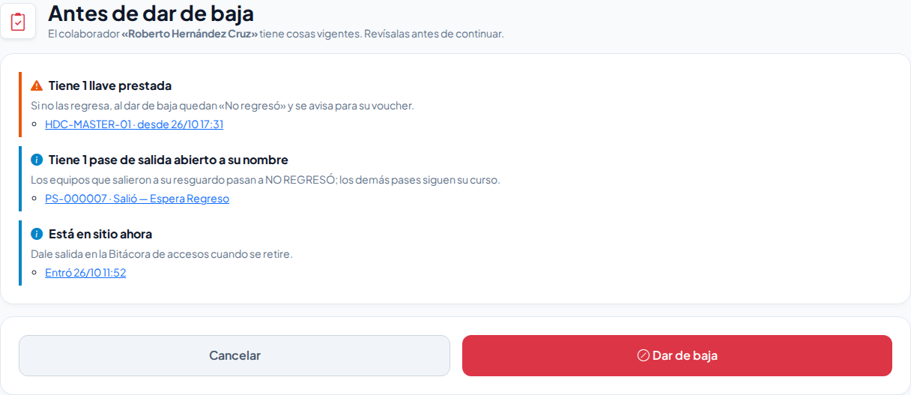

# Antes de dar de baja

**¿Para qué sirve?** Cuando das de baja a un colaborador, una persona, una empresa externa, un vehículo, una llave, un equipo, una sede, una zona de estacionamiento, un departamento, un puesto, un turno o un área, la plataforma revisa primero qué sigue dependiendo de él. Si encuentra algo vigente, te lo muestra en la pantalla **Antes de dar de baja** para que nada se quede «colgado» (por ejemplo, una llave prestada a alguien que ya no trabaja aquí).

## Antes de empezar

- Necesitas el permiso para dar de baja en el módulo de que se trate (por ejemplo, *Colaboradores* o *Llaves*). Si no ves el botón **Dar de baja**, pide el permiso a tu administrador.
- Si no hay nada vigente, la baja se hace directo, como siempre: esta pantalla no aparece.

## Cómo leer la revisión

Cada renglón tiene un color:

- **Rojo (no se puede todavía):** solo dos casos detienen la baja: una **sede con gente en sitio** y una **zona de estacionamiento con autos dentro**. Atiende eso primero (da salida o cambia de zona) y vuelve a intentarlo.
- **Amarillo (pendiente):** cosas que tiene a su cargo. Si continúas, pasan a **NO REGRESÓ** y a tu supervisor le llega un aviso en la campana para levantar el voucher. Por ejemplo, «Tiene 1 llave prestada» o «Tiene 1 responsiva abierta».
- **Azul (aviso):** cosas que siguen igual pero conviene saber, por ejemplo «Tiene una etiqueta NFC en su credencial» o «Tiene 2 vehículos».

Cada renglón trae enlaces para ir directo al lugar donde se atiende (el préstamo, la responsiva, la tarjeta en la Bitácora de accesos).

## Cómo dar de baja con pendientes

1. En la lista del módulo toca **Dar de baja** como siempre.
2. Si aparece **Antes de dar de baja**, lee los renglones.
3. Lo mejor es atender primero lo amarillo: recibe la llave en **Préstamo de llaves** o el equipo en **Responsivas**, y vuelve.
4. Si ya no va a regresar, continúa:
   - Si tiene **vehículos**, la casilla **Dar de baja sus vehículos** viene marcada: su calcomanía deja de servir en la caseta. Quítala si el vehículo se queda (por ejemplo, es de la empresa).
   - Si era el **único responsable** de un departamento, elige en **¿Quién lo reemplaza como responsable?** a la persona que atenderá las visitas y autorizaciones. Es obligatorio.
5. Toca **Dar de baja**.

**Qué debes ver:** el mensaje de éxito dice qué quedó pendiente. Las llaves y equipos que tenía quedan **NO REGRESÓ** y tu supervisor recibe el aviso «Llaves, gafetes o equipos que no regresaron» en **Mis pendientes**.

## Cómo dar de baja una llave o un equipo que alguien tiene

Una llave prestada, un gafete EN SITIO o un equipo ASIGNADO o FUERA no se da de baja directo desde su lista: alguien lo tiene.

1. En la ficha toca **Dar de baja**. Aparece **Antes de dar de baja** con quién lo tiene y desde cuándo.
2. Si ya regresó, recíbelo en su módulo (enlace **Ver dónde está**).
3. Si no regresó, toca **Dar de baja**: queda **NO REGRESÓ** y se abre su baja con voucher, con quien lo tenía propuesto como responsable.

**Qué debes ver:** la ficha con la pastilla **NO REGRESÓ** y la ventana de baja con voucher ya abierta.

## Si algo sale mal

| Mensaje o síntoma | Qué significa | Qué hacer |
|---|---|---|
| «Todavía no se puede dar de baja: atiende primero lo marcado en rojo.» | Hay gente en sitio en la sede o autos en la zona. | Da salida o cambia de zona en la Bitácora de accesos o en Estacionamientos. |
| «Es el único responsable de …: elige quién lo reemplaza …» | Era el único responsable de un departamento. | Elige a una persona en **¿Quién lo reemplaza como responsable?**. |
| «La llave … está prestada a …: recíbela o márcala «No regresó» en Préstamo de llaves.» | Intentaste dar de baja una llave prestada desde otro lado. | Sigue el mensaje o usa **Dar de baja** desde la lista de llaves. |
| «El gafete … está EN SITIO con …: dale salida en la Bitácora de accesos …» | Alguien en sitio tiene el gafete. | Dale salida; si no lo devuelve, quita la marca **Devolvió el gafete**. |
| «El equipo … está ASIGNADO a cargo de … (Responsiva …): recíbelo en Responsivas …» | El equipo está en una responsiva abierta. | Recíbelo en **Responsivas**; si no regresó, márcalo **Faltante**. |

## Preguntas frecuentes

- **¿Por qué no se bloquea la baja de un colaborador con una llave prestada?** Porque a veces la persona ya se fue y no va a volver. La plataforma deja la llave en **NO REGRESÓ** y avisa para cobrarla; así no se pierde el rastro.
- **¿Puedo deshacer la baja?** Sí, con **Reactivar** en la misma lista. Lo que quedó **NO REGRESÓ** sigue así hasta que lo recibas.
- **Si la llave aparece después, ¿qué hago?** Recíbela en **Préstamo de llaves** (la tarjeta **NO REGRESÓ** tiene **Recibir**): vuelve a **DISPONIBLE**.
- **¿Qué es «Restringir acceso»?** Es distinto de dar de baja: sirve para impedir que una persona, un vehículo o una empresa entre, con motivo y fecha. Ver [Padrón de personas](personas.md).

## Relacionado

- [Préstamo de llaves](prestamo-llaves.md)
- [Responsivas](responsivas.md)
- [Gafetes](gafetes.md)
- [Vouchers de reposición](vouchers.md)
- [Colaboradores](colaboradores.md)
