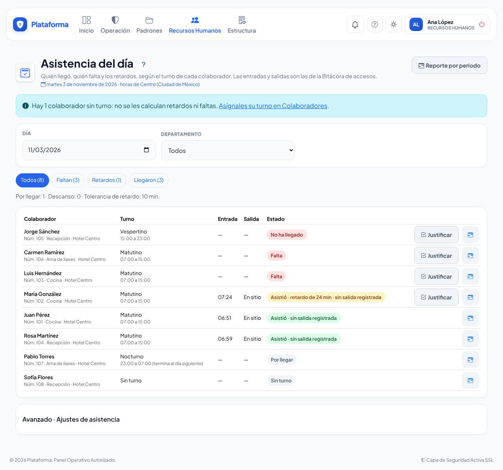
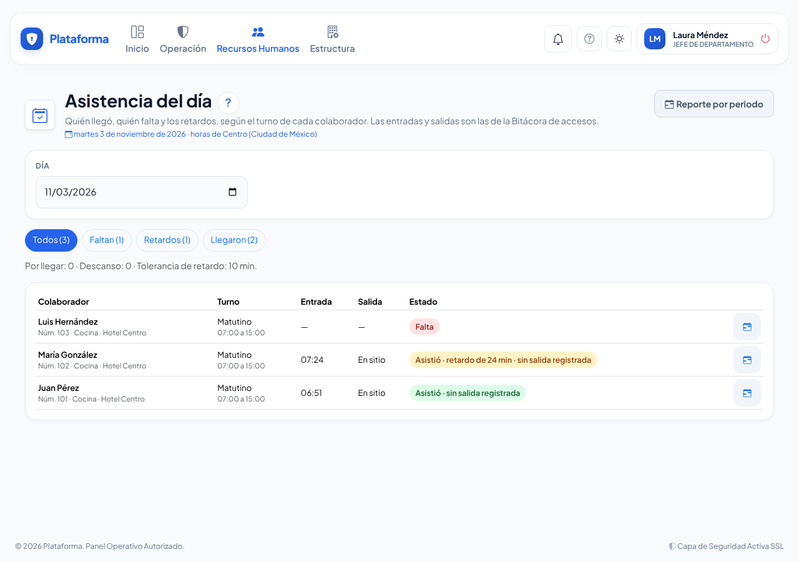
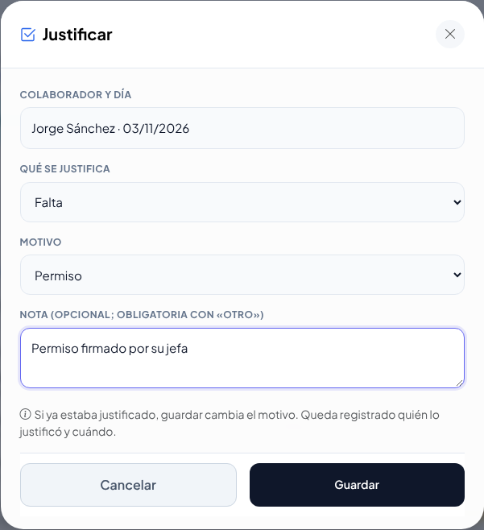
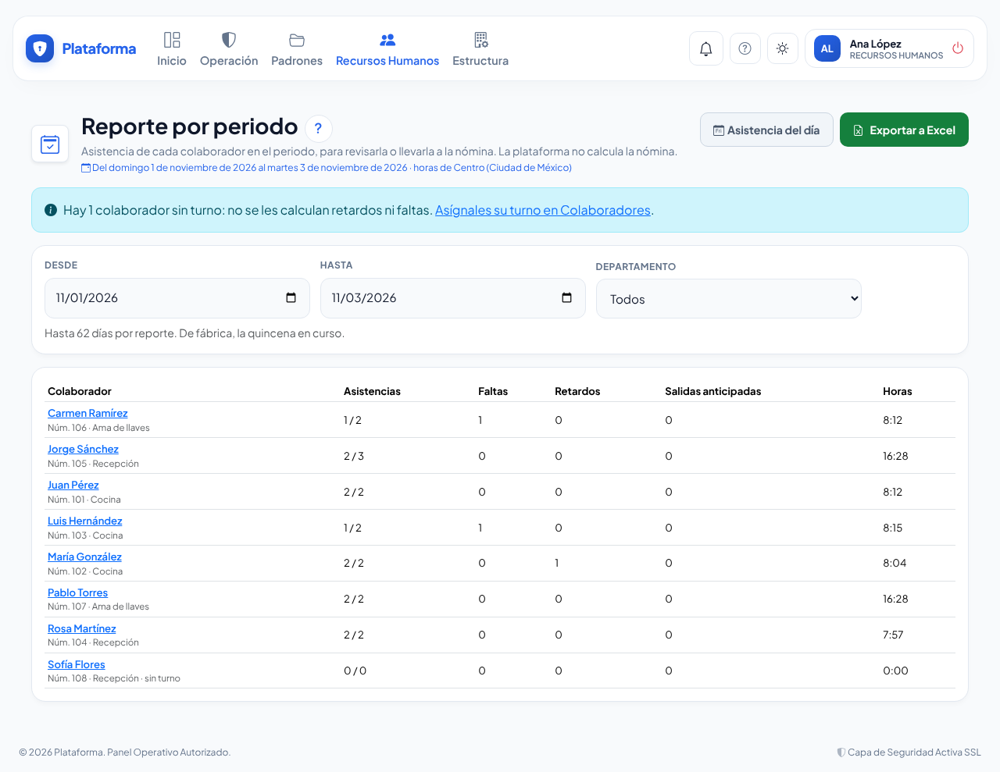
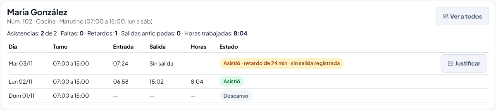
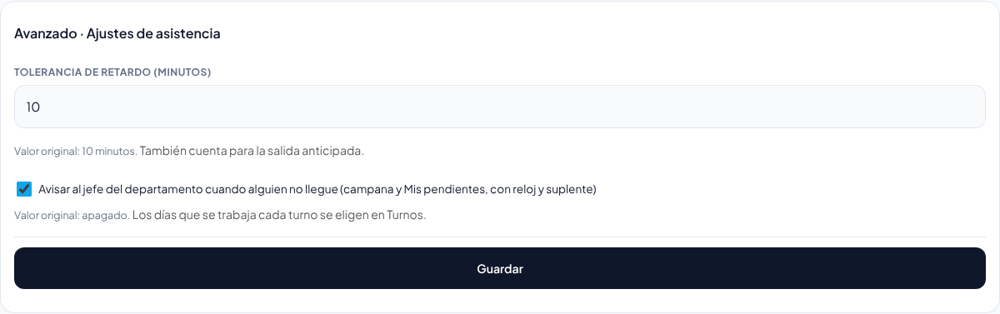

# Asistencia

**¿Para qué sirve?** Para saber, sin capturar nada nuevo, **quién llegó, quién falta y quién llegó tarde**, y para sacar el **reporte del periodo** que tu nómina necesita. La plataforma toma las entradas y salidas del personal que ya se registran en la caseta (con la credencial, el lector o a mano) y las compara con el **turno** de cada colaborador. La caseta trabaja igual que siempre: no tiene ningún paso nuevo.

La plataforma **no calcula la nómina**: entrega el reporte en Excel para que tu área de nómina lo use.

## Antes de empezar

- Asistencia es un **complemento**: solo aparece si tu empresa lo contrató. Si al abrirla dice **Esto no viene en tu plan**, pide a tu administrador que lo solicite.
- Para ver la pantalla tu rol debe poder consultar *Asistencia*. Recursos Humanos y el administrador ven a todo el personal; el director consulta y exporta; el **jefe de departamento** ve solo a la gente de los departamentos donde es responsable.
- Cada colaborador necesita su **turno** (en **Estructura → Colaboradores**, al editarlo). Sin turno no se le calculan retardos ni faltas; la pantalla te avisa cuántos faltan.
- Los **días de descanso** se marcan en el turno: en **Estructura → Turnos**, al editar el turno, abre **Avanzado · Días que se trabaja (para Asistencia)**. De fábrica se trabajan todos los días.

## Cómo ver la asistencia del día

1. Entra a **Recursos Humanos → Asistencia**. Se abre **Asistencia del día** con el día de hoy.
2. Arriba ves cuántos **Faltan**, cuántos tienen **Retardos** y cuántos **Llegaron**. Toca uno para ver solo ese grupo, o **Todos** para regresar.
3. Si ves varias sedes o departamentos, elige uno en **Sede** o **Departamento**. Para otro día, cambia **Día** (para volver, toca **Hoy**).
4. Cada renglón dice el **turno**, la hora de **Entrada**, la de **Salida** y el **Estado**:
   - **Asistió** (verde). Si llegó tarde dice «retardo de 25 min»; si se fue antes, «salió 30 min antes» (ámbar).
   - **No ha llegado** (rojo): su turno ya empezó y pasó la tolerancia.
   - **Falta** (rojo): su turno terminó y no entró.
   - **Por llegar**: su turno aún no empieza.
   - **Descanso**: ese día no trabaja según su turno.
   - **En sitio** en la salida: entró y todavía no sale.

**Qué debes ver:** la lista de tu gente con su estado de hoy, primero quien falta.

Si eres **jefe de departamento**, solo ves a la gente de tus departamentos y no tienes el botón **Justificar**:

## Cómo justificar una falta o un retardo

1. En el renglón de la persona toca **Justificar** (solo aparece si tu rol puede justificar y hay algo pendiente).
2. Revisa **Colaborador y día**.
3. En **Qué se justifica** elige **Falta**, **Retardo** o **Salida anticipada**.
4. Elige el **Motivo**: Permiso, Vacaciones, Día de descanso, Incapacidad, Comisión de trabajo u Otro.
5. Si quieres, escribe una **Nota** (con «Otro» es obligatoria).
6. Toca **Guardar**.

**Qué debes ver:** «Justificación guardada para Juan Pérez. Sigue con el reporte del periodo o justifica a otra persona.» El renglón ahora dice, por ejemplo, «Falta justificada: Vacaciones».

Si te equivocaste de motivo, vuelve a abrir **Justificar** en ese día y guarda el correcto: se cambia el que había. Queda registrado quién lo justificó y cuándo.

## Cómo sacar el reporte por periodo

1. En **Asistencia** toca **Reporte por periodo**.
2. De fábrica se muestra la **quincena en curso**. Cambia **Desde** y **Hasta** si necesitas otro periodo (hasta 62 días).
3. Cada renglón muestra las **Asistencias** (de los días que debía trabajar), las **Faltas**, los **Retardos**, las **Salidas anticipadas** y las **Horas** trabajadas. Lo justificado aparece aparte, por ejemplo «2 (+1 just.)».

4. Toca el nombre de una persona para ver su **detalle día por día**. Desde ahí también puedes **Justificar**. Para volver a la lista toca **Ver a todos**.
5. Para la nómina toca **Exportar a Excel**. El archivo trae un renglón por persona y día con la hora programada, la entrada, la salida, los minutos de retardo, la salida anticipada, las horas trabajadas, el estado y la justificación. Si tienes a una persona abierta, el archivo trae solo a esa persona.

**Qué debes ver:** se descarga el archivo «asistencia-…csv», que se abre en Excel con los acentos correctos.

También llegas al reporte de una persona desde **Estructura → Colaboradores**: en su ficha toca el ícono de calendario (**Asistencia**).

## Cómo se cuenta cada día

- **Retardo:** la entrada pasó la **tolerancia** (de fábrica 10 minutos después de la hora del turno). La misma tolerancia vale para la salida anticipada.
- **Horas trabajadas:** se suma cada entrada con su salida. Si la persona salió a comer y volvió, ese rato no cuenta. Si no tiene salida registrada, ese tramo no se suma.
- **Turnos que cruzan la medianoche** (por ejemplo 22:00 a 06:00): cuentan en el día en que **empiezan**. La salida del día siguiente se ve con su fecha.
- Una entrada cuenta para el turno si ocurre desde unas horas antes de su inicio hasta su fin; la primera es la hora de entrada y la última salida es la de salida.
- Los días antes de la alta del colaborador no cuentan.

## Cómo cambiar la tolerancia o el aviso de faltas

Solo quien configura Asistencia en toda la empresa (por ejemplo Recursos Humanos o el administrador).

1. En **Asistencia del día**, abre **Avanzado · Ajustes de asistencia** al final de la pantalla.
2. Cambia la **Tolerancia de retardo (minutos)**.
3. Marca **Avisar al jefe del departamento cuando alguien no llegue** si quieres que el jefe reciba el aviso en la campana y en **Mis pendientes** (de fábrica está apagado).
4. Toca **Guardar**.

**Qué debes ver:** «Ajustes de asistencia guardados. Revisa la asistencia de hoy con la nueva tolerancia.»

## Si algo sale mal

| Mensaje o síntoma | Qué significa | Qué hacer |
|---|---|---|
| **Esto no viene en tu plan** | Tu empresa no tiene el complemento Asistencia. | Pide a tu administrador que lo solicite en **Tu suscripción**. |
| «Hay 3 colaboradores sin turno» | A esas personas no se les calculan retardos ni faltas. | Asígnales su turno en **Estructura → Colaboradores**. |
| Sale **Falta** en un día que no trabaja | El turno no tiene marcados sus días de descanso. | En **Estructura → Turnos**, edita el turno y en **Avanzado · Días que se trabaja** desmarca los días de descanso. |
| «Con el motivo «Otro», escribe en la nota qué pasó.» | Elegiste «Otro» sin nota. | Escribe la nota y toca **Guardar**. |
| «Solo se justifican días que ya llegaron (hoy o antes).» | Intentaste justificar un día futuro. | Justifícalo cuando llegue ese día. |
| No veo a alguien de otro departamento | Como jefe de departamento solo ves a tu gente. | Pide a Recursos Humanos la información que necesites. |
| La salida dice **Sin salida** | La caseta no registró su salida. | Pide a la caseta que revise la Bitácora de accesos; las horas de ese tramo no se suman. |

## Preguntas frecuentes

**¿La caseta tiene que hacer algo distinto?** No. Asistencia usa las mismas entradas y salidas que la caseta ya registra en la Bitácora de accesos.

**¿Puedo corregir la hora de entrada desde aquí?** No. La hora es la que quedó en la Bitácora de accesos. Si hubo un error, justifícalo con su motivo y nota.

**¿Por qué una persona que entró a las 07:55 no tiene retardo?** Llegó antes de la hora de su turno o dentro de la tolerancia.

**¿El reporte calcula el sueldo?** No. Entrega los datos de asistencia para que tu nómina los use.

**¿Qué pasa con los datos de asistencia si alguien pide sus datos (derechos ARCO)?** La búsqueda de privacidad los encuentra y los exporta; las notas de las justificaciones se quitan al cumplirse el plazo de conservación de tu empresa.

## Relacionado

- [Turnos](turnos.md)
- [Colaboradores](colaboradores.md)
- [Bitácora de accesos](accesos.md)
- [Credenciales](credenciales.md)
- [Menús, Mis pendientes y modos de pantalla](menus.md)
