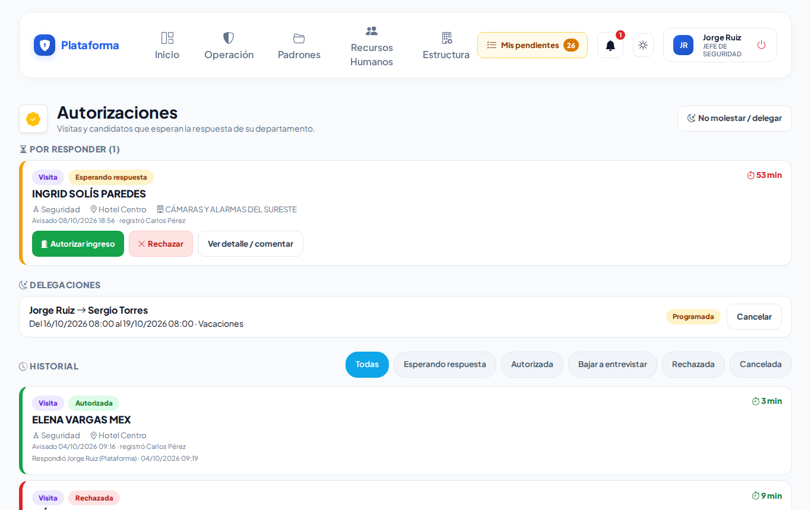
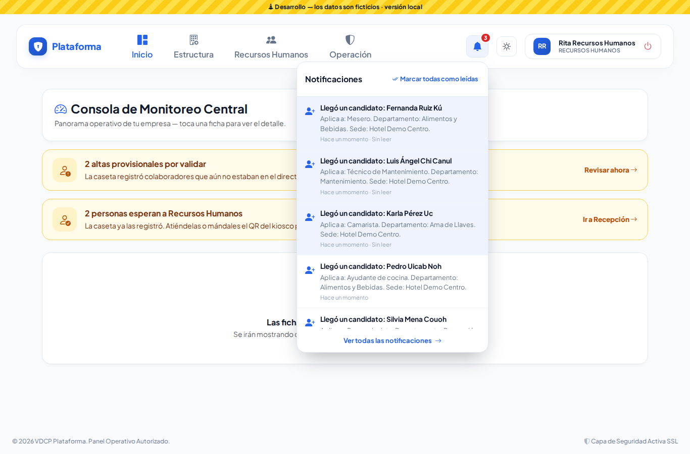
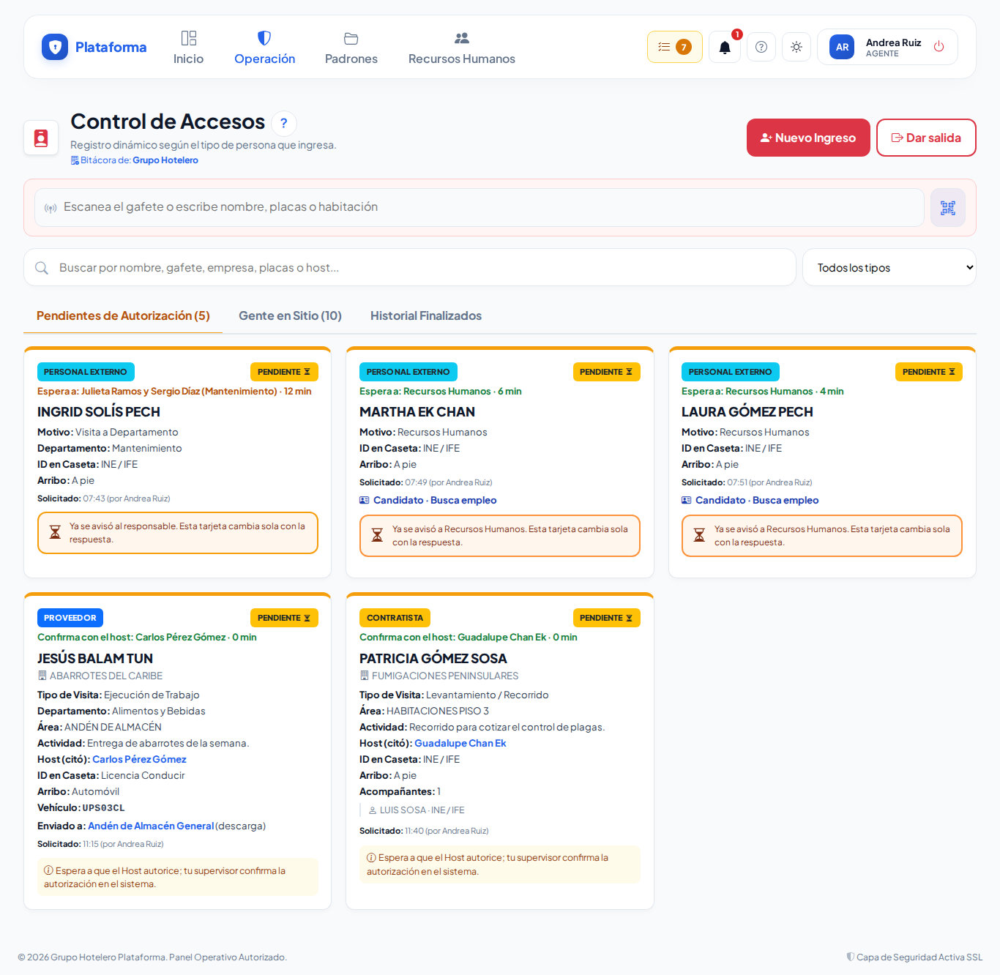
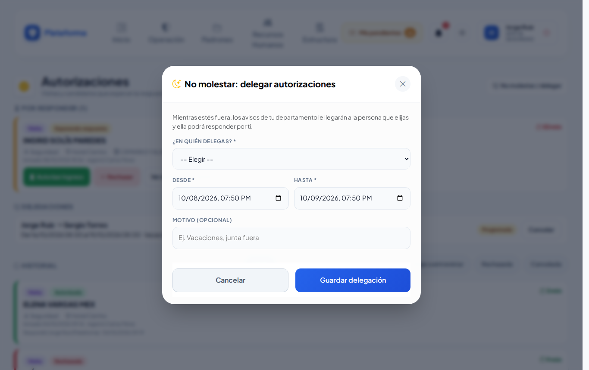
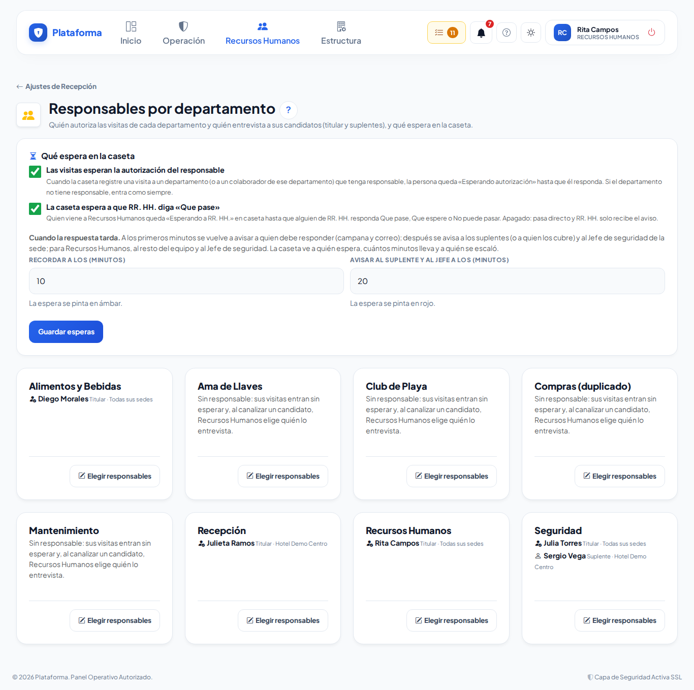

# Autorizaciones

**¿Para qué sirve?** Cuando una visita, un proveedor o un contratista viene a un **departamento**, su **responsable** decide si entra. Te llega como aviso en la **campana** (y por correo) con los botones **Autorizar ingreso** / **Rechazar**, y la caseta ve tu respuesta al momento. Aquí también eliges quién es responsable de cada departamento, quién te cubre cuando no estás («No molestar») y qué espera la caseta. Viene en todos los planes. Lo que tiene que ver con candidatos y Recursos Humanos está en [Recepción de RR. HH.](recepcion-y-autorizaciones.md).

## Antes de empezar

- **Responder autorizaciones:** necesitas el permiso **Responder** de *Autorizaciones departamentales* y ser **responsable** (o suplente) del departamento. Las autorizaciones llegan por la **campana** y por **Mis pendientes**; también las encuentras en **Estructura → Autorizaciones** (si respondes las de algún departamento o configuras quién autoriza).
- **Responsables por departamento y esperas:** necesitas el permiso **Configurar** con alcance de empresa.

## Cómo usar la campana

1. Arriba a la derecha está la **campana**. El número rojo son tus avisos sin leer; se actualiza solo.
2. Tócala para ver los últimos avisos; toca uno para abrirlo.
3. Si el aviso pide tu respuesta, trae los botones ahí mismo (por ejemplo **Que pase** / **Que espere** / **No puede pasar**, o **Autorizar ingreso** / **Rechazar**).
4. **Marcar todas como leídas** las limpia. **Ver todas las notificaciones** abre la lista completa.

Si tienes encendidos los avisos por correo en [Configuración](configuracion.md), también te llega un correo.

## Cómo responder una autorización

### Visitas, proveedores y contratistas que vienen a un departamento

1. La caseta registra la visita con el motivo **Visita a Departamento** (o **Visita a Colaborador**), o al proveedor o contratista con **¿A qué departamento viene?**.
2. Si la empresa lo pide y el departamento tiene responsable, la tarjeta de la caseta queda **PENDIENTE** con «Espera a: (tu nombre) (departamento) · minutos» y a ti te llega el aviso (también a los suplentes del departamento).
3. Toca **Autorizar ingreso** o **Rechazar** (en la campana, en **Mis pendientes**, en **Autorizaciones** o en el botón del correo).
4. La tarjeta de la caseta **cambia sola**: autorizado, la persona pasa a «Gente en Sitio» con «Autorizado por (departamento)»; rechazado, queda **FINALIZADO** con «No autorizado por (departamento): no ingresó» en el historial (hay que devolverle su identificación).
5. Si no contestas, la plataforma te lo **recuerda** a los minutos que configuró tu empresa (de fábrica, 10) con otro aviso en la campana y por correo. Si sigue sin respuesta (de fábrica, a los 20), **escala**: avisa a los suplentes del departamento (o a quien los cubre por «No molestar») y al Jefe de seguridad de la sede, y la caseta ve «Se escaló a: …». Cada aviso se manda una sola vez.

> Si el responsable avisa por teléfono, el supervisor puede usar **Confirmar Autorización** en la caseta (en un proveedor o contratista, **Autorizar por excepción** con el motivo «El responsable autorizó por teléfono»): queda anotado «respondida por caseta».

El aviso de un proveedor o contratista dice de qué empresa viene, quién lo citó y a qué viene (por ejemplo «Proveedor para Mantenimiento. Lo citó: Carlos Pérez. Actividad: Recarga de tanque. Viene de: GAS DEL SUR.»).

### Cuando la caseta lo deja pasar por excepción

Si el departamento no tiene responsable en esa sede, nadie contestó a tiempo o hubo una urgencia, el supervisor de la caseta puede dejar pasar al proveedor o contratista con **Autorizar por excepción**, siempre con un motivo. Entonces:

1. Te llega a la **campana** el aviso «Pasó por excepción: …» con el motivo y quién lo autorizó.
2. La solicitud se cierra: sus botones desaparecen y en **Autorizaciones** queda como autorizada «por caseta», con el comentario «Por excepción: (motivo)».
3. Todo queda en la Bitácora de auditoría.

**Qué debes ver:** el aviso en tu campana y, en la caseta, la tarjeta con «Autorizado por excepción (motivo, quién)».

**Qué debes ver:** «Listo: autorizaste el ingreso de …. La caseta ya lo ve.» o «Respuesta registrada: rechazaste a ….»

### La bandeja «Autorizaciones»

Se abre desde **Mis pendientes** o la campana. Arriba está **Por responder** (con los minutos que lleva esperando), luego tus **Delegaciones** y el **Historial** (filtra por **Todas**, **Autorizada**, **Rechazada**…). Toca **Ver detalle / comentar** para dejar un **Comentario (opcional)** antes de responder. Si entrevistas candidatos, el botón **Entrevistas** abre las que Recursos Humanos te canalizó (ver [Entrevistar y elegir](entrevistar-y-elegir.md)). En el historial pueden aparecer avisos «Candidato (proceso anterior)»: son de antes de que existieran las entrevistas con cita y ya no se responden.

### Desde el correo

El correo trae los mismos botones. Al tocarlo se abre la plataforma: **inicia sesión** y **confirma**. Así nadie puede autorizar solo con reenviar o abrir el correo. El botón vale 24 horas.

## Cómo delegar tus autorizaciones («No molestar»)

1. En **Autorizaciones** toca **No molestar / delegar**.
2. En **¿En quién delegas?** elige a otra persona (no puedes elegirte a ti mismo).
3. Escribe **Desde** y **Hasta** (fecha y hora) y, si quieres, el **Motivo (opcional)** (por ejemplo «Vacaciones»).
4. Toca **Guardar delegación**.

**Qué debes ver:** «Delegación guardada: mientras esté activa, los avisos de … le llegan a ….» La delegación también cubre tus **entrevistas** de candidatos: las nuevas le llegan a quien te cubre y esa persona puede evaluarlas. Cuando regreses, toca **Cancelar** en tu delegación: «Delegación cancelada: los avisos vuelven a llegarle al responsable.»

## Cómo elegir los responsables por departamento y qué espera en la caseta

Todo lo que tiene que ver con quién responde y qué espera está en una sola pantalla: **Responsables por departamento**. Llegas a ella desde **Estructura → Departamentos** (botón **Responsables**), desde **Recepción → Ajustes** o desde **Autorizaciones**.

1. En **Qué espera en la caseta**:
   - En **Esperan la autorización del responsable del departamento**, marca quién espera: **Visita**, **Proveedor** y **Contratista** (de fábrica, las tres). Marcada: la caseta elige a qué departamento viene la persona y, si ese departamento tiene responsable en la sede, queda «Esperando autorización» hasta que él responda; si no tiene responsable, la visita entra como siempre y el proveedor o contratista lo pasa el supervisor con **Autorizar por excepción**. **Proveedor** o **Contratista** sin marcar: se confirman con quien los citó (el Host) y **Confirmar Autorización**, como antes.
   - Enciende o apaga **La caseta espera a que RR. HH. diga «Que pase»**. Encendido: quien viene a Recursos Humanos espera en caseta tu respuesta. Apagado: pasa directo y solo te llega el aviso.
   - En **Recordar a los (minutos)** escribe a los cuántos minutos se vuelve a avisar a quien debe responder (campana y correo). Desde ese minuto la espera se pinta en **ámbar**. De fábrica, 10.
   - En **Avisar al suplente y al jefe a los (minutos)** escribe a los cuántos minutos, si nadie ha contestado, se avisa a los suplentes del departamento (o a quien los cubre) y al Jefe de seguridad de la sede; si la persona espera a Recursos Humanos, al resto del equipo de RR. HH. y al Jefe de seguridad. Desde ese minuto la espera se pinta en **rojo**. De fábrica, 20. Debe ser mayor que el recordatorio; ambos admiten hasta 240 minutos.
   - Toca **Guardar esperas**.
2. En cada departamento toca **Elegir responsables**: agrega el **Usuario**, la **Sede** (todas o una) y marca si es **suplente**. Si el departamento aún no tiene titular, el primer renglón vacío viene **sin** marcar «Suplente» (es el titular) y los siguientes vienen marcados.
3. Toca **Guardar responsables**.

**Qué debes ver:** «Esperas guardadas: la caseta ya aplica lo que elegiste.» y «Responsables de … guardados.» Solo aparecen usuarios con permiso para **Responder** autorizaciones; si falta alguien, dale ese permiso en [Roles y permisos](roles-y-permisos.md). El responsable también es quien sale primero en **¿Quién lo entrevista?** cuando Recursos Humanos canaliza a un candidato a su departamento (para eso necesita además el permiso **Evaluar** de *Candidatos*). En **Departamentos**, la tarjeta de un departamento sin responsable lo avisa con el enlace **Nombrar responsable**.

Cada recordatorio y cada escalamiento quedan en la Bitácora de auditoría y en el detalle de la autorización («Recordatorio enviado …», «Escalado … a …»). Quien responde las autorizaciones de un departamento (o configura quién autoriza) ve **Autorizaciones** en el menú **Estructura** (además de la campana y Mis pendientes).

## Si algo sale mal

| Mensaje o síntoma | Qué significa | Qué hacer |
|---|---|---|
| No puedes delegar en ti mismo: elige a otra persona que responda por ti. | Te elegiste a ti mismo. | Elige a otra persona. |
| Elige a quién delegas. / Indica desde cuándo (fecha y hora). / Indica hasta cuándo (fecha y hora). | Faltan datos de la delegación. | Complétalos. |
| «Hasta» debe ser después de «Desde». | Las fechas están al revés. | Corrige las fechas. |
| La delegación ya habría terminado: elige una fecha futura. | «Hasta» ya pasó. | Elige una fecha futura. |
| Ya hay una delegación en esas fechas: cancélala antes de crear otra. | Ya delegaste en esas fechas. | Cancela la anterior. |
| Elige a un usuario activo que pueda responder autorizaciones. | Esa persona no tiene el permiso. | Dale el permiso **Responder** o elige a otra. |
| Ese usuario ya está en la lista. / Máximo 10 responsables por departamento. | Repetiste un responsable o pasaste el límite. | Revisa la lista. |
| El enlace del correo ya venció o fue alterado. Abre la solicitud desde la plataforma. | El botón del correo pasó de 24 horas. | Responde desde la campana o **Autorizaciones**. |
| No hubo cambios que guardar. | Guardaste sin cambiar nada. | Cambia algo o sal de la pantalla. |
| La visita no queda «esperando autorización». | El departamento no tiene responsable o la opción está apagada. | Revisa **Responsables por departamento**. |
| El proveedor o contratista dice «Sin responsable en …: se autoriza por excepción». | Su departamento no tiene responsable en esa sede. | Nombra responsable en **Responsables por departamento**; mientras, el supervisor lo pasa con **Autorizar por excepción**. |
| El proveedor o contratista no pide departamento y dice «Confirma con el host». | La casilla **Proveedor** o **Contratista** está sin marcar. | Márcala en **Qué espera en la caseta** si quieres que espere al departamento. |
| «El aviso al suplente y al jefe debe ir después del recordatorio.» | Pusiste el segundo tiempo igual o menor que el primero. | Escribe en el segundo campo un número mayor. |
| Me llegó «Nadie ha respondido: … lleva … min en caseta» y no soy el responsable. | Eres suplente, cubres a alguien por «No molestar» o eres Jefe de seguridad de esa sede: se te escaló la espera. | Si puedes responder, toca el botón; si no, confirma en la caseta con **Confirmar Autorización** cuando te lo autoricen. |

## Preguntas frecuentes

**¿Dónde quedaron las Autorizaciones en el menú?** En **Estructura → Autorizaciones** (vienen en todos los planes), si configuras quién autoriza o respondes las de algún departamento. También te llegan por la campana y por **Mis pendientes**.

**¿Qué pasa si nadie responde?** La plataforma recuerda a quien debe responder y después avisa a los suplentes y al Jefe de seguridad de la sede (ver «Cómo elegir los responsables por departamento y qué espera en la caseta»). Mientras tanto la persona sigue esperando en la caseta, y el supervisor puede usar **Confirmar Autorización** si el responsable avisa por teléfono; en un proveedor o contratista, **Autorizar por excepción** con su motivo.

**¿Me entero si la caseta deja pasar a un proveedor sin mi respuesta?** Sí: te llega a la campana «Pasó por excepción: …» con el motivo y quién lo autorizó.

**Mi empresa no tiene Recursos Humanos, ¿me sirve esta página?** Sí. Las autorizaciones de departamentos, los responsables y «No molestar» vienen en todos los planes.

## Relacionado

- [Recepción de RR. HH.](recepcion-y-autorizaciones.md)
- [Bitácora de accesos](accesos.md)
- [Departamentos y puestos](departamentos-y-puestos.md)
- [Entrevistar y elegir](entrevistar-y-elegir.md)
- [Configuración](configuracion.md)
