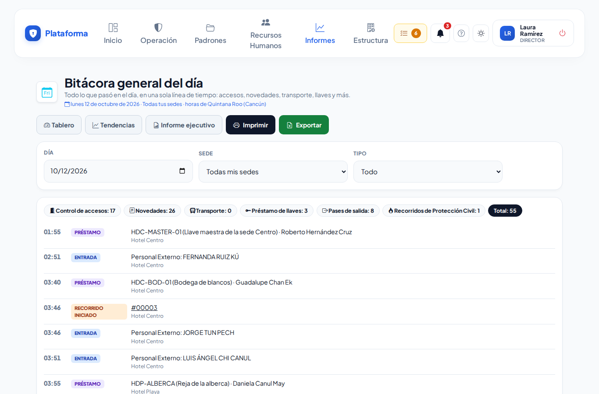
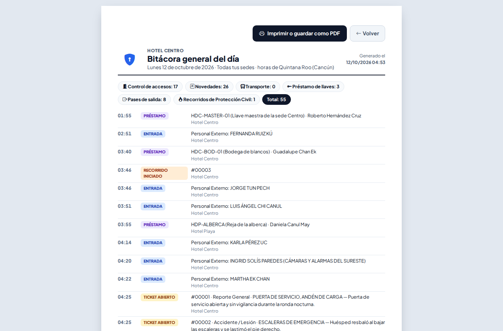

# Bitácora general del día

**¿Para qué sirve?** Para ver en una sola lista, por hora, todo lo que pasó en un día en tu sede: entradas y salidas de **Control de accesos**, tickets de **Novedades** (abiertos, notas y cierres), **Transporte**, **Préstamo de llaves**, **Pases de salida** que salieron o regresaron y **Recorridos de Protección Civil**. Es la hoja para **entregar el turno**.

**Antes de empezar:** necesitas que tu rol pueda **ver** la Bitácora general del día; cada tipo aparece solo si puedes ver su módulo. **Imprimir** y **Exportar** piden su propio permiso.

## Cómo ver un día

1. Entra a **Informes → Informes → Bitácora del día**. Se abre el día de hoy, en la hora de tu sede.
2. Para ver otro día, cámbialo en **Día** (no se puede elegir un día que todavía no llega). Toca **Hoy** para regresar.
3. Si trabajas en varias sedes, elige una en **Sede** (las horas se muestran en la zona horaria de esa sede).
4. Para ver solo una cosa, elige en **Tipo** (por ejemplo **Novedades**).

**Qué debes ver:** arriba, cuántos movimientos hubo de cada tipo y el total; abajo, la línea de tiempo con la hora, qué pasó (Entrada, Salida, Ticket abierto, Nota, Ticket cerrado, Préstamo, Devolución, Salió, Regresó, Inicia evento, Termina evento…) y el detalle. Los tickets, pases, recorridos, eventos y movimientos de transporte se pueden tocar para abrir su ficha.

Si tu empresa usa **Reservas** y puedes verlas, también salen los **eventos confirmados** del día: «Inicia evento — Salón Maya · Congreso de médicos · 100 personas (montaje desde 09:00)» y «Termina evento». Sirve para entregar el turno sabiendo qué eventos siguen.

## Cómo imprimirla para entregar el turno

1. Toca **Imprimir** (solo si tu rol puede imprimir).
2. Se abre la hoja carta con el logo, la empresa, el día y la sede, y al final las líneas **Entrega el turno** y **Recibe el turno** para firmar.
3. Toca **Imprimir o guardar como PDF**.

## Cómo exportarla a Excel

1. Toca **Exportar** (solo si tu rol puede exportar).
2. Se descarga un archivo de Excel (CSV) con fecha, hora, sede, tipo y detalle de cada movimiento, con los mismos filtros de la pantalla.

## Si algo sale mal

| Mensaje o síntoma | Qué significa | Qué hacer |
|---|---|---|
| «Sin movimientos registrados este día.» | Ese día no hubo nada de lo que puedes ver. | Revisa el día y la sede. |
| Falta un tipo (por ejemplo Transporte) | Tu rol no puede ver ese módulo. | Pide el permiso a tu administrador. |
| La fecha regresa a hoy | Elegiste un día que todavía no llega o una fecha que no existe. | Elige otro día. |
| No aparecen **Imprimir** o **Exportar** | Tu rol no tiene esos permisos. | Pide el permiso **Imprimir** o **Exportar**. |

## Preguntas frecuentes

**¿Una visita que entró a las 23:30 en qué día sale?** En el día de su hora local de la sede, aunque en otra zona horaria ya sea el día siguiente.

**¿Salen las notas automáticas de los tickets?** No: solo las notas que escribió una persona, más la apertura y el cierre.

**¿Se ven los vales de taxi anulados?** No: los movimientos de transporte anulados no salen.

## Relacionado

[Tablero](tablero.md) · [Tendencias](tendencias.md) · [Informe ejecutivo](informe-ejecutivo.md) · [Bitácora de accesos](accesos.md) · [Novedades](novedades.md) · [Préstamo de llaves](prestamo-llaves.md)
