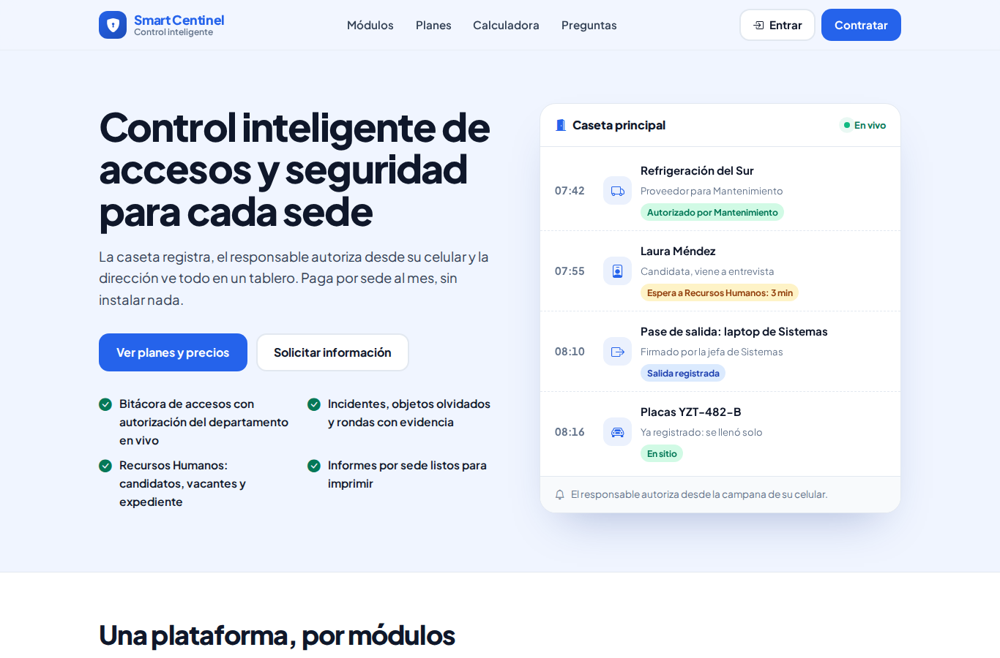
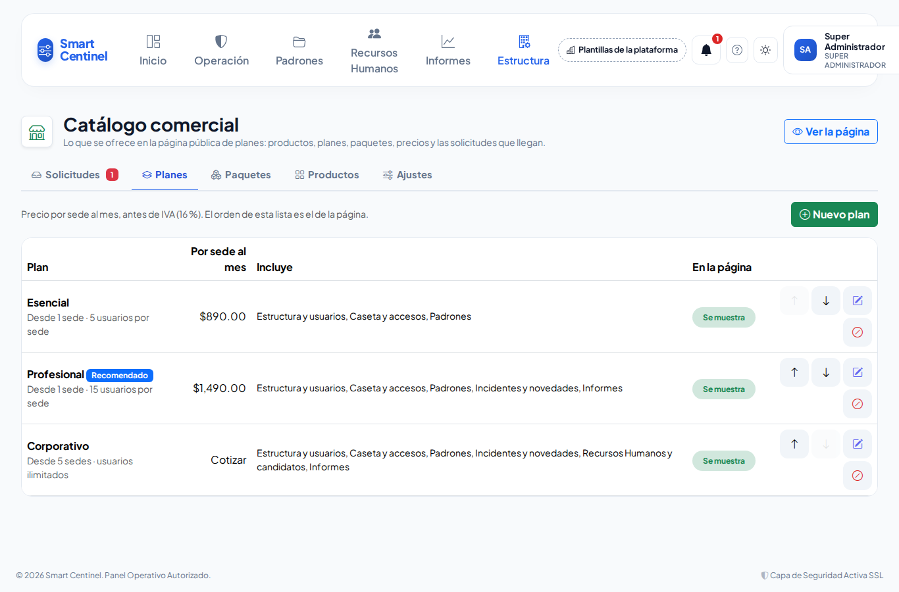
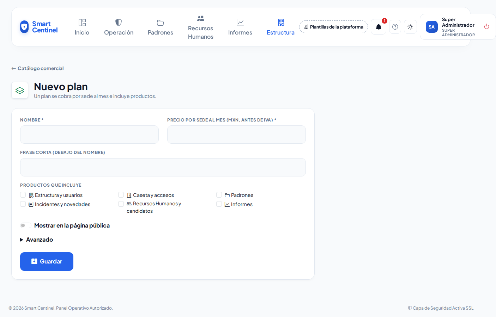
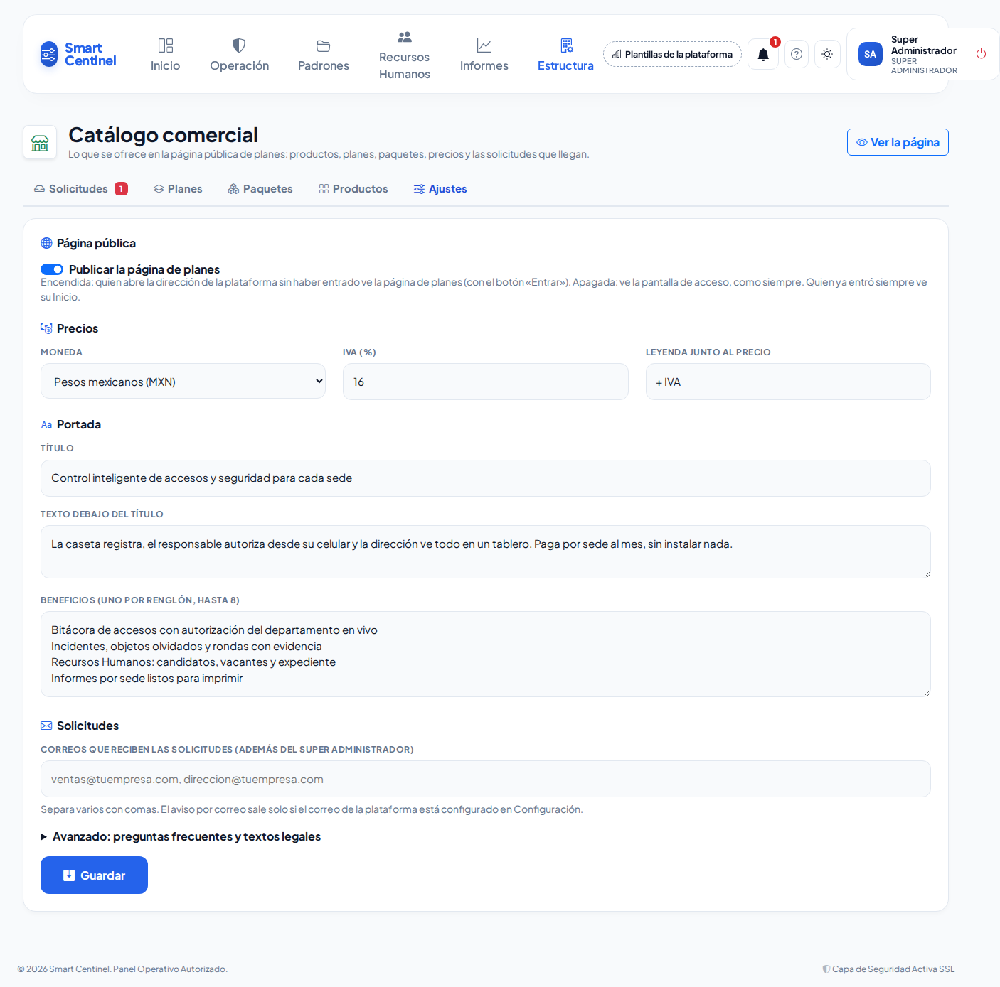
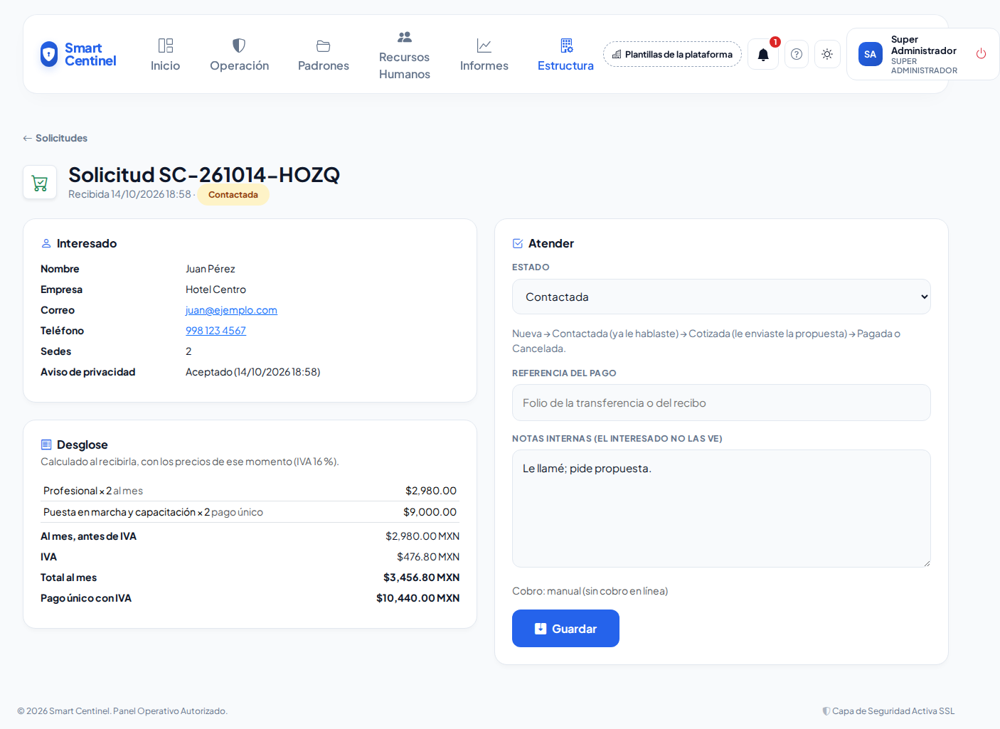
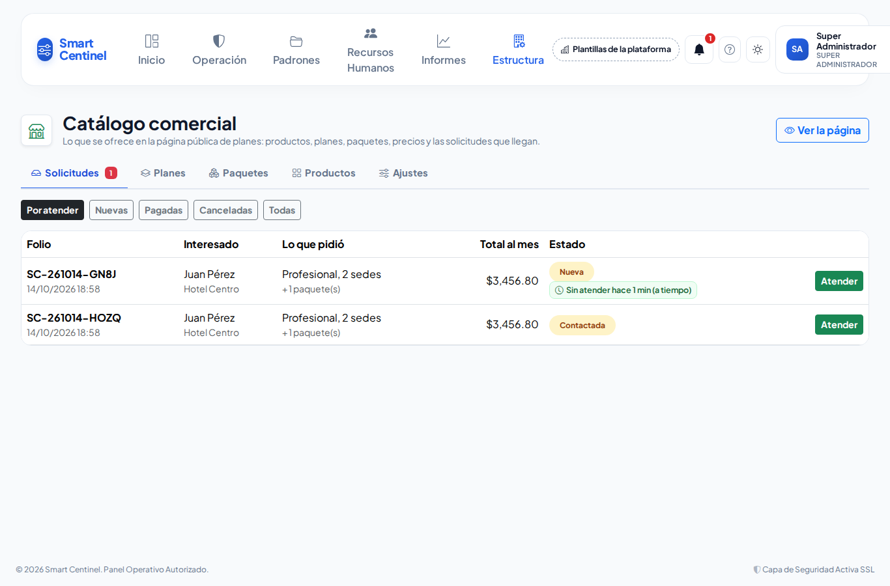

# Catálogo comercial y página de planes

**¿Para qué sirve?** Aquí decides **qué se ofrece y a qué precio** en la página pública de planes: los **productos** (módulos de la plataforma), los **planes** que se cobran **por sede al mes**, los **paquetes** que se suman (al mes o en un solo pago), la moneda y el IVA. También aquí llegan las **solicitudes** de quienes llenan el formulario «Contratar».

## Antes de empezar

- Esta pantalla solo la usa el **Super Administrador** de la plataforma. Los administradores de las empresas no la ven.
- La página pública nace **sin publicar** y con **precios de ejemplo**. Revisa precios, planes y textos antes de publicarla.
- Para que las solicitudes también lleguen por correo, el correo de la plataforma debe estar configurado en **Estructura → Configuración**.

## Cómo revisar la página antes de publicarla

1. Entra a **Estructura → Catálogo comercial**.
2. Toca **Ver la página** (arriba a la derecha). Se abre en otra pestaña con la franja amarilla «Vista previa: esta página todavía no está publicada; solo tú la ves».
3. Recorre la portada, los planes, los paquetes, la calculadora y las preguntas frecuentes.

**Qué debes ver:** la página tal como la verá un visitante, con el nombre, colores y símbolo de **Identidad de la plataforma**.

## Cómo cambiar el precio de un plan

1. En **Catálogo comercial** toca la pestaña **Planes**.
2. En el renglón del plan toca el lápiz (**Editar**).
3. Cambia el **Precio por sede al mes** (sin IVA) y, si quieres, la **Frase corta** y los **Productos que incluye**.
4. Toca **Guardar**.

**Qué debes ver:** «Plan «Profesional» guardado.» y el botón **Ver la página como la verá el público**.

## Cómo dar de alta un plan

1. En la pestaña **Planes** toca **Nuevo plan**.
2. Escribe el **Nombre** y el **Precio por sede al mes**.
3. Marca los **Productos que incluye**.
4. Enciende **Mostrar en la página pública** cuando el plan esté listo.
5. Si lo necesitas, abre **Avanzado**: **Sedes mínimas**, **Usuarios por sede incluidos** (vacío = ilimitados), **Recomendado** (se resalta; solo uno a la vez) y **Cotizar** (no muestra el precio; la persona pide una cotización).
6. Toca **Guardar**.

**Qué debes ver:** el plan en la lista. Si no encendiste «Mostrar en la página pública», el aviso te lo recuerda y el renglón dice **Oculto**.

## Cómo dar de alta un paquete

1. Toca la pestaña **Paquetes** y luego **Nuevo paquete**.
2. Escribe el **Nombre**, elige el **Cobro** (**Suscripción (al mes)** o **Venta directa (pago único)**) y escribe el **Precio**.
3. Marca los **Productos que incluye** y enciende **Mostrar en la página pública**.
4. En **Avanzado** indica si el precio es **por sede** y con qué planes **se puede sumar** (sin marcar ninguno, se suma a cualquiera).
5. Toca **Guardar**.

**Qué debes ver:** el paquete en la lista con su cobro, su precio y «Se suma a».

## Cómo cambiar el orden o dar de baja

1. En **Planes**, **Paquetes** o **Productos** usa las flechas **Subir** y **Bajar**: el orden de la lista es el de la página.
2. Para que algo deje de verse, toca el círculo rojo (**Dar de baja**) y confirma. Para regresarlo, toca la flecha circular (**Reactivar**).

**Qué debes ver:** «Orden guardado: así aparece en la página pública.» o «Plan «…» dado de baja: ya no se ve en la página pública. Su historial y las solicitudes se conservan.»

## Cómo agrupar módulos en un producto

1. Toca la pestaña **Productos** y luego **Nuevo producto** (o el lápiz de uno existente).
2. Escribe el **Nombre** y la **Clave** (minúsculas, por ejemplo `caseta_accesos`; no se cambia después).
3. Marca los **Módulos de la plataforma que habilita**.
4. En **Avanzado** escribe la **Descripción corta** que verá el visitante y el **Ícono**.
5. Toca **Guardar**.

## Cómo publicar la página y cambiar moneda, IVA y textos

1. Toca la pestaña **Ajustes**.
2. Enciende **Publicar la página de planes**. Desde ese momento, quien abre la dirección de tu plataforma **sin haber entrado** ve la página de planes con el botón **Entrar**. Quien ya entró sigue viendo su **Inicio**.
3. En **Precios** elige la **Moneda**, el **IVA (%)** y la **Leyenda junto al precio** (por ejemplo «+ IVA»).
4. En **Portada** cambia el **Título**, el texto de abajo y los **Beneficios** (uno por renglón).
5. En **Solicitudes** escribe los **correos** que, además del tuyo, reciben cada solicitud.
6. En **Avanzado** edita las **Preguntas frecuentes**, el **Texto legal** del pie y el **Aviso de privacidad**.
7. Toca **Guardar**.

**Qué debes ver:** «Ajustes guardados y página publicada: los visitantes ya la ven en la dirección de la plataforma.» Para retirarla, apaga el interruptor y toca **Guardar**.

> El texto legal y el aviso de privacidad que trae la página son un **borrador**: pide a tu abogado que los revise antes de publicar.

## Cómo atender una solicitud

Cuando alguien envía el formulario **Contratar**, te llega un aviso a la **campana** y un correo con el folio (por ejemplo `SC-261014-AB12`). La persona recibe un correo con su folio y su desglose.

1. Toca el aviso de la campana, o entra a **Catálogo comercial → Solicitudes**.
2. Las **Nuevas** muestran cuánto llevan esperando: verde (a tiempo), amarillo (más de 1 día) y rojo (más de 3 días).
3. Toca **Atender** en la solicitud.
4. Revisa los datos, lo que pidió y el **Desglose** (calculado con los precios del momento en que llegó).
5. Cambia el **Estado**: **Contactada** (ya le hablaste), **Cotizada** (le enviaste la propuesta), **Pagada** o **Cancelada**.
6. Si ya pagó, escribe la **Referencia del pago**. Usa **Notas internas** para lo que hablaron (la persona no las ve).
7. Toca **Guardar**.

**Qué debes ver:** «Solicitud … guardada como «Contactada».» y el botón para atender la siguiente nueva. El aviso de la campana se marca como leído.

## Si algo sale mal

| Mensaje o síntoma | Qué significa | Qué hacer |
|---|---|---|
| Escribe el precio por sede al mes, o marca «Cotizar» para no mostrar precio. | El plan no tiene precio. | Escribe el precio o, en **Avanzado**, marca **Cotizar**. |
| La clave solo lleva minúsculas, números y guion bajo… | La clave del producto tiene espacios o mayúsculas. | Escríbela como `caseta_accesos`. |
| Ya existe un producto con esa clave. | Otra clave igual. | Usa otra clave. |
| El IVA es un porcentaje entre 0 y 100. | El IVA está mal escrito. | Escribe por ejemplo `16`. |
| Revisa estos correos: … | Un correo de **Solicitudes** está incompleto. | Corrígelo o bórralo. |
| Un plan no aparece en la página. | Está **Oculto** o **De baja**. | Edítalo y enciende **Mostrar en la página pública**, o tócalo con **Reactivar**. |
| Los visitantes siguen viendo la pantalla de acceso. | La página no está publicada. | En **Ajustes** enciende **Publicar la página de planes** y toca **Guardar**. |
| No llegan los correos de las solicitudes. | El correo de la plataforma no está configurado. | Configúralo en **Estructura → Configuración**. Las solicitudes siempre llegan a la campana y a esta pantalla. |
| No tienes permiso para ver esto (error 403). | No eres Super Administrador. | Esta pantalla no es para tu rol. |

## Preguntas frecuentes

**¿Se cobra en línea?** Todavía no. La página registra la solicitud y te avisa; tú acuerdas el pago y lo anotas en la solicitud. La plataforma está preparada para conectar un cobro en línea más adelante.

**¿Si cambio un precio, cambian las solicitudes que ya llegaron?** No. Cada solicitud guarda el precio y el desglose del momento en que llegó.

**¿Cómo se calcula el total?** Precio del plan por sede × sedes (o las sedes mínimas del plan, si son más), más los paquetes; el IVA se suma aparte. Los paquetes de pago único se muestran por separado. La calculadora de la página y la solicitud usan exactamente la misma regla.

**¿Qué ve alguien que ya tiene cuenta?** Al abrir la dirección de la plataforma con su sesión iniciada ve su **Inicio**, como siempre. Si no ha entrado, ve la página de planes con el botón **Entrar**.

**¿Puedo quitar la página?** Sí: en **Ajustes** apaga **Publicar la página de planes** y toca **Guardar**.

## Relacionado

- [Identidad de la plataforma](identidad.md)
- [Configuración](configuracion.md)
- [Menús, Mis pendientes y modos de pantalla](menus.md)
