# Colaboradores

**¿Para qué sirve?** Es el directorio del personal de la empresa. Cada colaborador tiene un número de empleado, una sede física (o es corporativo), un departamento (área), un puesto (rango) y, si quieres, el turno que trabaja. La caseta los busca aquí para registrar accesos, préstamos de llaves, pases de salida y responsivas.

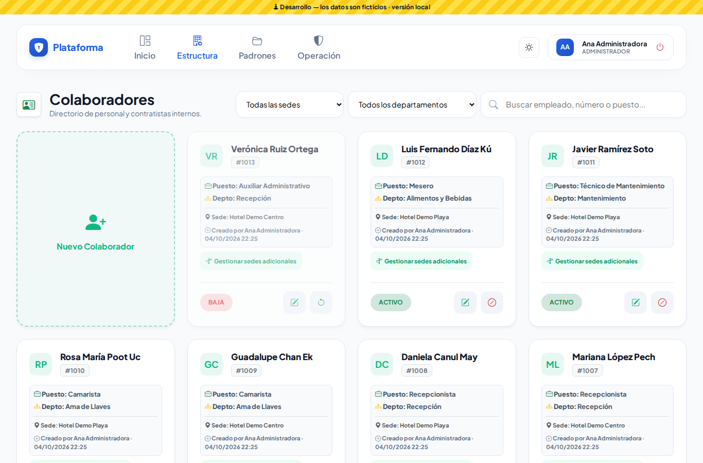

## Antes de empezar

- Para ver la pantalla tu rol debe poder consultar *Colaboradores*. Si no aparece en el menú, pide el permiso a tu administrador.
- Para dar de alta, editar o dar de baja necesitas esos permisos. Si no ves **Nuevo Colaborador**, tu rol solo consulta.
- **Colaboradores viene en todos los planes** (menú **Estructura**), como directorio: nombre, número, foto, sede, departamento, puesto, turno, gafete y altas por verificar. El **expediente** y los **datos legales** vienen con Recursos Humanos.
- Los **datos legales** (CURP, RFC, NSS, nacimiento, nacionalidad, correo personal y dirección) solo los ve y captura quien tiene el permiso **Datos personales**, y solo si tu plan incluye Recursos Humanos.
- Si tu rol es de una sede, solo puedes registrar colaboradores en tus sedes.
- Antes de dar de alta conviene tener listos los [Departamentos y Puestos](departamentos-y-puestos.md) y, si vas a asignar turnos, los [Turnos](turnos.md).

## Cómo encontrar a un colaborador

1. Entra a **Estructura → Colaboradores**.
2. Escribe en **Buscar empleado, número o puesto...** el nombre, el número de empleado, el puesto o el departamento.
3. Si quieres, elige en **Todas las sedes** (incluye a quienes la tienen como sede adicional) y en **Todos los departamentos**.
4. Con **Todos los turnos** ves solo a quienes trabajan en un turno (por ejemplo **Matutino (07:00–15:00)**), o a quienes aún no tienen uno con **Sin turno**. Este filtro aparece cuando la empresa tiene turnos.
5. Con **Todos los registros / Por verificar** ves solo los que registró la caseta y faltan por verificar.

**Qué debes ver:** las fichas que coinciden, con su número, puesto, departamento, turno (si tiene), sede y si está **ACTIVO**, **DE BAJA** o **POR VERIFICAR**. El filtro se mantiene mientras trabajas.

## Cómo dar de alta a un colaborador

1. Toca la tarjeta **Nuevo Colaborador**. Se abre **Alta de Colaborador**.
2. **1. Sede Física:** donde trabaja. Si la dejas en **-- Corporativo (todas las sedes) --**, trabaja en todas. Si tu rol es de una sede, es obligatoria.
3. **Núm. Empleado:** mientras escribes te avisa si ya existe.
4. **2. Departamento (área):** solo aparecen los que aplican en la sede elegida.
5. **3. Puesto (rango):** se acota según el departamento. Los puestos sin departamento (por ejemplo *Gerente*) siempre aparecen.
6. Escribe **Nombre(s)**, **Apellido Paterno**, **Apellido Materno** y, si quieres, el **Teléfono** (10 dígitos; puedes escribir espacios o guiones).
7. **Turno (opcional):** elige el horario que trabaja. Solo aparecen los turnos activos que se usan en la sede elegida; si no sabes, déjalo en **-- Sin turno --** y lo completas después.
8. Si tienes el permiso, llena **Datos Legales y de Contacto (Opcionales)**: CURP, RFC, NSS, Fecha de Nacimiento, Estado de Nacimiento, Nacionalidad, **Correo Personal** y **Dirección Completa** (ya no hace falta abrir la ficha otra vez para capturarlos). El CURP y el RFC se pasan a mayúsculas solos.
9. Toca **Guardar**.

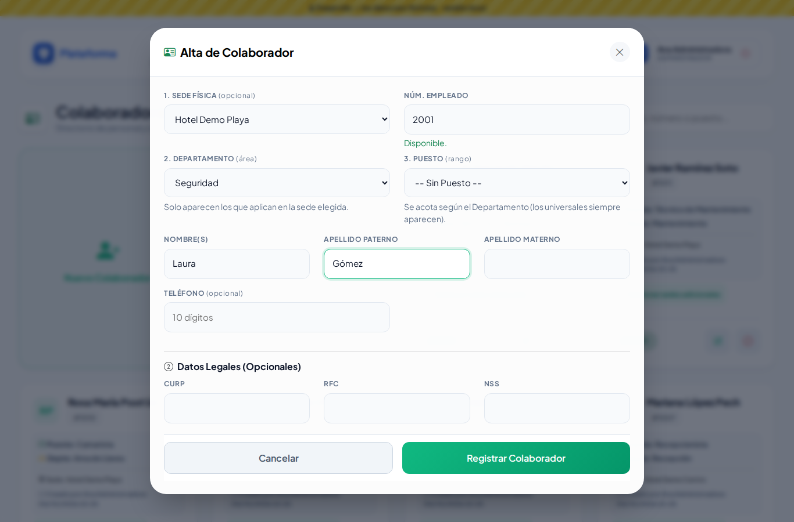

**Qué debes ver:** «Colaborador «Juan Pérez López» creado correctamente.»

### Avisos mientras escribes

- **Núm. Empleado:** verde «Número disponible.»; rojo «Ya existe un colaborador con el número «1001» en esta empresa. No se puede repetir.» (si es de una sede que no tienes a cargo, solo te dice que existe).
- **Nombre y apellidos:** amarillo «Ya existe un colaborador con ese nombre. ¿Es la misma persona? Si lo es, no lo des de alta otra vez: búscalo en la lista.» Si es otra persona con el mismo nombre, continúa normalmente.

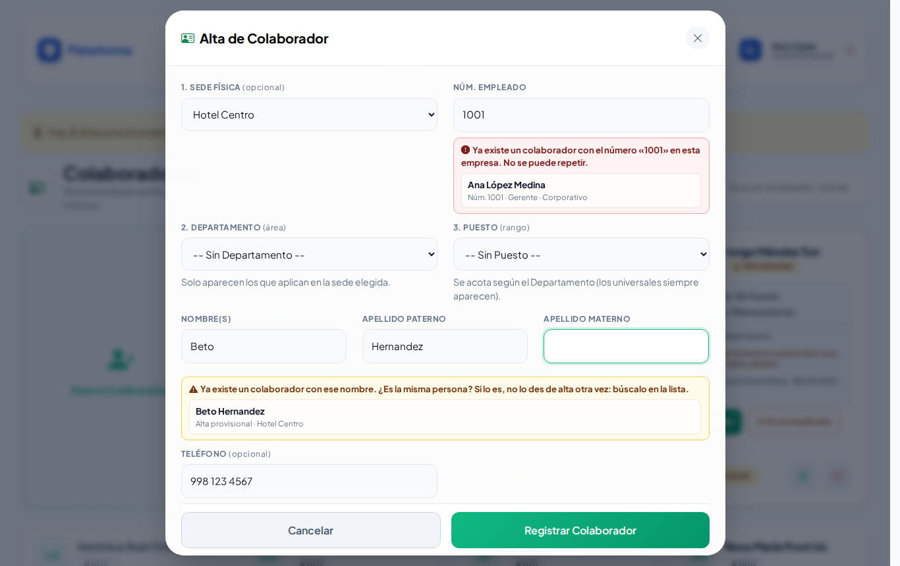

## Cómo dar de alta a muchos colaboradores desde Excel

Si vas a cargar toda tu plantilla de personal, no la captures uno por uno:

1. Toca **Importar** (arriba, junto al buscador).
2. Toca **Descargar plantilla**, llénala en Excel (una fila por colaborador; el **Número de empleado**, el **Nombre(s)** y el **Apellido paterno** son obligatorios) y guárdala.
3. Toca **Elegir archivo**, elige tu archivo y toca **Revisar archivo**.
4. Revisa la vista previa (**Nueva**, **Ya existe** o **Con error**, con el motivo en la celda) y toca **Guardar**.

**Qué debes ver:** «Listo: 120 nuevos.» con los botones **Ir a Colaboradores** y **Descargar resultado**. Los que ya existían (mismo número de empleado) se dejan como están o se actualizan, según lo que elijas. El CURP, RFC y NSS solo se toman si tu rol ve datos personales. Paso a paso, con la hoja de instrucciones, en [Importar desde Excel](importar-desde-excel.md).

## Cómo editar a un colaborador

1. Toca el **lápiz** (Editar) de la ficha. Se abre **Editar Colaborador**.
2. Corrige lo que haga falta (los mismos datos del alta, incluido el **Turno**; para quitárselo elige **-- Sin turno --**).
3. Toca **Guardar**.

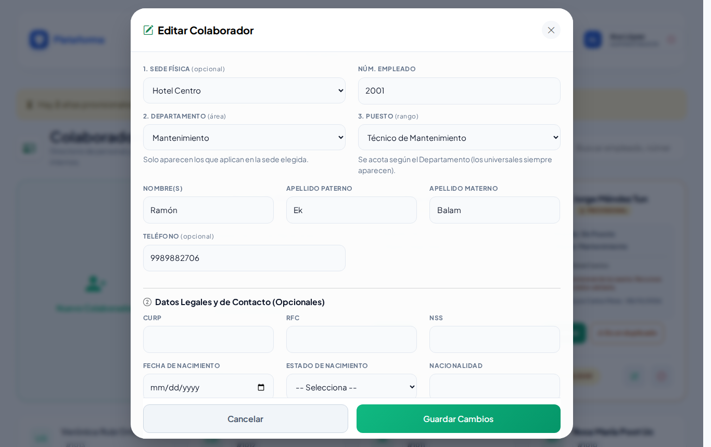

**Qué debes ver:** «Colaborador «…» actualizado correctamente.»

## Cómo asignar sedes adicionales

Si alguien trabaja en más de una sede (por ejemplo un agente que cubre turnos en otra sede):

1. Toca **Gestionar sedes adicionales** en su ficha.
2. Marca las sedes donde **también** trabaja, además de la principal.
3. Toca **Guardar**.

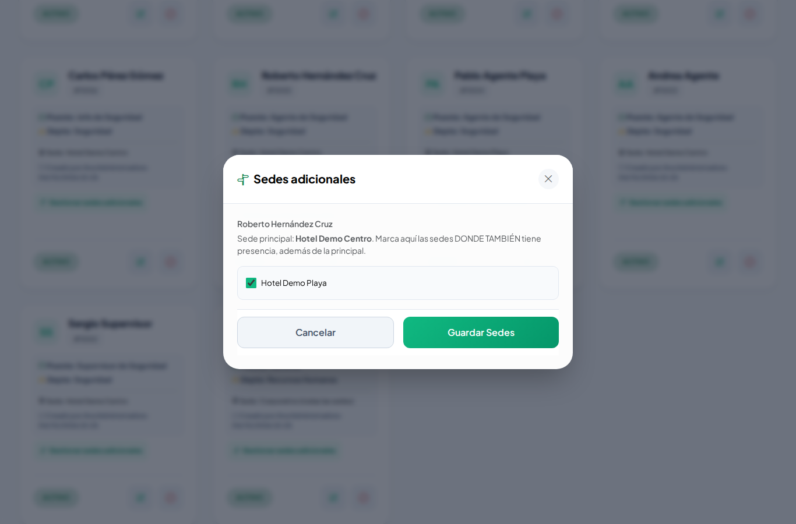

**Qué debes ver:** «Sedes adicionales de «…» actualizadas.» La ficha dice «+1 sede adicional» y aparece al filtrar por esa sede. Si tu rol es de una sede, solo ves tus sedes; las demás se conservan.

## Cómo dar de baja o reingresar a un colaborador

1. Toca el **círculo rojo** (Dar de baja) y confirma con **Aceptar** («¿Dar de baja a este colaborador? Podrás reactivarlo con el mismo botón.»).
2. Para regresarlo, toca la **flecha circular** (Reingresar) y confirma.

**Qué debes ver:** la ficha **DE BAJA**. Ya no aparece al buscarlo desde otros módulos. No se borra a nadie: su historial en bitácoras, pases y responsivas se conserva.

> Si tiene cosas vigentes (llaves prestadas, equipos a su cargo, vehículos, está en sitio o es el único responsable de un departamento), antes de confirmar se abre [Antes de dar de baja](antes-de-dar-de-baja.md) con la lista y lo que pasará con cada una.

**Si tiene cuenta de usuario:** al darlo de baja **su cuenta se da de baja sola** (ya no puede entrar y se le cierra la sesión). El mensaje lo dice: «También se dio de baja su cuenta de usuario «@…»; puedes reactivarla en Usuarios.» Quien administra usuarios de esa sede recibe el aviso en su campana. Al **reingresarlo**, la cuenta **no** se reactiva sola: el mensaje te lo recuerda («Su cuenta de usuario sigue dada de baja: reactívala en Usuarios si la necesita») y se hace desde [Usuarios](usuarios.md) con la **flecha circular** de su ficha.

## Cómo ver el código QR y asignar el gafete o tarjeta NFC / RFID

Cada colaborador tiene su propio **código QR** y puede tener una **etiqueta NFC / RFID** (su gafete o tarjeta). Con ellos la caseta lo encuentra al escanear en Accesos, Préstamo de llaves o Pases de salida.

1. En la ficha del colaborador toca el ícono de **QR** (Código QR e identificación), o abre su ficha con la **carpeta** y entra a la pestaña **Código y etiqueta**. Se abre **Código e identificación** con su nombre, su número de empleado, el QR y la dirección del código (botón **Copiar**).
2. Si tu rol puede editar colaboradores, abajo aparece **Asignar etiqueta NFC / RFID**: acerca el gafete o la tarjeta al lector USB/Bluetooth o al NFC del celular Android, o escribe su número, y toca **Guardar etiqueta**.
3. Si ya tenía una etiqueta, se muestra la actual; al guardar otra, la anterior deja de funcionar.
4. Para imprimir su credencial toca **Imprimir credencial**: abre [Etiquetas QR](etiquetas-qr.md) ya filtrado a ese colaborador; marca su casilla, elige la plantilla (por ejemplo **Gafete**) y toca **Imprimir**. Lo ves si puedes editar colaboradores y usar Etiquetas QR.

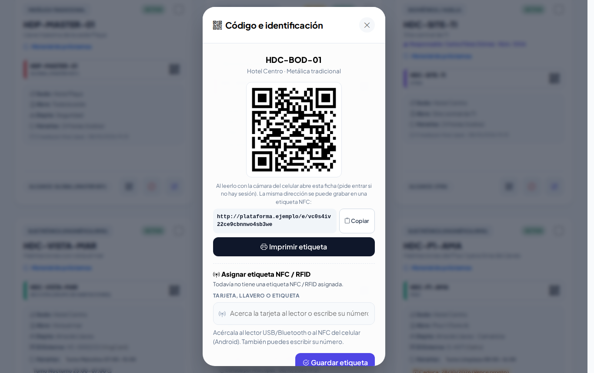

**Qué debes ver:** «Etiqueta … asignada. Ya se puede leer con el lector.» Si esa tarjeta ya es de otra cosa (otro colaborador, una llave, un vehículo…), el aviso te dice de cuál y no se asigna.

- Quien solo consulta colaboradores ve el QR, pero no el apartado para asignar la etiqueta.
- Los registrados en la caseta (**POR VERIFICAR**) reciben su etiqueta hasta que se verifican.

## Cómo registrar a un colaborador desde la caseta (queda por verificar)

Si en la caseta necesitas registrar a alguien que **no aparece** al buscarlo:

1. Toca la tarjeta **Registro rápido** (también aparece dentro de los formularios de accesos, préstamos y pases como «¿No aparece? Darlo de alta provisional»). Se abre **Registro Rápido de Colaborador**.
2. Escribe **Nombre(s)**, **Apellido Paterno** y elige la **Sede**. El **Número de Empleado** solo si lo sabes.
3. Si ya hay alguien con ese nombre, la plataforma te lo muestra («Ya hay alguien registrado con ese nombre. Si es la misma persona, úsala; si no, confirma que es otra.»): tócalo para usarlo, o toca **Es otra persona: registrarla**.
4. Toca **Guardar**.

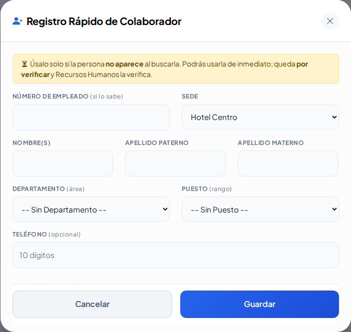

**Qué debes ver:** la persona queda marcada **POR VERIFICAR** y ya la puedes usar. Recursos Humanos (o, si tu plan no lo incluye, el administrador) la revisará después; cuando la verifique (o la una con su registro) te llega el resultado a la **campana**.

## Cómo verificar lo que registró la caseta (Recursos Humanos o administrador)

Lo verifica Recursos Humanos si tu plan lo incluye; si no, el administrador de tu empresa.

1. Te llega a la **campana** «Alta por verificar: …» con el botón **Verificar**. También aparece en **Inicio** («N colaboradores por verificar») y en **Mis pendientes** («Colaboradores por verificar»). Tócalo y llegas a la lista filtrada. Dentro de Colaboradores también verás el aviso.
2. Elige **Por verificar** en el filtro.
3. En cada ficha elige:
   - **Verificar:** revisa y corrige los datos, asigna su **Núm. Empleado** y toca **Guardar y verificar**. Desde ese momento es un colaborador normal. Verás «… verificado con el número …».
   - **Es un duplicado:** si la persona ya estaba registrada (por ejemplo «Beto Hernandez» es Roberto Hernández), busca y elige el **Colaborador correcto** y toca **Unir registros**. Todo lo que la caseta registró con esa alta pasa a ese colaborador y el alta queda dada de baja (unida).

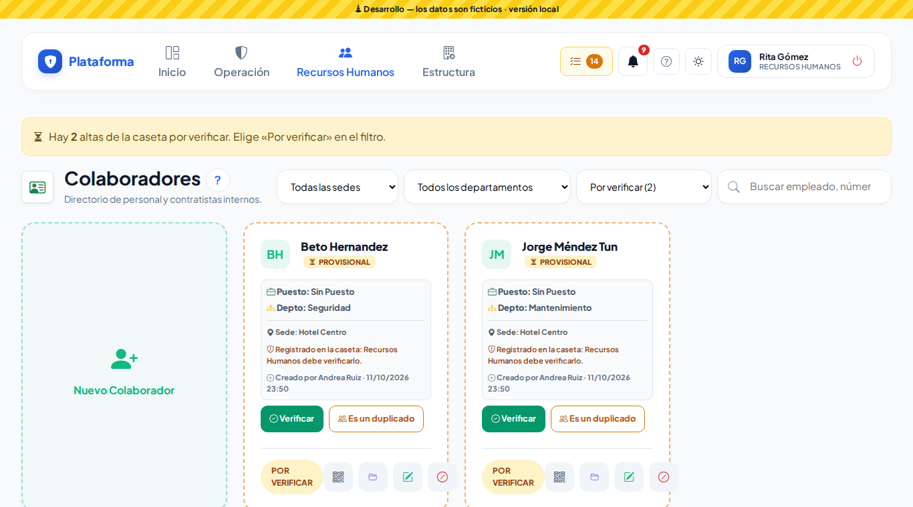

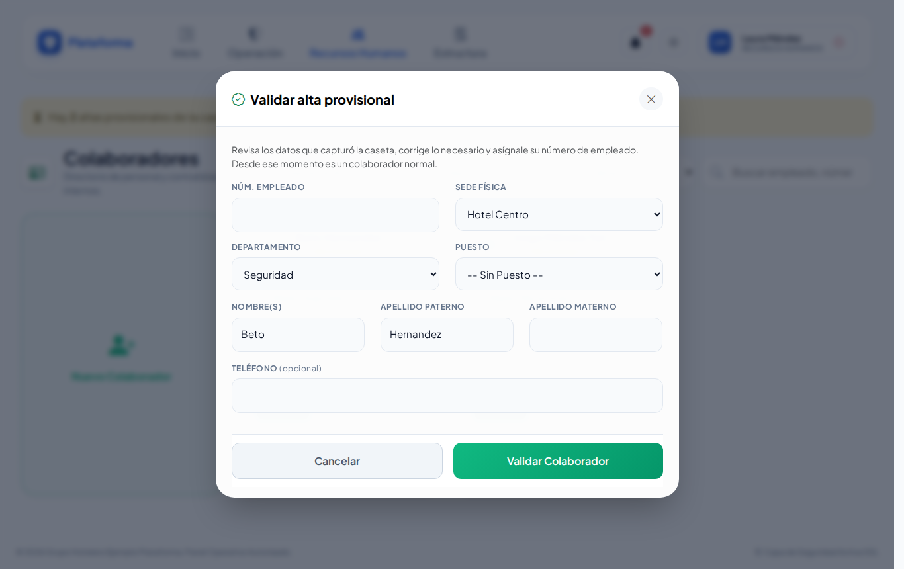

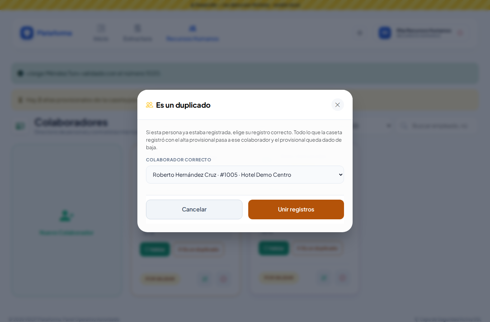

**Qué debes ver:** ««Beto Hernandez» validado con el número 2047.» o ««Beto Hernandez» se unió con «Roberto Hernández Cruz» (#1005).»

## Cómo ver la ficha de un colaborador

La ficha reúne en una sola pantalla lo que la plataforma sabe de la persona, ordenado en pestañas.

1. En **Estructura → Colaboradores**, busca al colaborador y toca el icono de **carpeta** (**Ficha**) de su renglón. También llegas desde su ficha de candidato, en **Documentos** (se abre directo en la pestaña **Expediente**).
2. Arriba ves su nombre y, debajo, las pestañas. Toca la que necesites (en el celular puedes deslizar la barra de pestañas; con el teclado usa las **flechas** izquierda y derecha):
   - **Datos:** estado, número de empleado, sede, departamento, puesto, **turno**, teléfono, fecha de alta y cuenta de usuario, más sus **llaves a su cargo** (también las que **NO REGRESÓ**), **resguardos en campo**, lo que **no regresó** (equipos de sus responsivas o de pases que pidió, y gafetes) y **procedimientos por leer**.
   - **Expediente:** sus **datos legales y de contacto** (CURP, RFC, NSS, nacimiento, nacionalidad, correo y dirección) y sus **documentos de contratación** (los que entregó como candidato, escaneados o recibidos en papel).
   - **Código y etiqueta:** su **código QR**, la dirección del código y su **etiqueta NFC / RFID**. El botón **Código e identificación** abre la misma ventana que el ícono de QR de la lista (ahí se asigna la etiqueta si tu rol puede editar colaboradores); al lado está **Imprimir credencial**.
   - **Historial:** **movimientos del registro** (alta, verificación, ediciones, bajas, reingresos, cambios de sedes y de etiqueta, con quién y cuándo), **su paso por Candidatos** (vacante, entrevistas y calificaciones, fecha de contratación y de firma del contrato), sus **accesos recientes** y sus **pases de salida**.
3. Si copias la dirección de la página con una pestaña abierta y la compartes, se abre en esa misma pestaña.

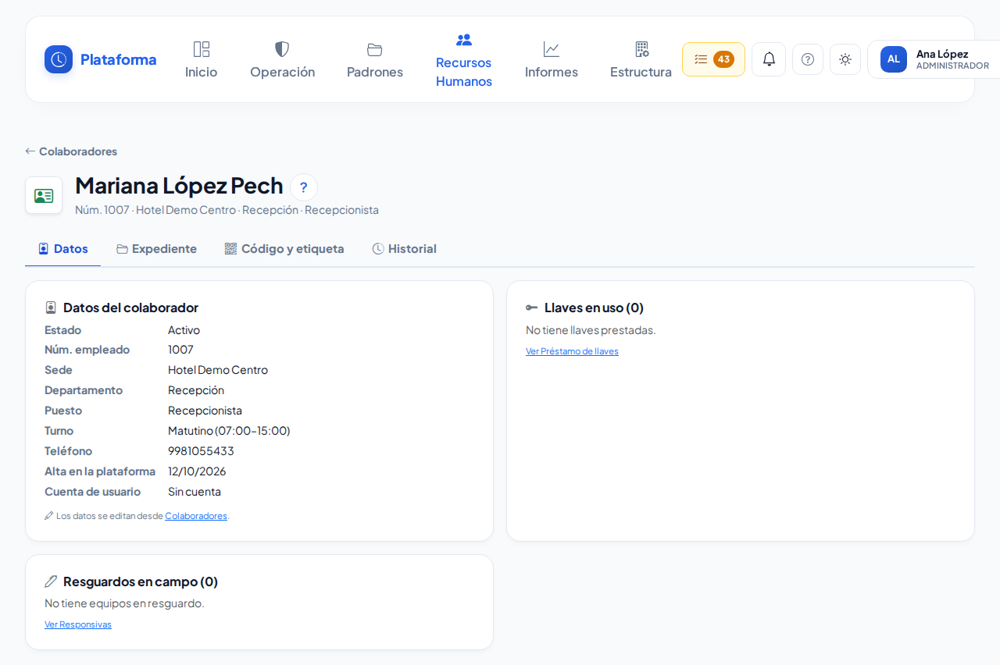

**Qué debes ver:** solo las pestañas y apartados que tu rol puede ver. La pestaña **Expediente** son datos personales: si tu rol no tiene el permiso **Datos personales**, no aparece. **Su paso por Candidatos** solo lo ve quien puede consultar Candidatos, y **Ver el detalle en la Bitácora de auditoría** quien puede ver la bitácora.

## En el celular y en modo Noche

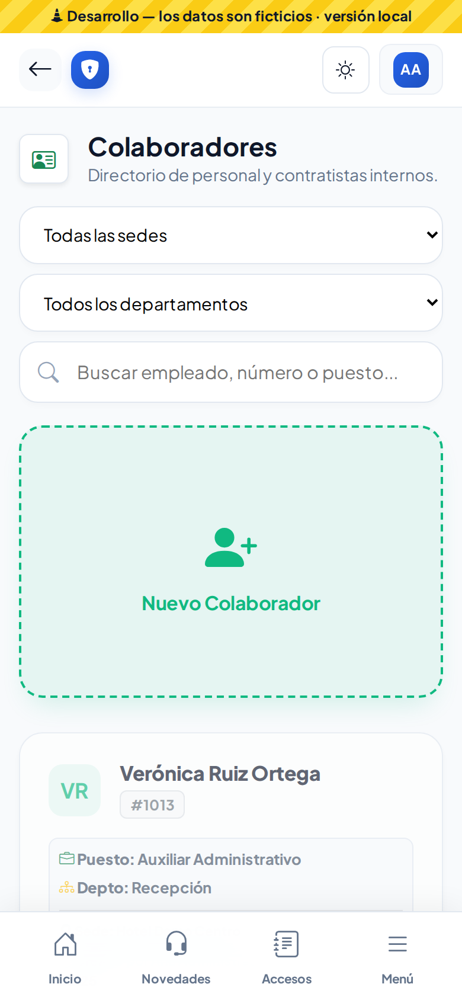 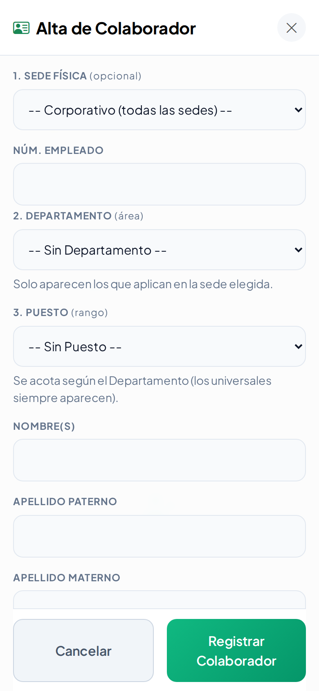 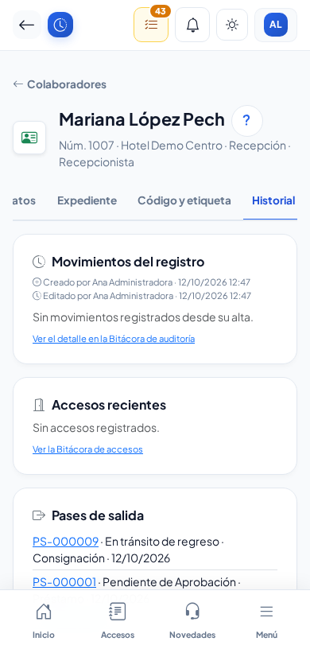

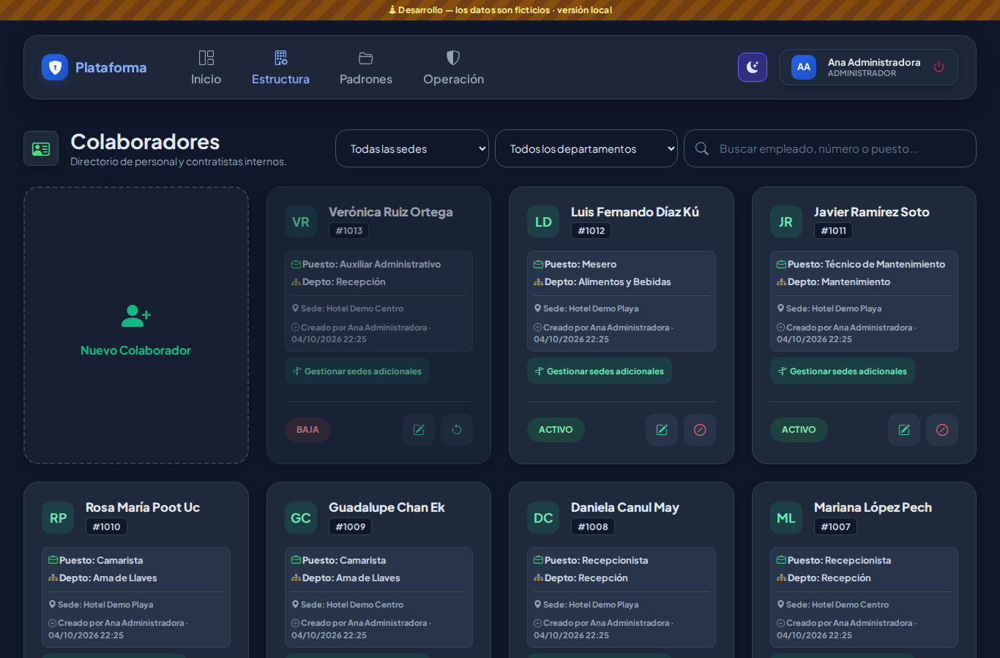

## Si algo sale mal

Los mensajes salen en rojo dentro de la ventana; lo que escribiste se conserva.

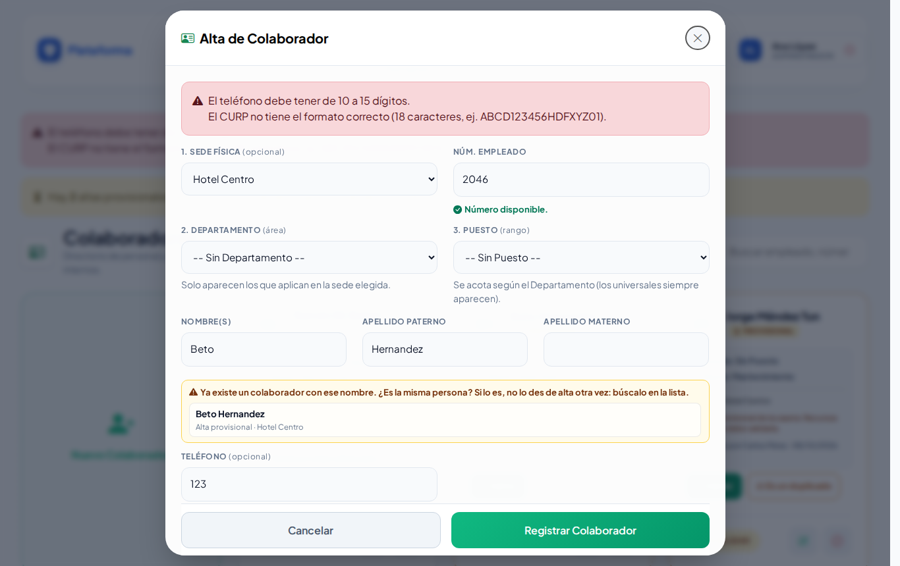

| Mensaje o síntoma | Qué significa | Qué hacer |
|---|---|---|
| Ya existe otro colaborador registrado con ese número de empleado. | El número ya se usa. | Revisa el número con Recursos Humanos. |
| Ya existe otro colaborador registrado con ese CURP. / RFC. / NSS. | Esa persona ya está registrada. | Búscala en la lista (puede estar de baja). |
| El CURP no tiene el formato correcto (18 caracteres, ej. ABCD123456HDFXYZ01). | El CURP está incompleto. | Cópialo de su documento. |
| El RFC no tiene el formato correcto (12 o 13 caracteres, ej. ABCD123456XYZ). | El RFC está incompleto. | Corrígelo o déjalo vacío. |
| El NSS debe tener exactamente 11 dígitos. | Faltan o sobran números. | Corrige el NSS. |
| El teléfono debe tener de 10 a 15 dígitos. | Faltan números. | Escribe el teléfono con lada. |
| La fecha de nacimiento debe ser anterior a hoy. | La fecha está mal. | Corrige la fecha. |
| Elige una de tus sedes: solo puedes registrar colaboradores en ellas. | Elegiste una sede que no es tuya. | Elige una de tus sedes. |
| El departamento «…» no aplica en la sede elegida. | Ese departamento no se usa en esa sede. | Elige otro o agrégale la sede en Departamentos. |
| El puesto «…» no aplica en el departamento elegido. | El puesto es de otro departamento. | Elige otro puesto. |
| El turno «…» no se usa en la sede elegida. | Ese turno no está marcado para esa sede. | Elige otro turno o agrégale la sede en [Turnos](turnos.md). |
| El turno no existe en esta empresa o está desactivado. | El turno se desactivó mientras capturabas. | Elige otro turno o déjalo **-- Sin turno --**. |
| No aparece el turno que busco. | Está desactivado o no se usa en la sede elegida. | Revísalo en [Turnos](turnos.md). |
| No veo la pestaña **Expediente** en la ficha. | Tu rol no tiene el permiso **Datos personales**. | Pídelo a tu administrador si lo necesitas. |
| Este colaborador ya no está pendiente de verificar. | Otra persona ya lo verificó o lo unió. | Recarga la página. |
| Elige un colaborador activo y ya validado. | Al unir elegiste uno inválido. | Elige el colaborador correcto. |
| No veo el apartado **Asignar etiqueta NFC / RFID**. | Tu rol solo consulta colaboradores, o el colaborador está **POR VERIFICAR**. | Pide a quien verifica (Recursos Humanos o el administrador) que lo verifique, o el permiso de editar a tu administrador. |
| No veo los datos legales. | Tu rol no tiene el permiso **Datos personales**. | Pídelo a tu administrador si lo necesitas. |

## Preguntas frecuentes

**¿Dónde están los documentos que entregó al contratarse?** En su ficha (icono de carpeta en su renglón), pestaña **Expediente**, si tu rol puede ver datos personales.

**¿Dónde veo cuándo se dio de baja o reingresó?** En su ficha, pestaña **Historial**, apartado **Movimientos del registro**.

**¿Qué pasa si desactivan el turno que tiene?** Lo conserva y la ficha dice «turno desactivado». Al editarlo puedes dejarlo o cambiarlo por uno activo. Si el turno se elimina, el colaborador queda **Sin turno**.

**¿Se puede borrar a un colaborador?** No. Se da de baja y se puede reingresar; así se conserva su historial.

**¿Qué significa «Corporativo»?** Que el colaborador no pertenece a una sede en particular y trabaja en todas.

**¿Por qué no aparece un departamento al dar de alta?** Porque no aplica en la sede elegida. Revísalo en [Departamentos y puestos](departamentos-y-puestos.md).

**¿Quién ve el CURP, RFC y NSS?** Solo quien tiene el permiso **Datos personales**. En la bitácora de auditoría se ven ocultos (solo los últimos 4 caracteres).

**¿Para qué sirve su QR si ya tiene gafete?** El QR se lee con la cámara de cualquier celular o tableta; el gafete NFC / RFID con el lector. Los dos llevan a la misma ficha.

**¿Cómo le doy una cuenta para entrar a la plataforma?** En [Usuarios](usuarios.md), vinculando la cuenta con su ficha de colaborador.

## Relacionado

- [Departamentos y puestos](departamentos-y-puestos.md)
- [Turnos](turnos.md)
- [Usuarios](usuarios.md)
- [Altas por verificar](altas-por-verificar.md)
- [Importar desde Excel](importar-desde-excel.md)
