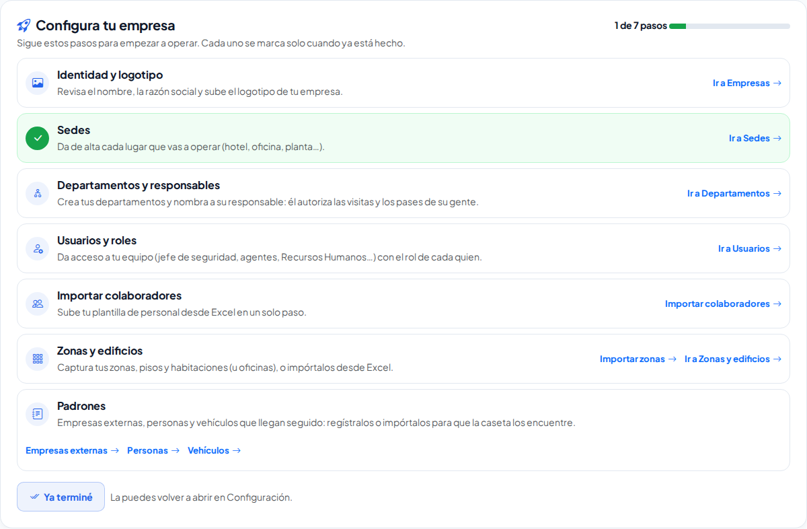
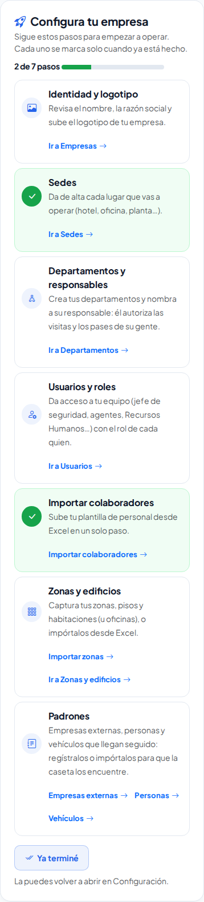

# Configura tu empresa

**¿Para qué sirve?** Cuando tu empresa es nueva en la plataforma, la pantalla de **Inicio** te muestra la tarjeta **Configura tu empresa** con los pasos para empezar a operar, en orden, cada uno con su botón para ir directo. No tienes que marcar nada: cada paso se pone en verde solo cuando la plataforma ve que ya lo hiciste.

**Antes de empezar:** la tarjeta la ve quien administra la **Configuración** de la empresa (normalmente el Administrador). Si no la ves y la necesitas, ábrela desde **Estructura → Configuración** (ver abajo) o pide a tu administrador que lo haga.

## Los pasos

| Paso | Qué hacer | Se marca solo cuando… |
|---|---|---|
| 1. Identidad y logotipo | Revisa el nombre y la razón social y sube el logotipo en **Estructura → Empresas**. | La empresa tiene logotipo. |
| 2. Sedes | Da de alta cada lugar que vas a operar. | Hay al menos una sede activa. |
| 3. Departamentos y responsables | Crea los departamentos y nombra a su responsable. | Hay un departamento con responsable. |
| 4. Usuarios y roles | Da acceso a tu equipo con el rol de cada quien. | Hay al menos otro usuario activo además de ti. |
| 5. Importar colaboradores | Sube tu plantilla de personal desde Excel. | Hay colaboradores activos. |
| 6. Zonas y edificios | Captura o importa tus zonas, pisos y habitaciones. | Hay al menos una zona o edificio. |
| 7. Padrones | Registra o importa empresas externas, personas y vehículos. | Hay al menos un registro en alguno de los tres padrones. |

## Cómo usar la tarjeta

1. Entra a la plataforma; la tarjeta aparece en **Inicio**, arriba de tus pendientes.
2. Lee el paso que sigue y toca su botón (por ejemplo **Ir a Sedes** o **Importar colaboradores**).
3. Haz lo que pide la pantalla y regresa a **Inicio**.

**Qué debes ver:** el paso que terminaste aparece con una palomita verde y el avance de arriba sube (por ejemplo «3 de 7 pasos»). Cuando terminas los siete dice **¡Tu empresa está lista!**

En el celular la tarjeta se ve igual, con los botones debajo de cada paso.

## Cómo ocultarla («Ya terminé»)

1. En la tarjeta, toca **Ya terminé**.

**Qué debes ver:** el aviso verde «Ocultamos «Configura tu empresa» de Inicio…» con el botón **Ir a Configuración**. La tarjeta ya no sale en Inicio para nadie de tu empresa.

## Cómo volver a mostrarla

1. Abre **Estructura → Configuración**.
2. En la tarjeta **Configura tu empresa** (arriba) ves cuántos pasos llevas y si se ve en Inicio.
3. Toca **Mostrar en Inicio** (o **Ocultar de Inicio** si ya se ve).

**Qué debes ver:** el aviso verde «Listo: «Configura tu empresa» ya se ve en Inicio.» y la tarjeta de nuevo en **Inicio**.

## Si algo sale mal

| Mensaje o síntoma | Qué significa | Qué hacer |
|---|---|---|
| No veo la tarjeta en Inicio | Alguien tocó **Ya terminé**, o tu empresa ya tenía datos cuando empezó a usar la plataforma. | Ábrela desde **Estructura → Configuración → Mostrar en Inicio**. |
| Un paso no se pone en verde | Falta el dato con el que se marca (por ejemplo, el departamento existe pero aún no tiene responsable). | Revisa la columna «Se marca solo cuando…» de la tabla de arriba. |
| Un paso no tiene botón | Tu rol no puede abrir esa pantalla. | Pide a quien administra la plataforma que haga ese paso o te dé el permiso. |
| No veo **Configura tu empresa** en Configuración | Tu rol no puede editar la Configuración. | Pide a tu administrador que la muestre u oculte. |

## Preguntas frecuentes

**¿Tengo que hacer los pasos en orden?** Es lo recomendado (por ejemplo, las sedes antes que los colaboradores), pero cada paso se marca en cuanto está hecho, sin importar el orden.

**¿Ocultarla borra algo?** No. Solo deja de mostrarse en Inicio; todo lo que capturaste se queda.

**¿La ven todos los usuarios?** No, solo quien administra la Configuración de la empresa.

## Relacionado

- [Importar desde Excel](importar-desde-excel.md)
- [Configuración](configuracion.md)
- [Primeros pasos](primeros-pasos.md)
