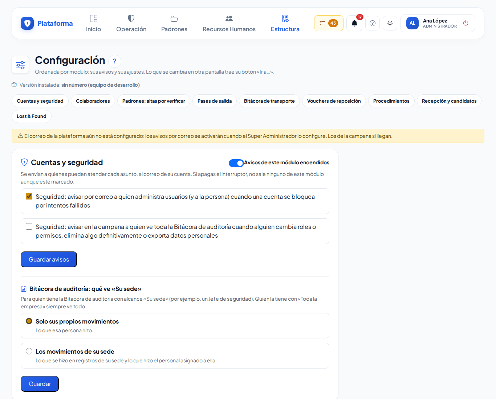
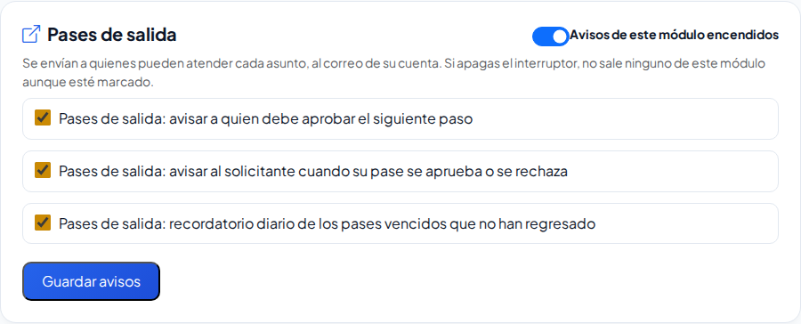
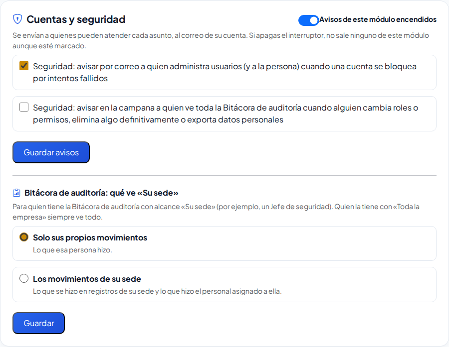
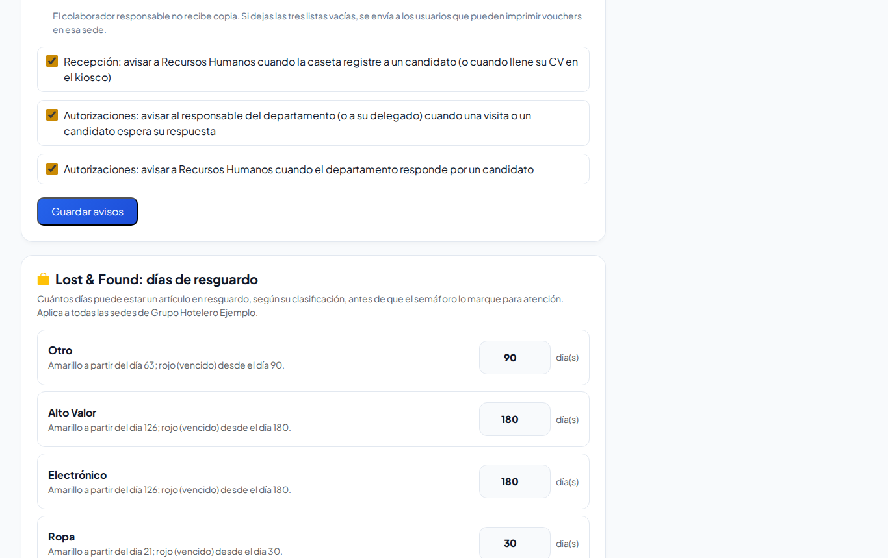
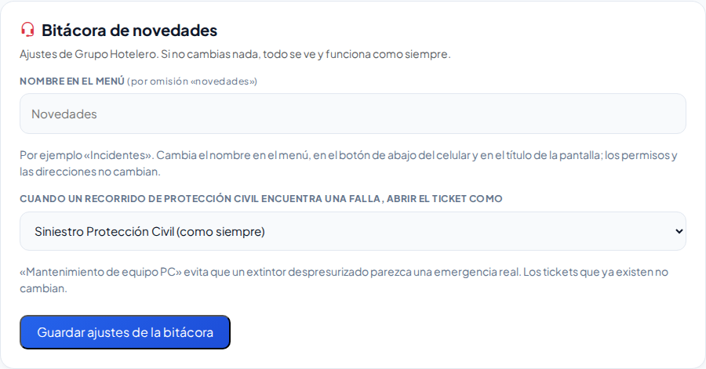
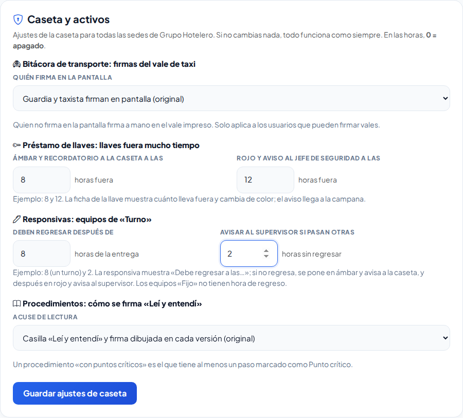
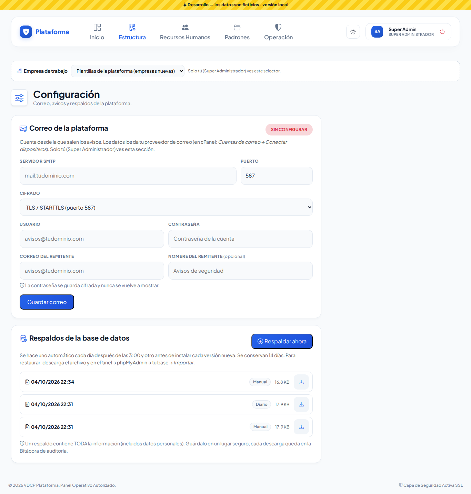
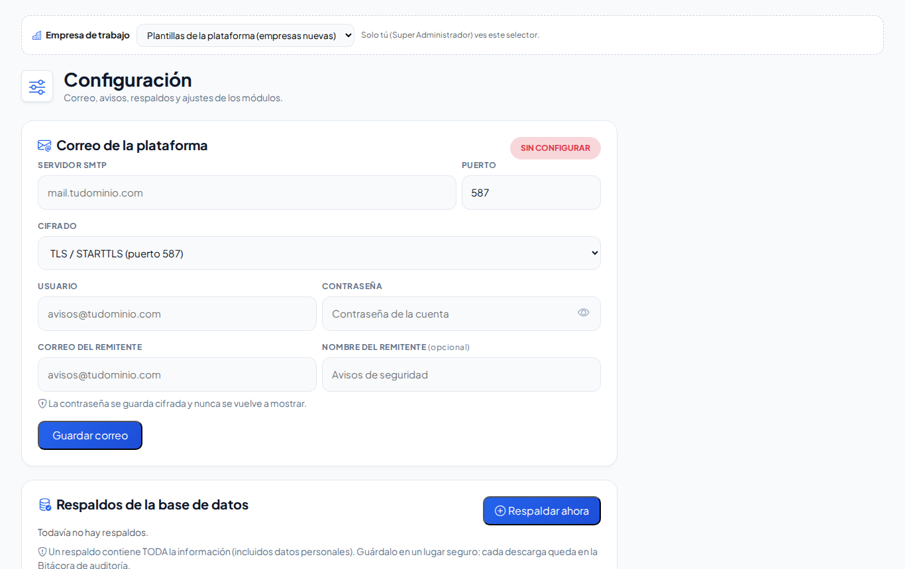

# Configuración

**¿Para qué sirve?** Aquí se ajusta cómo trabaja la plataforma para tu empresa, **ordenado por módulo**: cada módulo (Cuentas y seguridad, Bitácora de novedades, Pases de salida, Procedimientos, Recepción y candidatos…) tiene su tarjeta con sus avisos, un **interruptor general** para encenderlos o apagarlos todos, y sus ajustes (por ejemplo, si el módulo de la bitácora se llama **Novedades** o **Incidentes**). Aparte están la **caseta y los activos** (firmas de vales de taxi, llaves fuera mucho tiempo, equipos de turno y acuse de procedimientos) y los días de resguardo de **Lost & Found**. Arriba dice la **versión instalada**. El Super Administrador configura además el **correo de la plataforma** y los **respaldos**.

## Antes de empezar

- Para ver la pantalla tu rol debe poder consultar *Configuración*.
- Los avisos de la empresa los cambia quien tiene el permiso **editar** de Configuración con alcance de empresa (normalmente el administrador).
- Los días de Lost & Found los cambia quien tiene el permiso **Configurar** de Lost & Found en toda la empresa.
- **Correo de la plataforma** y **Respaldos** solo los ve el Super Administrador.
- Si el correo de la plataforma aún no está configurado, verás el aviso «El correo de la plataforma aún no está configurado: los avisos se activarán cuando el Super Administrador lo configure.»

## Cómo elegir los avisos por correo

1. Entra a **Estructura → Configuración**. Arriba están los módulos como botones: toca uno para ir directo a su tarjeta.
2. En la tarjeta del módulo, el interruptor **Avisos de este módulo encendidos / apagados** enciende o apaga **todos** los avisos de ese módulo de un solo toque (por ejemplo, un condominio que no usa Pases de salida).
3. Con el interruptor encendido, marca los avisos que quieres que lleguen. Por ejemplo:
   - **Colaboradores:** avisar a Recursos Humanos cuando la caseta registre un alta provisional.
   - **Bitácora de transporte:** enviar cada vale de taxi (escribe en **Correos que lo reciben** uno por línea o separados por coma).
   - **Pases de salida:** aprobación, resultado, recordatorio de pases vencidos y, si pusiste tiempos en el Circuito, recordar al firmante y avisar al siguiente nivel cuando una firma tarda.
   - **Padrones: altas por verificar** en Vehículos, Empresas externas o Personas.
   - **Bitácora de novedades:** tickets canalizados y pendientes de turno sin atender; hallazgos de los Recorridos de Protección Civil (vienen **apagados**: la campana avisa siempre).
   - **Procedimientos:** publicados, recordatorios y procedimientos enviados a revisión (a quien puede aprobarlos).
   - **Vouchers de reposición** con cobro al colaborador: escribe los correos de **Copia Seguridad**, **Copia Recepción** y **Copia Administración**. Si dejas las tres listas vacías, se envía a los usuarios que pueden imprimir vouchers en esa sede. El colaborador responsable no recibe copia.
   - **Recepción y candidatos** y las autorizaciones de los departamentos.
   - **Cuentas y seguridad:** cuenta bloqueada y **movimientos sensibles** (ver abajo).
4. Toca **Guardar avisos** en esa tarjeta (guarda los avisos de todos los módulos).

**Qué debes ver:** «Avisos actualizados.» y, si apagaste alguno, «Apagados por módulo: …». Los avisos se envían a los usuarios con permiso para atender cada asunto, al correo de su cuenta. Si una persona no quiere recibir alguno, lo silencia ella misma en [Mi cuenta](mi-cuenta.md) → **Mis avisos**.

## Cómo recibir avisos de movimientos sensibles

En **Cuentas y seguridad** marca «Seguridad: avisar en la campana a quien ve toda la Bitácora de auditoría cuando alguien cambia roles o permisos, elimina algo definitivamente o exporta datos personales» y toca **Guardar avisos**. Viene **apagado**. Encendido, quien ve toda la Bitácora de auditoría (normalmente Administrador y Director) recibe en su **campana** cada uno de esos movimientos, con un enlace a su historial. Quien hizo el movimiento no recibe su propio aviso.

## Cómo elegir qué ve «Su sede» en la Bitácora de auditoría

1. En la tarjeta **Cuentas y seguridad**, baja a **Bitácora de auditoría: qué ve «Su sede»**.
2. Elige **Solo sus propios movimientos** (como siempre) o **Los movimientos de su sede** (lo que se hizo en registros de su sede y lo que hizo el personal asignado a ella).
3. Toca **Guardar**.

**Qué debes ver:** «Listo: quien tiene la bitácora con alcance «Su sede» ahora ve los movimientos de su sede…». Aplica a quien tiene la bitácora con alcance «Su sede» (por ejemplo, un Jefe de seguridad); con «Toda la empresa» siempre se ve todo.

## Qué versión está instalada

Arriba de la pantalla dice **Versión instalada: v…** y desde cuándo. Sirve para saber si ya llegó una mejora o para dárselo a soporte cuando pidas ayuda.

## Cómo cambiar los días de resguardo de Lost & Found

Cada tipo de objeto (Otro, Alto Valor, Electrónico, Ropa, Perecedero) tiene cuántos días puede estar guardado antes de que el semáforo lo marque: **amarillo** al pasar el 70 % de sus días y **rojo (vencido)** al llegar a sus días.

1. Toca **Lost & Found** arriba o baja a **Lost & Found: días de resguardo**. También puedes cambiarlos desde el propio archivo de Lost & Found con el botón **Días de resguardo**: es el mismo dato, lo que guardes en un lugar se ve en el otro.
2. Escribe los días de cada tipo (mínimo 1). Debajo de cada uno dice desde qué día se pone amarillo y rojo.
3. Toca **Guardar días de resguardo**.

**Qué debes ver:** «Los días de resguardo de Lost & Found se guardaron correctamente.» Aplica a todas las sedes de la empresa.

## Cómo elegir el nombre del módulo: Novedades o Incidentes

**Novedades** es donde va todo lo que pasa en el día, sin importar su tipo; es el nombre de siempre. Si en tu empresa le dicen **Incidentes**, puedes elegirlo.

1. Baja a la tarjeta **Bitácora de novedades** (debajo de sus avisos).
2. En **Nombre del módulo** elige **Novedades (como siempre)** o **Incidentes**.
3. Si tu empresa usa otro nombre, elige **Otro nombre (escríbelo en Avanzado)**, abre **Avanzado: otro nombre** y escríbelo (máximo 40 letras).
4. Si quieres, en **Cuando un Recorrido de Protección Civil encuentra una falla, abrir el ticket como** elige **Mantenimiento de equipo PC** (lo normal es **Siniestro Protección Civil**).
5. Toca **Guardar ajustes de la bitácora**.

**Qué debes ver:** «Ajustes de la Bitácora de incidentes guardados.» (o con el nombre que elegiste). El nombre nuevo aparece en el menú, en el botón de abajo del celular, en el título de la pantalla, en los avisos de la campana y del correo, en los informes (Tablero, Tendencias y Bitácora del día), en Inicio y en el manual. Los tickets, los permisos y las direcciones no cambian. Si nunca lo cambias, se queda **Novedades**. Solo lo cambia quien edita la Configuración de toda la empresa.

## Cómo ajustar la caseta y los activos

Sin cambiar nada, todo funciona como siempre. Si tu empresa quiere trabajar distinto:

1. Baja a **Caseta y activos** (o tócalo en los botones de arriba).
2. Ajusta lo que necesites (en las horas, **0 = apagado**):

| Apartado | Qué decides | Por omisión |
|---|---|---|
| **Bitácora de transporte: firmas del vale de taxi** | Quién firma en la pantalla: los dos, **solo el guardia**, **solo el taxista** o nadie. Quien no firma en pantalla firma a mano en el vale impreso. | Guardia y taxista firman en pantalla. |
| **Préstamo de llaves: llaves fuera mucho tiempo** | A cuántas horas fuera la ficha se pone **ámbar** y avisa a la caseta, y a cuántas se pone **roja** y avisa al jefe de seguridad (ejemplo: 8 y 12). | Apagado. |
| **Responsivas: equipos de «Turno»** | Cuántas horas después de la entrega deben regresar los equipos de Turno y cuántas horas más esperar antes de avisar al supervisor (ejemplo: 8 y 2). | Apagado: sin hora de regreso. |
| **Procedimientos: cómo se firma «Leí y entendí»** | Casilla y firma dibujada, **solo la casilla**, o solo la casilla salvo en procedimientos con puntos críticos. | Casilla y firma dibujada. |

3. Toca **Guardar ajustes de caseta**.

**Qué debes ver:** «Ajustes de caseta y activos guardados.» Si dejas todo como estaba, dice «Ajustes de caseta guardados: todo funciona como el diseño original.» Aplica a todas las sedes de la empresa y lo cambia quien edita Configuración en toda la empresa.

## Otros ajustes de módulos

Debajo de los avisos de su módulo están sus ajustes; los que se cambian en otra pantalla traen su botón para ir:

- **Pases de salida**: resumen del circuito de firmas y, si tu empresa los cambió, las firmas que pide la caseta, qué pasa al corregir un pase rechazado y los tiempos de **Firmas que tardan**. Con **Configurar circuito** se cambian. Ver [Pases de salida](pases-salida.md).
- **Recepción de candidatos:** aviso de privacidad y duración del enlace del kiosco. Ver [Recepción y autorizaciones](recepcion-y-autorizaciones.md).
- **Bolsa de trabajo en internet.** Ver [Vacantes](vacantes.md).

## Cómo configurar el correo de la plataforma (Super Administrador)

1. Pide a tu proveedor de correo los datos de la cuenta desde la que saldrán los avisos (por ejemplo `avisos@tuempresa.com`): servidor de salida, puerto, usuario y contraseña de la cuenta. La pantalla te lo recuerda: «Los datos te los da tu proveedor de correo».
2. En **Correo de la plataforma** captura **Servidor SMTP**, **Puerto** (normalmente 587 con TLS, o 465 con SSL), **Cifrado**, **Usuario** (la cuenta completa), **Contraseña**, **Correo del remitente** y, si quieres, el **Nombre del remitente**.
3. Toca **Guardar correo**.
4. En **Enviar correo de prueba a** escribe tu correo y toca **Enviar prueba**. Revisa tu bandeja de entrada y también la de correo no deseado.

**Qué debes ver:** «Configuración de correo guardada. Envía un correo de prueba para confirmar que funciona.» y la etiqueta **CONFIGURADO**. Si algo falla, la pantalla muestra el último error (por ejemplo, contraseña incorrecta o puerto bloqueado).

> Escribe la contraseña **solo en esta pantalla**, nunca en un chat o correo. Se guarda cifrada y no se vuelve a mostrar. Para cambiarla escribe la nueva; si dejas el campo vacío, se conserva la anterior.

## Cómo hacer o descargar un respaldo (Super Administrador)

- **Automáticos:** la plataforma se respalda sola cada día después de las 3:00 y antes de instalar cada versión nueva. Se guardan 14 días.
- **Respaldar ahora:** crea uno en el momento (por ejemplo antes de un cambio grande). Confirma con **Aceptar**.
- **Descargar:** con la flecha de cada respaldo. Guárdalo en un lugar seguro: contiene **toda** la información, incluidos datos personales. Cada descarga queda en la [Bitácora de auditoría](auditoria.md).
- **Restaurar** un respaldo reemplaza toda la información actual. Para restaurar: descarga el archivo y pide a tu proveedor de hospedaje o a tu administrador de base de datos que lo importe. Hazlo solo si de verdad lo necesitas.
- El archivo descargado trae en su primera línea la misma indicación, por si se lo envías a otra persona.

## Si algo sale mal

| Mensaje o síntoma | Qué significa | Qué hacer |
|---|---|---|
| Escribe solo el nombre del servidor (ej. mail.tudominio.com), sin https:// ni espacios. | El servidor está mal escrito. | Escribe solo el nombre del servidor. |
| Usa un puerto de correo: … | El puerto no es de correo. | Usa 587 (TLS) o 465 (SSL). |
| Primero guarda la configuración del correo. | Tocaste **Enviar prueba** sin guardar. | Toca **Guardar correo** y luego prueba. |
| No se pudo crear el respaldo: … | Hubo un problema al respaldar. | Intenta de nuevo; si sigue, avisa a soporte. |
| Los avisos son de toda la empresa: hace falta el permiso «editar» de Configuración con alcance de empresa. | Tu rol no puede cambiar los avisos. | Pídelo a tu administrador. |
| Los días de resguardo son de toda la empresa: hace falta el permiso «configurar» de Lost & Found con alcance de empresa. | Tu rol no puede cambiar los días. | Pídelo a tu administrador. |
| Las horas para avisar al jefe deben ser más que las del recordatorio a la caseta. | En llaves pusiste el rojo antes que el ámbar. | Pon más horas en el rojo (o 0 para apagarlo). |
| Escribe un número entero de horas, de 0 a … (0 = apagado). | Las horas no son válidas. | Escribe un número entero dentro del rango. |
| No llegan los correos. | El correo de la plataforma no está configurado o el aviso está apagado. | Revisa el aviso amarillo y las casillas; revisa el correo no deseado. |

## Preguntas frecuentes

**¿A quién le llegan los avisos?** A los usuarios activos con permiso para atender ese asunto en la sede correspondiente, al correo de su cuenta (salvo donde escribes correos fijos).

**¿Los días de Lost & Found se pueden poner por sede?** No; aplican a todas las sedes de la empresa.

**¿Los ajustes de Caseta y activos cambian lo que ya se registró?** No. Los vales y acuses que ya existen se quedan como se capturaron; el semáforo de llaves y la hora de regreso de los equipos de Turno se calculan con los ajustes de hoy.

**¿Cada cuánto se respalda la plataforma?** Diario y antes de cada actualización; se guardan 14 días.

**¿Puedo restaurar un respaldo yo mismo desde esta pantalla?** No. Descarga el archivo y entrégaselo a tu proveedor de hospedaje o a tu administrador de base de datos para que lo importe.

## Relacionado

- [Lost & Found y robo](lost-found-y-robo.md)
- [Recepción y autorizaciones](recepcion-y-autorizaciones.md)
- [Vacantes](vacantes.md)
- [Altas por verificar](altas-por-verificar.md)
- [Bitácora de transporte](transporte.md)
- [Préstamo de llaves](prestamo-llaves.md)
- [Responsivas](responsivas.md)
- [Procedimientos](procedimientos.md)
