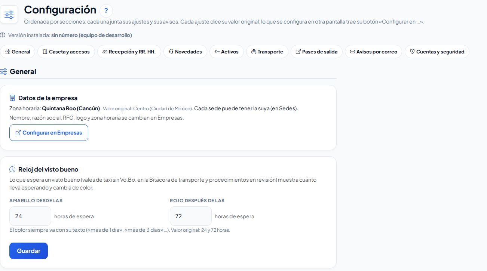
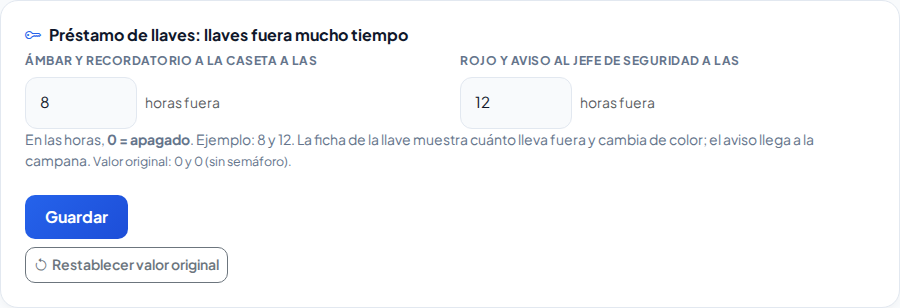
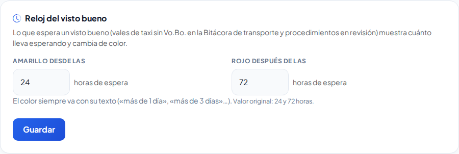
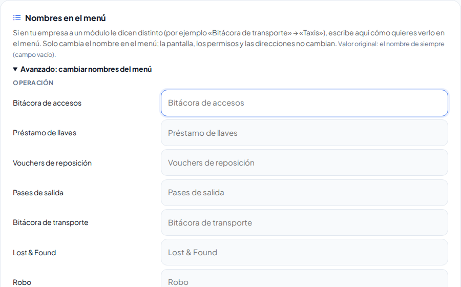
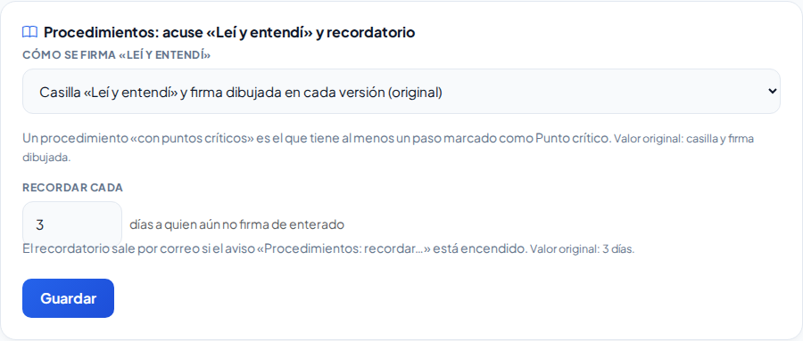
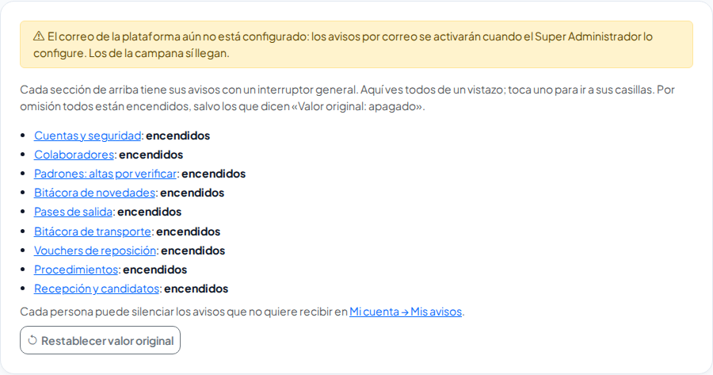
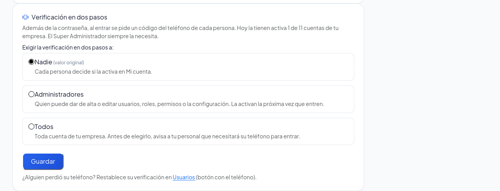
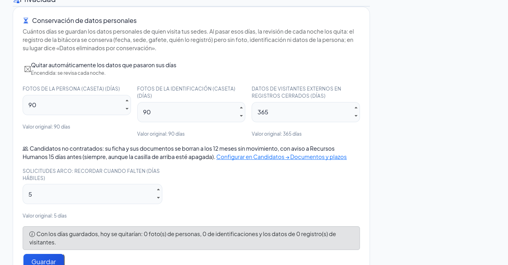
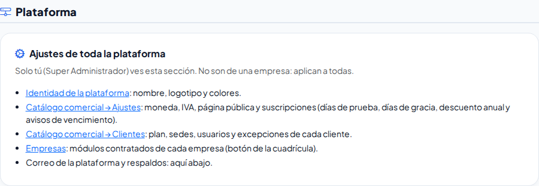
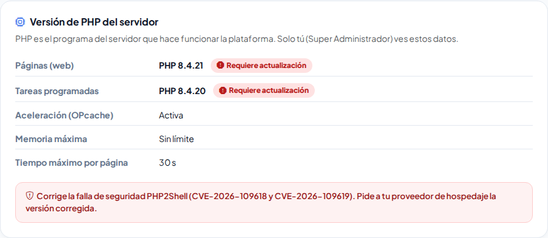

# Configuración

**¿Para qué sirve?** Aquí está **todo lo que tu empresa puede ajustar**, ordenado por **secciones**: General, Caseta y accesos, Recepción y RR. HH., Novedades (o como se llame tu bitácora), Activos, Transporte, Pases de salida, Avisos por correo, Cuentas y seguridad y Privacidad. Cada sección junta sus ajustes y sus avisos por correo. Cada ajuste dice su **valor original** y, si lo cambiaste, tiene un botón **Restablecer valor original**. Lo que se configura en otra pantalla aparece con su valor y un botón **Configurar en …** que te lleva directo. El Super Administrador ve además la sección **Plataforma**.

## Antes de empezar

- Solo ves las secciones y los avisos de los módulos que **tu plan incluye** (por ejemplo, sin Recursos Humanos no aparece «Recepción y RR. HH.»).

- Para ver la pantalla tu rol debe poder consultar *Configuración*. Si tu rol solo consulta, verás los valores pero no los botones **Guardar** ni **Restablecer valor original**.
- Los ajustes de la empresa los cambia quien tiene el permiso **editar** de Configuración con alcance de **toda la empresa** (normalmente el administrador). Con alcance de una sede solo se consultan.
- Algunas tarjetas piden además el permiso de su módulo: los días de Lost & Found (**Configurar** de Lost & Found), el kiosco y los plazos de candidatos (**Configurar** de Candidatos), la bolsa de trabajo (**Configurar** de Vacantes), las esperas (**Configurar** de Autorizaciones departamentales), la impresión desde padrones (**Configurar** de Etiquetas QR) y el circuito de pases (**Configurar** de Pases de salida). Si no tienes ese permiso, la tarjeta no aparece.
- **Privacidad** (conservación de datos, aviso de privacidad y solicitudes ARCO) la ve quien tiene el permiso **Datos personales** de Configuración con alcance de toda la empresa (normalmente el administrador).
- **Plataforma** (Super Administradores, correo de la plataforma, respaldos, versión de PHP del servidor y enlaces a Identidad y Catálogo comercial) solo la ve el Super Administrador.

## Cómo moverte por las secciones

1. Entra a **Estructura → Configuración**.
2. Arriba dice la **Versión instalada** y, debajo, un botón por sección. Toca una sección para ir directo a ella.
3. Dentro de cada sección hay tarjetas. Las que dicen **Configurar en …** se cambian en su pantalla; toca el botón y llegas ahí.

**Qué debes ver:** la sección elegida, con su título subrayado y sus tarjetas. Debajo de cada campo dice el **Valor original** (el que trae la plataforma).

## Cómo cambiar un ajuste y regresarlo a su valor original

1. Busca la tarjeta en su sección (por ejemplo **Activos → Préstamo de llaves: llaves fuera mucho tiempo**).
2. Cambia el valor y toca **Guardar** en esa tarjeta. Solo se guarda esa tarjeta; las demás no cambian.
3. Para regresar al valor original, toca **Restablecer valor original** en la misma tarjeta y confirma con **Aceptar**. El botón solo aparece si esa tarjeta tiene algo distinto del original.

**Qué debes ver:** al guardar, «Ajustes de caseta y activos guardados.» (o el mensaje de esa tarjeta); al restablecer, «Listo: … volvieron a su valor original.»

## General

### Datos de la empresa
Muestra la **zona horaria** de tu empresa. El nombre, la razón social, el RFC, el logo y la zona horaria se cambian con **Configurar en Empresas**. Cada sede puede tener su propia zona horaria en **Sedes**.

### Cómo cambiar el reloj del visto bueno
Lo que espera un visto bueno (vales de taxi sin Vo.Bo. en la Bitácora de transporte y procedimientos en revisión) muestra cuánto lleva esperando y cambia de color.

1. En **General → Reloj del visto bueno**, escribe en **Amarillo desde las** cuántas horas de espera lo ponen amarillo y en **Rojo después de las** cuántas lo ponen rojo.
2. Toca **Guardar**.

**Qué debes ver:** «Ajustes de caseta y activos guardados.» Valor original: **24** y **72** horas. El color siempre va con su texto, por ejemplo «más de 1 día» o «más de 36 h».

### Cómo cambiar el nombre de un módulo en el menú
Si en tu empresa a un módulo le dicen distinto, puedes cambiar cómo se ve en el menú.

1. En **General → Nombres en el menú**, abre **Avanzado: cambiar nombres del menú**.
2. Junto al nombre de siempre, escribe el nombre que quieres (máximo 40 letras). Deja vacío el que no quieras cambiar.
3. Toca **Guardar**.

**Qué debes ver:** «Nombres del menú guardados. Revisa el menú: ya aparecen con el nombre nuevo.» Solo cambia el nombre en el menú: la pantalla, los permisos y las direcciones son los mismos. El nombre de la bitácora (Novedades o Incidentes) se cambia en su propia sección.

### Cómo volver a mostrar «Configura tu empresa» en Inicio

1. En **General**, en la tarjeta **Configura tu empresa**, ves cuántos pasos llevas y si se ve en Inicio.
2. Toca **Mostrar en Inicio** (o **Ocultar de Inicio**).

**Qué debes ver:** «Listo: «Configura tu empresa» ya se ve en Inicio.» Aplica a toda la empresa. Ver [Configura tu empresa](configura-tu-empresa.md).

## Caseta y accesos

| Tarjeta | Qué decides | Valor original | Dónde se cambia |
|---|---|---|---|
| **Quién espera autorización del departamento** | Si visitas, proveedores y contratistas esperan la autorización; qué pasa si el departamento no tiene quien autorice en la sede (y cuántos departamentos están así hoy); si la caseta espera el «Que pase» de RR. HH.; a los cuántos minutos se recuerda y se avisa al suplente y al jefe. | Todos esperan; sin quien autorice, esperan al supervisor; 10 y 20 minutos. | **Configurar en Responsables por departamento** |
| **Imprimir etiquetas desde los padrones** | Hoja propia de cada padrón o plantillas de Etiquetas QR. | Hoja propia de cada padrón. | **Configurar en Etiquetas QR → Plantillas** |
| **Motivo de la visita** | Qué motivo viene marcado al registrar una visita (ninguno, o el que elijas) y, en hoteles, si se ofrece **Visita a huésped**. | Ninguno marcado; «Visita a huésped» sí. | Aquí, con **Guardar** |
| **Procedimientos: acuse «Leí y entendí» y recordatorio** | Cómo se firma el acuse y **cada cuántos días** se recuerda a quien no ha firmado. | Casilla y firma dibujada; cada 3 días. | Aquí, con **Guardar** |
| Avisos de **Colaboradores**, **Altas por verificar** y **Procedimientos** | Ver «Avisos por correo». | Encendidos. | Aquí |

## Recepción y RR. HH.

- **Avisos** de Recepción y candidatos.
- **Aviso de privacidad y kiosco**: el texto que acepta el candidato y cuánto dura el enlace del kiosco (valor original: 2 horas y 3 veces; el aviso original es un borrador para que lo revise tu abogado). Es el mismo formulario de **Recepción → Ajustes**. Ver [Recepción y autorizaciones](recepcion-y-autorizaciones.md).
- **Candidatos: plazos y documentos para contratar**: muestra cada plazo con su valor original. Se cambia con **Configurar en Candidatos → Documentos y plazos**.
- **Criterios para calificar las entrevistas**: se cambian con **Configurar en Candidatos → Criterios de entrevista**.
- **Bolsa de trabajo en internet**. Ver [Vacantes](vacantes.md).

## Novedades (o el nombre de tu bitácora)

### Cómo elegir el nombre del módulo: Novedades o Incidentes

**Novedades** es donde va todo lo que pasa en el día, sin importar su tipo; es el nombre de siempre. Si en tu empresa le dicen **Incidentes**, puedes elegirlo.

1. En la sección de la bitácora, busca la tarjeta **…: nombre y hallazgos**.
2. En **Nombre del módulo** elige **Novedades (como siempre)** o **Incidentes**.
3. Si tu empresa usa otro nombre, elige **Otro nombre (escríbelo en Avanzado)**, abre **Avanzado: otro nombre** y escríbelo (máximo 40 letras).
4. Si quieres, en **Cuando un Recorrido de Protección Civil encuentra una falla, abrir el ticket como** elige **Mantenimiento de equipo PC** (valor original: **Siniestro Protección Civil**).
5. Toca **Guardar ajustes de la bitácora**.

**Qué debes ver:** «Ajustes de la Bitácora de incidentes guardados.» (o con el nombre que elegiste). El nombre nuevo aparece en el menú, en el botón de abajo del celular, en los títulos, en los avisos, en los informes, en Inicio y en el manual. Los tickets, los permisos y las direcciones no cambian.

### Cómo cambiar los días de resguardo de Lost & Found

Cada tipo de objeto (Otro, Alto Valor, Electrónico, Ropa, Perecedero) tiene cuántos días puede estar guardado antes de que el semáforo lo marque: **amarillo** al pasar el 70 % de sus días y **rojo (vencido)** al llegar a sus días.

1. Baja a **Lost & Found: días de resguardo**. También puedes cambiarlos desde el archivo de Lost & Found con el botón **Días de resguardo**: es el mismo dato.
2. Escribe los días de cada tipo (mínimo 1). Debajo de cada uno dice desde qué día se pone amarillo y rojo, y su **valor original**.
3. Toca **Guardar días de resguardo**.

**Qué debes ver:** «Los días de resguardo de Lost & Found se guardaron correctamente.» Aplica a todas las sedes de la empresa.

## Activos

| Tarjeta | Qué decides | Valor original |
|---|---|---|
| **Préstamo de llaves: llaves fuera mucho tiempo** | A cuántas horas fuera la ficha se pone **ámbar** y avisa a la caseta, y a cuántas se pone **roja** y avisa al jefe de seguridad (ejemplo: 8 y 12). **0 = apagado.** | Apagado. |
| **Responsivas: equipos de «Turno»** | Cuántas horas después de la entrega deben regresar y cuántas horas más esperar antes de avisar al supervisor (ejemplo: 8 y 2). | Apagado: sin hora de regreso. |
| Avisos de **Vouchers de reposición** con cobro | Correos de **Copia Seguridad**, **Copia Recepción** y **Copia Administración**. Si dejas las tres vacías, se envía a quien puede imprimir vouchers en esa sede. | Encendido. |

## Transporte

- **Firmas del vale de taxi**: quién firma en la pantalla (los dos, solo el guardia, solo el taxista o nadie). Quien no firma en pantalla firma a mano en el vale impreso. Valor original: guardia y taxista firman en pantalla.
- **Avisos** del vale de taxi: en **Correos que lo reciben** escribe uno por línea o separados por coma; si lo dejas vacío, se envía a quien puede autorizar vales en esa sede.

## Pases de salida

- **Circuito de aprobación**: resumen de quién firma y en qué orden; con **Configurar circuito** se cambia. Ver [Pases de salida](pases-salida.md).
- **Avisos**: aprobación, resultado, recordatorio de pases vencidos y firmas que tardan.

## Cómo elegir los avisos por correo

1. En cada sección, la tarjeta **…: avisos por correo** tiene un interruptor **Avisos de este módulo encendidos / apagados** que enciende o apaga todos los avisos de ese módulo de un solo toque.
2. Con el interruptor encendido, marca los avisos que quieres que lleguen. Los que dicen **Valor original: apagado** vienen apagados de origen.
3. Toca **Guardar avisos** en esa tarjeta (guarda los avisos de todas las secciones).
4. En la sección **Avisos por correo** ves todos los módulos con **encendidos** o **apagados**; toca uno para ir a sus casillas. Ahí está también **Restablecer valor original** para regresar todos los avisos a como vienen de origen (los correos que capturaste se conservan).

**Qué debes ver:** «Avisos actualizados.» y, si apagaste alguno, «Apagados por módulo: …». Si el correo de la plataforma aún no está configurado, verás «El correo de la plataforma aún no está configurado…»; los avisos de la campana sí llegan. Cada persona puede silenciar los avisos que no quiere en [Mi cuenta](mi-cuenta.md) → **Mis avisos**.

## Cuentas y seguridad

### Cómo encender o apagar los avisos de movimientos sensibles
Quien ve toda la Bitácora de auditoría recibe en su **campana** cuando alguien cambia roles o permisos, elimina algo definitivamente o exporta datos personales.

1. En **Cuentas y seguridad** busca «Seguridad: avisar en la campana a quien ve toda la Bitácora de auditoría…».
2. Viene **encendido**. Quita o pon la marca.
3. Toca **Guardar avisos**.

### Cómo elegir qué ve «Su sede» en la Bitácora de auditoría
1. En **Cuentas y seguridad**, baja a **Bitácora de auditoría: qué ve «Su sede»**.
2. Elige **Los movimientos de su sede** (valor original) o **Solo sus propios movimientos**.
3. Toca **Guardar**.

**Qué debes ver:** «Listo: quien tiene la bitácora con alcance «Su sede» ahora ve los movimientos de su sede…».

### Cómo exigir la verificación en dos pasos
Con la verificación en dos pasos, al entrar se pide la contraseña y un código del teléfono de cada persona (ver [Mi cuenta](mi-cuenta.md)).

1. En **Cuentas y seguridad**, busca la tarjeta **Verificación en dos pasos**. Dice cuántas cuentas de tu empresa ya la tienen activa.
2. En **Exigir la verificación en dos pasos a:** elige:
   - **Nadie** (valor original): cada persona decide si la activa.
   - **Administradores**: quien puede dar de alta o editar usuarios, roles, permisos o la configuración.
   - **Todos**: toda cuenta de tu empresa.
3. Toca **Guardar**.

**Qué debes ver:** «Listo: …» con a quién le aplica. Quien la necesite y no la tenga, la activa **la próxima vez que entre** (la plataforma lo lleva a Mi cuenta y no lo deja seguir hasta activarla). Avisa antes a tu personal que tenga su teléfono a la mano. El **Super Administrador** siempre la necesita, sin importar este ajuste. Si alguien pierde su teléfono, restablécela en [Usuarios](usuarios.md).

### Cierre de sesión por inactividad
La tarjeta dice tras cuántos minutos sin actividad se cierra la sesión (valor original: 20). Es igual para todas las empresas; si necesitas otro tiempo, pídelo a quien administra la plataforma.

## Privacidad

Aquí cuidas los datos personales de quien visita tus sedes, publicas tu aviso de privacidad y llegas a las solicitudes ARCO. El aviso de privacidad **solo se edita aquí** (Recepción solo muestra su versión). El detalle está en [Privacidad y solicitudes ARCO](privacidad-y-arco.md).

### Cómo elegir cuántos días se conservan los datos personales
1. En **Privacidad → Conservación de datos personales** escribe los días para:
   - **Fotos de la persona (caseta)** — valor original: 90 días.
   - **Fotos de la identificación (caseta)** — valor original: 90 días.
   - **Datos de visitantes externos en registros cerrados** (visita, huésped, proveedor, contratista) — valor original: 365 días.
   - **Lost & Found: quien reportó una pérdida o recibió un objeto** (nombre, teléfono, correo, identificación y firma) — valor original: 365 días.
   - **Novedades y accidentes cerrados** (involucrados, testigos, personas observadas, descripción del sospechoso, huésped accidentado y sus datos médicos) — valor original: 1825 días (5 años).
   - **Reservas terminadas: datos del cliente** — valor original: 1825 días.
   - **Transporte: firma del taxista en los vales** — valor original: 1825 días.
2. Revisa el recuadro gris: dice cuántas fotos y registros se quitarían **hoy** con esos días.
3. Marca **Quitar automáticamente los datos que pasaron sus días** para encender la tarea. Si tu empresa ya existía antes de esta función, viene **apagada**: nada se quita hasta que tú la enciendas. Los plazos de Lost & Found, novedades y accidentes, reservas y transporte son nuevos: si tu empresa ya existía, un aviso amarillo te lo dice y **se aplican hasta que guardes esta tarjeta**.
4. Toca **Guardar** y confirma con **Aceptar**.

**Qué debes ver:** «Listo: la conservación quedó encendida…». Cada noche se quitan los datos que pasaron sus días: **el registro de la bitácora se queda** (fecha, sede, gafete, quién lo registró), pero sin foto, identificación ni datos de la persona; en lugar del nombre dice «Datos eliminados por conservación». El resumen queda en la [Bitácora de auditoría](auditoria.md).

- Los **candidatos no contratados** tienen su propio plazo (se borran a los 12 meses sin movimiento, con aviso 15 días antes); se cambia en **Candidatos → Documentos y plazos**, con el botón de la misma tarjeta.
- Los registros de **colaboradores** y de **unidades de emergencia** conservan sus datos; solo pierden las fotos al pasar sus días. Los **accidentes de trabajo** de tus colaboradores tampoco se tocan.
- En todos los casos el registro se queda (el ticket, la reserva, el vale): solo se quitan los datos de la persona.

### Cómo publicar una versión nueva del aviso de privacidad
1. En **Privacidad → Aviso de privacidad** revisa el texto. Si un aviso amarillo dice que tiene **datos por completar** entre corchetes, pide a tu abogado el texto definitivo.
2. Escribe o pega el texto nuevo.
3. Toca **Guardar como versión nueva**.

**Qué debes ver:** «Versión N del aviso publicada…». Desde ese momento es el que aceptan las personas en el kiosco, la solicitud de empleo y la bolsa de trabajo, y cada persona queda con **la versión que aceptó**. En **Historial de versiones** ves todas (con **Ver texto**). La tarjeta también tiene la dirección de la **página pública** de tu aviso, con el botón para que las personas ejerzan sus derechos ARCO.

## Plataforma (Super Administrador)

Arriba de la sección hay enlaces a **Identidad de la plataforma** (nombre, logotipo y colores), **Catálogo comercial → Ajustes** (moneda, IVA, página pública y suscripciones: días de prueba, días de gracia, descuento anual y avisos de vencimiento), **Catálogo comercial → Clientes** y **Empresas** (módulos contratados). Debajo están la versión de PHP del servidor, el correo de la plataforma y los respaldos.

## Cómo dar de alta y cuidar a los Super Administradores (Super Administrador)

Debe haber **al menos dos Super Administradores activos**: si uno pierde su teléfono y sus códigos de respaldo, el otro le devuelve el acceso desde aquí, sin entrar al servidor. Mientras haya uno solo, **Inicio** lo avisa en rojo («Falta el segundo Super Administrador»).

1. En **Plataforma → Super Administradores** toca **Agregar Super Administrador**.
2. Escribe **Nombre completo**, **Usuario** y **Correo** (obligatorio para el Super Administrador).
3. Si la plataforma tiene correo, deja **Contraseña temporal** vacía y le llega un enlace de bienvenida; si no, escribe una contraseña temporal y dásela en persona.
4. Escribe **Tu contraseña** y toca **Guardar**.

**Qué debes ver:** «Listo: «…» ya es Super Administrador…». Al entrar, la persona cambia su contraseña y activa su verificación en dos pasos.

### Cuando otro Super Administrador perdió su teléfono o su contraseña

Su petición te llega a la **campana**, a **Inicio** («Super Administradores que piden ayuda») y a esta tarjeta.

1. Confirma con la persona que fue ella quien lo pidió.
2. Si no fue esa persona, toca **Rechazar** junto a su nombre en el recuadro **Piden ayuda**; le avisamos y ahí termina.
3. Si sí fue, en su renglón toca **Restablecer o dar de baja**.
4. Para el teléfono: escribe **Tu contraseña** y toca **Quitar sus dos pasos**. Para la contraseña: escribe una **Contraseña temporal** (o déjala vacía si la plataforma tiene correo) y **Tu contraseña**, y toca **Guardar**.

**Qué debes ver:** «Quitamos la verificación en dos pasos de «…»…» o «Contraseña de «…» restablecida…». Los demás Super Administradores reciben un aviso y todo queda en la [Bitácora de auditoría](auditoria.md).

- **Dar de baja** a un Super Administrador solo se puede si quedan **al menos dos** activos; si no, la tarjeta dice «No se puede: quedaría menos de dos Super Administradores activos.»
- Tu propia cuenta se cambia en [Mi cuenta](mi-cuenta.md).
- Si escribes mal **Tu contraseña** 5 veces, la tarjeta dice «Escribiste mal tu contraseña demasiadas veces. Espera … minuto(s)…»: espera 15 minutos y vuelve a intentarlo. Así nadie puede adivinarla si deja tu sesión abierta.

## Cómo revisar la versión de PHP del servidor (Super Administrador)

PHP es el programa del servidor que hace funcionar la plataforma. Cuando sale una falla de seguridad, tu proveedor de hospedaje publica una versión corregida; aquí ves si ya la tienes.

1. Entra a **Estructura → Configuración**.
2. En el índice toca **Plataforma**.
3. Busca la tarjeta **Versión de PHP del servidor**.

**Qué debes ver:**

- **Páginas (web):** la versión exacta con la que se abren las pantallas (por ejemplo «PHP 8.4.27»).
- **Tareas programadas:** la versión con la que corren los recordatorios, respaldos e instalaciones automáticas. Si dice «Sin dato todavía», aparece cuando la instalación automática del servidor anota su versión.
- Junto a cada versión, **Al día** (verde) o **Requiere actualización** (rojo). Con rojo, abajo sale: «Corrige la falla de seguridad PHP2Shell (CVE-2026-109618 y CVE-2026-109619). Pide a tu proveedor de hospedaje la versión corregida.».
- **Aceleración (OPcache):** «Activa» hace que las pantallas abran más rápido. **Memoria máxima** y **Tiempo máximo por página:** los límites que da el hospedaje.

Las versiones corregidas son **8.5.12**, **8.4.27**, **8.3.36** y **8.2.35** o posteriores de su misma serie. La 8.1 y anteriores ya no reciben correcciones: siempre dicen **Requiere actualización**.

## Cómo configurar el correo de la plataforma (Super Administrador)

1. Pide a tu proveedor de correo los datos de la cuenta desde la que saldrán los avisos (por ejemplo `avisos@tuempresa.com`): servidor de salida, puerto, usuario y contraseña de la cuenta. La pantalla te lo recuerda: «Los datos te los da tu proveedor de correo».
2. En **Correo de la plataforma** captura **Servidor SMTP**, **Puerto** (normalmente 587 con TLS, o 465 con SSL), **Cifrado**, **Usuario** (la cuenta completa), **Contraseña**, **Correo del remitente** y, si quieres, el **Nombre del remitente**.
3. Toca **Guardar correo**.
4. En **Enviar correo de prueba a** escribe tu correo y toca **Enviar prueba**. Revisa tu bandeja de entrada y también la de correo no deseado.

**Qué debes ver:** «Configuración de correo guardada. Envía un correo de prueba para confirmar que funciona.» y la etiqueta **CONFIGURADO**. Si algo falla, la pantalla muestra el último error (por ejemplo, contraseña incorrecta o puerto bloqueado).

> Escribe la contraseña **solo en esta pantalla**, nunca en un chat o correo. Se guarda cifrada y no se vuelve a mostrar. Para cambiarla escribe la nueva; si dejas el campo vacío, se conserva la anterior.

## Cómo hacer o descargar un respaldo (Super Administrador)

- **Automáticos:** la plataforma se respalda sola cada día después de las 3:00 y antes de instalar cada versión nueva. Se guardan 14 días.
- **Respaldar ahora:** crea uno en el momento (por ejemplo antes de un cambio grande). Confirma con **Aceptar**.
- **Descargar:** con la flecha de cada respaldo. Guárdalo en un lugar seguro: contiene **toda** la información, incluidos datos personales. Cada descarga queda en la [Bitácora de auditoría](auditoria.md).
- **Fotos, documentos y firmas** no van en este respaldo: para mudar la plataforma completa usa el botón **Respaldos y traslado a otro servidor** (ver [Respaldos y traslado a otro servidor](respaldos-y-traslado.md)).
- **Restaurar** un respaldo reemplaza toda la información actual. Para restaurar: descarga el archivo y pide a tu proveedor de hospedaje o a tu administrador de base de datos que lo importe. Hazlo solo si de verdad lo necesitas.
- El archivo descargado trae en su primera línea la misma indicación, por si se lo envías a otra persona.

## Si algo sale mal

| Mensaje o síntoma | Qué significa | Qué hacer |
|---|---|---|
| No veo los botones **Guardar** ni **Restablecer valor original**. | Tu rol solo puede consultar la Configuración (o tiene alcance de una sede). | Pídelo a tu administrador. |
| No veo una tarjeta (por ejemplo, plazos o esperas). | Tu rol no tiene el permiso de ese módulo. | Pídelo a tu administrador. |
| Escribe solo el nombre del servidor (ej. mail.tudominio.com), sin https:// ni espacios. | El servidor está mal escrito. | Escribe solo el nombre del servidor. |
| Usa un puerto de correo: … | El puerto no es de correo. | Usa 587 (TLS) o 465 (SSL). |
| Primero guarda la configuración del correo. | Tocaste **Enviar prueba** sin guardar. | Toca **Guardar correo** y luego prueba. |
| No se pudo crear el respaldo: … | Hubo un problema al respaldar. | Intenta de nuevo; si sigue, avisa a soporte. |
| Los avisos son de toda la empresa: hace falta el permiso «editar» de Configuración con alcance de empresa. | Tu rol no puede cambiar los avisos. | Pídelo a tu administrador. |
| Los días de resguardo son de toda la empresa: hace falta el permiso «configurar» de Lost & Found con alcance de empresa. | Tu rol no puede cambiar los días. | Pídelo a tu administrador. |
| Las horas para avisar al jefe deben ser más que las del recordatorio a la caseta. | En llaves pusiste el rojo antes que el ámbar. | Pon más horas en el rojo (o 0 para apagarlo). |
| Las horas para el rojo deben ser más que las del amarillo. | En el reloj del visto bueno el rojo quedó antes que el amarillo. | Pon más horas en el rojo. |
| Escribe un número entero de días, de 1 a 30. | El recordatorio de procedimientos no es válido. | Escribe un número de 1 a 30. |
| Escribe un número entero de horas, de 0 a … (0 = apagado). | Las horas no son válidas. | Escribe un número entero dentro del rango. |
| «…»: máximo 40 letras; solo letras, números, espacios, punto, guion y «&». | El nombre del menú tiene signos no permitidos o es muy largo. | Escríbelo más corto y sin signos. |
| No llegan los correos. | El correo de la plataforma no está configurado o el aviso está apagado. | Revisa el aviso amarillo y las casillas; revisa el correo no deseado. |
| Este ajuste es de toda la empresa: hace falta el permiso «editar» de Configuración con alcance de empresa. | Tu rol no puede cambiar a quién se exige la verificación en dos pasos. | Pídelo a tu administrador. |
| «Fotos de la persona (caseta)» va de 7 a 3650 días. (o el de otro tipo) | Los días están fuera del rango permitido. | Escribe un número dentro del rango que dice el mensaje. |
| Es el mismo texto de la versión N: cambia algo para publicar una nueva. | El aviso no cambió. | Si no hay cambios, no hace falta publicar. |
| Una versión dice **Requiere actualización** (rojo). | El servidor tiene una versión de PHP con la falla PHP2Shell o una serie que ya no recibe correcciones. | Pide a tu proveedor de hospedaje la versión corregida (8.5.12, 8.4.27, 8.3.36, 8.2.35 o posterior). Cuando la cambie, vuelve a abrir Configuración: debe decir **Al día**. |
| **Tareas programadas** dice «Sin dato todavía». | La instalación automática aún no anota su versión de PHP. | Espera a la siguiente instalación; si sigue igual, pide a tu proveedor de hospedaje que revise las tareas programadas. |
| **Debe haber al menos dos Super Administradores activos…** | Darías de baja al penúltimo Super Administrador. | Da de alta otro antes de dar de baja a este. |
| **Tu contraseña no es correcta.** (Super Administradores) | Cada cambio pide tu propia contraseña. | Escribe la contraseña con la que entras. |
| No veo la sección **Privacidad**. | Tu rol no tiene el permiso **Datos personales** de Configuración con alcance de toda la empresa. | Pídelo a tu administrador. |

## Preguntas frecuentes

**¿Qué pasa si toco «Restablecer valor original»?** Esa tarjeta regresa a como viene de origen. Solo esa tarjeta: las demás no cambian. En los avisos, los correos que capturaste se conservan.

**¿Por qué algunos ajustes dicen «Configurar en …»?** Porque se cambian en la pantalla de su módulo; así hay un solo lugar para cada dato. Aquí ves su valor actual.

**¿A quién le llegan los avisos?** A los usuarios activos con permiso para atender ese asunto en la sede correspondiente, al correo de su cuenta (salvo donde escribes correos fijos).

**¿Los ajustes cambian lo que ya se registró?** No. Los vales, acuses y tickets que ya existen se quedan como se capturaron; los relojes y semáforos se calculan con los ajustes de hoy.

**¿Los días de Lost & Found se pueden poner por sede?** No; aplican a todas las sedes de la empresa.

**¿Si enciendo la conservación, se puede deshacer?** No: lo que se quita ya no regresa. Por eso, antes de encenderla, revisa los días y el recuadro de «hoy se quitarían». Si la apagas, ya no se quita nada más.

**¿Por qué las páginas y las tareas programadas pueden tener versiones distintas?** El hospedaje elige la versión de PHP de las páginas y la de las tareas programadas por separado. Las dos deben decir **Al día**.

**¿Quién más ve la versión de PHP?** Nadie: solo el Super Administrador, en esta tarjeta.

**¿Puedo restaurar un respaldo yo mismo desde esta pantalla?** No. Descarga el archivo y entrégaselo a tu proveedor de hospedaje o a tu administrador de base de datos para que lo importe.

## Relacionado

- [Empresas y sedes](empresas-y-sedes.md)
- [Recepción de RR. HH.](recepcion-y-autorizaciones.md)
- [Autorizaciones](autorizaciones.md)
- [Vacantes](vacantes.md)
- [Lost & Found y robo](lost-found-y-robo.md)
- [Bitácora de transporte](transporte.md)
- [Préstamo de llaves](prestamo-llaves.md)
- [Responsivas](responsivas.md)
- [Procedimientos](procedimientos.md)
- [Pases de salida](pases-salida.md)
- [Etiquetas QR](etiquetas-qr.md)
- [Mi cuenta](mi-cuenta.md)
- [Privacidad y solicitudes ARCO](privacidad-y-arco.md)
- [Configura tu empresa](configura-tu-empresa.md)
