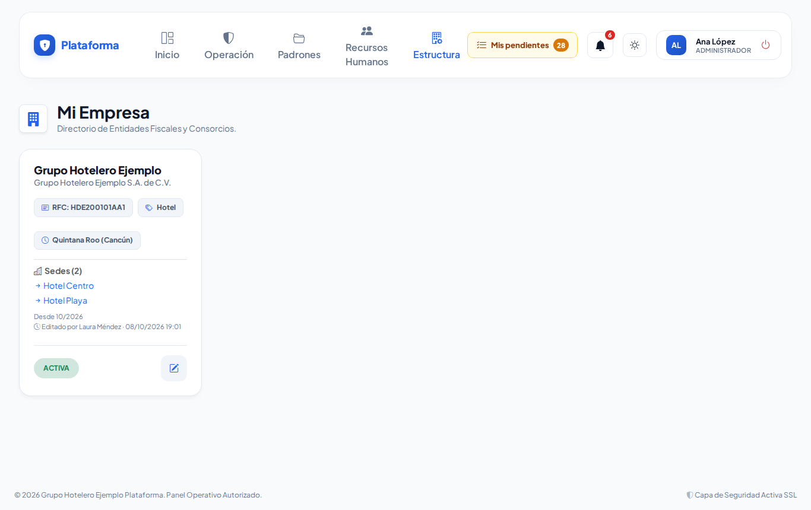
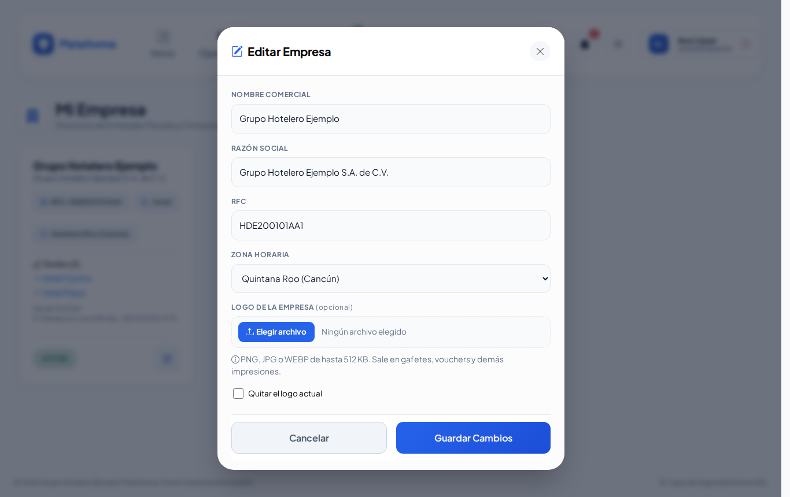
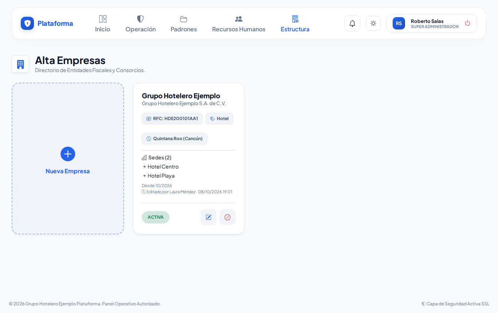
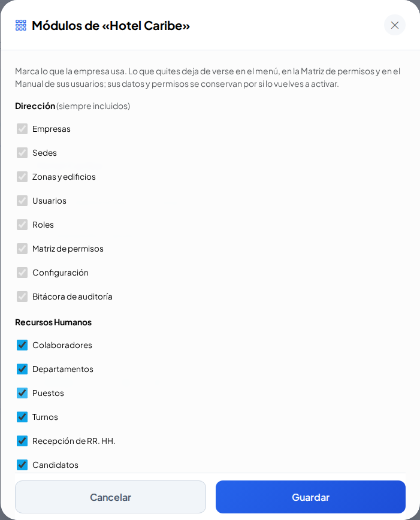
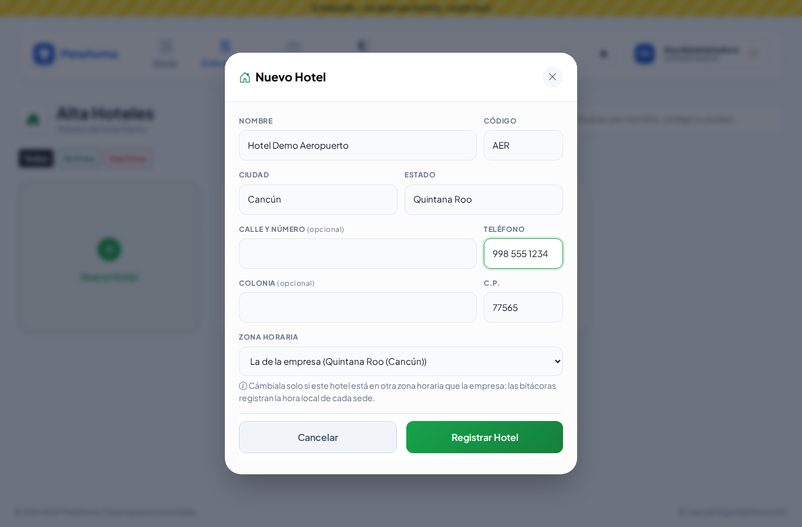
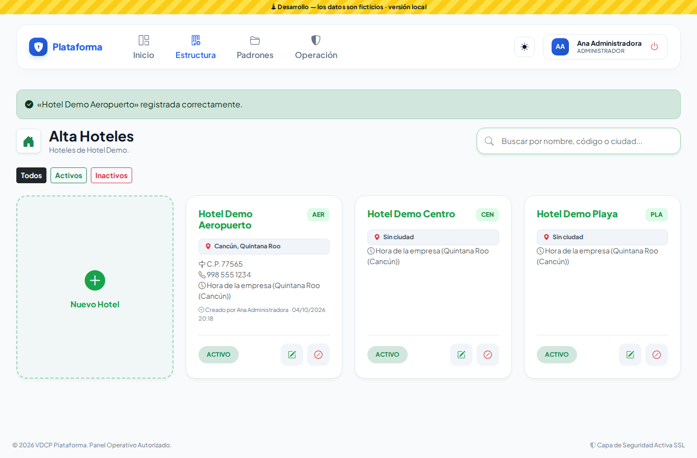
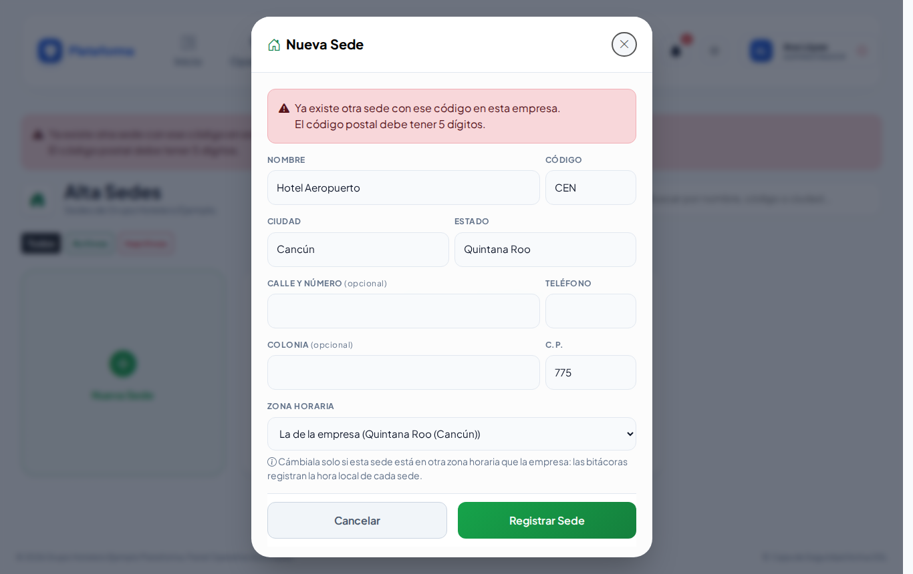

# Empresas y sedes

**¿Para qué sirve?** Aquí están los datos de tu **empresa** (nombre, razón social, RFC, rubro, zona horaria y logo) y sus **sedes**: los centros de trabajo donde opera (por ejemplo «Hotel Centro» y «Hotel Playa»). Casi todas las pantallas se organizan por sede, y la hora que ves en cada sede depende de su zona horaria.

## Antes de empezar

- Para ver estas pantallas tu rol debe poder consultar *Empresas* y *Sedes*. Si no aparecen en el menú, pide el permiso a tu administrador.
- Los datos de la empresa solo los cambia quien tiene el permiso **editar** de Empresas con alcance de empresa (normalmente el administrador).
- Dar de alta **empresas nuevas** solo lo hace el **Super Administrador** de la plataforma.

## Cómo corregir los datos de tu empresa

1. Entra a **Estructura → Empresas**. Se abre **Empresas** con la ficha de tu empresa.
2. Toca el **lápiz** (Editar). Se abre **Editar Empresa**.
3. Corrige **Nombre Comercial**, **Razón Social**, **RFC** o **Zona Horaria**.
4. **Logo de la Empresa (opcional):** toca **Elegir archivo** y elige un PNG, JPG o WEBP de hasta 512 KB. Sale en gafetes, vouchers y demás impresiones. Para quitarlo, marca **Quitar el logo actual**.
5. Toca **Guardar Cambios**.

**Qué debes ver:** «Empresa actualizada correctamente.»

## Cómo dar de alta una empresa nueva (Super Administrador)

1. Entra a **Estructura → Empresas**. Se abre **Empresas** con todas las empresas de la plataforma.
2. Toca la tarjeta **Nueva Empresa**.
3. Captura **Nombre Comercial**, **Razón Social**, **RFC**, **Rubro** (Hotel, Corporativo / industria, Condominio o Fraccionamiento) y **Zona Horaria**.
4. Toca **Registrar Empresa**.

**Qué debes ver:** «Empresa «…» creada con sus módulos y roles base. Ahora registra sus sedes.» El rubro decide cómo se llaman las cosas (por ejemplo «Habitación» en un hotel, «Oficina» en un corporativo o «Casa» en un fraccionamiento).

## Cómo elegir los módulos de una empresa (Super Administrador)

Cada empresa nueva nace con **todos** los módulos. Si una empresa no usa alguno (por ejemplo, un condominio que no usa Recursos Humanos), quítalo:

1. Entra a **Estructura → Empresas** y, en la ficha de la empresa, toca el ícono de **cuadrícula** (Módulos contratados).
2. Marca los módulos que usa y quita la marca a los demás. Los de **Dirección** (empresa, sedes, usuarios, roles, permisos, configuración, bitácora) siempre se quedan. Los marcados **Próximamente** todavía no tienen pantalla.
3. Toca **Guardar** y confirma con **Aceptar**.

**Qué debes ver:** «Módulos de «…» actualizados: tiene N módulos…». Lo que quitaste deja de verse en el menú, en la Matriz de permisos y en el Manual de sus usuarios; sus datos y permisos se conservan por si lo vuelves a activar.

**¿En qué empresa estoy?** Arriba, junto a **Mis pendientes**, el Super Administrador ve siempre el nombre de su **empresa de trabajo** (o **Plantillas de la plataforma**). Si el nombre es largo o la pantalla es angosta, se recorta con «…»: pasa el puntero encima para verlo completo. Se cambia con el selector **Empresa de trabajo** de las pantallas de Estructura.

## Cómo registrar una sede

1. Entra a **Estructura → Sedes**.
2. Toca la tarjeta **Nueva Sede**.
3. Captura:
   - **Nombre** y **Código** corto (por ejemplo `CEN`), sin espacios ni acentos.
   - **Ciudad** y **Estado**.
   - Si quieres, **Calle y Número**, **Colonia**, **C.P.** y **Teléfono**.
4. Deja la **Zona Horaria** en **La de la empresa**, salvo que esa sede esté en otro horario.
5. Toca **Registrar Sede**.

**Qué debes ver:** ««Hotel Aeropuerto» registrada correctamente. ¿Qué sigue?» con dos botones: **Capturar sus zonas y edificios** y **Dar de alta a su personal en Usuarios** (solo los que tu rol puede usar). Usa **Buscar por nombre, código o ciudad...** y **Todos / Activos / De baja** para encontrar una sede.

## Cómo editar, dar de baja o reactivar una sede

1. **Editar** (lápiz): corrige los datos y toca **Guardar Cambios**. Verás ««…» actualizada correctamente.»
2. **Dar de baja** (círculo rojo): confirma con **Aceptar** («¿Dar de baja «…»? Ya no aparecerá para nuevas capturas; su historial se conserva. Podrás reactivarla con el mismo botón.»). La sede deja de aparecer para nuevas capturas, pero su historial se conserva: ««…» dada de baja: ya no aparecerá para nuevas capturas. Su historial se conserva. Puedes reactivarla con el mismo botón.» Su ficha dice **DE BAJA**.
3. **Reactivar** (flecha circular): confirma con **Aceptar** y la sede vuelve a estar **ACTIVO**.

## Cómo dar de baja o reactivar una empresa (Super Administrador)

1. Entra a **Estructura → Empresas**.
2. En la ficha de la empresa toca el **círculo rojo** (Dar de baja) y confirma con **Aceptar** («¿Dar de baja la empresa «…»? Sus usuarios ya no podrán entrar. Podrás reactivarla después con el mismo botón.»).
3. Para regresarla, toca la **flecha circular** (Reactivar) y confirma.

**Qué debes ver:** «Empresa dada de baja: sus usuarios ya no pueden entrar. Puedes reactivarla con el mismo botón.» y la ficha dice **DE BAJA**. Usa **Todas / Activas / De baja** para encontrarla.

## Cómo exportar los datos de una empresa

1. Entra a **Estructura → Empresas**.
2. En la ficha de la empresa toca la **flecha hacia abajo** (Exportar datos). La ve el Super Administrador y quien tiene el permiso **Exportar** de Empresas con alcance de empresa (de origen, el Administrador), solo para su empresa.
3. Toca **Exportar datos**, confirma con **Aceptar** y, cuando esté lista, toca **Descargar**.

**Qué debes ver:** «Exportación lista (…). Descárgala abajo y guárdala en un lugar seguro.» El archivo trae todos los datos de la empresa, hojas de Excel (CSV) de lo principal y sus fotos, documentos y firmas, sin contraseñas. El paso a paso completo está en [Respaldos y traslado a otro servidor](respaldos-y-traslado.md).

## Si algo sale mal

Los mensajes salen en rojo dentro de la ventana; lo que escribiste se conserva.

| Mensaje o síntoma | Qué significa | Qué hacer |
|---|---|---|
| Ya existe otra sede con ese código en esta empresa. | El código ya se usa. | Usa otro código. |
| El código solo puede tener letras, números y guiones (sin espacios ni acentos). | El código tiene espacios o acentos. | Corrígelo (por ejemplo `PLA`). |
| El código postal debe tener 5 dígitos. | El C.P. está incompleto. | Corrígelo o déjalo vacío. |
| El teléfono solo puede tener números, espacios, +, guiones y paréntesis. | El teléfono tiene letras. | Corrígelo. |
| El RFC no tiene un formato válido (12 caracteres para persona moral, 13 para persona física). | El RFC está mal escrito. | Cópialo de la constancia fiscal. |
| Ya existe una empresa registrada con ese RFC. | Esa empresa ya existe. | Revisa la lista de empresas. |
| El logo no debe pesar más de 512 KB. / El logo debe ser PNG, JPG o WEBP (SVG no está permitido por seguridad). | La imagen no se acepta. | Reduce la imagen o cámbiala a PNG. |
| Los datos de la empresa solo los cambia quien tiene el permiso «editar» de Empresas con alcance de empresa. | Tu rol no puede editar la empresa. | Pídelo a tu administrador. |

## Preguntas frecuentes

**¿Cuándo cambio la zona horaria de una sede?** Solo si esa sede está en otro horario que la empresa (por ejemplo, otra región del país). Las bitácoras registran la hora local de cada sede.

**¿Puedo borrar una sede?** No; se da de baja para conservar su historial y se puede reactivar.

**¿Qué pasa si doy de baja la empresa?** Sus usuarios ya no pueden entrar. Solo lo hace el Super Administrador.

## Relacionado

- [Zonas y edificios](zonas-y-areas.md)
- [Usuarios](usuarios.md)
- [Configuración](configuracion.md)
- [Respaldos y traslado a otro servidor](respaldos-y-traslado.md)
