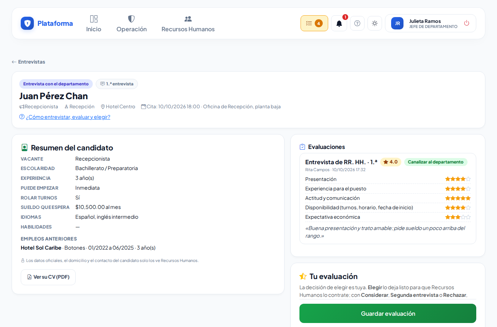
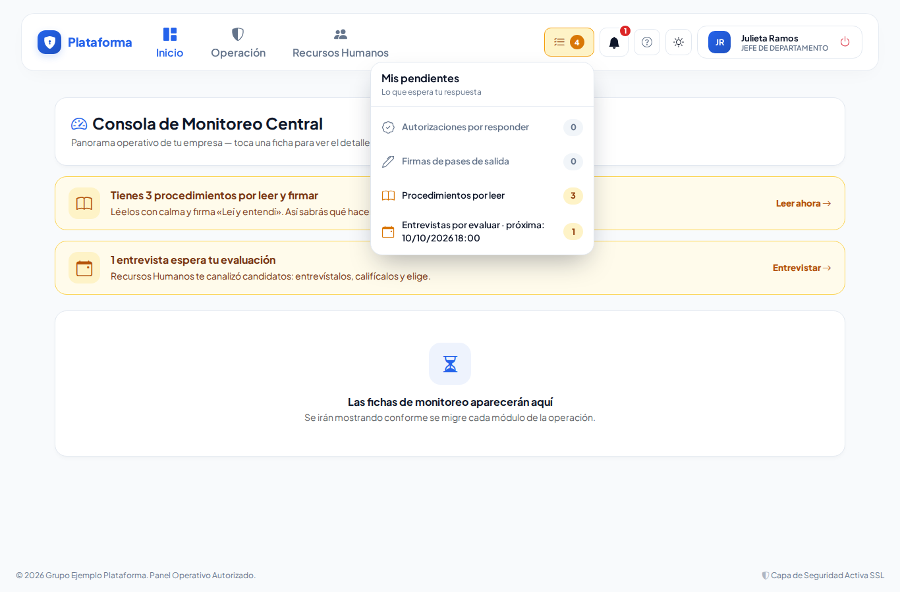
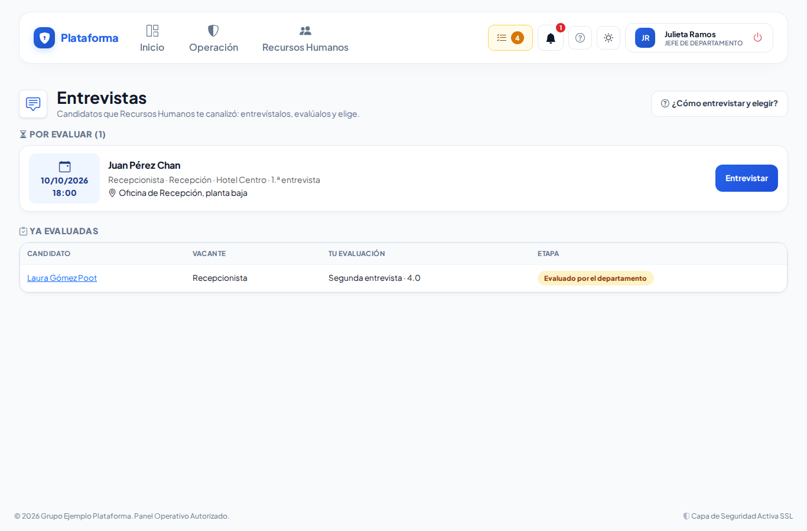
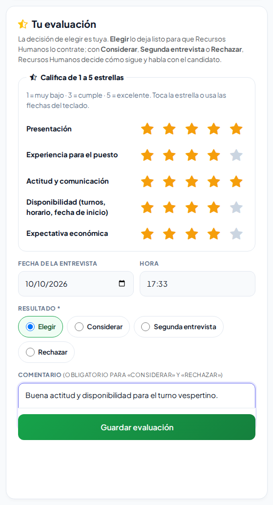
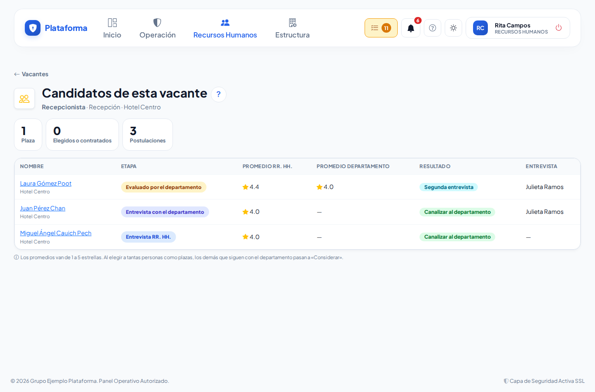

# Entrevistar y elegir

**¿Para qué sirve?** Cuando Recursos Humanos entrevista a un candidato y le sirve, te lo **canaliza** con una cita para que tú lo entrevistes. En la pantalla **Entrevistar** ves su resumen y la opinión de Recursos Humanos, lo calificas y decides: **Elegir**, **Considerar**, **Segunda entrevista** o **Rechazar**. La decisión de elegir es tuya; Recursos Humanos se encarga de los documentos, el contrato y de hablar con el candidato.

## Antes de empezar

- Tu rol necesita el permiso **Evaluar** de *Candidatos*. Lo traen los roles **Jefe de departamento**, **Director**, **Jefe de seguridad** y **Supervisor**. Si no te llegan las entrevistas, pide el permiso a tu administrador.
- Para que Recursos Humanos te proponga de una vez, debes estar como **responsable** de tu departamento (Recursos Humanos o el administrador lo definen en **Autorizaciones → Responsables por departamento**).
- Solo puedes evaluar las entrevistas que te asignaron (o las de la persona que te delegó sus avisos). No ves los datos oficiales del candidato (CURP, RFC, NSS), su domicilio ni su teléfono.

## Cómo te enteras de una entrevista

Cuando Recursos Humanos te canaliza a alguien, te llega el aviso «Entrevista: Juan Pérez · 15/10/2026 11:00» por cualquiera de estos caminos:

- la **campana** (arriba a la derecha);
- **Mis pendientes**, en el renglón **Entrevistas por evaluar** (dice cuál es la próxima cita);
- un **correo** con el botón **Abrir la entrevista** (pide iniciar sesión; vale 3 días);
- el aviso de **Inicio** «1 entrevista espera tu evaluación»;
- el menú **Recursos Humanos → Mis entrevistas** (lo ves siempre que puedas entrevistar);
- el botón **Entrevistas** de la pantalla **Autorizaciones**.

Cuando el candidato llega a la caseta para su entrevista, te llega otro aviso: «Juan Pérez ya está en recepción para su entrevista de las 11:00».

## Cómo ver tus entrevistas

1. Toca **Mis pendientes → Entrevistas por evaluar** (o el aviso de la campana).
2. En **Por evaluar** ves cada candidato con su **cita** (o «Ahora (está en sala)»), la vacante, el departamento y el lugar. Si es de alguien que te delegó sus avisos, dice «Por delegación de …».
3. Abajo, en **Ya evaluadas**, quedan las que ya calificaste.
4. Toca la tarjeta del candidato para abrir **Entrevistar**.

## Cómo entrevistar y evaluar

1. En **Entrevistar** revisa el **Resumen del candidato**: vacante, escolaridad, experiencia, cuándo puede empezar, si puede rolar turnos y el sueldo que espera. Si la vacante lo permite, toca **Ver su CV (PDF)**.
2. Revisa en **Evaluaciones** lo que calificó Recursos Humanos (estrellas, promedio y comentario).
3. Entrevista a la persona.
4. En **Tu evaluación**, califica cada criterio de **1 a 5 estrellas** (con el dedo, el ratón o el teclado: tabulador para llegar y flechas para cambiar).
5. Revisa la **Fecha y hora de la entrevista** (ya viene la de ahora).
6. Elige el **Resultado**:
   - **Elegir:** te quedas con esta persona.
   - **Considerar:** te gustó, pero no para ahora (queda en cartera para otra vacante).
   - **Segunda entrevista:** quieres verla otra vez. Sigue contigo y Recursos Humanos le pone fecha a la segunda cita.
   - **Rechazar:** no te sirve.
7. Escribe un **Comentario**. Es obligatorio para **Considerar** y **Rechazar**; ayuda a Recursos Humanos a explicarle al candidato.
8. Toca **Guardar evaluación**. Si elegiste **Elegir**, confirma con **Aceptar**.

**Qué debes ver:** «Listo: elegiste a esta persona. Recursos Humanos ya lo sabe y se encarga de los documentos y el contrato.», «Listo: pediste una segunda entrevista. Recursos Humanos le pondrá fecha y te avisará; te queda en «Por evaluar».» o «Evaluación guardada (…). Recursos Humanos ya la tiene y se comunica con el candidato.» La entrevista pasa a **Ya evaluadas** (la segunda entrevista se queda en **Por evaluar**, con «Sin fecha» hasta que Recursos Humanos la agende).

## Cómo corregir tu evaluación

Después de guardarla tienes **15 minutos** para corregirla (mientras Recursos Humanos no la haya atendido).

1. Vuelve a abrir la entrevista: en vez de «Tu evaluación» verás **Corregir tu evaluación**, con las estrellas, el resultado y el comentario que guardaste.
2. Cambia lo que haga falta y toca **Guardar corrección**.

**Qué debes ver:** «Evaluación corregida (…). Recursos Humanos ya tiene la versión nueva.» Si habías elegido **Elegir**, solo puedes corregir las estrellas y el comentario: para deshacer una elección, avisa a Recursos Humanos. Pasados los 15 minutos, el formulario desaparece.

## Cómo marcar que no se presentó

Si la cita era **Ahora, está en sala** y la persona no apareció, en la pantalla de la entrevista toca **No se presentó** y confirma con **Aceptar**. Recursos Humanos recibe el aviso y, si vuelve a agendar, te llega la cita nueva. Con una cita de fecha y hora lo marca Recursos Humanos (si pasan 24 horas sin que la caseta registre su llegada, la campana de Recursos Humanos le propone **Marcar como no se presentó**).

## Si se te pasa evaluar

Si pasan **2 días hábiles** desde la cita (o lo que configure tu empresa) sin que guardes tu evaluación, te llega un recordatorio al día por campana y correo hasta que la registres; si delegaste tus avisos («No molestar»), le llega a quien te cubre. En **Mis pendientes**, **Entrevistas por evaluar** se pone en ámbar y en rojo al doble.

## Qué pasa después de tu evaluación

| Elegiste | Qué pasa |
|---|---|
| **Elegir** | El candidato queda **Elegido**. Recursos Humanos reúne sus documentos y su contrato firmado y lo contrata; sus documentos pasan a su expediente de colaborador. Si la vacante ya no tiene plazas, los demás candidatos de esa vacante que seguían contigo pasan a «Considerar» y ya no tienes que evaluarlos. |
| **Segunda entrevista** | El candidato sigue contigo como **2.ª entrevista**, sin fecha. Recursos Humanos le pone fecha y te llega la cita. |
| **Considerar** | Queda en cartera: Recursos Humanos decide si lo guarda para otra vacante o te lo manda otra vez. |
| **Rechazar** | Recursos Humanos cierra el contacto con el candidato. A él no le llega ningún aviso de rechazo. |

## Cómo comparar a los candidatos de una vacante

1. Entra a **Recursos Humanos → Vacantes**.
2. En la tarjeta de la vacante toca **Candidatos de esta vacante**.
3. Ves a los candidatos que te canalizaron con su etapa, el promedio de Recursos Humanos, tu promedio y el resultado.

## Cuando no estás («No molestar»)

Si sales de vacaciones, delega tus avisos en **Autorizaciones → No molestar / delegar** (ver [Recepción y autorizaciones](recepcion-y-autorizaciones.md)). Mientras dure la delegación, las entrevistas nuevas le llegan a quien te cubre, y esa persona puede evaluar las tuyas. Su evaluación queda anotada «por delegación de» ti en la ficha del candidato, en su historial y en el aviso que recibe Recursos Humanos.

## Si algo sale mal

| Mensaje o síntoma | Qué significa | Qué hacer |
|---|---|---|
| Califica «…» de 1 a 5 estrellas. | Faltó calificar un criterio. | Toca las estrellas de ese criterio. |
| Escribe un comentario: es obligatorio para «Considerar» y «Rechazar». | Elegiste Considerar o Rechazar sin comentario. | Escribe el comentario. |
| Elige el resultado de la entrevista. | No elegiste el resultado. | Elige Elegir, Considerar, Segunda entrevista o Rechazar. |
| Esta entrevista ya se evaluó o Recursos Humanos la cambió. | Alguien más ya la evaluó, o Recursos Humanos la canceló o la reprogramó con otra persona. | Revisa **Mis pendientes**. |
| «Página no encontrada» al abrir una entrevista. | La entrevista no es tuya (o ya se asignó a otra persona). | Abre tus entrevistas desde **Mis pendientes**. |
| El enlace del correo ya venció o fue alterado. | El botón del correo pasó de 3 días. | Abre la entrevista desde **Mis pendientes**. |
| No aparece **Ver su CV (PDF)**. | La vacante no tiene marcado **El jefe puede ver el CV**, o el candidato no subió su CV en PDF. | Pide a Recursos Humanos que lo marque en la vacante. |
| No me llegan las entrevistas. | Te falta el permiso **Evaluar** o no eres responsable del departamento. | Pide a tu administrador el permiso y que te agregue en **Responsables por departamento**. |

## Preguntas frecuentes

**¿Recursos Humanos puede elegir por mí?** No. Solo la persona asignada (o quien la cubre por delegación) puede elegir.

**¿Por qué no veo el teléfono ni el domicilio del candidato?** Son datos personales que solo ve Recursos Humanos. Tú ves lo necesario para decidir.

**¿Puedo cambiar mi evaluación?** Sí, durante los 15 minutos siguientes a guardarla (ver «Cómo corregir tu evaluación»). Después, avisa a Recursos Humanos.

**¿Qué pasa si el candidato no llega?** Si la cita era «Ahora, está en sala», márcalo tú con **No se presentó**; si tenía fecha y hora, lo marca Recursos Humanos y te llega el aviso. Si vuelve a agendar, te llega la nueva cita.

**¿Quién califica con qué criterios?** Recursos Humanos los define para toda la empresa (por ejemplo Presentación, Experiencia para el puesto, Actitud y comunicación). Son los mismos para ti y para Recursos Humanos.

## Relacionado

- [Pedir y aprobar solicitudes](solicitudes.md)
- [Recepción y autorizaciones](recepcion-y-autorizaciones.md)
- [Vacantes](vacantes.md)
