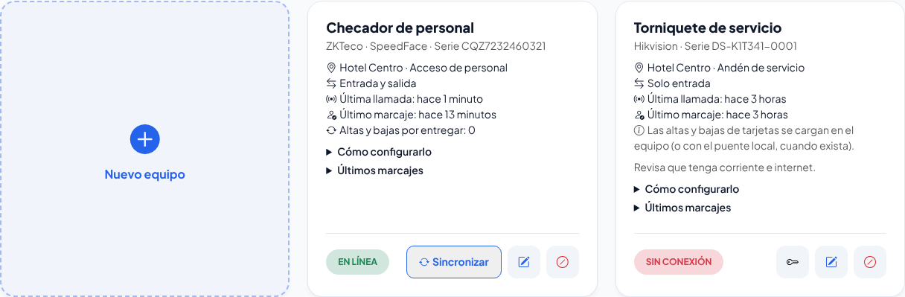
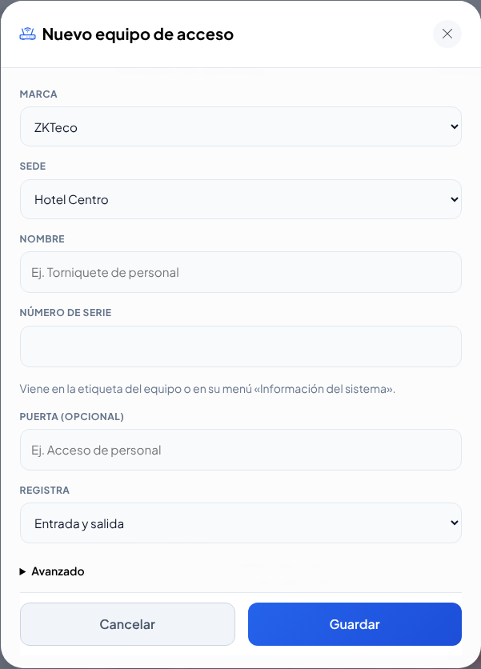
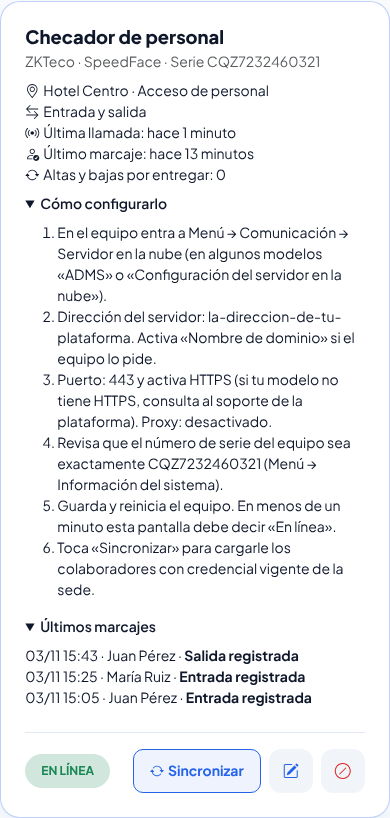

# Equipos de acceso

**¿Para qué sirve?** Para conectar a la plataforma los **lectores, torniquetes y checadores** de las marcas **ZKTeco** y **Hikvision**. Cuando un colaborador pasa su tarjeta o pone su huella, su **entrada** o **salida** aparece sola en la **Bitácora de accesos**, como si la hubiera registrado la caseta. La caseta sigue trabajando igual: si un equipo falla, registra a mano.

## Antes de empezar

- Necesitas que tu rol pueda **editar** la *Configuración* en la sede del equipo (normalmente el administrador). El jefe de seguridad puede **consultar** el estado de los equipos de su sede, pero no cambiarlos.
- Ten a la mano: la **marca**, el **número de serie** del equipo (viene en su etiqueta o en su menú «Información del sistema») y la **puerta** donde está.
- El equipo necesita **internet** y que alguien entre a su menú o a su página de configuración.
- El personal se reconoce por su **número de empleado** o por el número de su **tarjeta** (la tarjeta de su credencial). Revisa que cada colaborador tenga su número de empleado en su ficha.

## Cómo dar de alta un equipo

1. Entra a **Estructura → Configuración → Caseta y accesos** y, en la tarjeta **Equipos de acceso**, toca **Configurar en Equipos de acceso**.
2. Toca **Nuevo equipo**.
3. Elige la **Marca** y la **Sede**, escribe un **Nombre** para reconocerlo (por ejemplo «Torniquete de personal»), su **Número de serie** y la **Puerta** (opcional).
4. En **Registra** elige **Solo entrada**, **Solo salida** o **Entrada y salida**.
5. Si el equipo es ZKTeco y la red del cliente tiene IP fija, abre **Avanzado** y escribe esa IP en **IP públicas desde las que llama** (más seguro).
6. Toca **Guardar**.

**Qué debes ver:** la tarjeta del equipo con **SIN CONECTAR** y abierta la sección **Cómo configurarlo**. Si es Hikvision, arriba aparece en amarillo su **dirección con token**: tócala con **Copiar dirección** y guárdala, porque **no se vuelve a mostrar**.

## Cómo configurar un equipo ZKTeco

1. En el equipo entra a **Menú → Comunicación → Servidor en la nube** (en algunos modelos se llama «ADMS»).
2. Escribe la **dirección de tu plataforma** (sin «https://»), el **puerto** que dice la tarjeta del equipo y activa **HTTPS** si lo tiene.
3. Revisa que el número de serie del equipo sea el mismo que diste de alta.
4. Guarda y reinicia el equipo.
5. En menos de un minuto la tarjeta debe decir **EN LÍNEA**.
6. Toca **Sincronizar** para que el equipo reciba a los colaboradores de la sede que tienen su **credencial vigente**.

**Qué debes ver:** en «Altas y bajas por entregar» el número baja a 0 en un minuto. Pasa una tarjeta: en **Últimos marcajes** aparece «Entrada registrada».

Después ya no tienes que hacer nada: cuando Recursos Humanos entrega, repone o da de baja una credencial, o da de baja a un colaborador, el equipo lo recibe solo.

## Cómo configurar un equipo Hikvision

1. Desde la red del cliente, entra a la página del equipo con la cuenta de administrador.
2. Busca **Escucha HTTP** (en otros modelos «Host de alarma HTTP»).
3. Escribe la **dirección de tu plataforma**, el puerto y el protocolo que dice la tarjeta del equipo, y en **URL** la ruta con el token que copiaste.
4. Elige el formato **JSON** y, si lo tiene, activa el **latido** cada 1 a 5 minutos.
5. Guarda y pasa una tarjeta.

**Qué debes ver:** en **Últimos marcajes** aparece «Entrada registrada».

Las tarjetas de los equipos Hikvision **se cargan en el propio equipo** (en su página o su programa): la plataforma todavía no puede mandárselas.

## Cómo saber si un equipo funciona

Cada tarjeta dice:

- **EN LÍNEA**: llama a la plataforma.
- **SIN RESPUESTA**: hace unos minutos que no llama.
- **SIN CONEXIÓN**: pasó más de las horas que configuraste sin llamar. Se avisa al jefe de seguridad.
- **SIN CONECTAR**: nunca ha llamado; revisa los pasos de **Cómo configurarlo**.
- **DE BAJA**: la plataforma no acepta sus llamadas.

Abre **Últimos marcajes** para ver los 10 más recientes y qué pasó con cada uno.

## Cómo cambiar el aviso de «sin conexión»

1. Abajo de la lista, en **Cuando un equipo se queda sin conexión**, escribe cuántas horas esperar (de 1 a 72).
2. Toca **Guardar**.

**Qué debes ver:** «Guardado: se avisa al jefe de seguridad si un equipo pasa N h sin conexión». Al doble del tiempo el aviso pasa a su suplente. Valor original: 2 horas.

## Cómo editar, dar de baja o reactivar un equipo

1. En la tarjeta del equipo toca el lápiz para **Editar** (la marca no se cambia: si cambiaste de equipo, da de alta otro).
2. Para dejar de usarlo, toca **Dar de baja** y confirma. Para volver a usarlo, toca **Reactivar**.
3. En un Hikvision, la llave **Generar otro token** crea una dirección nueva y la anterior deja de servir (escríbela en el equipo).

## Qué pasa en la caseta

- La entrada o salida aparece en la **Bitácora de accesos** con «(por Equipo: nombre del equipo)».
- Si alguien usa una **credencial dada de baja**, o es un colaborador dado de baja, el equipo no registra su paso y la caseta y el supervisor reciben en la campana **«Credencial no vigente usada en …»**. Atiéndelo en la puerta.
- Si alguien entra sin haber registrado su salida (o sale sin haber registrado su entrada), el supervisor recibe un aviso. **Solo es un aviso**: su paso sí se registró.

## Si algo sale mal

| Mensaje o síntoma | Qué significa | Qué hacer |
|---|---|---|
| «Ese número de serie ya está registrado…» | Ese equipo ya está dado de alta (quizá dado de baja) | Búscalo en la lista y toca **Reactivar** |
| La tarjeta sigue en **SIN CONECTAR** | El equipo no llega a la plataforma | Revisa internet, la dirección, el puerto, HTTPS y el número de serie |
| En «Últimos marcajes»: «No se encontró a quién pertenece» | El número de empleado o la tarjeta no es de ningún colaborador | Revisa el número de empleado en su ficha o la tarjeta de su credencial |
| «No pertenece a esta sede» | El colaborador es de otra sede | Agrégale la sede en su ficha o usa el equipo de su sede |
| «Credencial no vigente» | Su credencial está dada de baja o vencida | Recursos Humanos debe entregarle una vigente |
| «Evento del equipo que no es un marcaje» | El equipo avisó otra cosa (puerta abierta, rostro…) | Nada; el reconocimiento facial no se usa |
| «Altas y bajas por entregar» no baja | El equipo no está en línea | Revisa la conexión del equipo |
| «… que el equipo no aceptó» | El equipo rechazó un alta | Revisa el número de empleado (solo números en la mayoría de los equipos) y toca **Sincronizar** |

## Preguntas frecuentes

**¿Tengo que registrar en caseta a quien pasó por el equipo?** No. Ya aparece en la Bitácora de accesos.

**¿Se guarda la foto o el nombre que manda el equipo?** No. Solo se guarda quién pasó, a qué hora y por qué puerta.

**¿Qué pasa si se va el internet?** El equipo guarda los marcajes y los manda cuando vuelve; la plataforma no los duplica. Mientras tanto, la caseta registra a mano.

**¿El equipo bloquea a quien no registró su salida?** No. Solo avisa al supervisor.

**¿Puedo usar reconocimiento facial?** No. La plataforma ignora el paso por rostro.

## Relacionado

- [Bitácora de accesos](accesos.md)
- [Colaboradores](colaboradores.md)
- [Configuración](configuracion.md)
- [Reloj y suplente](reloj-y-suplente.md)
