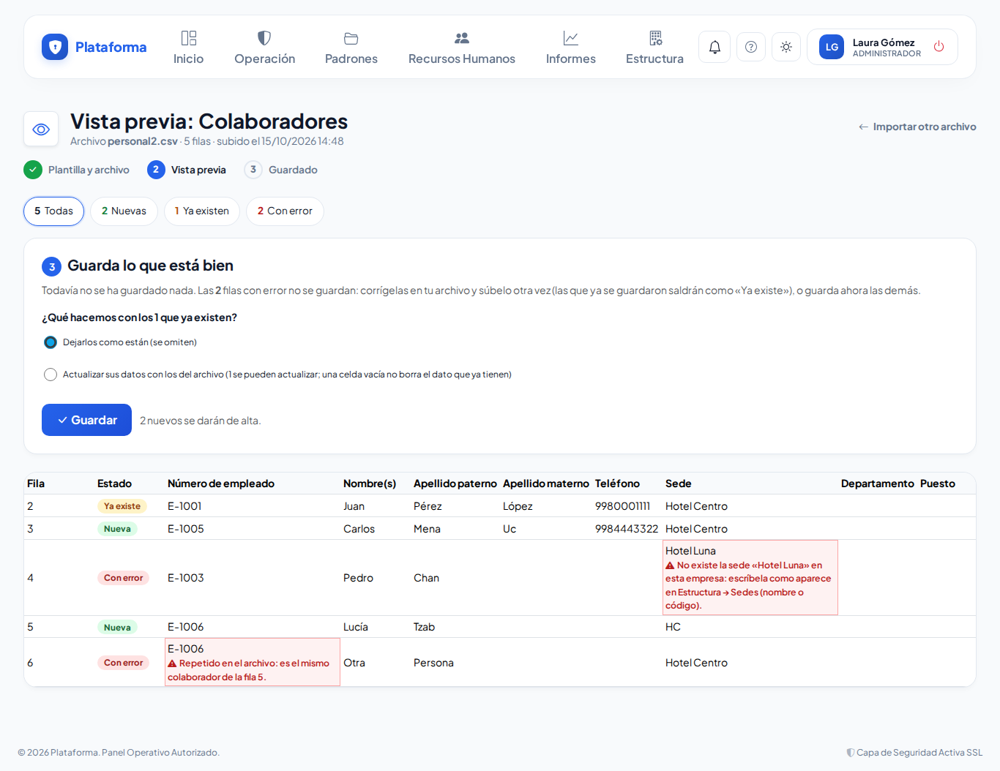
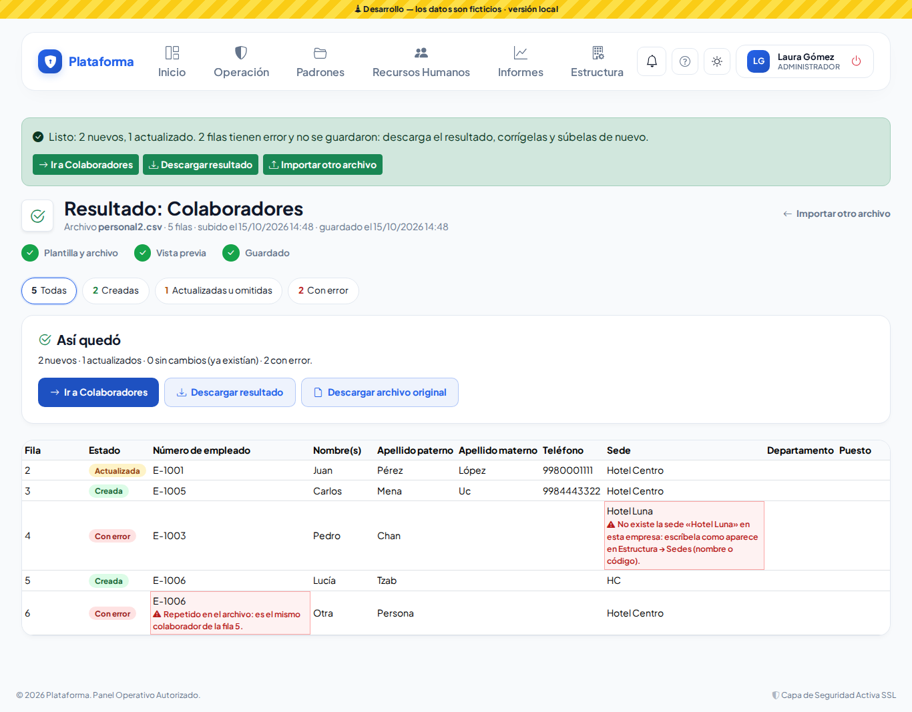

# Importar desde Excel

**¿Para qué sirve?** Para dar de alta muchos registros de una vez en lugar de capturarlos uno por uno: tu plantilla de personal, las empresas externas que te visitan, el padrón de personas, los vehículos o las zonas, pisos y habitaciones de cada sede. Antes de guardar ves una **vista previa** con cada fila marcada como **Nueva**, **Ya existe** o **Con error**; nada se guarda hasta que tú lo decides.

**Antes de empezar:**

- Necesitas que tu rol pueda **Importar** en el módulo (Colaboradores, Padrón de personas, Empresas externas, Padrón vehicular o Zonas y edificios). Si no ves el botón **Importar** en la lista, pide a tu administrador ese permiso.
- Para dar de alta registros nuevos tu rol también debe poder **Crear**; para actualizar los que ya existen, **Editar**.
- Si solo administras algunas sedes, solo puedes importar en tus sedes.
- Ten listas las **sedes**, y si vas a importar colaboradores, los **departamentos**, **puestos** y **turnos**: el archivo los escribe por su nombre y deben existir antes.

## Qué puedes importar

| Lista | Dónde está el botón **Importar** | Con qué se reconoce si ya existe |
|---|---|---|
| Colaboradores | **Estructura → Colaboradores** | Número de empleado (o el nombre completo de un alta de la caseta por verificar) |
| Padrón de personas | **Padrones → Padrón de personas** | Folio de identificación (o el nombre completo si no lo trae) |
| Empresas externas | **Padrones → Empresas externas** | Razón social o nombre comercial |
| Padrón vehicular | **Padrones → Padrón vehicular** | Placas |
| Zonas y edificios | **Estructura → Zonas y edificios** | Sede + zona + piso + habitación |

## Cómo descargar la plantilla

1. Entra a la lista que vas a llenar, por ejemplo **Estructura → Colaboradores**.
2. Toca **Importar** (arriba, junto al buscador).

3. En **Descarga la plantilla**, toca **Descargar plantilla**. Se descarga un archivo de Excel (CSV) con los encabezados en español y una fila de ejemplo.
4. Ábrelo en Excel, **borra la fila de ejemplo** y copia tus datos debajo de los encabezados, una fila por registro.

**Qué debes ver:** el archivo abre en Excel con los encabezados en el renglón 1. Las columnas que llevan **\*** (por ejemplo «Número de empleado \*») son obligatorias; las demás las puedes dejar vacías y completarlas después en la ficha.

> Toca **Qué va en cada columna** (en la misma pantalla) para ver qué escribir en cada columna y un ejemplo. La tabla de abajo («Hoja de instrucciones») dice lo mismo.

## Cómo subir tu archivo y revisar la vista previa

1. En la misma pantalla, en **Sube tu archivo**, toca **Elegir archivo** y elige tu archivo. Sirve el libro de Excel (.xlsx) o el archivo CSV.
2. Toca **Revisar archivo**.
3. Revisa la **vista previa**: arriba ves cuántas filas son **Nuevas**, cuántas **Ya existen** y cuántas tienen **error**. Toca cualquiera de esos números para ver solo esas filas.
4. En las filas con error, la celda que falló se ve en rojo con el motivo debajo (por ejemplo «No existe la sede «Sede Luna» en esta empresa» o «El CURP no tiene el formato correcto»).

**Qué debes ver:** la tabla con todas tus filas y el aviso «Todavía no se ha guardado nada».

## Cómo guardar

1. Si hay filas que **Ya existen**, elige qué hacer con ellas:
   - **Dejarlos como están (se omiten)**: no se toca lo que ya tienes.
   - **Actualizar sus datos con los del archivo**: se cambian con lo que trae tu archivo. Una celda vacía **no borra** el dato que ya tienen.
2. Toca **Guardar**.
3. El aviso verde dice cuántos se crearon, cuántos se actualizaron y cuántos tenían error, con los botones **Ir a …** (la lista) y **Descargar resultado**.

**Qué debes ver:** la pantalla **Resultado** con cada fila marcada como **Creada**, **Actualizada**, **Omitida (ya existía)** o **Con error**. Las filas con error no se guardaron: corrígelas en tu archivo y vuelve a subirlo (las que ya se guardaron saldrán como «Ya existe»).

## Cómo descargar el resultado o el archivo original

1. Entra a **Importar** en la lista.
2. Abajo, en **Archivos anteriores**, toca **Ver** en el archivo que buscas.
3. Toca **Descargar resultado** (tu archivo con la columna «resultado» y el detalle de cada fila) o **Descargar archivo original** (tal como lo subiste).

**Qué debes ver:** el archivo se descarga y abre en Excel. En Colaboradores, si tu rol no ve datos personales, el CURP, RFC y NSS salen ocultos y no puedes bajar el archivo original.

## Hoja de instrucciones: qué va en cada columna

**Colaboradores**

| Columna | Qué escribir |
|---|---|
| Número de empleado \* | El número de nómina. No se repite en la empresa. |
| Nombre(s) \*, Apellido paterno \*, Apellido materno | Como en su identificación. |
| Teléfono | De 10 a 15 dígitos (los espacios y guiones se quitan solos). |
| Sede | El nombre o el código de la sede, como en **Estructura → Sedes**. |
| Departamento, Puesto, Turno | El nombre tal como aparece en **Estructura → Departamentos**, **Puestos** y **Turnos**. |
| CURP, RFC, NSS, Fecha de nacimiento, Estado de nacimiento, Nacionalidad, Correo personal, Dirección completa | Solo si tu rol ve datos personales. Fecha como día/mes/año (31/12/1990). |

**Padrón de personas:** Tipo \* (Visitante, Proveedor o Contratista), Nombre completo \*, Empresa que representa (se liga sola si ya está en Empresas externas; si hay varias parecidas y ninguna se llama exactamente igual, el renglón marca el error para que escribas el nombre exacto), Tipo de identificación (INE, Pasaporte, Licencia de conducir…), Folio de identificación, Teléfono, Categoría (solo visitantes: General, Prospecto de RR. HH. o Familiar) y Motivo de la visita.

**Empresas externas:** Razón social o nombre comercial \*, Categoría \* (Proveedor de insumos / alimentos, Transporte de personal, Contratista, Taxi…), RFC, Teléfono, Dirección y Sedes donde opera («Todas» o los nombres de las sedes separados por coma).

**Padrón vehicular:** Placas \*, Categoría \* («Particular» o «De una empresa»), Tipo \* (Sedán, SUV / Camioneta, Pick-up, Autobús…), Marca \*, Color \*, Modelo, Capacidad, Número económico y Empresa propietaria (obligatorios en los de una empresa; la empresa debe existir en Empresas externas) y Número de empleado del dueño (opcional en los particulares).

**Zonas y edificios:** Sede \*, Zona o edificio \*, Piso y Habitación (u Oficina, según tu giro). Cada fila es un lugar: si la zona o el piso ya existen se usan los que hay y solo se crea lo que falta. Deja vacío el piso si la habitación va directo en la zona.

**Límites:** hasta **2,000 filas** y **5 MB** por archivo (si tienes más, divídelo). Del libro de Excel se lee solo la **primera hoja**, a partir del renglón 1 con los encabezados; las fórmulas toman el último valor que Excel guardó. Las columnas que no son de la plantilla no se toman en cuenta (la vista previa te dice cuáles).

## Si algo sale mal

| Mensaje o síntoma | Qué significa | Qué hacer |
|---|---|---|
| «Faltan las columnas «Número de empleado»…» | Tu archivo no trae los encabezados de la plantilla en el renglón 1. | Descarga la plantilla y copia tus datos en ella sin cambiar los encabezados. |
| «El archivo trae 2,500 filas y el máximo es 2,000 por archivo…» | El archivo es muy grande. | Divídelo en dos o más archivos y súbelos uno por uno. |
| «El archivo no es un libro de Excel (.xlsx) válido…» | El archivo está dañado o no es de Excel. | Ábrelo en Excel y guárdalo de nuevo, o guárdalo como «CSV UTF-8». |
| «No existe la sede «…» en esta empresa…» | La sede está mal escrita o no existe. | Escríbela como en **Estructura → Sedes** (nombre o código). Las sedes no se crean al importar. |
| «Repetido en el archivo: es el mismo … de la fila 5.» | Dos filas tienen el mismo número de empleado, folio o placas. | Deja solo una fila de cada uno. |
| «Elige una de tus sedes: solo puedes registrar colaboradores en ellas.» | Solo administras algunas sedes. | Importa solo las filas de tus sedes o pide a quien administra toda la empresa que lo haga. |
| «No tienes permiso para dar de alta…» | Tu rol puede importar pero no crear. | Pide a tu administrador el permiso «Crear» del módulo. |
| La opción «Actualizar sus datos…» está gris | Tu rol no puede editar ese módulo. | Guarda con «Dejarlos como están» o pide el permiso «Editar». |
| «Este archivo ya se guardó…» | Tocaste **Guardar** dos veces. | Revisa el resultado: ya se guardó una vez. |
| «Tu suscripción está suspendida; tienes acceso de solo consulta…» | La plataforma está en solo consulta. | Puedes descargar plantillas y ver resultados, pero no importar; contacta a quien te vende la plataforma. |

## Preguntas frecuentes

**La caseta ya registró a alguien de mi plantilla sin número, ¿se duplica?** No. Si una fila tiene el mismo nombre que un alta de la caseta por verificar, la vista previa la marca **Ya existe** con «alta de la caseta por verificar: al actualizar se une con ella y queda verificada». Elige actualizar lo que ya existe: el alta toma el número de tu archivo y queda verificada. Solo pasa si no hay duda: si hay otra persona con el mismo nombre o el alta de la caseta es de otra sede que la de tu fila, se da de alta como nueva y el alta de la caseta queda en **Altas por verificar** para que la unas a mano con **Aprobar · es el mismo**.

**¿Se guarda algo cuando reviso el archivo?** No. La vista previa solo te muestra cómo quedaría cada fila. Se guarda cuando tocas **Guardar**.

**¿Qué pasa con las filas que tienen error?** No se guardan; las demás sí. Descarga el resultado, corrige esas filas y súbelas en otro archivo.

**Si actualizo, ¿se borran los datos que dejé vacíos?** No. Una celda vacía conserva el dato que ya tenía el registro.

**¿Puedo usar mi propio Excel con otras columnas?** Sí, mientras el renglón 1 tenga los encabezados de la plantilla (en cualquier orden). Las columnas de más no se toman en cuenta.

**¿Mi Excel guarda los acentos raros?** La plataforma entiende el CSV que guarda Excel en español y también el «CSV UTF-8»; los acentos y la ñ se respetan.

**¿Queda registro de quién importó?** Sí. Cada archivo guardado deja un registro en la Bitácora de auditoría con el nombre del archivo y cuántos registros se crearon, actualizaron u omitieron, y el archivo original se conserva para descargarlo después.

## Relacionado

- [Configura tu empresa](configura-tu-empresa.md)
- [Colaboradores](colaboradores.md)
- [Padrón de personas](personas.md)
- [Empresas externas](proveedores.md)
- [Padrón vehicular](vehiculos.md)
- [Zonas y edificios](zonas-y-areas.md)
