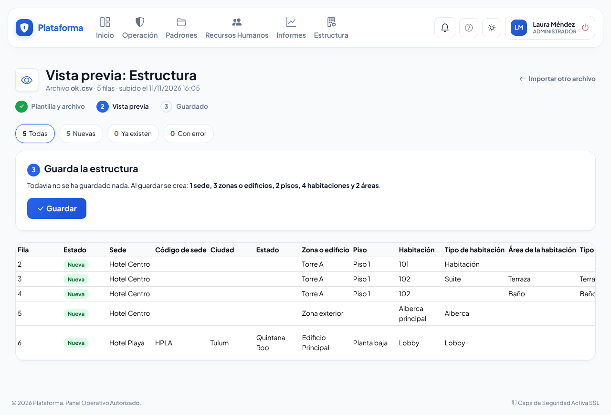
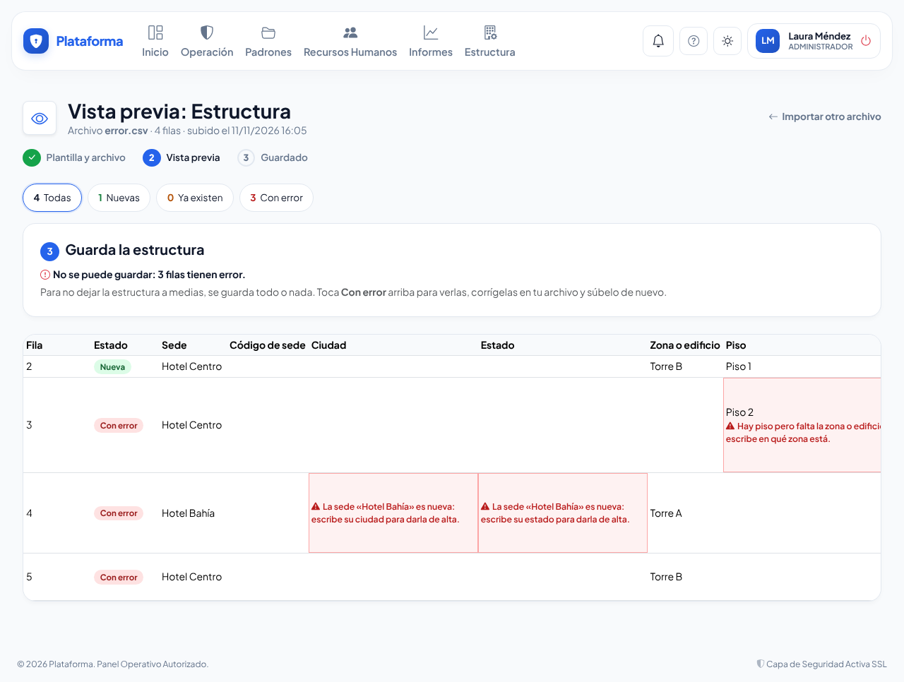
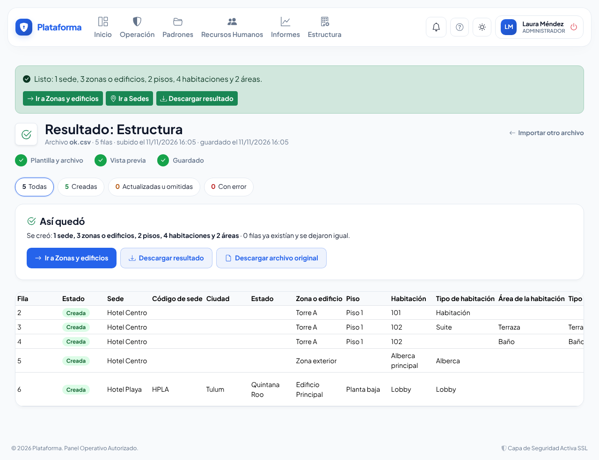

# Importar estructura

**¿Para qué sirve?** Para dar de alta en un solo paso la estructura física de tu empresa: las **sedes**, sus **zonas o edificios**, los **pisos**, las **habitaciones** y las **áreas** de cada habitación (Baño, Terraza, Recámara…). Escribes todo en un archivo de Excel, revisas una **vista previa** y lo guardas. Lo que ya existe se usa tal como está: nada se duplica y nada se borra.

**Antes de empezar:**

- Necesitas que tu rol pueda **Importar** en *Sedes*. De fábrica lo tiene el **Administrador** de la empresa; si no ves el botón **Importar estructura**, pide ese permiso a tu administrador.
- Para dar de alta **sedes nuevas** tu rol también debe poder **Crear** sedes; para dar de alta **zonas, pisos, habitaciones y áreas**, **Crear** en *Zonas y edificios*. Si solo administras algunas sedes, solo puedes agregar lugares en tus sedes.
- Si tu empresa tiene un plan con un número de sedes, el archivo no puede crear más sedes de las que incluye tu plan.
- **Super Administrador:** arriba de la pantalla elige la empresa en **Empresa de trabajo**; todo lo que importes queda en esa empresa.

## Cómo descargar la plantilla

1. Entra a **Estructura → Sedes**.
2. Toca **Importar estructura** (arriba a la derecha).
3. Toca **Descargar plantilla**. Se descarga un libro de Excel con dos hojas:
   - **Estructura**: los encabezados y unos renglones de ejemplo con nombres ficticios. Bórralos y escribe los tuyos.
   - **Instrucciones**: qué va en cada columna y los tipos de habitación y de área que ya tienes.

**Qué debes ver:** un archivo «Plantilla_Estructura_…xlsx». Al abrirlo, la primera hoja se llama **Estructura**.

## Cómo llenar el archivo

Escribe **un renglón por lugar** con su camino completo, de lo general a lo particular. Por ejemplo, para la habitación 101 del piso 1 de la Torre A del Hotel Centro:

| Sede | Zona o edificio | Piso | Habitación | Tipo de habitación | Área de la habitación | Código |
|---|---|---|---|---|---|---|
| Hotel Centro | Torre A | Piso 1 | 101 | Habitación | | TA-101 |
| Hotel Centro | Torre A | Piso 1 | 102 | Suite | Terraza | |
| Hotel Centro | Torre A | Piso 1 | 102 | | Baño | |
| Hotel Centro | Zona exterior | | Alberca principal | Alberca | | |

Qué va en cada columna:

| Columna | Qué escribir |
|---|---|
| **Sede \*** | El nombre o el código de la sede. Es la única columna obligatoria. Si la sede no existe, se da de alta. |
| **Código de sede** | Solo para una sede nueva: letras, números y guiones, hasta 10. Si lo dejas vacío, lo armamos con su nombre. |
| **Ciudad** y **Estado** | Obligatorios solo cuando la sede es nueva. Basta con escribirlos en el primer renglón de esa sede. |
| **Zona o edificio** | Torre, edificio, ala o zona exterior. Vacío si el renglón es solo la sede. |
| **Piso** | Vacío si la habitación está directo en la zona (una alberca, un lobby). |
| **Habitación** | El nombre o número de la habitación. Vacío si solo quieres crear la zona o el piso. |
| **Tipo de habitación** | Opcional (Habitación, Suite…). Si el tipo no está en tu lista, se agrega. |
| **Área de la habitación** | Una parte de la habitación: Baño, Terraza, Recámara… Vacío si no aplica. |
| **Tipo de área** | Opcional. Si el tipo no está en tu lista, se agrega. |
| **Código** | Opcional: la clave o número del **último** lugar del renglón (hasta 20 caracteres). |

<!-- solo: corporativo -->
En tu empresa la columna se llama **Oficina** (y **Tipo de oficina**, **Área de la oficina**): una oficina, una sala de juntas, un almacén.
<!-- fin -->
<!-- solo: condominio, fraccionamiento -->
En tu empresa la columna se llama **Vivienda** (y **Tipo de vivienda**, **Área de la vivienda**). Hay además una columna **Área común**: escribe **Sí** si el lugar es la alberca, el salón o la casa club; déjala vacía o escribe **No** si es una vivienda.
<!-- fin -->

**Reglas que conviene saber:**

- **Sin huecos en medio:** un piso necesita su zona; un área necesita su habitación. El piso sí puede quedar vacío.
- **No importan mayúsculas, acentos ni espacios de más:** «torre a», «TORRE A» y «Torre  A» son la misma zona.
- **No repitas renglones:** dos renglones con el mismo camino se marcan como repetidos.
- **Solo se lee la primera hoja.** Hasta **5,000 renglones** y **5 MB** por archivo; si tienes más, divídelo.
- También sirve un archivo CSV (guárdalo en Excel como «CSV UTF-8»).

## Cómo subir el archivo y revisar la vista previa

1. En **Importar estructura**, en **Sube tu archivo**, toca **Elegir archivo** y elige tu libro.
2. Toca **Revisar archivo**.
3. Revisa la tabla: cada renglón sale como **Nueva** (se va a crear), **Ya existe** (se deja igual) o **Con error** (con el motivo en rojo en la celda que hay que corregir).

**Qué debes ver:** arriba, los conteos **Nuevas**, **Ya existen** y **Con error** (tócalos para filtrar) y, en **Guarda la estructura**, todo lo que se va a crear: por ejemplo «1 sede, 3 zonas o edificios, 2 pisos, 4 habitaciones y 2 áreas». En el **Detalle** de cada renglón ves qué crea ese renglón. Todavía no se ha guardado nada.

## Cómo corregir los errores

Para no dejar la estructura a medias, se guarda **todo o nada**: si un solo renglón tiene error, el botón **Guardar** no aparece.

1. Toca **Con error** para ver solo esos renglones. El número de **Fila** es el renglón de tu archivo.
2. Corrige cada uno en tu archivo de Excel.
3. Toca **Importar otro archivo** y súbelo de nuevo.

## Cómo guardar

1. Cuando la vista previa no tenga errores, toca **Guardar**.

**Qué debes ver:** «Listo: 1 sede, 3 zonas o edificios, 2 pisos, 4 habitaciones y 2 áreas.» con los botones **Ir a Zonas y edificios**, **Ir a Sedes** y **Descargar resultado**. Las sedes, zonas y habitaciones ya aparecen en sus pantallas.

## Cómo descargar la estructura que ya tienes

1. En **Importar estructura** toca **Descargar lo que ya hay**.

**Qué debes ver:** un libro «Estructura_…xlsx» con tus sedes, zonas, pisos, habitaciones y áreas activas, en el mismo formato de la plantilla. Te sirve de **respaldo** y para **agregar renglones** y volver a subirlo: lo que ya existe sale como **Ya existe** y solo se crea lo nuevo.

## Si algo sale mal

| Mensaje o síntoma | Qué significa | Qué hacer |
|---|---|---|
| «La sede «…» es nueva: escribe su ciudad para darla de alta.» | La sede no existe y le falta la ciudad o el estado. | Escribe su ciudad y su estado en ese renglón. |
| «Hay piso pero falta la zona o edificio…» | Hay un nivel vacío en medio. | Escribe la zona o edificio de ese piso. |
| «Hay área pero falta la habitación…» | El área no dice de qué habitación es. | Escribe la habitación. |
| «Repetido en el archivo (igual a la fila 5).» | Dos renglones dicen exactamente lo mismo. | Borra uno. |
| «La sede «…» ya existe con el código «…»…» | El código de sede no es el que ya tiene. | Deja vacía la columna o escribe el código que tiene. |
| «La sede «…» está dada de baja…» | No se agregan lugares a una sede dada de baja. | Reactívala en **Estructura → Sedes** y vuelve a subir el archivo. |
| «… está desactivado: reactívalo antes de agregarle espacios.» | La zona, el piso o la habitación están dados de baja. | Reactívalo en **Zonas y edificios** y vuelve a subir el archivo. |
| «Tu plan incluye 2 sedes y ya tienes 2 activas…» | El archivo crearía más sedes de las de tu plan. | Amplía tu plan en **Empresas → Tu suscripción** o quita esas sedes del archivo. |
| «… admite hasta 100 caracteres…» | El nombre es demasiado largo. | Acórtalo. |
| «El archivo trae 5,500 filas y el máximo es 5,000…» | El archivo es muy grande. | Divídelo en dos y súbelos uno por uno. |
| «No se guardó nada: … algo cambió desde la vista previa.» | Mientras revisabas, alguien dio de baja un lugar que el archivo usa. | Revisa los renglones con error, corrige y sube el archivo de nuevo. |
| No ves **Importar estructura** | Tu rol no tiene el permiso **Importar** de *Sedes*. | Pídelo a tu administrador. |

## Preguntas frecuentes

- **¿Si subo el mismo archivo dos veces se duplica todo?** No. La segunda vez todo sale como **Ya existe** y no se crea nada.
- **¿Puedo cambiar el nombre o el tipo de algo que ya existe con el archivo?** No: importar solo agrega. Los cambios se hacen en **Zonas y edificios** o en **Sedes**.
- **¿Importar borra lo que no viene en mi archivo?** No. Nunca borra ni da de baja nada.
- **¿Puedo importar elementos (camas, extintores)?** No con este archivo: se agregan en **Zonas y edificios**, dentro de cada habitación o área.
- **¿En qué se diferencia de «Importar» en Zonas y edificios?** Aquí también se crean sedes, áreas de la habitación y tipos nuevos, y se guarda todo o nada.

## Relacionado

- [Empresas y sedes](empresas-y-sedes.md)
- [Zonas y edificios](zonas-y-areas.md)
- [Importar desde Excel](importar-desde-excel.md)
- [Glosario](glosario.md)
