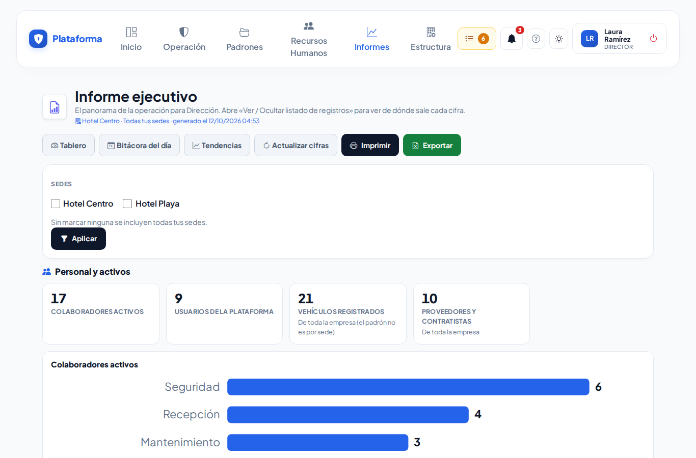
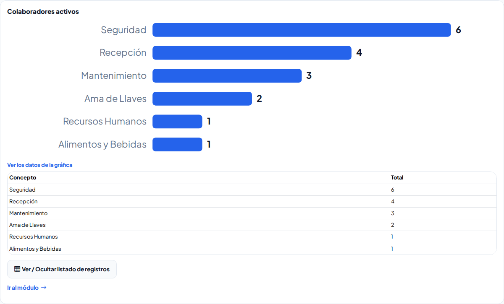
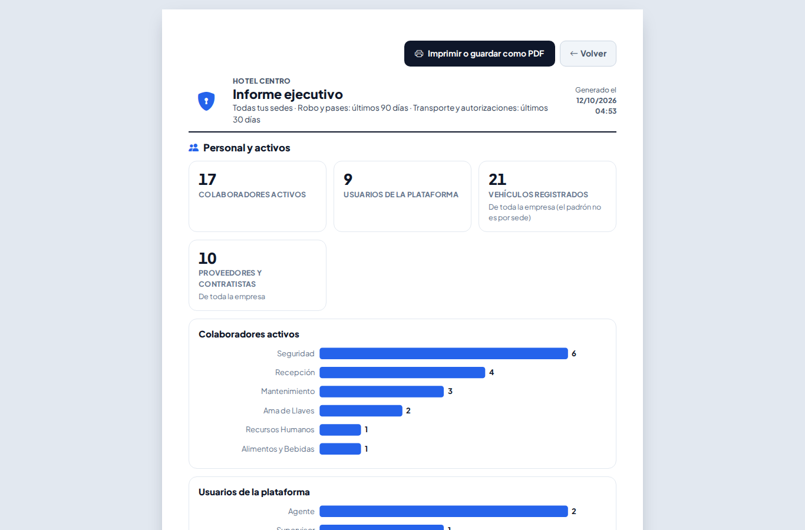

# Informe ejecutivo

**¿Para qué sirve?** Para que Dirección vea en una sola pantalla cómo está la operación: personal y activos, seguridad física, robos y pases de salida de los últimos 90 días, transporte de los últimos 30 días, candidatos y vacantes, y autorizaciones. Cada bloque trae sus cifras, su gráfica y el listado de registros de donde salen. Se puede imprimir en hoja carta o guardar como PDF.

**Antes de empezar:** necesitas que tu rol pueda **ver** el Informe ejecutivo. Cada ficha aparece solo si además puedes ver su módulo (Colaboradores, Usuarios, Préstamo de llaves, Robo, Pases de salida, Transporte, Candidatos, Vacantes, Autorizaciones…). **Imprimir** y **Exportar** piden su propio permiso. Si te falta algo, pide a tu administrador que revise tu rol.

## Cómo leer el informe

1. Entra a **Informes → Informes → Informe ejecutivo**.
2. Arriba ves la empresa, las sedes que incluye y la hora en que se generó.
3. Recorre los bloques: **Personal y activos**, **Seguridad física**, **Robo — últimos 90 días**, **Pases de salida — últimos 90 días**, **Transporte — últimos 30 días**, **Candidatos y vacantes**, **Autorizaciones — últimos 30 días** y, si tu empresa usa Reservas, **Eventos de hoy** (los eventos confirmados del día con su horario, área y personas esperadas).

**Qué debes ver:** cifras grandes; en rojo lo que pide atención (por ejemplo, robos sin parte a la policía o pases vencidos) y en verde lo que va bien.

## Cómo ver de dónde sale una cifra

1. Debajo de las cifras de cada bloque está su gráfica.
2. Toca **Ver / Ocultar listado de registros** para ver los registros (hasta 100).
3. Toca **Ir al módulo** para abrir la pantalla completa.

**Qué debes ver:** el listado sin datos personales: nunca aparecen CURP, RFC, NSS, teléfonos ni solicitudes de empleo. En **Candidatos y vacantes** solo hay cifras por etapa y por vacante, sin nombres.

## Cómo elegir las sedes

1. Si trabajas en varias sedes, marca las que quieres en **Sedes** (sin marcar ninguna se incluyen todas las tuyas).
2. Toca **Aplicar**.

**Qué debes ver:** la línea de arriba dice qué sedes incluye. Vehículos y Proveedores son de toda la empresa (esos padrones no son por sede).

## Cómo imprimir o guardar como PDF

1. Toca **Imprimir** (solo aparece si tu rol puede imprimir el Informe ejecutivo). Se abre una hoja carta sin menús, con el logo, la empresa, la fecha y los periodos.
2. Toca **Imprimir o guardar como PDF** y, en la ventana de impresión, elige tu impresora o **Guardar como PDF**.

## Cómo exportar a Excel

1. Toca **Exportar** (solo si tu rol puede exportar el informe).
2. Se descarga un archivo de Excel (CSV) con cada bloque, indicador y valor.

## Si algo sale mal

| Mensaje o síntoma | Qué significa | Qué hacer |
|---|---|---|
| «Tu rol no puede consultar ninguno de los módulos que forman este informe» | Tienes el informe pero ningún módulo de origen. | Pide a tu administrador los permisos de los módulos. |
| Una cifra no cambió después de capturar algo | Las cifras se guardan 5 minutos para que la pantalla abra rápido. | Toca **Actualizar cifras**. |
| No aparece **Exportar** | Tu rol no puede exportar este informe. | Pide el permiso **Exportar**. |
| No aparece **Imprimir** | Tu rol no puede imprimir este informe. | Pide el permiso **Imprimir** del Informe ejecutivo. |
| «No tienes permiso para ver esto» al abrir la hoja para imprimir | Te quitaron el permiso **Imprimir** o abriste un enlace guardado. | Pide el permiso **Imprimir** a tu administrador. |
| Falta un bloque | No puedes ver ese módulo, o por un momento no se pudo calcular. | Toca **Actualizar cifras**; si sigue sin salir, pide el permiso. |

## Preguntas frecuentes

**¿Qué es «Tiempo para cubrir»?** El promedio de días entre que se publicó una vacante y se cerró como cubierta, de las cerradas en los últimos 180 días.

**¿Qué es una autorización «escalada»?** Una que nadie respondió a tiempo y pasó al suplente o al jefe.

**¿Puedo ver la tendencia de una cifra?** Sí: toca **Tendencias** arriba.

**¿Y lo que pasó hoy?** Toca **Bitácora del día**.

## Relacionado

[Tablero](tablero.md) · [Tendencias](tendencias.md) · [Bitácora general del día](bitacora-del-dia.md) · [Lost & Found y Robo](lost-found-y-robo.md) · [Transporte](transporte.md) · [Candidatos](candidatos.md)
