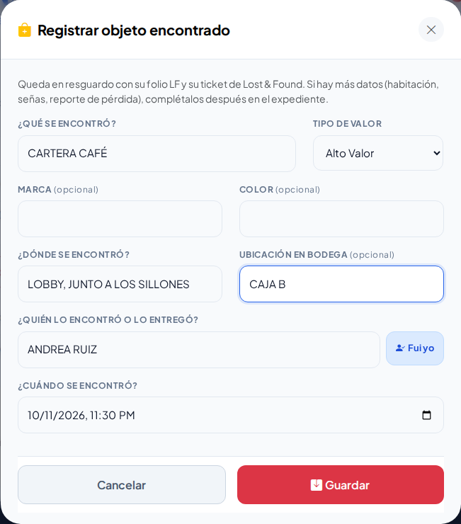
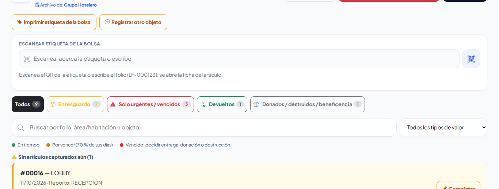
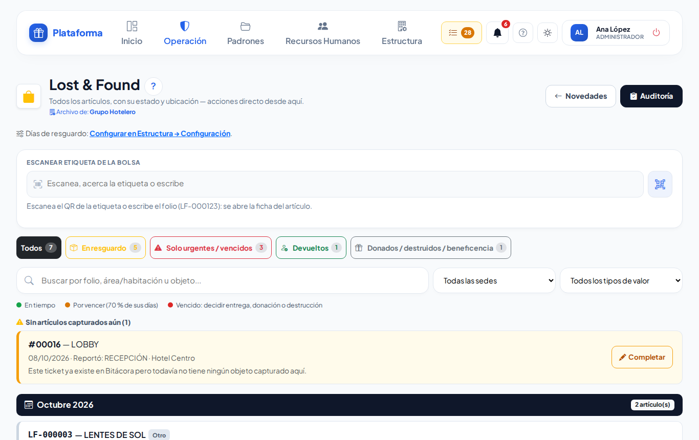
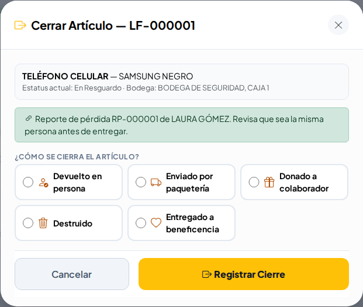
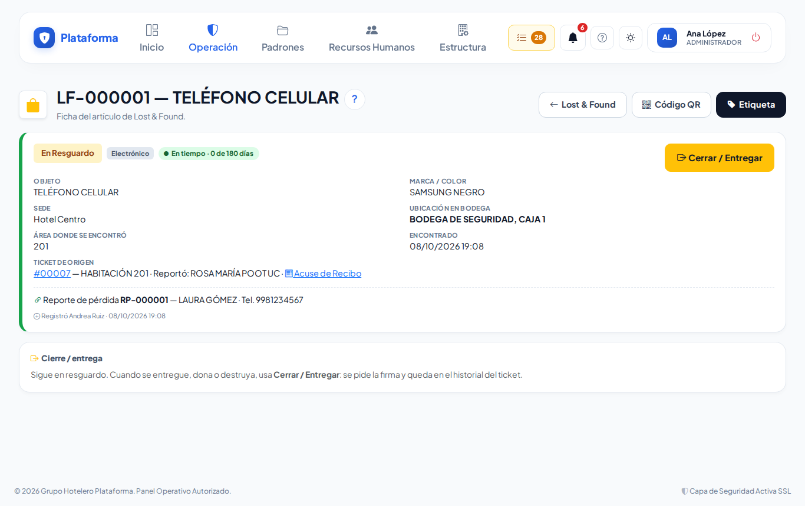
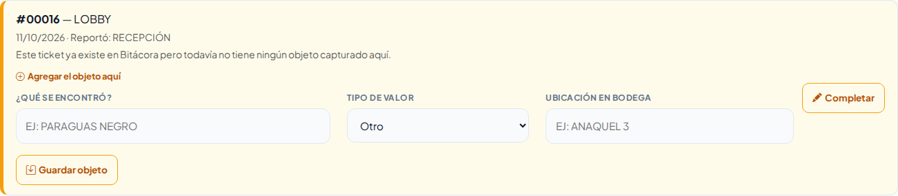
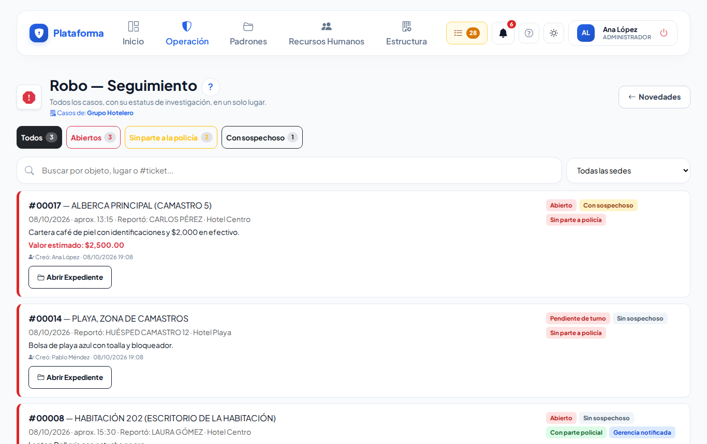
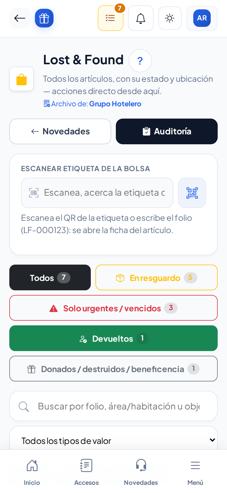

# Lost & Found y Robo

**¿Para qué sirve?**

- **Lost & Found** es el archivo de los objetos encontrados: dónde están guardados, cuántos días llevan y a quién se entregaron.
- **Robo** reúne los casos de robo para darles seguimiento sin buscarlos entre las demás novedades.

Los casos de robo **se registran en la [Bitácora de novedades](novedades.md)** (ticket de Robo). Un objeto encontrado se registra aquí mismo con **Registrar objeto encontrado** (la plataforma crea su ticket por ti) o desde un ticket de Lost & Found en la Bitácora. Aquí se consultan, se entregan y se imprimen.

**Antes de empezar:** necesitas que tu rol pueda **ver** Lost & Found o Robo. Para registrar un objeto se necesita **crear** tickets en la Bitácora o en Lost & Found; para entregarlo, **firmar**; para imprimir etiquetas, **imprimir**. Si no ves un botón, pide a tu administrador que revise tu rol.

## Cómo registrar un objeto encontrado

1. Entra a **Operación → Incidentes → Lost & Found** y toca **Registrar objeto encontrado**.
2. Escribe **¿Qué se encontró?** (por ejemplo «Paraguas negro») y elige el **Tipo de valor**. Marca y color son opcionales.
3. Escribe **¿Dónde se encontró?** y, si ya lo guardaste, la **Ubicación en bodega**.
4. En **¿Quién lo encontró o lo entregó?** escribe el nombre o toca **Fui yo**. Revisa **¿Cuándo se encontró?** (trae la hora actual).
5. Toca **Guardar**.

**Qué debes ver:** el mensaje verde con el folio (**LF-…**) y el número de ticket, y dos botones para seguir: **Imprimir etiqueta de la bolsa** y **Registrar otro objeto**. Si hay más datos (habitación, señas, un reporte de pérdida), complétalos después en el expediente del ticket.

## Cómo leer el archivo de Lost & Found

1. Entra a **Operación → Incidentes → Lost & Found**.
2. Cada renglón dice el folio y el objeto (por ejemplo **LF-000123 — CARTERA**), cuándo se encontró, **cuántos días lleva en resguardo**, marca, color, dónde se encontró y en qué **Bodega** está.
3. El **color** es el semáforo: **verde** en tiempo, **ámbar** por vencer, **rojo** vencido.
4. Usa los filtros (**Todos**, **En resguardo**, **Solo urgentes / vencidos**, **Devueltos**…) o escribe en el buscador: se aplican solos.

**Qué debes ver:** si un huésped ya reportó el objeto como perdido, el renglón dice **Reporte de pérdida RP-…** con su nombre.

Para abrir un objeto rápido, en **Escanear etiqueta de la bolsa** escanea el QR de su etiqueta o escribe su folio.

## Cómo entregar o cerrar un objeto

1. Toca **Cerrar / Entregar** en el renglón (o en la ficha del objeto).
2. Elige **¿Cómo se cierra el artículo?**:
   - **Devuelto en persona**: a un huésped o persona externa (nombre e identificación) o a un colaborador (escanea su gafete). Si alguien reportó la pérdida, su nombre ya viene: **revisa que sea la misma persona**.
   - **Enviado por paquetería**: nombre, paquetería y número de guía.
   - **Donado a colaborador**: escanea el gafete del colaborador.
   - **Destruido**.
   - **Entregado a beneficencia**: escribe la institución.
3. Pide la **firma** en el recuadro (quien recibe, o quien autoriza).
4. Toca **Registrar Cierre**.

**Qué debes ver:** el renglón cambia a **Devuelto al Huésped**, **Donado a Colaborador**, etc., y el cierre queda en el Minuto a Minuto del ticket. Sin firma no se registra.

## Cómo ver la ficha de un objeto

1. Toca el **ojo** del renglón.
2. Revisa dónde está, de qué ticket viene (con su **Acuse de Recibo**), reportes de pérdida o robos ligados y, si se entregó, a quién, cuándo y la firma.

## Cómo imprimir la etiqueta de la bolsa

1. Toca el botón de **etiqueta** (en el renglón o en la ficha).
2. Toca **Imprimir Etiqueta** y pégala en la bolsa.

**Qué debes ver:** al escanear la etiqueta se abre la ficha del objeto.

## Cómo hacer la auditoría de bodega

1. Toca **Auditoría**.
2. Elige la sede y las fechas y toca **Aplicar**.
3. Imprime la lista, marca cada objeto que encuentres y anota las diferencias. Al final firman quien contó y quien cotejó.

**Qué debes ver:** la lista de lo que debería estar en bodega hoy.

## Cómo cambiar los días de resguardo

Cada tipo de objeto (Otro, Alto Valor, Electrónico, Ropa, Perecedero) tiene cuántos días puede estar guardado antes de que el semáforo lo marque: **amarillo** al pasar el 70 % de sus días y **rojo (vencido)** al llegar a sus días.

1. En el archivo de Lost & Found toca **Días de resguardo** (arriba, junto a **Auditoría**). Solo lo ve quien puede configurar Lost & Found.
2. Escribe los días de cada tipo (mínimo 1). Debajo de cada uno dice desde qué día se pone amarillo y rojo, y quién lo cambió por última vez.
3. Toca **Guardar**.

**Qué debes ver:** «Días de resguardo guardados: el semáforo ya los usa…» y la lista de **urgentes / vencidos** con los días nuevos. Aplica a todas las sedes de la empresa y es el mismo dato que en **Estructura → Configuración**.

Si tu rol puede configurar Lost & Found solo en tu sede, la ventana te muestra los días pero sin **Guardar**: son de toda la empresa y los cambia tu administrador.

## Cómo completar un ticket sin artículos

Arriba de la lista, **Sin artículos capturados aún** muestra los tickets de Lost & Found que todavía no tienen objeto.

1. Toca **Agregar el objeto aquí** en el ticket.
2. Escribe **¿Qué se encontró?**, el **Tipo de valor** y la **Ubicación en bodega**.
3. Toca **Guardar objeto**.

**Qué debes ver:** el objeto aparece en el archivo con su folio y el ticket sale de la lista. Para capturar más (habitación, reporte de pérdida) usa **Completar**, que abre el expediente.

## Cómo dar seguimiento a un robo

1. Entra a **Operación → Incidentes → Robo**.
2. Filtra (**Todos**, **Abiertos**, **Sin parte a la policía**, **Con sospechoso**) o busca por objeto, lugar o número de ticket.
3. Toca **Abrir Expediente** en el caso. Se abre el **mismo expediente** de la Bitácora de novedades (una sola ficha por robo), con el enlace **Volver a Seguimiento de robos**.
4. Completa circunstancias, sospechoso, testigos y canalización, y anota el avance en el **Minuto a Minuto**.
5. Toca **Buscar Coincidencias en Lost & Found**: si ya se encontró algo parecido, tócalo y **Vincular**.
6. Toca **Guardar Expediente**: regresas a la lista de robos. Para cerrarlo, elige **Resuelto y Cerrado** y escribe cómo se resolvió.

Si tu rol solo trabaja robos (no la Bitácora completa), el expediente se abre aquí mismo, con el mismo orden y los mismos nombres.

**Qué debes ver:** las etiquetas del caso (**Abierto**, **Con sospechoso**, **Sin parte a policía**…) y, si se ligó, **Vinculado con el hallazgo LF-…**.

## En el celular

## Si algo sale mal

| Mensaje o síntoma | Qué significa | Qué hacer |
|---|---|---|
| «Elige cómo se cierra el artículo.» | Falta el tipo de cierre. | Elige una opción. |
| El recuadro de firma se pone rojo | Falta la firma. | Pide la firma y vuelve a registrar. |
| «Escribe el nombre de quien recibe.» | Falta quién recibe. | Escríbelo. |
| «Escribe el número de guía del envío.» | Falta la guía de paquetería. | Escríbela. |
| «Escanea el gafete o busca al colaborador que recibe el artículo.» | Falta el colaborador. | Escanea su gafete. |
| «Este caso ya está Resuelto. Reábrelo antes de vincular un hallazgo.» | El robo está cerrado. | Reábrelo en la Bitácora de novedades. |
| No veo **Cerrar / Entregar** | Tu rol solo consulta. | Pide a tu supervisor que lo entregue. |
| «Los días de «Ropa» deben ser al menos 1: un artículo no puede vencer el mismo día que se encuentra.» | Escribiste 0 o dejaste vacío un tipo en **Días de resguardo**. | Escribe 1 o más y toca **Guardar**. |
| No veo **Días de resguardo** | Tu rol no configura Lost & Found. | Pide a tu administrador que cambie los días. |
| «Escribe qué objeto se encontró (por ejemplo: paraguas, cartera, celular).» | Falta el objeto. | Escríbelo. |
| «Escribe dónde se encontró (por ejemplo: Lobby, junto a los sillones).» | Falta el lugar. | Escríbelo. |
| «Escribe quién lo encontró o lo entregó (o toca «Fui yo»).» | Falta quién lo trajo. | Escribe el nombre o toca **Fui yo**. |
| «Solo se agregan objetos a un ticket de Lost & Found que siga abierto.» | El ticket se cerró o no es de Lost & Found. | Registra el objeto como nuevo. |

## Preguntas frecuentes

- **¿Dónde registro un objeto encontrado?** Aquí, con **Registrar objeto encontrado**, o en la [Bitácora de novedades](novedades.md) con un ticket de **Lost & Found** (el ticket rápido ya pide el objeto).
- **¿Qué pasa cuando un objeto se vence?** Se pone en rojo; tu supervisor decide si se dona, se destruye o se entrega a beneficencia.
- **¿Puedo volver a cerrar un objeto ya entregado?** No; un objeto cerrado no se vuelve a cerrar.
- **¿Qué es «Sin artículos capturados aún»?** Tickets de Lost & Found sin objetos anotados; toca **Agregar el objeto aquí** (o **Completar** para abrir el expediente).

## Relacionado

- [Bitácora de novedades](novedades.md)
- [Etiquetas QR](etiquetas-qr.md)
- [Bitácora de accesos](accesos.md)
