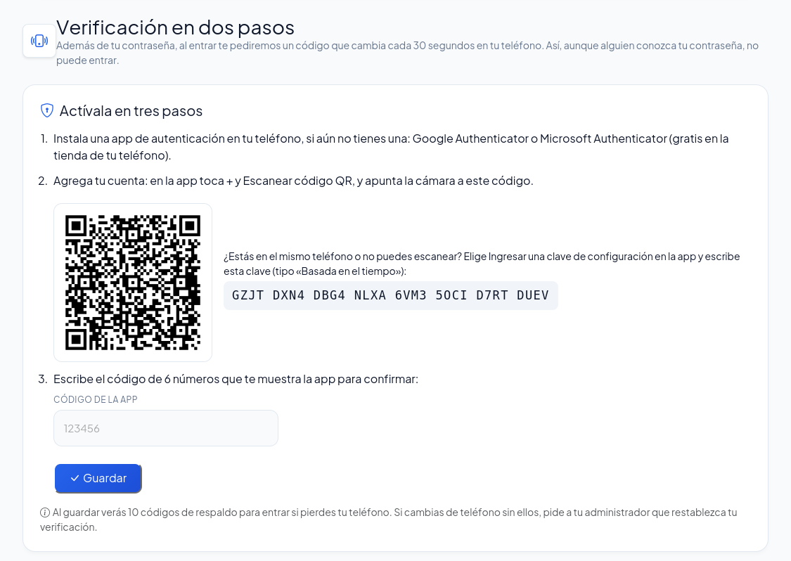

# Mi cuenta

**¿Para qué sirve?** Para ver los datos de tu cuenta (nombre, usuario, correo, rol y sede) y **cambiar tu contraseña** cuando quieras. Tu contraseña es solo tuya: nadie más la conoce, ni quien te dio de alta ni quien administra la plataforma.

**Antes de empezar:** solo necesitas haber entrado con tu usuario. No hace falta ningún permiso: todos tienen su pantalla **Mi cuenta**.

## Cómo abrir Mi cuenta

1. En la computadora, toca tu **nombre** (arriba a la derecha, junto al botón de apagar).
2. En el celular, toca tu **avatar** (el círculo con tus iniciales arriba a la derecha) o abre **Menú** y, en **Sesión**, toca **Mi cuenta**.

**Qué debes ver:** la pantalla **Mi cuenta** con las tarjetas **Mis datos** y **Cambiar mi contraseña** y, debajo, **Verificación en dos pasos**.

Si tu cuenta no tiene correo (por ejemplo, una cuenta de caseta), en **Correo** dice **«Sin correo: si olvidas tu contraseña, pide ayuda a tu administrador.»** Ver [Entrar y salir de la plataforma](inicio-de-sesion.md).

## Cómo cambiar mi contraseña

1. En **Cambiar mi contraseña** escribe tu **Contraseña actual**.
2. Escribe la **Contraseña nueva**: mínimo 8 caracteres, con letras y números; no puede contener tu usuario ni tu correo, ni ser de las más usadas. El **ojo** muestra lo que escribes.
3. En **Repite la contraseña nueva** escríbela otra vez, igual.
4. Toca **Guardar**.

**Qué debes ver:** «Tu contraseña cambió y cerramos tus otras sesiones. Ya puedes seguir trabajando: toca «Inicio» para volver al panel.» Además llega un aviso a tu **campana** («Cambiaste tu contraseña»). Si tenías la plataforma abierta en otro equipo, ahí se cerró la sesión: vuelve a entrar con la contraseña nueva.

## Cómo crear mi contraseña en el primer acceso

Si quien te dio de alta escribió tu contraseña inicial (o te restableció una), al entrar la plataforma te lleva directo a **Mi cuenta** con el aviso **«Crea tu propia contraseña para continuar»**. Hasta que la cambies no puedes usar ninguna otra pantalla (solo salir).

1. En **Contraseña actual** escribe la contraseña que te dieron.
2. Escribe y repite tu **Contraseña nueva**.
3. Toca **Guardar**.

**Qué debes ver:** el aviso desaparece y ya puedes tocar **Inicio** y trabajar normalmente. Desde ese momento, nadie más conoce tu contraseña.

> Si en vez de una contraseña te llegó un **correo de bienvenida**, no necesitas este paso: toca **Crear mi contraseña** en el correo, escríbela dos veces y entra con ella.

## Cómo activar la verificación en dos pasos

Con la verificación en dos pasos, al entrar te pedimos tu contraseña **y** un código de 6 números que cambia cada 30 segundos en tu teléfono. Aunque alguien conozca tu contraseña, sin tu teléfono no puede entrar.

1. En tu teléfono instala una app de autenticación gratuita: **Google Authenticator** o **Microsoft Authenticator** (búscala en la tienda de tu teléfono).
2. En **Mi cuenta**, baja a **Verificación en dos pasos** y toca **Activar la verificación en dos pasos**.
3. En la app de tu teléfono toca **+** y **Escanear código QR**, y apunta la cámara al código de la pantalla.
   - Si estás en el mismo teléfono o no puedes escanear, en la app elige **Ingresar una clave de configuración** y escribe la clave de letras y números que aparece junto al código (tipo «Basada en el tiempo»).
4. En **Código de la app** escribe los 6 números que te muestra la app y toca **Guardar**.
5. Aparecen tus **10 códigos de respaldo**. Toca **Imprimir** o cópialos en un lugar seguro. **Es la única vez que los verás.** Después toca **Ya los guardé: volver al inicio**.

**Qué debes ver:** «Listo: la verificación en dos pasos quedó activa…» y, en **Mi cuenta**, la etiqueta verde **Activa** con cuántos códigos de respaldo te quedan. En tu **campana** llega «Activaste la verificación en dos pasos».

> Si tu empresa la exige para tu cuenta (o eres Super Administrador), al entrar la plataforma te lleva directo a esta pantalla con el aviso «Tu cuenta necesita la verificación en dos pasos». Hasta activarla solo puedes usar **Mi cuenta** y salir.

## Cómo entrar si perdí o cambié mi teléfono

- **Con tus códigos de respaldo:** en la pantalla del código escribe uno de ellos (por ejemplo `ABCD-EF23`) en vez del código de la app. Cada uno sirve **una sola vez**. Ya dentro, entra a **Mi cuenta** y vuelve a activar la verificación con tu teléfono nuevo (primero quítala o pide que la restablezcan).
- **Sin códigos de respaldo:** escribe tu usuario y tu contraseña y, en la pantalla del código, toca **¿No tienes tu teléfono?** → **Perdí mi teléfono: pedir ayuda**. Tu petición llega a los pendientes de tu administrador; búscalo en persona. Cuando la restablezca, entras solo con tu contraseña y la activas otra vez con tu teléfono nuevo.
- **Si eres Super Administrador:** el mismo botón avisa a los **otros Super Administradores**, que te la restablecen desde **Configuración → Plataforma → Super Administradores**. No hace falta entrar al servidor.

## Cómo crear códigos de respaldo nuevos

Hazlo si ya usaste varios o si crees que alguien los vio.

1. En **Mi cuenta → Verificación en dos pasos**, en **Códigos de respaldo nuevos**, escribe tu contraseña.
2. Toca **Restablecer códigos de respaldo**.

**Qué debes ver:** «Códigos nuevos listos: los anteriores ya no sirven…» y los 10 códigos nuevos (una sola vez). Guárdalos o imprímelos.

## Cómo quitar la verificación en dos pasos

1. En **Mi cuenta → Verificación en dos pasos**, en **Quitar la verificación**, escribe tu contraseña y un código de la app (o uno de respaldo).
2. Toca **Dar de baja la verificación** y confirma con **Aceptar**.

**Qué debes ver:** «Quitaste la verificación en dos pasos: ya solo se pide tu contraseña…». Si tu empresa la exige para tu cuenta, o eres Super Administrador, en lugar del formulario verás que **no se puede quitar**.

## Cómo elegir qué avisos recibo

1. Abre **Mi cuenta** y baja a **Mis avisos**.
2. En **En la campana** y **Por correo** aparecen, por módulo, los avisos que te pueden llegar. Quita la marca de los que no quieres recibir.
3. Toca **Guardar**.

**Qué debes ver:** «Listo: silenciaste N aviso(s). Lo que espera tu respuesta sigue apareciendo en «Mis pendientes».» Los avisos de tu propia cuenta (por ejemplo, «tu contraseña cambió») siempre llegan. Si tu empresa apagó un aviso para todos en Configuración, no te llega aunque lo tengas marcado.

## Cómo activar los avisos en este navegador

Con los avisos activos, tu computadora te muestra un aviso (en la esquina de la pantalla) cuando llega una notificación nueva, **aunque estés en otra pestaña o en otro programa**, siempre que la plataforma siga abierta en alguna pestaña y tu sesión no haya terminado.

1. Abre **Mi cuenta** y busca **Avisos en este navegador**. (También está al final de la lista de la **campana**.)
2. Toca **Activar avisos en este navegador**.
3. El navegador te pregunta si quieres permitir las notificaciones: elige **Permitir**.

**Qué debes ver:** un aviso de prueba «Avisos activos» y, en la pantalla, el texto en verde «Avisos activos en este navegador…» con el botón **Apagar avisos en este navegador**.

**Qué esperar después:**

- Cada notificación nueva aparece como aviso con su título y su texto. Si tocas el aviso, se abre la pestaña de la plataforma directo en el asunto y la notificación queda leída.
- Las que esperan tu respuesta (una visita o un candidato que espera tu autorización, o una autorización que te pasaron por tardanza) **se quedan en pantalla** hasta que las toques o las cierres; las demás se quitan solas.
- Si te llegan varias de golpe, verás un solo aviso «Tienes N notificaciones nuevas».
- Con la pestaña en segundo plano, el título de la pestaña muestra cuántas tienes sin leer, por ejemplo «(3) Inicio».
- Aunque tengas varias pestañas abiertas, cada notificación se avisa una sola vez.
- Puede tardar hasta un minuto en llegar el aviso con la pestaña en segundo plano.

**Para apagarlos:** toca **Apagar avisos en este navegador** (en Mi cuenta o en la campana). La campana sigue funcionando igual.

> Los avisos se activan **en cada navegador por separado**: si usas otra computadora, actívalos también ahí.

## Qué puedo cambiar y qué no

- **Sí:** tu contraseña y tu verificación en dos pasos (activarla, códigos de respaldo nuevos y quitarla si tu empresa no la exige).
- **No (lo administra quien da de alta usuarios):** tu nombre, tu usuario, tu correo, tu rol y tu sede. Si tu correo está mal o cambió, pide a tu administrador que lo corrija en **Usuarios**; es el correo donde llegan los enlaces para recuperar tu contraseña.

## Si algo sale mal

| Mensaje o síntoma | Qué significa | Qué hacer |
|---|---|---|
| **La contraseña actual no es correcta.** | Escribiste mal la contraseña con la que entraste. | Revísala con el ojo y vuelve a intentar. Si no la recuerdas, sal y usa **Olvidé mi contraseña** en la pantalla para entrar. |
| **La confirmación no coincide con la contraseña nueva.** | Las dos contraseñas nuevas no son iguales. | Escríbelas de nuevo, iguales. |
| **La contraseña nueva debe ser distinta de la actual.** | Pusiste la misma contraseña. | Elige una diferente. |
| **La contraseña nueva no puede contener el nombre de usuario ni el correo.** | Tu contraseña incluye tu usuario o la parte de tu correo antes de la @. | Elige otra que no los incluya. |
| **Esa contraseña nueva es de las más usadas y fácil de adivinar; elige otra.** | Es una contraseña muy común. | Combina palabras, números y signos que solo tú recuerdes. |
| **El campo contraseña nueva debe tener al menos 8 caracteres.** | Es muy corta. | Escribe 8 o más caracteres, con letras y números. |
| **El código no coincide. Revisa que la hora de tu teléfono sea automática…** | Al activar, el código no corresponde a la clave de la pantalla. | En los ajustes de tu teléfono activa **Fecha y hora automáticas**, espera a que cambie el código y escríbelo de nuevo. Si escaneaste otro código antes, borra esa cuenta de la app y vuelve a escanear. |
| **La contraseña no es correcta.** (al crear códigos nuevos o quitar la verificación) | La contraseña que escribiste no es la de tu cuenta. | Escríbela de nuevo con cuidado. |
| **El código no es correcto.** | El código ya cambió o es de otra cuenta de la app. | Escribe el que se ve ahora para esta plataforma. |
| **Tu empresa exige la verificación en dos pasos para tu cuenta: no se puede quitar.** | Tu empresa la pide a tu tipo de cuenta. | Déjala activa. Si cambiaste de teléfono, usa un código de respaldo o pide que la restablezcan. |
| **Antes de continuar, activa la verificación en dos pasos…** | Tu cuenta la necesita y aún no la activas. | Actívala en esa misma pantalla; toma un minuto. |
| **Antes de continuar, crea tu propia contraseña…** | Entraste con una contraseña que te dio otra persona. | Cámbiala aquí; después ya podrás usar todo. |
| **Los avisos están bloqueados en este navegador…** | Alguna vez elegiste **Bloquear** cuando el navegador preguntó. | Toca el candado junto a la dirección de la plataforma, en **Notificaciones** elige **Permitir** y vuelve a cargar la página. |
| **En celulares y tabletas estos avisos todavía no están disponibles…** | Tu celular o tableta (iPhone, iPad o Android) no muestra este tipo de aviso desde una página. | Revisa la **campana** y **Mis pendientes**. |
| **Este navegador no puede mostrar avisos…** | Tu navegador es antiguo o no los permite. | Usa Chrome, Edge o Firefox actualizados. |
| Activé los avisos pero no me llega ninguno | Cerraste todas las pestañas de la plataforma, tu sesión terminó por inactividad o la computadora está en modo «No molestar» / «Concentración». | Deja una pestaña de la plataforma abierta, vuelve a entrar si tu sesión terminó y revisa que tu computadora permita notificaciones del navegador. |

## Preguntas frecuentes

- **¿Puedo cambiar mi correo desde aquí?** No. Pídelo a tu administrador en **Usuarios**; así el correo de recuperación siempre es uno verificado.
- **¿Qué pasa con mis otras sesiones al cambiar la contraseña?** Se cierran en todos los demás equipos; en el que estás sigues conectado.
- **¿Mi administrador puede ver mi contraseña?** No. La plataforma solo guarda la contraseña cifrada y nunca la muestra. Si alguien la restablece, tú la vuelves a crear.
- **¿Cada cuánto debo cambiarla?** No hay un plazo obligatorio, pero cámbiala si crees que alguien la conoce o si recibes un aviso de bloqueo que no fuiste tú.

- **¿Necesito internet en el teléfono para el código?** No. La app calcula el código sola; solo necesita que la hora del teléfono sea correcta (automática).
- **¿Puedo usar la verificación en dos pasos en la app de la plataforma en mi celular?** Sí, funciona igual: después de tu contraseña te pide el código. Si la app de autenticación está en el mismo teléfono, cambia de app, copia el código y regresa.
- **¿Qué hago si cambio de teléfono?** Antes de cambiarlo, quita la cuenta de la app vieja solo después de agregarla en la nueva: entra con un código de respaldo, quita la verificación y vuelve a activarla con el teléfono nuevo. Si ya no tienes el teléfono viejo, usa un código de respaldo o pide a tu administrador que la restablezca.

- **¿Me llegan avisos con el navegador cerrado?** No. Por ahora necesitas tener la plataforma abierta en alguna pestaña (puede estar minimizada o detrás de otras). Si cierras el navegador o tu sesión termina por inactividad, los avisos se detienen; lo que llegó mientras tanto te espera en la campana.
- **¿Por qué en mi iPhone no aparece el botón para activarlos?** Los celulares y tabletas no muestran estos avisos desde una página abierta. En el celular usa la campana y Mis pendientes.

## Relacionado

- [Entrar y salir de la plataforma](inicio-de-sesion.md)
- [Menús, Mis pendientes y modos de pantalla](menus.md)
- [Usuarios](usuarios.md)
