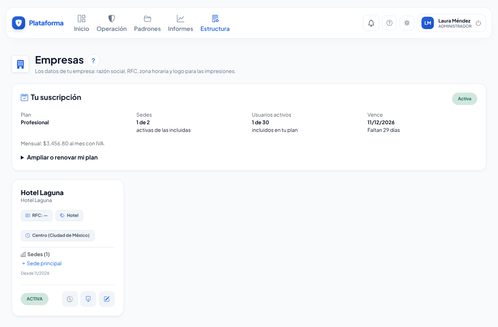
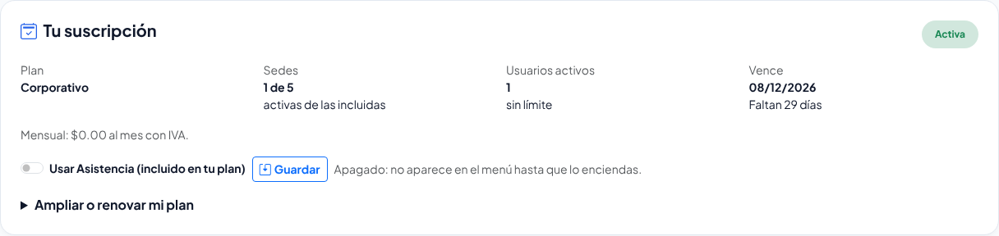
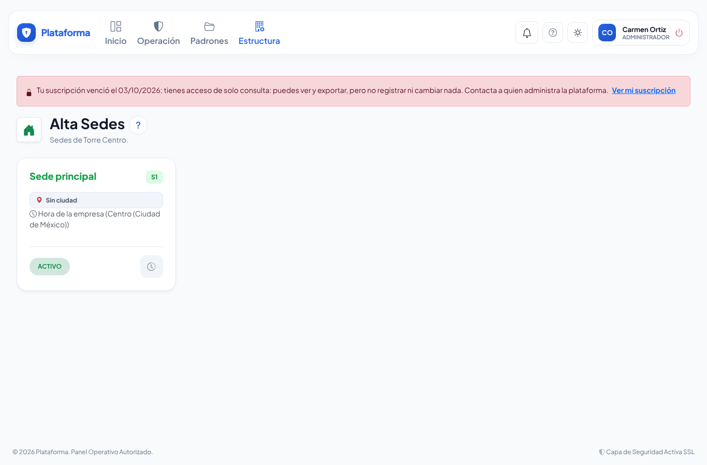

# Tu suscripción

**¿Para qué sirve?** Muestra lo que tu empresa tiene contratado: el **plan**, cuántas **sedes** y **usuarios activos** incluye, cuándo **vence** y en qué estado está. Desde aquí pides **renovar** o **ampliar** tu plan y enciendes lo que tu plan incluye apagado, como **Asistencia** en Corporativo.

## Antes de empezar

- La ve quien administra los datos de la empresa (rol **Administrador**). Si no ves el bloque **Tu suscripción** en **Empresas**, tu empresa no tiene una suscripción con límites: sigue trabajando normalmente.
- Para pedir cambios necesitas poder editar los datos de la empresa.

## Cómo ver tu suscripción

1. Entra a **Estructura → Empresas**.
2. Arriba de los datos de tu empresa está **Tu suscripción**.

**Qué debes ver:** el estado (**Activa**, **En prueba**, **Por vencer**, **En periodo de gracia** o **Solo consulta**), tu plan, «1 de 2» sedes activas, los usuarios activos y la fecha de vencimiento con los días que faltan.

## Cómo pedir renovar o ampliar tu plan

1. En **Tu suscripción** abre **Ampliar o renovar mi plan**.
2. En **¿Qué necesitas?** elige **Renovar mi plan** (o **Contratar mi plan** si estás en prueba) o **Ampliar o cambiar de plan**.
3. Elige el **Plan**, **¿Cuántas sedes?**, el **Giro de tu empresa**, la **Forma de pago** (Mensual o Anual, con descuento) y los **Paquetes** (por ejemplo **Recursos Humanos y candidatos** o **Reservas y eventos**). Si el giro que eliges es distinto al actual, lo revisamos contigo antes de cambiarlo.
4. Si tienes un código de promoción, escríbelo en **Avanzado**.
5. Toca **Guardar solicitud**.

**Qué debes ver:** «Solicitud SC-… guardada: te contactaremos para confirmar el pago…». En cuanto se registra tu pago, tu suscripción se actualiza sola y te llega un aviso a la campana.

## Cómo encender lo que tu plan incluye (Asistencia)

El plan **Corporativo** incluye **Asistencia**, pero llega apagada: no cambia nada en tu empresa hasta que tú decidas usarla.

1. Entra a **Estructura → Empresas** y busca **Tu suscripción**.
2. En **Usar Asistencia (incluido en tu plan)** enciende el interruptor.
3. Toca **Guardar**.

**Qué debes ver:** «Asistencia quedó encendido. Ábrelo en el menú Recursos Humanos → Asistencia…». Al lado del interruptor dice **Encendido: está en el menú.** Revisa en la **Matriz de permisos** qué roles la usan (Recursos Humanos y el administrador ya pueden).

Para dejar de usarla, apaga el interruptor y toca **Guardar**: deja de verse en el menú y lo que ya estaba registrado se conserva para cuando la vuelvas a encender.

Si tu plan es **Esencial** o **Profesional**, Asistencia es un complemento: pídelo en **Ampliar o renovar mi plan**, en **Paquetes**.

## Qué pasa cuando vence

1. **Antes de vencer** te llegan avisos por la campana y por correo (7 días y 1 día antes).
2. **Al vencer** empieza un **periodo de gracia** (15 días): todo sigue funcionando y arriba de cada pantalla ves una franja amarilla con la fecha límite.
3. **Al terminar la gracia** la plataforma queda en **solo consulta**: tu equipo puede **ver y exportar** la información, cambiar su propia contraseña y cerrar sesión, pero **no registrar ni cambiar nada**. Arriba de cada pantalla aparece una franja roja.
4. **Al registrar tu pago** todo vuelve a funcionar en ese momento. Tu información nunca se borra.

## Qué pasa si cambias a un plan menor

1. Lo que tu plan nuevo ya no incluye queda en **solo consulta**: tu equipo puede **ver, exportar e imprimir** lo que ya estaba, pero no registrar nada nuevo en esos módulos.
2. Te llega un aviso a la campana y por correo: «Algunos módulos quedaron en solo consulta» con la lista.
3. Si vuelves a contratarlo (plan mayor o complemento), todo vuelve a funcionar al momento. Tu información nunca se borra.

## Si algo sale mal

| Mensaje o síntoma | Qué significa | Qué hacer |
|---|---|---|
| Tu plan incluye 2 sedes y ya tienes 2 activas… | Llegaste al número de sedes contratadas. | Da de baja una sede que ya no uses o pide ampliar tu plan. |
| Tu plan incluye 30 usuarios activos y ya tienes 30… | Llegaste al número de usuarios contratados. | Da de baja a quien ya no use la plataforma o pide ampliar tu plan. |
| Franja roja «tienes acceso de solo consulta» y no puedes guardar nada. | Terminó la gracia sin pago (o la suscripción se suspendió). | Pide la renovación en **Tu suscripción** o comunícate con el contacto que dice la franja. |
| Esa promoción ya venció / no existe. | El código no sirve. | Revisa el código o envía la solicitud sin él. |
| «Esto no viene en tu plan (…)» al abrir una pantalla | Ese módulo no está en tu plan. | Toca **Ver mi suscripción** y pide el plan o el complemento que lo trae. |
| «Asistencia viene en tu plan y está apagado» | Tu plan la incluye, pero tu empresa no la ha encendido. | Quien administra la empresa la enciende en **Tu suscripción** con **Usar Asistencia** y **Guardar**. |
| «Ese módulo no viene incluido en tu plan.» al tocar **Guardar** junto a **Usar …** | Tu plan cambió y ya no lo incluye. | Recarga la página; si lo necesitas, pide el complemento en **Ampliar o renovar mi plan**. |

## Preguntas frecuentes

**¿Se borra mi información si no pago?** No. Queda en solo consulta: puedes verla y exportarla.

**¿Cuentan los usuarios dados de baja?** No. Solo cuentan los usuarios **activos**.

**¿Puedo pedir la renovación aunque esté en solo consulta?** Sí: **Ampliar o renovar mi plan** funciona siempre.

**¿Qué trae cada plan?** Todos traen la estructura de tu empresa: sedes, zonas, usuarios y roles, y el directorio de **colaboradores**, **departamentos**, **puestos**, **turnos** y **quién autoriza**. **Esencial** suma la caseta y los padrones; **Profesional**, además, incidentes, Protección Civil, procedimientos e informes; **Corporativo**, además, Recursos Humanos y Asistencia (la enciendes tú). En todos los planes vienen las **credenciales de empleado** con QR o tarjeta 125 kHz o MIFARE, el **lector QR/NFC** y los **equipos de acceso** ZKTeco o Hikvision, sin cobro aparte. Complementos: **Reservas y eventos** (cualquier plan), **Recursos Humanos y candidatos** y **Asistencia** (Esencial y Profesional). De pago único puedes pedir la puesta en marcha, el kit de lector, la integración de cada equipo de acceso y tarjetas CR80 para imprimir credenciales.

**¿Qué es el pago anual?** Pagas los 12 meses juntos con un descuento. Se elige en **Forma de pago**.

## Relacionado

- [Empresas y sedes](empresas-y-sedes.md)
- [Usuarios](usuarios.md)
- [Mi cuenta](mi-cuenta.md)
