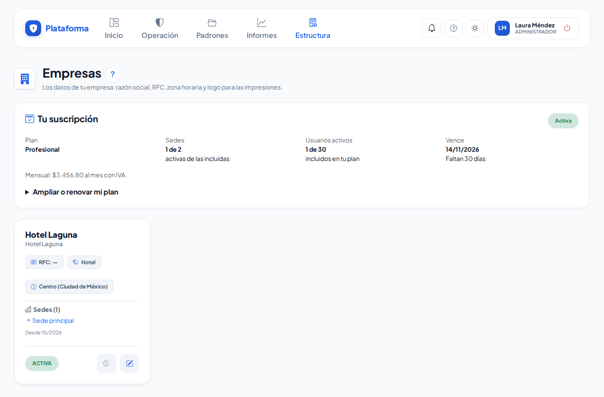
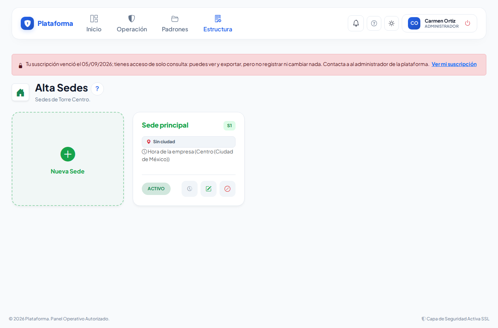

# Tu suscripción

**¿Para qué sirve?** Muestra lo que tu empresa tiene contratado: el **plan**, cuántas **sedes** y **usuarios activos** incluye, cuándo **vence** y en qué estado está. Desde aquí pides **renovar** o **ampliar** tu plan.

## Antes de empezar

- La ve quien administra los datos de la empresa (rol **Administrador**). Si no ves el bloque **Tu suscripción** en **Empresas**, tu empresa no tiene una suscripción con límites: sigue trabajando normalmente.
- Para pedir cambios necesitas poder editar los datos de la empresa.

## Cómo ver tu suscripción

1. Entra a **Estructura → Empresas**.
2. Arriba de los datos de tu empresa está **Tu suscripción**.

**Qué debes ver:** el estado (**Activa**, **En prueba**, **Por vencer**, **En periodo de gracia** o **Solo consulta**), tu plan, «1 de 2» sedes activas, los usuarios activos y la fecha de vencimiento con los días que faltan.

## Cómo pedir renovar o ampliar tu plan

1. En **Tu suscripción** abre **Ampliar o renovar mi plan**.
2. En **¿Qué necesitas?** elige **Renovar mi plan** (o **Contratar mi plan** si estás en prueba) o **Ampliar o cambiar de plan**.
3. Elige el **Plan**, **¿Cuántas sedes?**, la **Forma de pago** (Mensual o Anual, con descuento) y los **Paquetes**.
4. Si tienes un código de promoción, escríbelo en **Avanzado**.
5. Toca **Guardar solicitud**.

**Qué debes ver:** «Solicitud SC-… guardada: te contactaremos para confirmar el pago…». En cuanto se registra tu pago, tu suscripción se actualiza sola y te llega un aviso a la campana.

## Qué pasa cuando vence

1. **Antes de vencer** te llegan avisos por la campana y por correo (7 días y 1 día antes).
2. **Al vencer** empieza un **periodo de gracia** (15 días): todo sigue funcionando y arriba de cada pantalla ves una franja amarilla con la fecha límite.
3. **Al terminar la gracia** la plataforma queda en **solo consulta**: tu equipo puede **ver y exportar** la información, cambiar su propia contraseña y cerrar sesión, pero **no registrar ni cambiar nada**. Arriba de cada pantalla aparece una franja roja.
4. **Al registrar tu pago** todo vuelve a funcionar en ese momento. Tu información nunca se borra.

## Si algo sale mal

| Mensaje o síntoma | Qué significa | Qué hacer |
|---|---|---|
| Tu plan incluye 2 sedes y ya tienes 2 activas… | Llegaste al número de sedes contratadas. | Da de baja una sede que ya no uses o pide ampliar tu plan. |
| Tu plan incluye 30 usuarios activos y ya tienes 30… | Llegaste al número de usuarios contratados. | Da de baja a quien ya no use la plataforma o pide ampliar tu plan. |
| Franja roja «tienes acceso de solo consulta» y no puedes guardar nada. | Terminó la gracia sin pago (o la suscripción se suspendió). | Pide la renovación en **Tu suscripción** o comunícate con el contacto que dice la franja. |
| Esa promoción ya venció / no existe. | El código no sirve. | Revisa el código o envía la solicitud sin él. |

## Preguntas frecuentes

**¿Se borra mi información si no pago?** No. Queda en solo consulta: puedes verla y exportarla.

**¿Cuentan los usuarios dados de baja?** No. Solo cuentan los usuarios **activos**.

**¿Puedo pedir la renovación aunque esté en solo consulta?** Sí: **Ampliar o renovar mi plan** funciona siempre.

**¿Qué es el pago anual?** Pagas los 12 meses juntos con un descuento. Se elige en **Forma de pago**.

## Relacionado

- [Empresas y sedes](empresas-y-sedes.md)
- [Usuarios](usuarios.md)
- [Mi cuenta](mi-cuenta.md)
