# Bitácora de novedades

**¿Para qué sirve?** Aquí se levanta un **ticket** por cada cosa que pasa en la sede (un accidente, un objeto olvidado, un robo, una habitación abierta con valores, un conato de incendio…) y se le da seguimiento hasta cerrarlo. El camino siempre es el mismo:

1. Alguien reporta algo → la caseta **despacha un ticket rápido**.
2. Quien atiende abre el **Expediente** y llena el formato de la categoría.
3. Cada avance se anota en el **Minuto a Minuto**.
4. Cuando todo está documentado, el caso se marca **Resuelto y Cerrado**.

**Antes de empezar:** necesitas que tu rol pueda **ver** y **crear** en Novedades (para atender, también **editar**). Reabrir casos y exportar son permisos aparte. Si no ves **Nuevo Ticket**, pide a tu administrador que revise tu rol.

**Novedades** es donde va todo lo que pasa en el día, sin importar su tipo. Tu empresa puede llamarlo **Incidentes** (lo elige el administrador en **Estructura → Configuración → Bitácora de novedades → Nombre del módulo**); si es así, el menú, los títulos, los avisos, los informes y esta página usan ese nombre. Es la misma pantalla y funciona igual.

## Cómo leer la lista

1. Entra a **Operación → Incidentes → Novedades** (en el celular, el botón **Novedades** de abajo).
2. Usa el buscador (número de ticket, ubicación o lo que se reportó) y los filtros de **categoría** y **sede**. En el filtro de categoría, **Protección Civil (todos)** junta los siniestros, el mantenimiento de equipo y los recorridos de antes; también puedes elegir solo uno de ellos.
3. Tienes dos pestañas: **Tickets Abiertos / Asignados** (borde rojo) e **Historial Resueltos** (borde verde).

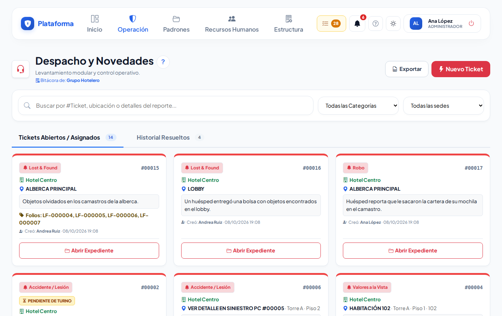

**Qué debes ver:** cada ficha con la categoría, el número (por ejemplo `#00012`), la sede, la ubicación, lo que pasó, quién lo creó y quién le dio seguimiento. Las que dicen **PENDIENTE DE TURNO** las atiende el siguiente turno: abajo dicen desde hace cuánto, qué turno lo recibe y quién es su **dueño** (o **Sin dueño**).

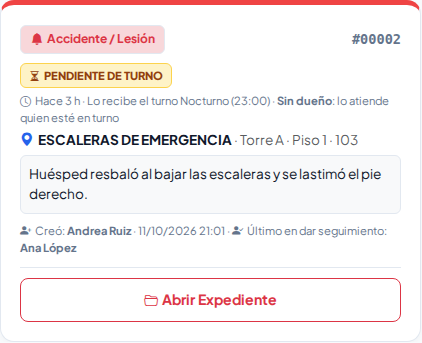

## Cómo despachar un ticket rápido

1. Toca **Nuevo Ticket**. Se abre **Generar Ticket Rápido**.
2. Revisa la **Sede**.
3. Elige la **Categoría** (la más cercana; se puede corregir al atender).
4. En **¿Quién reporta?** escribe el nombre, **escanea su gafete**, o toca **Fui yo quien lo observó**.
5. Si ya sabes quién lo atiende, elige **¿A quién se canaliza?** (solo personal de Seguridad de la sede). Esa persona recibe el aviso en su **campana** y en **Mis pendientes** («Tickets canalizados a mí»).
6. Si le toca a otra área (Mantenimiento, Ama de llaves, Recursos Humanos…), elige además **O a un departamento**. Quien responde por ese departamento en la sede recibe el aviso y ve **solo ese ticket** (ver abajo «Cuando te canalizan un ticket a tu departamento»).
7. En **¿Dónde pasó?** escribe y elige el lugar de la lista (zona, piso o habitación de Zonas y edificios). Si quieres, agrega el **Detalle del lugar** (por ejemplo «cerca del elevador»). Si el lugar no está en la lista, deja lo que escribiste.
8. Revisa **¿Cuándo sucedió?** (ya trae la hora actual) y escribe **¿Qué sucedió?**.
9. Toca **Despachar Ticket**.

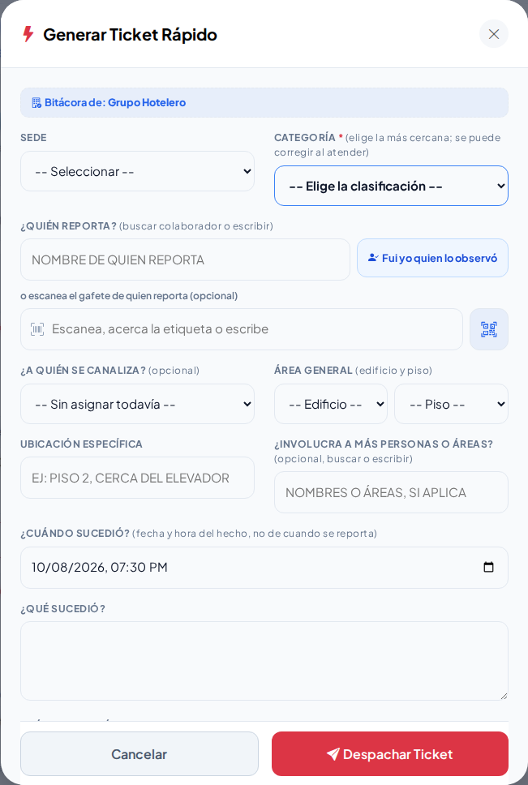

**Qué debes ver:** el ticket nuevo en **Tickets Abiertos / Asignados**. Si lo canalizaste, el mensaje verde dice «Le avisamos a …». Si falta algo, el aviso sale en rojo **dentro** de la ventana y lo que escribiste se conserva.

### Si es un objeto encontrado (Lost & Found)

Al elegir la categoría **Lost & Found (Objetos Perdidos)** aparece el recuadro **Objeto encontrado**: escribe **¿Qué se encontró?**, el **Tipo de valor** y, si ya lo guardaste, la **Ubicación en bodega**. Al despachar, el objeto queda en resguardo con su folio **LF-…** y ya aparece en el archivo de Lost & Found. Si alguien **perdió** algo (no lo encontraron), deja el recuadro vacío y captura el reporte de pérdida en el expediente.

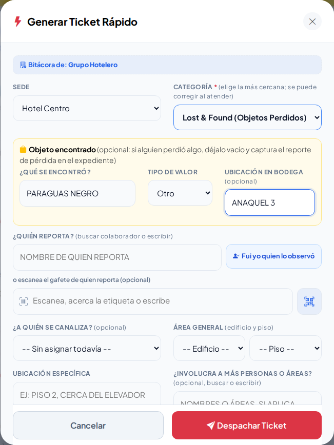

Para un objeto sencillo también puedes usar **Registrar objeto encontrado** en el archivo de [Lost & Found](lost-found-y-robo.md).

## Cómo atender un ticket (Expediente)

1. En la ficha toca **Abrir Expediente** (o **Ver Expediente** si solo puedes consultar).
2. Arriba está el reporte inicial (no cambia). Revisa y completa las **Preguntas Base**: categoría, a quién se canaliza, habitación (si aplica), involucrados, cuándo y cómo sucedió. El **Área General** ya viene del reporte inicial («— del reporte inicial»); solo si está mal toca **Cambiar edificio o piso**.
3. Llena el **formato de la categoría** (ver tabla).
4. En la línea del **Minuto a Minuto** escribe lo que se hizo.
5. Toca **Guardar Expediente**.

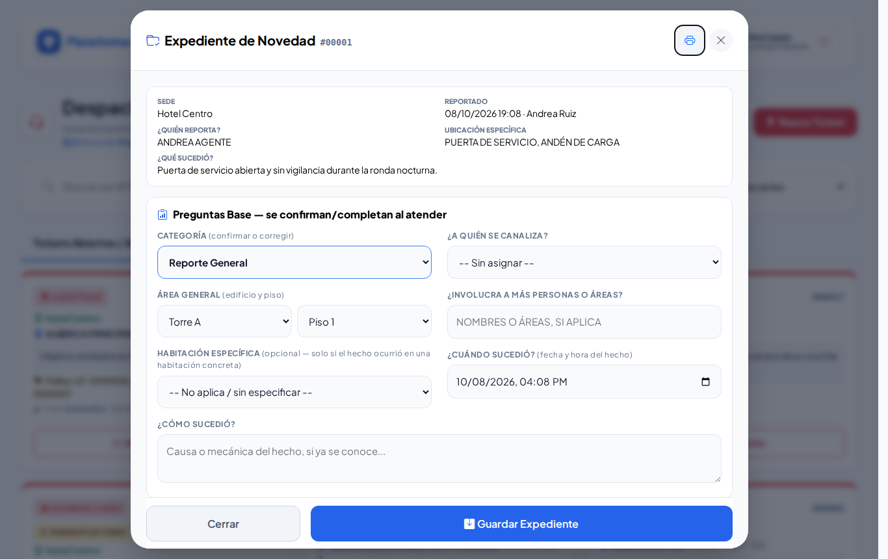

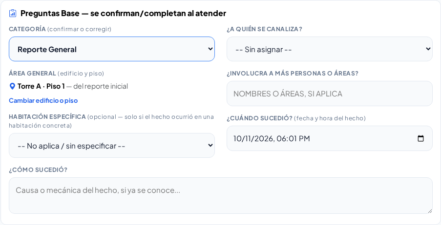

**Qué debes ver:** tu nota aparece en el Minuto a Minuto con fecha, hora y tu nombre. Lo escrito ahí **no se puede borrar ni cambiar**.

Si tu empresa asoció un procedimiento a la categoría del ticket, arriba del expediente aparece **¿Qué hacer? Ver procedimiento «…»**: tócalo para leer los pasos en otra pestaña.

**Cambiar la categoría:** un ticket de Lost & Found con objetos **en resguardo**, o un robo que ya tiene su detalle capturado, no se puede cambiar a otra categoría (los objetos o el detalle se quedarían sin su ticket). Primero entrega los objetos o regístralos en otro ticket de Lost & Found; si el robo fue un error, ciérralo con su resolución y abre un ticket nuevo.

| Categoría | Qué se captura |
|---|---|
| **Reporte General** | **Tipo de reporte** (opcional; por ejemplo Ruido, Mascotas o Fuga de agua, según la lista de tu empresa), quién fue observado, qué hacía, por qué y acciones inmediatas. La ficha dice, por ejemplo, «Reporte General · Ruido». |
| **Accidente / Lesión** | Formato de huésped o colaborador, dictamen médico con el mapa del cuerpo, anexo de guardavidas, Recursos Humanos y firmas. |
<!-- solo: hotel -->
| **Valores a la Vista** | Habitación, personas, puertas y ventanas, caja fuerte y valores por zona. |
<!-- fin -->
| **Siniestro Protección Civil** | Tipo de evento, alarma, evacuación, servicios externos, lesionados, daños y causa. Si hubo lesionados, se abre solo un ticket de Accidente ligado. |
| **Lost & Found (Objetos Perdidos)** | Artículos encontrados (folio LF-…) y reportes de pérdida (folio RP-…). |
| **Robo** | Circunstancias, qué se llevaron, sospechoso, testigos, policía y canalización. |
| **Mantenimiento de equipo PC** | Lo abre solo un Recorrido de Protección Civil cuando un equipo falla (por ejemplo, un extintor sin presión): muestra los equipos con falla. Anota en el Minuto a Minuto lo que se reparó. No cuenta como siniestro en el Tablero ni en Tendencias. |

En los formatos largos cada apartado se abre o se cierra tocando su título; si tiene un error, se abre solo y dice **Revisar**.

## Cómo capturar un Accidente con sus firmas

1. En **Seguridad: Formato de Afectado** elige **Huésped / Cliente** o **Colaborador Interno** (para un colaborador, escanea su gafete: departamento y puesto se llenan solos).
2. En el **Dictamen Clínico** marca el tipo de herida y toca en el **mapa del cuerpo** las zonas afectadas.
3. En **Firmas Digitales de Cierre** elige quién firma, pídele que firme en el recuadro y toca **Guardar Esta Firma**. Repite con cada persona.
4. Toca **Guardar Expediente**.

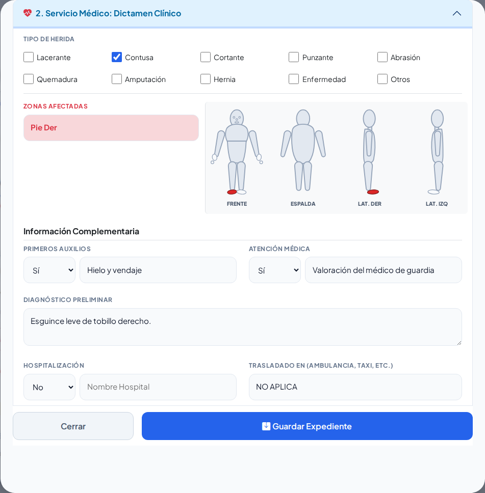

**Qué debes ver:** las firmas guardadas aparecen en el expediente y en la hoja impresa (botón de la impresora, arriba a la derecha).

En un caso nuevo, la **Fecha** y la **Hora del Accidente** ya vienen sugeridas con las de «¿Cuándo sucedió?» del ticket, el **No. Habitación** con la habitación del ticket y el **Lugar o área del accidente** con su ubicación. Son sugerencias: cámbialas si no son. Si en **Turno** no escribes nada, al guardar se toma el turno de la ficha del colaborador; si escribes otro (porque cubría a alguien), se respeta lo que escribiste. El formato es el mismo de siempre.

## Cómo dejar un ticket para el siguiente turno

1. En el expediente, en **¿A quién se canaliza?** elige quién lo atenderá (su **dueño**). Si no sabes, déjalo sin asignar.
2. En **Estatus Final del Expediente** elige **Pendiente de Turno (lo atiende el siguiente turno)**.
3. Toca **Guardar Expediente**.

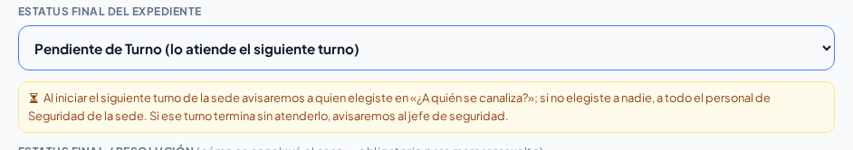

**Qué debes ver:** la ficha dice **PENDIENTE DE TURNO**, desde hace cuánto, qué turno lo recibe y su dueño. Esto pasa después, sin que hagas nada más:

- Su dueño recibe el aviso en la campana en ese momento.
- Al **empezar el siguiente turno** de la sede, la campana le avisa otra vez a su dueño o, si no tiene, a todo el personal de Seguridad de la sede.
- Si ese turno **termina** y el ticket sigue pendiente, se avisa al jefe de seguridad de la sede.

Si tu sede no tiene turnos registrados (Estructura → Turnos), el aviso al personal llega en el momento en que lo dejas pendiente y, si **en 8 horas** sigue pendiente, se avisa al jefe de seguridad de la sede. El expediente te dice cuál de los dos casos aplica.

## Avisos en la campana

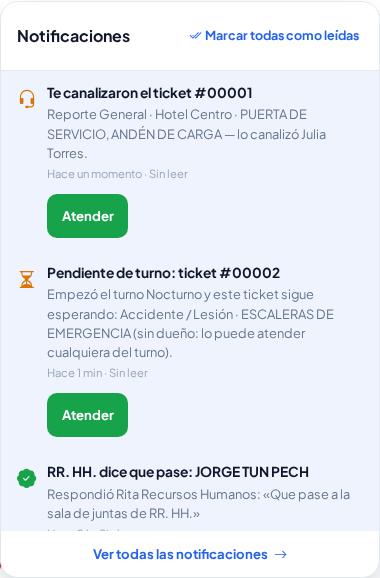

- **Te canalizaron el ticket #…**: toca **Atender** para abrir el expediente. También aparece en **Mis pendientes → Tickets canalizados a mí**.
- **Pendiente de turno: ticket #…**: un ticket que se dejó para tu turno.
- **Ticket #… resuelto**: el caso que levantaste (o que tenías canalizado) se cerró; el aviso dice la resolución.

**Reloj del ticket canalizado:** el renglón **Tickets canalizados a mí** cambia de color según cuánto lleva contigo. A las horas de su categoría se te recuerda (de fábrica: **Accidente 2 h**, **Robo 4 h**, las demás **24 h**) y al triple pasa al jefe de seguridad de la sede. Si lo canalizan a otra persona, su reloj empieza de nuevo. Las horas se cambian en **Configuración → (tu bitácora) → Reloj de los tickets canalizados**. El Accidente que se abre solo desde un Siniestro con lesionados queda canalizado a quien tenía el siniestro (o a quien lo documentó), así que no se queda sin dueño. Un hallazgo de un recorrido de Protección Civil que nadie toma aparece en **Mis pendientes → Hallazgos de recorrido sin atender**.

## Cuando te canalizan un ticket a tu departamento

Si respondes por un departamento (Mantenimiento, Recursos Humanos…), Seguridad te puede canalizar un incidente. No necesitas ver toda la bitácora: solo ves los tickets de tu departamento.

1. Te llega el aviso **Ticket #… para (tu departamento)** a la **campana** y aparece en **Mis pendientes → Tickets de tu departamento**. También está en **Operación → Incidentes → Tickets de mi departamento**.
2. Ábrelo: ves dónde y cuándo pasó, qué sucedió y el **Minuto a Minuto**.
3. Si quieres dejar constancia de un avance, escribe en **Agregar nota** y toca **Guardar nota**. Seguridad la ve en el expediente.
4. Cuando hayas hecho tu parte, escribe (si quieres) **¿Qué se hizo?** y toca **Atender**.

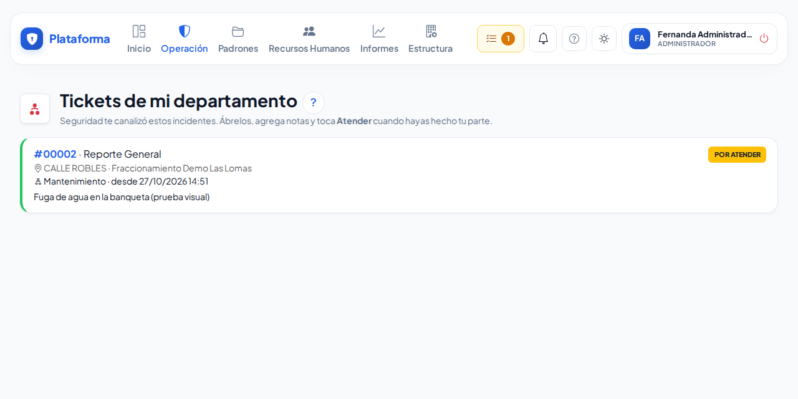

**Qué debes ver:** el mensaje verde «Listo: atendiste tu parte del ticket #…». El ticket dice **ATENDIDO**, a Seguridad le llega el aviso y en el expediente aparece «(departamento) atendió su parte».

**Reloj:** el ticket de tu departamento usa las mismas horas por categoría que los tickets canalizados. A esas horas se te recuerda y al triple pasa al jefe de seguridad de la sede.

**Accidente de un colaborador:** se canaliza solo al **departamento que recibe accidentes de personal** (lo eliges en [Configuración](configuracion.md#cómo-elegir-el-departamento-que-recibe-los-accidentes-del-personal); de fábrica, el que se llama Recursos Humanos), si aplica en tu sede y tiene responsable, para que le dé seguimiento. El accidente de un residente no se le manda. El formato del Accidente no cambia.

## Cómo cerrar o reabrir un caso

1. En **Estatus** elige **Resuelto y Cerrado (Documentación Completa)**.
2. Escribe en **Estatus Final / Resolución** cómo se concluyó (obligatorio).
3. Toca **Guardar Expediente**.
4. Para corregir un caso resuelto, toca **Reabrir Caso para Editar** y escribe el motivo.

**Qué debes ver:** el caso pasa a **Historial Resueltos** y se ve en solo lectura. La reapertura queda anotada en el Minuto a Minuto.

## Cómo exportar

1. Filtra lo que necesitas.
2. Toca **Exportar**.

**Qué debes ver:** un archivo de Excel (CSV) con exactamente lo que estás viendo. Solo aparece si tienes ese permiso.

## En el celular

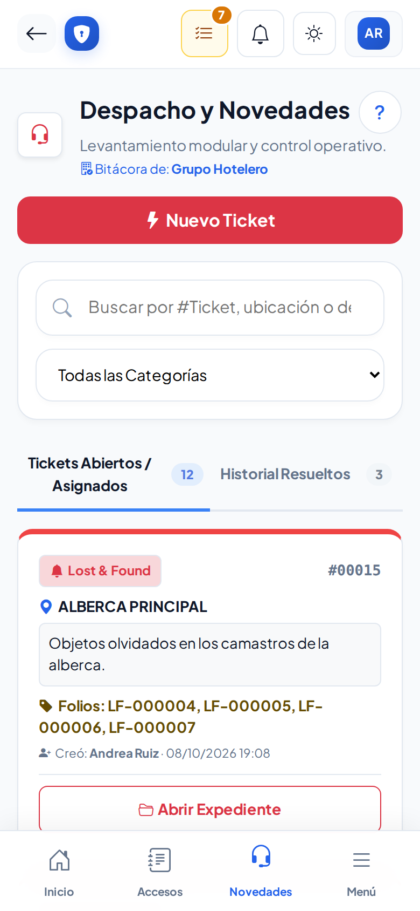

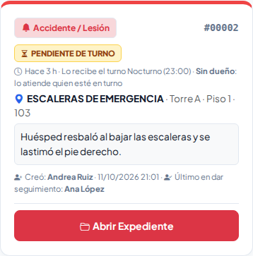

## Si algo sale mal

| Mensaje o síntoma | Qué significa | Qué hacer |
|---|---|---|
| «Elige la clasificación del ticket (Categoría)…» | Falta la categoría. | Elige la más cercana. |
| «Escribe quién reporta (o toca «Fui yo quien lo observó»).» | Falta quién reporta. | Escribe el nombre o toca el botón. |
| «Elige el lugar de la lista o escribe dónde pasó (por ejemplo: Piso 2, cerca del elevador).» | Falta el lugar. | Elígelo en «¿Dónde pasó?» o escríbelo. |
| «Este caso ya está Resuelto. Para editarlo usa «Reabrir Caso para Editar» y escribe el motivo.» | El caso está cerrado. | Reábrelo con el motivo. |
| «Escribe el motivo antes de continuar: un caso resuelto no se puede reabrir sin justificación.» | Falta el motivo de reapertura. | Explica por qué se reabre. |
| «Este ticket tiene objetos en resguardo (LF-…). Primero entrégalos o regístralos en otro ticket de Lost & Found; después cambia la categoría.» | Quisiste cambiar de categoría un ticket con objetos guardados. | Entrega los objetos o muévelos a otro ticket de Lost & Found. |
| «Este robo ya tiene su detalle capturado…» | Quisiste cambiar de categoría un robo ya documentado. | Ciérralo con su resolución y abre un ticket nuevo con la categoría correcta. |
| «Elige una opción válida en «Tipo de reporte».» | Ese tipo ya no está en la lista de tu empresa. | Elige otro de la lista o déjalo **— Sin tipo —**. |
| No deja marcar Resuelto | Falta **Estatus Final / Resolución**. | Escribe cómo se concluyó. |
| Franja roja arriba: «Tu envío no llegó completo y no se guardó. Revisa los datos y vuelve a guardar. Si se repite, avisa a tu administrador con la hora.» | Lo que guardaste (por ejemplo, el expediente con sus firmas) no llegó a la plataforma: se cortó en el camino. | Abre el expediente, revisa qué falta (las firmas se ven en «Firmas»), vuelve a firmar si hace falta y toca **Guardar**. Si se repite, anota la hora y avisa a tu administrador. |
| Página «La acción no llegó completa» | Se perdió la conexión al guardar o se envió de una forma que no se esperaba. | Toca «Ir al inicio», abre el expediente y revisa si tus cambios ya están. |

## Preguntas frecuentes

- **¿Qué hago si no sé qué categoría es?** Elige la más cercana; quien atiende la puede corregir.
- **¿Puedo borrar algo del Minuto a Minuto?** No, así queda constancia de todo.
- **¿Quién ve los tickets de Lost & Found?** También quien solo tiene permiso de Lost & Found (por ejemplo, Ama de Llaves).
- **¿Cómo imprimo el expediente?** Con el botón de la impresora, arriba a la derecha del expediente.
- **¿Dónde se hacen los recorridos de Protección Civil?** En su propia pantalla: [Recorridos de Protección Civil](recorridos-pc.md).
- **¿Cómo sé qué tickets me canalizaron?** En **Mis pendientes → Tickets canalizados a mí**: abre la lista solo con los tuyos.
- **¿Por qué no veo Valores a la Vista?** Es una categoría de hotel (la revisión de la habitación con la camarista). En otros giros no se ofrece; usa **Reporte General** con su tipo.
- **¿Quién decide los tipos de Reporte General?** Tu administrador, en **Estructura → Configuración → Bitácora de novedades → Avanzado: tipos de «Reporte General»**.
- **¿Por qué en mi menú dice «Incidentes»?** Tu empresa le cambió el nombre en Configuración; es la misma Bitácora de novedades.

## Relacionado

- [Lost & Found y Robo](lost-found-y-robo.md)
- [Recorridos de Protección Civil](recorridos-pc.md)
- [Bitácora de accesos](accesos.md)
