# Pases de salida

**¿Para qué sirve?** Para autorizar y seguir todo equipo que **sale de la sede**: un préstamo, una venta, una reparación, un traspaso a otra sede. Cada pase pasa por **aprobaciones** (en orden) y por la **caseta**; si el equipo debe volver, el pase no se cierra hasta que regresa.

**Antes de empezar:** según lo que hagas necesitas un permiso distinto en Pases de salida: **crear** (pedir pases), **aprobar** (firmar aprobaciones), **firmar** (caseta: salida, llegada y regreso) e **imprimir**. Si no ves un botón, tu rol no tiene ese permiso: pide ayuda a tu administrador.

## Cómo leer la lista

1. Entra a **Operación → Caseta → Pases de salida**.
2. Cada ficha tiene el **folio** (por ejemplo `PS-000123`), una **etiqueta de color** con el estado, el solicitante, el motivo y la **línea de pasos**: **Solicitud → Aprobaciones → Salida → En destino / Fuera → Regreso → Cerrado**.
3. El recuadro azul dice **quién debe actuar ahora** (por ejemplo «Espera la firma de: Contraloría (paso 2 de 3)»).
4. Usa las **píldoras** para filtrar: **Pendientes de mi firma**, **Vencidos**, **Fuera de la propiedad**, **Llegan a mi sede**, etc. En **Buscar** escribe el folio, el solicitante, el equipo o su serie, o escanea el QR de la hoja impresa.

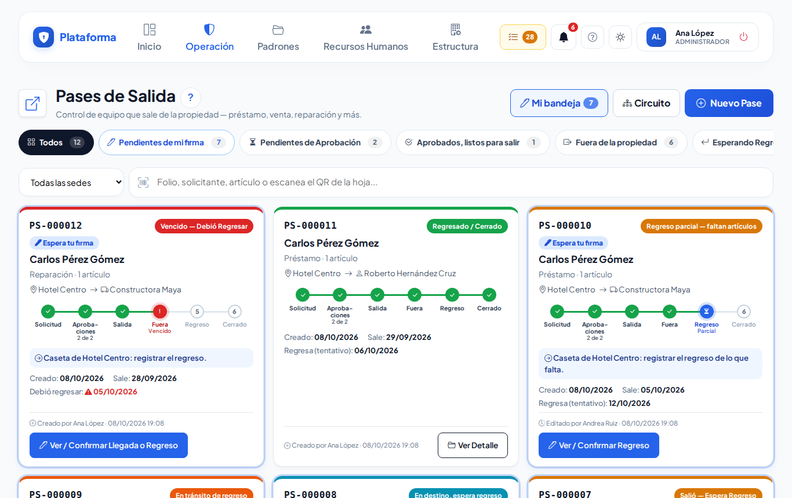

**Qué debes ver:** los pases que te tocan llevan la etiqueta azul **Espera tu firma** y borde azul. Debajo del recuadro azul, el **reloj** dice cuánto lleva esperando la firma del paso actual (por ejemplo «Esperando firma desde hace 7 h»). Si tu empresa puso tiempos en **Firmas que tardan**, el reloj se pinta en **verde**, **ámbar** (ya se recordó a quien firma) o **rojo** (ya se avisó al siguiente nivel).

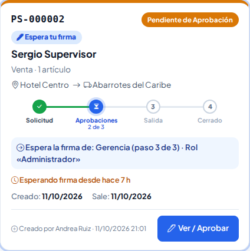

| Etiqueta | Qué quiere decir |
|---|---|
| **Pendiente de Aprobación** | Le faltan firmas de aprobación. |
| **Rechazado — devuelto al solicitante** | Hay que corregirlo y reenviarlo, o cancelarlo. |
| **Aprobado, listo para salir** | La caseta ya puede registrar la salida. |
| **Salió — Espera Regreso** | Ya salió y debe volver. |
| **Regreso parcial — faltan artículos** | Regresó una parte; falta lo demás. |
| **Vencido — Debió Regresar** | Pasó su **regreso programado** y no ha vuelto. ¡Dale seguimiento! |
| **Regresado / Cerrado** | Terminó. |
| **Cancelado** | Se canceló antes de aprobarse. |

## Cómo pedir un pase nuevo

1. Toca **Nuevo Pase**. Si trabajas en una sola sede, la **Sede de Origen** ya viene elegida. Si tu rol es **Solicitante** o **Jefe de departamento**, tu nombre ya viene como **Solicitante** (solo puedes pedir pases a tu nombre).
2. En **1. Motivo y Solicitante**: elige el **motivo** (la ventana te dice si el equipo debe regresar). Escanea el gafete del solicitante o escribe su nombre y elígelo. Si no aparece, toca **Nuevo Colaborador**.
3. En **2. Enviar A**: elige otra sede o un proveedor (si no está, **Nuevo Proveedor**). Si el equipo se le entrega a una persona para que lo use (por ejemplo, un radio para su turno), no es un pase: hazlo con una [responsiva](responsivas.md). Escribe la **Salida programada** (el día en que planeas que salga) y, si el equipo regresa, el **Regreso programado** (el día en que debe volver). El regreso programado no puede ser antes de la salida programada.

   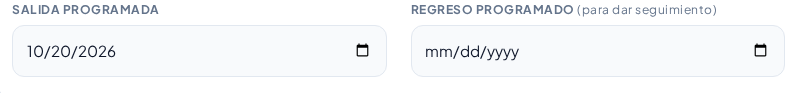
4. En **3. Artículos que Salen**: escanea la etiqueta del equipo del padrón (se llena solo; solo salen equipos **DISPONIBLES** de la sede de origen y cada uno una vez) o escribe cantidad, equipo, marca, modelo, serie y descripción. Si tu empresa pide aprobaciones según el valor, verás también **Valor por pieza $ (opcional)**: escríbelo si lo conoces (los equipos del padrón con costo registrado ya traen su valor). Si lo dejas vacío, el pase pedirá todas las aprobaciones.
5. Toca **Guardar y Enviar a Aprobación** (o **Registrar y capturar siguiente** si harás otro).

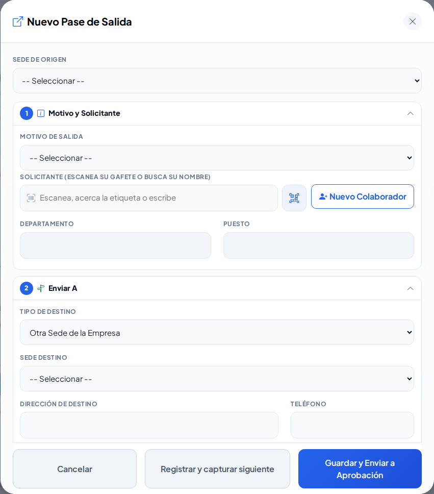

**Qué debes ver:** el pase aparece como **Pendiente de Aprobación** y quien firma el primer paso recibe un aviso en la **campana** (y por correo). Normalmente el primer paso es **Jefe del departamento del solicitante**: lo firma el jefe de tu departamento. Cada apartado (1, 2, 3) se puede cerrar tocando su título; si falta algo, se abre solo.

## Quién firma el paso «Jefe del departamento del solicitante»

El circuito de aprobación empieza con este paso. Lo firma el **jefe del departamento** de la persona que pide el pase, en la sede de donde sale el equipo:

1. El **responsable** de ese departamento en **Estructura → Departamentos** (el mismo que autoriza las visitas a su departamento). Si activó **No molestar**, también puede firmar la persona en quien delegó.
2. Si el departamento no tiene responsable que pueda firmar (o el pase es del propio jefe), firma su **suplente**.
3. Si el departamento no tiene responsable ni suplente, firma quien tenga permiso **Aprobar** de Pases de salida y sea de ese departamento.
4. Si tampoco hay nadie, lo puede firmar cualquiera con permiso **Aprobar** en la sede, para que el pase no se quede atorado.

Quien firma necesita el permiso **Aprobar** de Pases de salida en la sede (el rol **Jefe de departamento** ya lo trae). En la ficha del pase, debajo de «Le toca firmar ahora», ves quién puede firmarlo.

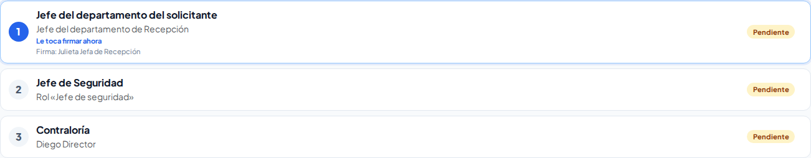

**Qué debes ver:** el jefe del departamento recibe el aviso **Te toca firmar el pase PS-…** en la **campana** y el pase aparece en su **Mis pendientes → Firmas de pases de salida**. Al aprobarlo, el pase pasa al siguiente paso del circuito. Si tarda y tu empresa puso tiempos en **Firmas que tardan**, el recordatorio y el aviso al siguiente nivel funcionan igual que en los demás pasos.

## Cómo aprobar o rechazar un pase

1. Toca el aviso **Te toca firmar el pase PS-…** de la **campana** (botón **Abrir pase**), o **Mis pendientes** (arriba), o la píldora **Pendientes de mi firma**, y abre el pase.
2. Revisa el **Resumen** y la pestaña **Artículos**.
3. Toca **Aprobar**. Firma con **Usar mi firma guardada** o **Firmar ahora** en el recuadro (marca «Guardar mi firma» para la próxima vez). Si quieres, escribe un comentario.
4. Toca **Aprobar y firmar**.
5. Si no estás de acuerdo, toca **Rechazar** y escribe el **motivo** (obligatorio).

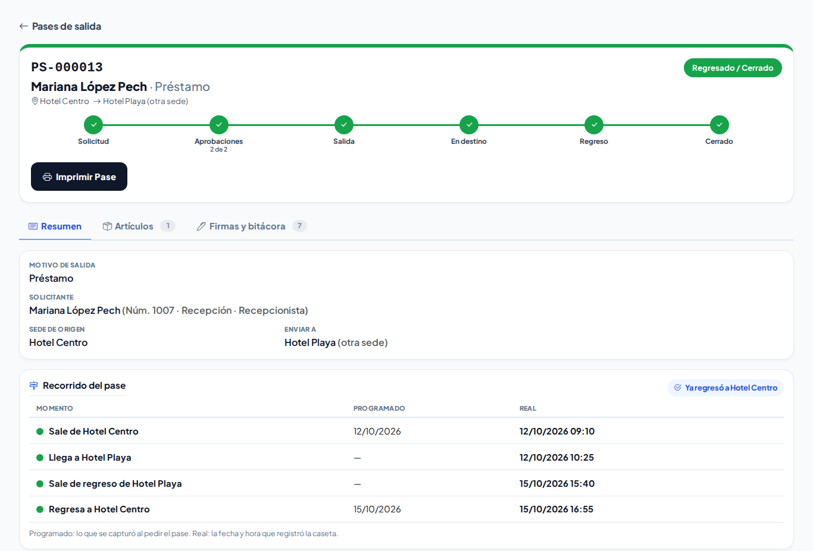
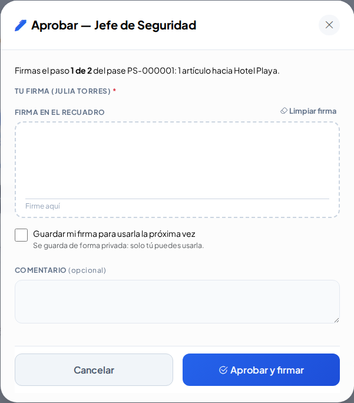

**Qué debes ver:** el pase pasa al siguiente paso y la siguiente persona recibe su aviso. El aviso de la campana de los demás que podían firmar ese paso queda leído y sin botón. Si rechazaste, regresa al solicitante con tu motivo en rojo.

Reglas: los pasos van **en orden**; no puedes aprobar tu propio pase ni firmar dos pasos del mismo pase. Un paso **opcional** que no aplica se puede saltar con **Omitir paso**. Si un paso dice **solo con valor de $50,000.00 o más** (u otra cantidad), se pide solo a los pases de ese valor.

## Cómo corregir un pase rechazado

1. En la **campana** te llega **Tu pase PS-… fue rechazado** con el motivo. Ábrelo: el motivo del rechazo sale en rojo.
2. Toca **Corregir y reenviar**, cambia lo que te pidieron y escribe qué corregiste.
3. Toca **Guardar y Reenviar a Aprobación**. Si ya no se necesita, toca **Cancelar pase**.

**Qué debes ver:** según lo que configuró tu empresa:

- **Empezar desde el primer paso** (lo normal): las aprobaciones empiezan otra vez desde el paso 1.
- **Retomar desde el paso que rechazó**: las firmas que ya tenías se conservan (en la lista dicen «firma conservada del envío anterior») y el pase vuelve al paso que lo rechazó. Si al corregir cambiaste el motivo o el valor y ahora aplica otro paso, también se pide. Si ya no falta ninguna firma, queda **Aprobado, listo para salir**.

Cuando se aprueba el último paso te llega **Tu pase PS-… fue aprobado**.

## Cómo leer el recorrido del pase

En la ficha del pase, pestaña **Resumen**, el apartado **Recorrido del pase** junta en un solo lugar todo lo que le pasa al equipo, con el nombre del lugar:

| Momento | Cuándo aparece |
|---|---|
| **Sale de Hotel Centro** | Siempre (la sede de donde sale). |
| **Llega a Hotel Playa** | Solo si va a otra sede de la empresa: la caseta de esa sede confirma la llegada. |
| **Sale de regreso de Hotel Playa** | Solo si va a otra sede: la caseta de esa sede autoriza que vuelva. |
| **Regresa a Hotel Centro** | Solo si el equipo debe regresar. |

Cada momento tiene dos columnas:

- **Programado**: la fecha que se escribió al pedir el pase (**Salida programada** y **Regreso programado**).
- **Real**: la fecha y la hora que registró la caseta. Si todavía no ocurre dice **Pendiente**.

1. Abre el pase y quédate en la pestaña **Resumen**.
2. Baja a **Recorrido del pase**.

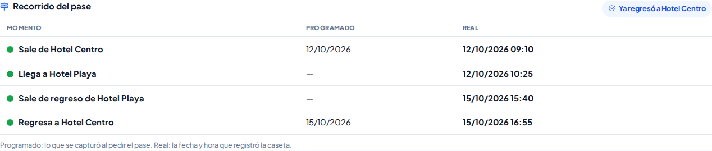

**Qué debes ver:**

- Un punto **verde** en lo que ya ocurrió, **gris** en lo pendiente, **ámbar** si regresó solo una parte y **rojo** si está vencido.
- Si salió otro día del programado, una nota como «**1 día después de lo programado**».
- Si regresó una parte: «**Parcial: 2 de 4 · el último, 19/10/2026 17:10**».
- Si ya pasó su regreso programado y no ha vuelto: «**Pendiente · Vencido (debía regresar el 17/10/2026)**».
- En una venta o un traspaso definitivo, solo **Sale de …** y la leyenda «**Salida definitiva, no espera regreso**».

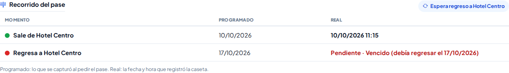

En el celular, cada momento se ve como una tarjeta con su **Programado** y su **Real**:

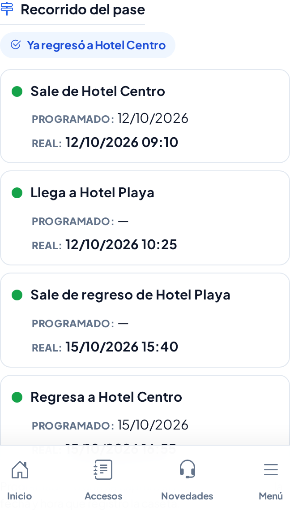

## Cómo registrar en caseta la salida, la llegada y el regreso

1. Abre el pase (aparece en **Mis pendientes**) y toca el botón de la caseta: **Registrar Salida** (sede de origen), **Confirmar llegada a esta sede** (sede destino, cuando llega el equipo), **Autorizar salida de regreso** (sede destino, cuando el equipo vuelve a su sede) o **Registrar Regreso** (sede de origen).
2. **Verifica los artículos**: escanea cada equipo del padrón o márcalo con el dedo. Para la salida deben estar **todos**. Esto se pide siempre.
3. Escribe el **nombre** de quien se lleva o entrega el equipo y pídele que **firme** en el recuadro.
4. Firma tú como Seguridad (con tu firma guardada es un solo toque) y guarda.
5. En el **regreso**, escribe cuántos regresan de cada artículo. Si lo que falta ya no volverá, marca **Cerrar el pase aunque falten artículos**.

Tu empresa puede pedir menos firmas en algún movimiento. La ventana te lo dice:

- «**En este pase, este movimiento solo pide la firma de Seguridad.**»: no hay recuadro para la otra persona; su nombre es opcional.
- «**Este movimiento no pide firmas**…»: solo revisas los artículos y guardas. Queda registrado que lo hiciste tú, la hora y lo que revisaste.

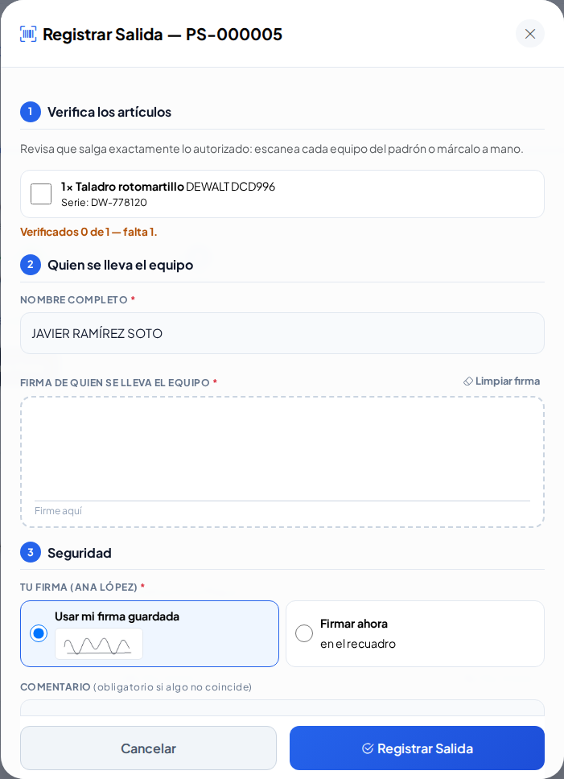

**Qué debes ver:** la línea de pasos avanza y el **Recorrido del pase** muestra la fecha y la hora reales. Si faltan artículos en el regreso, queda **Regreso parcial** y sigue esperando lo demás.

Los equipos del padrón cambian solos de estado: al salir quedan **FUERA** en [Equipos de seguridad](equipos.md) y al regresar vuelven a **DISPONIBLE**. Si cierras el pase con faltantes, los equipos que no volvieron quedan **NO REGRESÓ** y el mensaje te dice cuáles, para darlos de baja con su voucher.

### Si el regreso programado ya pasó al dar salida

Un pase no puede salir con un regreso que «ya debió ocurrir». Si al tocar **Registrar Salida** el **regreso programado** ya pasó:

1. Arriba de la ventana verás «**El regreso programado (19/10/2026) ya pasó.** Pregunta cuándo regresa y escribe la nueva fecha antes de dar salida.»
2. Pregunta a quien se lleva el equipo cuándo regresa y escríbelo en **Nuevo regreso programado** (hoy o después).
3. Sigue con la revisión de artículos y las firmas, y toca **Registrar Salida**.

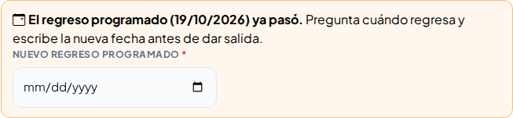

**Qué debes ver:** el pase sale con el regreso programado nuevo. En **Firmas y bitácora** queda «**Cambió el regreso programado: 19/10/2026 → 25/10/2026**». El pase se marca **Vencido** solo si pasa también la fecha nueva. Quien aprueba un pase así ve el aviso «El regreso programado (…) ya pasó: al dar salida, la caseta pedirá un nuevo regreso programado.»

## Cómo saber qué pases llegan a tu sede (caseta destino)

1. En **Pases de salida** toca la píldora **Llegan a mi sede**.
2. Verás los pases aprobados o en camino hacia tu sede. Cada uno dice qué harás: «**Viene a Hotel Playa: aún no sale de Hotel Centro.**» o «**En camino a Hotel Playa.**» y «**Cuando llegue, toca «Confirmar llegada a esta sede».**».
3. Cuando el pase sale hacia tu sede, te llega a la **campana** el aviso **Un pase viene a tu sede: PS-…**.
4. Cuando llegue el equipo, abre el pase y toca **Confirmar llegada a esta sede**.

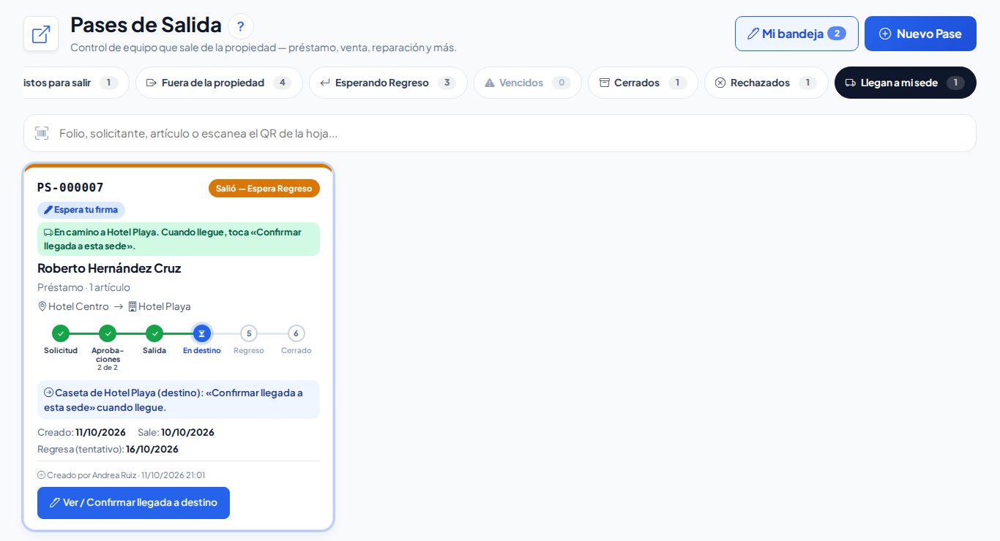

**Qué debes ver:** al confirmar la llegada, el pase sale de **Llegan a mi sede** y el aviso de la campana queda leído. La píldora solo la ve quien registra la caseta.

## Cómo imprimir y verificar un pase

1. En la ficha toca **Imprimir Pase**. Sale una hoja carta con el folio, un **código QR**, el **Recorrido del pase** (programado y real), los artículos y las firmas.
2. En la caseta, escanea el QR con el celular: se abre una página que dice si el **pase es auténtico**, su estado en ese momento y su **Recorrido del pase**.

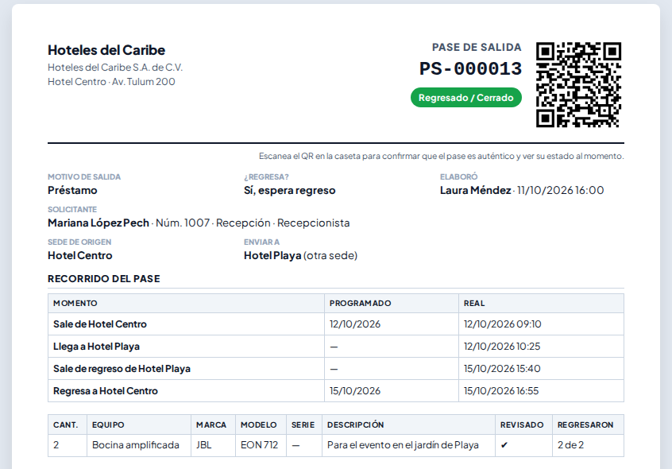

**Qué debes ver:** las firmas que faltan quedan con línea para firmar a mano. Si un movimiento de caseta no pide alguna firma, la hoja no trae ese renglón; si no pide ninguna, dice «**Sin firma: se registra en la plataforma.**» y, ya hecho, quién lo registró y cuándo.

## Cómo configurar quién aprueba (administrador)

1. Toca **Circuito** en la lista (o **Estructura → Configuración → Pases de salida**).
2. Para cada paso escribe su **nombre** (por ejemplo «Contraloría») y elige **quién firma**: **el jefe del departamento del solicitante**, cualquiera con permiso Aprobar, los usuarios de un **rol**, o **usuarios específicos**.
3. Indica si es **obligatorio** y a qué **motivos** aplica. Usa las flechas para el orden.
4. Toca **Guardar circuito**.

**Qué debes ver:** los pases nuevos siguen el circuito nuevo; los que ya están en curso conservan sus pasos.

Si no cambias nada, se usa el circuito original: **Jefe del departamento del solicitante**, Contraloría y Gerencia; dos firmas en cada movimiento de caseta; y el rechazo empieza desde el primer paso.

### Si tu circuito no tiene el paso del jefe del departamento

Si tu empresa ya tenía su propio circuito, no cambia solo. Arriba de los pasos verás «**Tu circuito no tiene el paso del jefe del departamento.**»:

1. Toca **Agregar el paso del jefe del departamento**.
2. Revisa el orden de los pasos y, si quieres ajustarlo, toca **Guardar circuito**.

**Qué debes ver:** «Agregamos el paso «Jefe del departamento del solicitante» al inicio del circuito…». Los pases nuevos (y los que se reenvíen) empiezan con ese paso; los que ya están en curso no cambian.

**Para regresar a lo original:** toca **Restablecer la configuración original** al final de la pantalla y confirma. Verás «Se restableció la configuración original…»: vuelven los tres pasos, las dos firmas en caseta y el rechazo desde el primer paso. Los pases que ya están en curso no cambian.

## Cómo pedir un paso solo según el valor del equipo (administrador)

1. En **Circuito**, en el paso que quieres (por ejemplo «Gerencia»), abre **Condición de valor (avanzado)**.
2. En **Aplica si el valor es mayor o igual a $** escribe la cantidad en pesos, por ejemplo `50000`. Si quieres un tope, escríbelo en **y menor a $**.
3. Toca **Guardar circuito**.

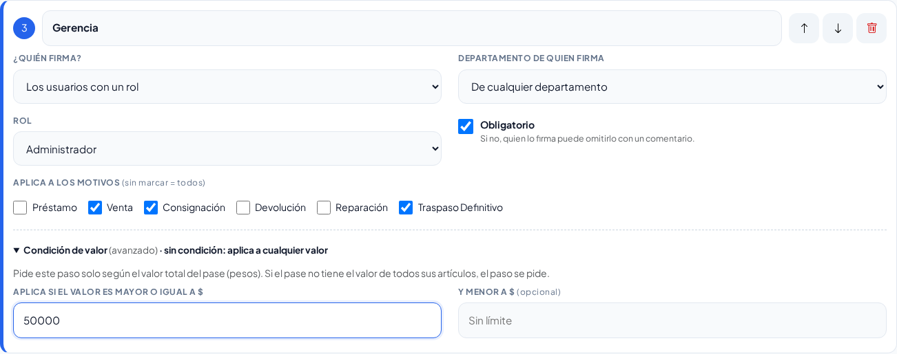

**Qué debes ver:** el paso dice «solo con valor de $50,000.00 o más». Al pedir un pase aparece **Valor por pieza $** en cada artículo. El valor total del pase es la suma de cantidad × valor. Si algún artículo no tiene valor, el paso **sí** se pide (por seguridad). Cada motivo necesita al menos un paso obligatorio sin condición de valor.

## Cómo elegir qué pasa al corregir un rechazado (administrador)

1. En **Circuito**, en **Al corregir y reenviar un pase rechazado**, elige **Empezar desde el primer paso** (lo normal) o **Retomar desde el paso que rechazó**.
2. Toca **Guardar circuito**.

**Qué debes ver:** aplica a los pases que se reenvíen desde ese momento.

## Cómo elegir las firmas de la caseta (administrador)

1. En **Circuito**, baja a **Firmas en caseta**.
2. Para cada movimiento (**Registrar Salida**, **Confirmar llegada a esta sede**, **Autorizar salida de regreso**, **Registrar Regreso**) elige: **Dos firmas (persona y Seguridad)**, **Solo Seguridad** o **Sin firma**.
3. Si un motivo debe ser distinto, abre **Excepciones por motivo (avanzado)** y elige las firmas en el renglón de ese motivo. Deja **Igual que todos** en lo demás.
4. Toca **Guardar circuito**.

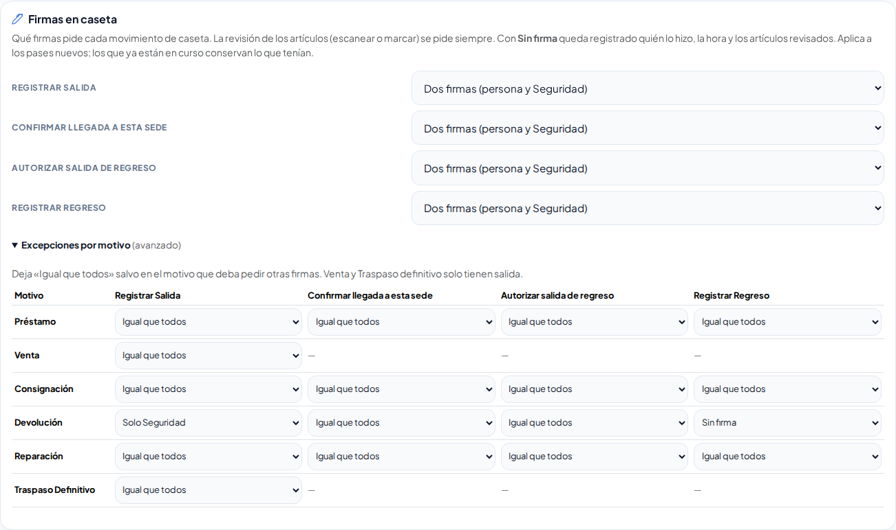

**Qué debes ver:** los pases nuevos piden esas firmas; los que ya están en curso conservan las que tenían. La revisión de los artículos se pide siempre. En la ficha del pase, el **Resumen** dice qué movimientos piden menos firmas.

## Cómo avisar cuando una firma tarda (administrador)

1. En **Circuito**, baja a **Firmas que tardan**.
2. En **Recordar a quien debe firmar después de** escribe un número y elige **horas** o **días** (por ejemplo 4 horas).
3. En **Avisar al siguiente nivel después de** escribe un tiempo mayor (por ejemplo 1 día).
4. Toca **Guardar circuito**.

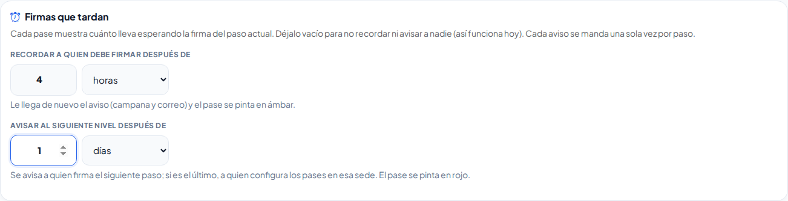

**Qué debes ver:** cuando un paso lleva ese tiempo sin firma, a quien debe firmarlo le llega otra vez el aviso en la **campana** («Recordatorio: el pase PS-… espera tu firma») y por correo si está encendido. Si sigue sin firma, se avisa a quien firma el **siguiente paso** del circuito o, si era el último, a quien configura los pases en esa sede («Firma atrasada: pase PS-…»). Cada aviso se manda una sola vez por paso y queda en la bitácora del pase. Si dejas los dos campos vacíos (así viene), nadie recibe avisos nuevos; solo se ve el reloj.

## En el celular

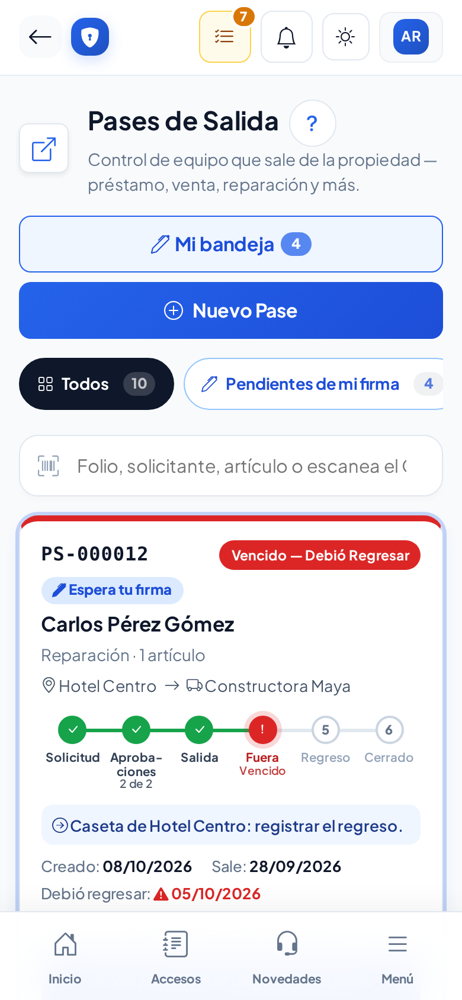

## Si algo sale mal

| Mensaje o síntoma | Qué significa | Qué hacer |
|---|---|---|
| «Elige al solicitante: escanea su gafete, busca su nombre o regístralo con «Nuevo Colaborador».» | Falta el solicitante. | Escanea su gafete o búscalo. |
| «El equipo … no está DISPONIBLE (está ASIGNADO). Primero recíbelo en Responsivas.» | Alguien tiene ese equipo con una responsiva. | Recíbelo en Responsivas y vuelve a intentarlo. |
| «El equipo … no está DISPONIBLE (está DE BAJA). Solo sale un equipo disponible.» | El equipo está de baja, en mantenimiento, fuera o no regresó. | Quítalo del pase o elige otro. |
| «El equipo … ya está en el pase …, que sigue abierto.» / «… está dos veces en el pase.» | Ese equipo ya va en otro pase o lo agregaste dos veces. | Quítalo de este pase. |
| «El equipo … es de otra sede: solo salen equipos de ….» | El equipo pertenece a otra sede. | Pide el pase desde su sede. |
| «Solo puedes solicitar pases de salida a tu nombre.» | Tu rol pide pases solo para ti. | Deja tu nombre en **Solicitante**; si el pase es de otra persona, que lo pida ella o la caseta. |
| «Tu usuario no está vinculado a un colaborador: pide a tu administrador que lo vincule en Usuarios para poder solicitar pases.» (sale en rojo al abrir **Nuevo Pase** y al intentar guardar) | Tu cuenta no está ligada a tu ficha de colaborador. | Pide a tu administrador que la vincule en [Usuarios](usuarios.md). |
| «Agrega al menos un artículo que salga en el pase.» | No hay artículos. | Escanea o escribe al menos uno. |
| «Eres el solicitante de este pase: no puedes aprobarlo tú.» | No se aprueba lo propio. | Lo aprueba otra persona del circuito. |
| «Escribe el motivo del rechazo: el solicitante lo verá para corregir su pase.» | El rechazo necesita motivo. | Escribe qué hay que corregir. |
| «El regreso programado (…) ya pasó: escribe el nuevo regreso programado antes de dar salida.» | El pase debía regresar antes de hoy y aún no sale. | Pregunta cuándo regresa y escribe el **Nuevo regreso programado**. |
| «El nuevo regreso programado no puede ser antes de hoy (…).» | Escribiste una fecha pasada. | Escribe hoy o una fecha posterior. |
| «El regreso programado no puede ser antes de la salida programada.» | Al pedir el pase, el regreso quedó antes de la salida. | Corrige alguna de las dos fechas. |
| «La hora de este movimiento quedaría antes del movimiento anterior del pase (…).» | La hora del equipo no coincide con la del movimiento anterior. | Espera un momento e intenta de nuevo; si sigue, avisa a tu administrador. |
| «Marca o escanea cada artículo que sale: faltan …» | No verificaste todos los artículos. | Escanea o marca los que faltan. |
| «Escribe el nombre de quien se lleva el equipo.» | Falta quién recibe. | Escribe su nombre y pide su firma. |
| Recuadro amarillo «Espera la firma de …» | No te toca firmar este paso. | Espera a que firme la persona indicada. |
| «Este paso lo firma: Jefe del departamento de …» | El paso es del jefe del departamento del solicitante y tú no eres su responsable (ni su suplente). | Lo firma el responsable del departamento. Si el responsable está mal, pide a tu administrador que lo corrija en **Estructura → Departamentos**. |
| «El circuito ya tiene 8 pasos (el máximo): quita uno antes de agregar el del jefe del departamento.» | No caben más pasos. | Quita un paso, toca **Guardar circuito** y vuelve a tocar **Agregar el paso del jefe del departamento**. |
| «El aviso al siguiente nivel debe ir después del recordatorio (más horas o días).» | En **Firmas que tardan** el segundo tiempo es menor o igual al primero. | Escribe un tiempo mayor en **Avisar al siguiente nivel**. |
| «En «Recordar a quien debe firmar» el máximo es 30 días.» | El tiempo es demasiado largo. | Escribe 30 días o menos. |
| «En el paso «…», escribe el valor en pesos (solo números, por ejemplo 50000).» | La condición de valor tiene letras. | Escribe solo la cantidad. |
| «En el paso «…», el valor «menor a» debe ser mayor que el valor «mayor o igual a».» | El tope es menor que el mínimo. | Corrige las cantidades o deja vacío el tope. |
| «Cada motivo necesita al menos un paso obligatorio sin condición de valor: …» | Ese motivo podría quedar sin aprobaciones. | Deja al menos un paso obligatorio sin condición de valor para ese motivo. |
| «El valor de un artículo no puede ser negativo.» | Escribiste un valor menor a cero. | Corrige el valor o déjalo vacío. |

## Preguntas frecuentes

- **¿Cómo sé qué pases me tocan?** Abre **Mis pendientes** o la píldora **Pendientes de mi firma**.
- **Soy jefe de departamento y no me llegan los pases de mi gente, ¿por qué?** Revisa en **Estructura → Departamentos** que seas el responsable de tu departamento en tu sede, que tu rol tenga **Aprobar** de Pases de salida y que el colaborador que pide el pase tenga ese departamento en su ficha.
- **¿Qué diferencia hay entre «Programado» y «Real»?** Lo programado es lo que se escribió al pedir el pase (**Salida programada**, **Regreso programado**). Lo real es la fecha y la hora que registró la caseta en cada momento (**Sale de …**, **Llega a …**, **Sale de regreso de …**, **Regresa a …**).
- **¿Qué pasa si el equipo no regresa a tiempo?** El pase se marca **Vencido — Debió Regresar** y cada mañana llega un recordatorio a la **campana** (y por correo, si está encendido) de quien lo pidió y de quien aprueba en la sede. Al registrar el regreso, el aviso queda leído.
- **¿Por qué en este pase la caseta no pidió mi firma?** Tu empresa configuró ese movimiento con **Solo Seguridad** o **Sin firma**. Lo ves en el **Resumen** del pase.
- **¿Si cambian la configuración, cambia mi pase?** No. Cada pase conserva las firmas de caseta que tenía al enviarse.
- **¿Puedo hacer el pase desde el celular?** Sí, todo funciona igual.
- **¿Puedo borrar un pase?** No; si ya no se necesita, se cancela antes de aprobarse.

## Relacionado

- [Menús, Mis pendientes y modos de pantalla](menus.md)
- [Equipos de seguridad](equipos.md)
- [Bitácora de accesos](accesos.md)
- [Departamentos y puestos](departamentos-y-puestos.md)
