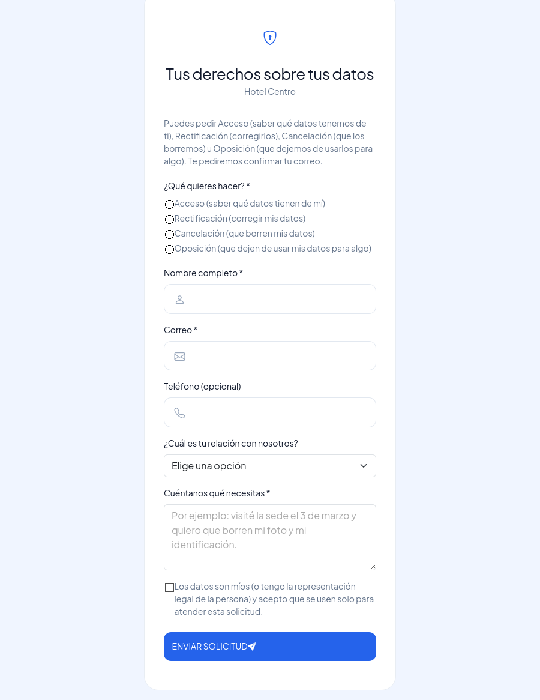
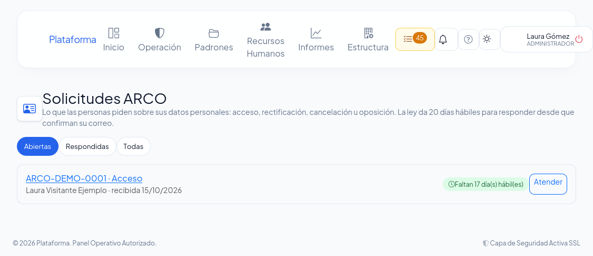
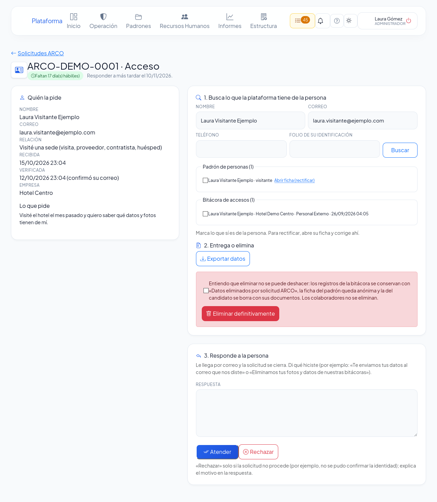

# Privacidad y solicitudes ARCO

**¿Para qué sirve?** Para cumplir con la ley de protección de datos personales: las personas (visitas, huéspedes, candidatos, proveedores, clientes de una reserva) pueden pedir **Acceso** (saber qué datos tienes de ellas), **Rectificación** (corregirlos), **Cancelación** (que los borres) u **Oposición** (que dejes de usarlos para algo). Aquí recibes esas solicitudes con su plazo legal, encuentras sus datos, se los entregas o los eliminas, y les respondes. También eliges cuántos días se conservan los datos y publicas tu aviso de privacidad.

**Antes de empezar:** necesitas que tu rol tenga el permiso **Datos personales** de Configuración con alcance de **toda la empresa** (normalmente el administrador). Si no ves **Solicitudes ARCO** ni la sección **Privacidad** en Configuración, pide a tu administrador ese permiso.

> El aviso de privacidad que trae la plataforma tiene datos entre corchetes por completar (nombre, domicilio y correo de contacto de tu empresa): complétalo con tu abogado antes de usarlo.

## Cómo llegan las solicitudes

1. La persona abre la **página pública de tu aviso de privacidad** (el enlace está en el kiosco, en la solicitud de empleo y en la bolsa de trabajo) y toca **Ejercer mis derechos ARCO**.
2. Llena un formulario corto: qué quiere hacer, su nombre, su correo, su relación con tu empresa y qué necesita.
3. Le llega un correo para **confirmar** que el correo es suyo. Al confirmarlo empieza el **plazo legal: 20 días hábiles** (de lunes a viernes) para responder.
4. Te llega el aviso a la **campana** y aparece en **Mis pendientes → Solicitudes ARCO por atender**.

**Qué debes ver:** en **Solicitudes ARCO** (desde Mis pendientes, la campana o **Estructura → Configuración → Privacidad → Abrir solicitudes ARCO**) cada solicitud con su folio (por ejemplo `ARCO-2026-0001`; las que llegaron desde la página de la plataforma empiezan con `ARCO-P-` y conservan ese folio cuando te las canalizan), qué pide y un **reloj**: verde mientras hay tiempo, **ámbar** cuando faltan pocos días (5 hábiles, o lo que elijas en Configuración) y **rojo** cuando vence hoy o ya venció.

## Cómo atender una solicitud

1. En **Solicitudes ARCO** toca **Atender** en la solicitud.
2. Lee **Quién la pide** y **Lo que pide**.
3. En **1. Busca lo que la plataforma tiene de la persona**, revisa el nombre, correo y teléfono (ya vienen llenos) y, si lo tienes, escribe el **folio de su identificación**. Toca **Buscar**. Deja su **nombre completo**: con él se encuentran también los tickets, accidentes y observaciones que la mencionan.
4. Aparecen los registros encontrados, agrupados: **Padrón de personas**, **Bitácora de accesos**, **Candidatos**, **Colaboradores**, **Lost & Found: reportes de pérdida**, **Lost & Found: entregas**, **Novedades que la mencionan**, **Accidentes (con datos médicos)**, **Reservas** y **Bitácora de transporte**. **Marca solo los que sí son de esa persona** (puede haber personas con el mismo nombre).
5. Según lo que pidió:
   - **Acceso:** toca **Exportar datos**. Se prepara un archivo con sus registros, fotos y documentos. La pantalla regresa con la misma búsqueda y lo que marcaste. Toca **Descargar el archivo** y entrégaselo por el medio que acordaron (el botón sigue ahí aunque después busques con otros datos).
   - **Rectificación:** toca **Abrir ficha (rectificar)** junto al registro y corrige ahí los datos.
   - **Cancelación u Oposición:** marca **Entiendo que eliminar no se puede deshacer** y toca **Eliminar definitivamente**.
6. En **3. Responde a la persona** escribe qué hiciste y toca **Atender**. Si la solicitud no procede (por ejemplo, no se pudo confirmar su identidad), explica el motivo y toca **Rechazar**.

**Qué debes ver:** «Solicitud ARCO-… respondida: le enviamos tu respuesta a la persona por correo…». La solicitud pasa a **Respondidas** y sale de Mis pendientes. Todo lo que hiciste queda en **Lo que se ha hecho** y en la [Bitácora de auditoría](auditoria.md).

**Qué pasa al eliminar:**
- Los registros de la **bitácora** se conservan (fecha, sede, gafete, quién los registró) pero sin foto, identificación ni datos de la persona; en lugar del nombre dicen «Datos eliminados por solicitud ARCO».
- La ficha del **padrón de personas** queda anónima y dada de baja.
- La ficha del **candidato** se borra con sus documentos (si ya fue contratado, no: ya es colaborador).
- **Lost & Found:** el reporte de pérdida y la entrega se conservan, sin su nombre, teléfono, correo, identificación ni firma.
- **Accidentes de huésped:** el ticket se conserva (fecha, lugar), sin sus datos (nombre, habitación, edad, país…), **sin los datos médicos** (diagnóstico, hospital, médico, lesiones) y sin su firma. El formulario del accidente no cambia.
- **Novedades:** su nombre se quita de la descripción, de los involucrados, de las notas, de los testigos y de «¿Quién o quiénes fueron observados?» del Reporte General.
- **Reservas:** la reserva sigue en pie, sin el nombre, la empresa, el correo ni el teléfono del cliente.
- **Transporte:** su nombre sale de las observaciones y, si manejó el taxi, se borra su firma.
- Los **colaboradores** y sus **accidentes de trabajo** no se eliminan desde aquí (la relación laboral obliga a conservar sus datos); solo se rectifican en su ficha o en el ticket.
- El mensaje te dice cuántos registros se trataron de cada módulo.

## Cómo dar por verificada una solicitud sin correo confirmado

Si la persona no recibió el correo (o la plataforma no tiene correo configurado), la solicitud aparece con **Correo sin confirmar**.

1. Pide a la persona una **identificación oficial** (en persona o por un medio seguro) y confirma que es ella.
2. Abre la solicitud y toca **Aprobar**. Confirma con **Aceptar**.

**Qué debes ver:** «Solicitud verificada: el plazo de 20 días hábiles empezó hoy…». Ya puedes buscar sus datos y responder.

## Cómo canalizar una solicitud de la página de la plataforma (Super Administrador)

Las solicitudes que llegan desde la página pública de la plataforma (no desde el aviso de una empresa) no tienen empresa.

1. En **Solicitudes ARCO** toca **De la página de la plataforma**.
2. Abre la solicitud, elige la **Empresa** que tiene los datos de la persona y toca **Canalizar**.

**Qué debes ver:** «Solicitud … canalizada a …». Pasa a la bandeja de esa empresa con el mismo plazo y le avisa a quien la atiende.

## Cómo elegir cuántos días se conservan los datos y publicar el aviso

Se hace en **Estructura → Configuración → Privacidad**. Los pasos están en [Configuración](configuracion.md) («Cómo elegir cuántos días se conservan los datos personales» y «Cómo publicar una versión nueva del aviso de privacidad»).

## Si algo sale mal

| Mensaje o síntoma | Qué significa | Qué hacer |
|---|---|---|
| **Primero confirma la identidad de la persona (la solicitud aún no está verificada).** | La persona no confirmó su correo. | Confirma su identidad y toca **Aprobar**. |
| **Esta solicitud ya se respondió.** | Ya la atendiste o la rechazaste. | No hace falta hacer nada más. |
| **Marca al menos un registro de la lista.** | Tocaste Exportar o Eliminar sin marcar registros. | Marca los registros que son de la persona. |
| **Marca «Entiendo que no se puede deshacer» para eliminar los datos.** | Falta confirmar. | Marca la casilla y vuelve a tocar **Eliminar definitivamente**. |
| **Escribe la respuesta para la persona (de 10 a 5,000 caracteres).** | La respuesta está vacía o muy corta. | Explica qué hiciste. |
| **Primero canaliza la solicitud a la empresa que corresponde.** | Llegó desde la página de la plataforma. | El Super Administrador la canaliza. |
| No encontramos registros con esos datos. | Con ese nombre, correo o teléfono no hay nada. | Prueba con el nombre como lo escribió la caseta o con el folio de su identificación; si de verdad no hay, respóndele que no tienes información suya. |
| No veo **Solicitudes ARCO**. | Tu rol no tiene el permiso **Datos personales** de Configuración con alcance de toda la empresa. | Pídelo a tu administrador. |

## Preguntas frecuentes

- **¿Cuánto tiempo tengo para responder?** 20 días hábiles desde que la persona confirma su correo (o desde que tú la das por verificada). El reloj de cada solicitud te dice cuántos faltan; cuando quedan pocos te llega un recordatorio, y si vence, también se avisa al Super Administrador.
- **¿Qué incluye el archivo de «Exportar datos»?** Los registros que marcaste (en archivos que se abren en Excel), y las fotos, firmas y documentos ligados a ellos, incluidos los datos médicos de un accidente. Solo lo de tu empresa.
- **¿Busca en todos los módulos?** Sí: padrón, caseta, candidatos, colaboradores, Lost & Found, novedades, accidentes, reservas y transporte.
- **¿La persona ve lo que hice?** Le llega por correo tu respuesta. Lo demás queda solo en la plataforma.
- **¿Puedo deshacer una eliminación?** No. Por eso pide confirmación y por eso conviene exportar antes si la persona también pidió acceso.
- **¿Se guarda quién atendió cada solicitud?** Sí, en la solicitud y en la Bitácora de auditoría (sin el nombre ni el correo de la persona).

## Relacionado

- [Configuración](configuracion.md)
- [Bitácora de auditoría](auditoria.md)
- [Personas](personas.md)
- [Candidatos](candidatos.md)
- [Bitácora de accesos](accesos.md)
- [Lost & Found y robo](lost-found-y-robo.md)
- [Bitácora de novedades](novedades.md)
- [Reservas de áreas](reservas-de-areas.md)
- [Bitácora de transporte](transporte.md)
