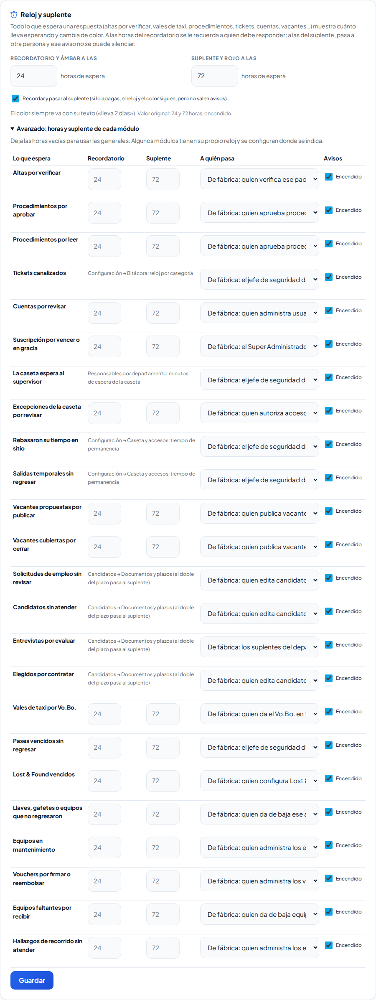

# Reloj y suplente

**¿Para qué sirve?** Para que nada se quede esperando sin que nadie lo note. Todo lo que espera una respuesta (una visita en caseta, un alta por verificar, un vale de taxi, una vacante, un ticket…) dice cuánto lleva, cambia de color y, si nadie responde, **pasa a otra persona** (el suplente).

**Antes de empezar:** no necesitas hacer nada. Lo que te toca aparece en **Mis pendientes** y en la campana. Las horas las elige tu administrador en **Configuración → General → Reloj y suplente**.

## Cómo leer el reloj y el color

1. Toca **Mis pendientes** (junto a la campana) o abre **Inicio**.
2. Cada renglón dice cuántas cosas te esperan y tiene un color:
   - **Sin color:** a tiempo.
   - **Ámbar:** ya pasó la hora del recordatorio (de fábrica, **24 horas**). Te llegó un recordatorio en la campana.
   - **Rojo:** ya pasó al suplente (de fábrica, **72 horas**). A otra persona le llegó un aviso para que lo atienda o le dé seguimiento.
3. Dentro de cada pantalla, la tarjeta dice **Lleva …** («Lleva 2 días», «Lleva 5 h»).

**Qué debes ver:** el color siempre va con su texto; no tienes que adivinar.

Algunas cosas tienen su propio reloj:

| Qué espera | Recordatorio | Pasa al suplente |
|---|---|---|
| Visita, proveedor o candidato en caseta | Los minutos de la caseta | Los minutos de la caseta (al jefe de seguridad) |
| Ticket canalizado | Accidente 2 h · Robo 4 h · lo demás 24 h | Al triple (al jefe de seguridad de la sede) |
| Persona en sitio | Visita 4 h · proveedor 8 h · daypass hasta el cierre | Al doble (al jefe de seguridad) |
| Salida temporal | 2 h | 4 h |
| Candidatos | El plazo de cada etapa | Al doble del plazo |
| Llaves fuera | 12 h | 24 h |
| Lost & Found vencido | Cada semana | 72 h después de vencer |
| Pendiente de turno sin turnos en la sede | De inmediato | A las 8 h |

## Quién es el suplente

- De fábrica, quien puede resolverlo en **toda la empresa** (por ejemplo, quien verifica altas en todas las sedes).
- En la caseta, los tickets, la permanencia y los pases vencidos: el **jefe de seguridad de la sede**.
- En las entrevistas: quien la canalizó en Recursos Humanos (puede volver a canalizarla o marcar «No se presentó»); un suplente del departamento solo si también puede hacerlo.
- En lo que tiene hora fija: una **ruta sin registro** (15 minutos después de su hora; una hora después, quien da el Vo.Bo. en toda la empresa), una **orden de servicio** (un día antes del montaje; al empezar el montaje, el responsable general de Reservas), la **recarga** de un equipo de Protección Civil (15 días antes; al vencer, quien los administra en toda la empresa) y su **revisión** (al pasar los días de su tipo; una semana después, igual).
- Si no hay nadie más, le llega a las mismas personas con un aviso que ya no se puede silenciar.

Tu administrador puede elegir un **rol** distinto para cada cosa en Configuración.

El suplente siempre es alguien que **puede atenderlo** (no solo verlo): por ejemplo, una entrevista atrasada pasa a Recursos Humanos, que puede volver a canalizarla o marcar «No se presentó», y un ticket canalizado pasa a quien puede reasignarlo en esa sede. Lo que te pasaron aparece en tu **Mis pendientes**: en su renglón de siempre o en **«Te lo pasaron: …»**, con su color rojo, hasta que se atienda.

Si delegaste tus aprobaciones (**Mi cuenta → Delegar mis aprobaciones**), el recordatorio y el aviso de suplente le llegan a la persona en quien delegaste, siempre que pueda atenderlo; si ella también delegó, a la última de la cadena que pueda. Lo mismo pasa en **Mis pendientes**: mientras dure tu delegación, esos renglones los ve quien te cubre y no tú. También **Altas por verificar**, **Cuentas por revisar** y **Procedimientos por aprobar**: el número que ves es justo lo que puedes atender, y coincide con los recordatorios que te llegan.

**Qué debes ver:** a cada quien le llega **un solo** recordatorio y **un solo** aviso de suplente por cada asunto, aunque tenga varias pantallas abiertas.

## Cómo saber que quien lo pidió se enteró

Cuando respondes, quien lo pidió recibe el resultado en su campana: la caseta sabe si se autorizó, el jefe sabe si su vacante se publicó o se canceló, el guardia sabe si su vale de taxi se aprobó o se rechazó, quien registró un alta sabe si se verificó.

## Cómo cambiar las horas (Administrador)

1. Abre **Estructura → Configuración → General → Reloj y suplente**.
2. Escribe las horas del **Recordatorio y ámbar** y del **Suplente y rojo**.
3. Si no quieres que salgan avisos (solo el reloj y el color), quita la marca de **Recordar y pasar al suplente**.
4. Toca **Avanzado** para ponerle horas propias a un módulo, elegir el rol al que pasa o apagar solo ese.
5. Toca **Guardar**.

**Qué debes ver:** el mensaje «Reloj y suplente guardado». Para volver a 24 y 72, toca **Restablecer valor original**.

## Si algo sale mal

| Mensaje o síntoma | Qué significa | Qué hacer |
|---|---|---|
| «Las horas para el rojo deben ser más que las del amarillo.» | El suplente debe llegar después del recordatorio. | Escribe más horas en «Suplente y rojo». |
| «…: las horas para pasar al suplente deben ser más que las del recordatorio.» | Lo mismo, en un módulo de Avanzado. | Corrige las horas de ese renglón. |
| No me llegó el recordatorio | Lo silenciaste en Mi cuenta, o tu administrador apagó los avisos. | Revisa **Mi cuenta → Mis avisos**; lo pendiente sigue en Mis pendientes. |
| Me llegó algo que no es mío | Eres el suplente de fábrica. | Atiéndelo o pásaselo a quien corresponde. Tu administrador puede elegir otro rol. |

## Preguntas frecuentes

**¿Puedo silenciar el aviso de suplente?** No. Tampoco lo que no tiene renglón en Mis pendientes. El resto sí, en **Mi cuenta → Mis avisos**.

**¿Qué pasó con lo que ya esperaba el día que se encendió?** Cuenta sus avisos desde ese día para no recibir todo de golpe; la tarjeta sí dice cuánto lleva de verdad.

**¿Me llegan avisos de madrugada?** Solo de lo que de verdad espera (por ejemplo, la caseta). Lo demás se revisa cuando alguien usa la plataforma.

## Relacionado

[Menús y Mis pendientes](menus.md) · [Mi cuenta](mi-cuenta.md) · [Configuración](configuracion.md) · [Bitácora de accesos](accesos.md)
