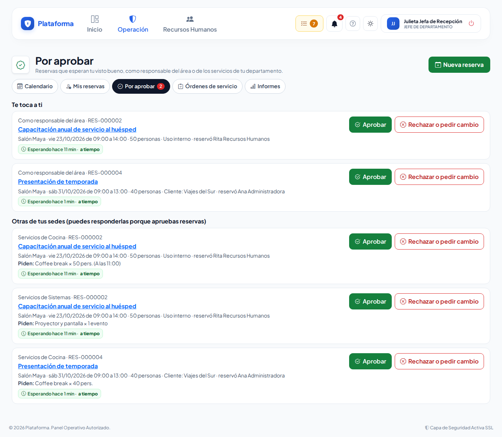
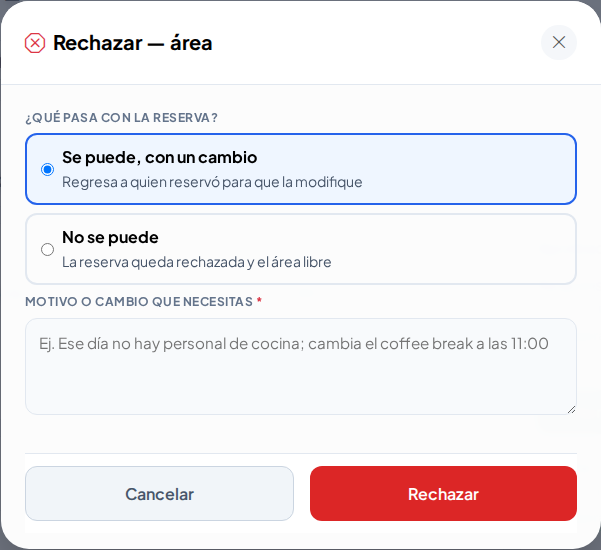

# Aprobar reservas

**¿Para qué sirve?** Cuando alguien reserva un área que te toca, o pide servicios que atiende tu departamento, la reserva espera **tu visto bueno**. Puedes **Aprobar**, **Rechazar** o **pedir un cambio** sin buscarla: te llega a la campana y a **Mis pendientes**.

**Antes de empezar:** apruebas si eres el **responsable (o suplente) del área**, el **responsable general de reservas**, el **responsable (o suplente) de un departamento** en **Departamentos → Responsables**, o si alguien te delegó con «No molestar». Quien tiene permiso de **aprobar** reservas en tu sede también puede responder cualquiera.

## Cómo aprobar desde la campana

1. Toca la **campana**. El aviso dice «Reserva por aprobar: …» con el área, el día, las personas y, si es de tu departamento, los servicios («Coffee break × 50 pers.»).
2. Toca **Aprobar**.

**Qué debes ver:** el aviso verde «Aprobada…». Cuando todas las partes aprueban, dice que la reserva quedó **confirmada** y se avisa a quien reservó y a los departamentos.

## Cómo revisar lo que te toca

1. Entra a **Operación → Reservas → Reservas de áreas** → pestaña **Por aprobar** (o toca **Reservas por aprobar** en **Mis pendientes**).
2. Cada reserva que espera es una **ficha** con la parte que te toca (Área, Cocina, Sistemas…), el día, las personas, lo que piden y un **reloj**: cuánto lleva esperando y su color (**a tiempo**, **ámbar** cuando ya se recordó, **rojo** cuando ya se avisó al responsable general). Si apruebas reservas en la sede, filtra con **Te toca a ti** u **Otras de tus sedes**.
3. En la esquina de la ficha: **Aprobar** (palomita), **Rechazar o pedir cambio** (tache: abre la reserva) y **Ver** (ojo).

## Cómo rechazar o pedir un cambio

1. En la ficha de la reserva toca **Rechazar** junto a tu aprobación.
2. Elige:
   - **Se puede, con un cambio**: la reserva regresa a quien la hizo para que la modifique.
   - **No se puede**: la reserva queda rechazada y el área libre.
3. Escribe el **Motivo o cambio que necesitas** y toca **Rechazar**.

**Qué debes ver:** el aviso verde con el resultado. Quien reservó recibe tu motivo en su campana. Si elegiste **No se puede**, en el bloque **Aprobaciones** de la ficha tu parte queda **Rechazada** y las que seguían esperando (por ejemplo, la del área o la de Cocina) quedan como **Ya no aplica**, sin botones.

## Cómo ajustar el costo de un evento

Solo con permiso de **aprobar** reservas y en reservas **para un cliente**.

1. En la ficha toca **Ajustar costo**.
2. Escribe un **Descuento**, marca **Cortesía** o fija el **Importe del área para este evento**.
3. Escribe el **Motivo** (por ejemplo «Cliente frecuente») y toca **Guardar**.

**Qué debes ver:** «Costo guardado. Total: …» con el botón **Imprimir la cotización**. No se vuelve a pedir aprobación.

## Si algo sale mal

| Mensaje o síntoma | Qué significa | Qué hacer |
|---|---|---|
| «Escribe el motivo del rechazo.» / «Escribe qué cambio necesitas.» | Rechazar y pedir cambio llevan motivo. | Escríbelo y vuelve a tocar **Rechazar**. |
| «Alguien más ya respondió esta aprobación.» | Otra persona (tu suplente o tu delegado) respondió antes. | Revisa la ficha: ya tiene respuesta. |
| «Esta aprobación ya se respondió o ya no aplica.» | La reserva se modificó, se canceló o ya se rechazó. | No tienes que hacer nada. |
| No te llegan avisos | No eres responsable de esa área o departamento. | Pide a tu administrador que te nombre en el área o en Departamentos → Responsables. |

## Preguntas frecuentes

**¿Qué pasa si no respondo?** A las horas que fija tu empresa (por omisión 4) se te recuerda y se avisa a tu suplente; a las 24 h se avisa al responsable general de reservas, que puede responder por ti.

**¿Me voy de vacaciones?** Usa **«No molestar»** en Mi cuenta para delegar: los avisos le llegan a tu delegado y él puede aprobar.

**Si la persona modifica la reserva, ¿apruebo todo otra vez?** Solo si cambió lo tuyo. Lo que no cambió conserva tu aprobación.

## Relacionado

- [Reservas de áreas](reservas-de-areas.md)
- [Órdenes de servicio de reservas](reservas-departamentos.md)
- [Departamentos y puestos](departamentos-y-puestos.md)
