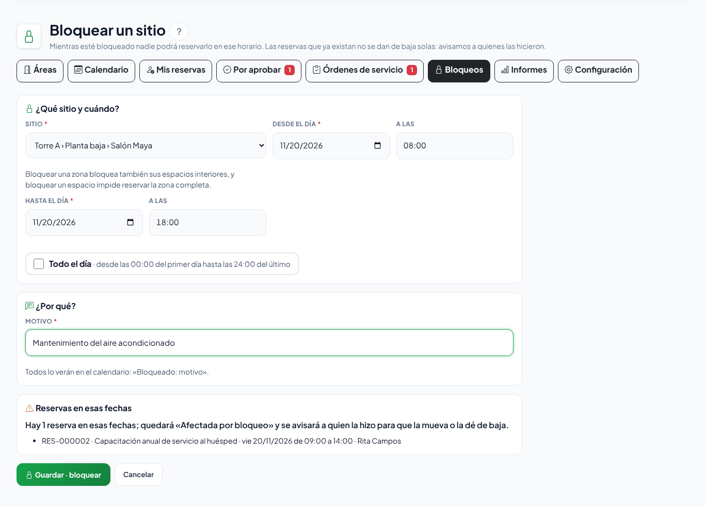
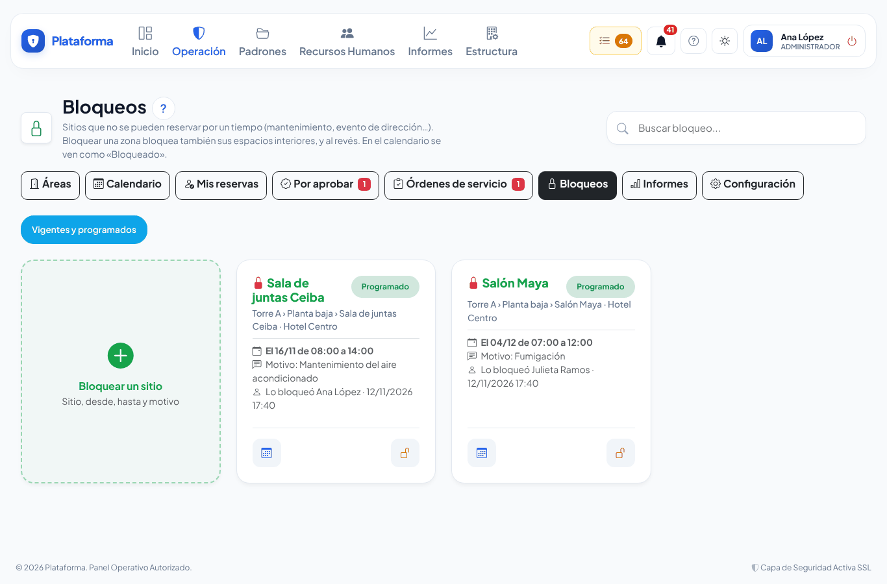
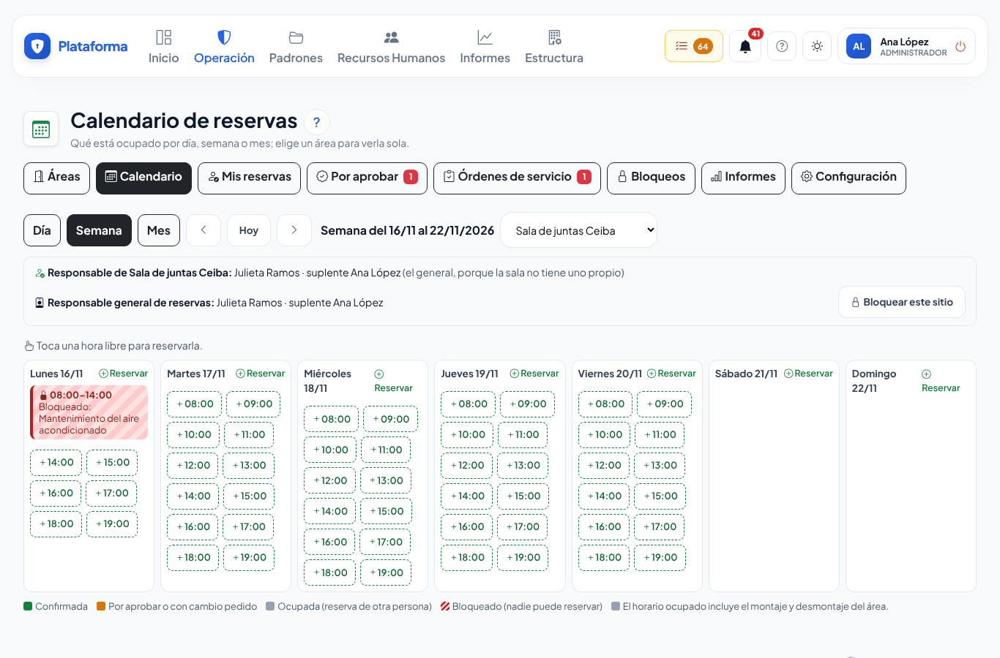

# Bloquear un sitio de reservas

**¿Para qué sirve?** Para que **nadie pueda reservar** un salón, una sala o una zona durante un tiempo: por ejemplo, mientras le dan **mantenimiento** o porque la dirección lo ocupa para un evento. En el calendario todos ven ese horario como **«Bloqueado: el motivo»**. Si ya había reservas en esas fechas, no se cancelan solas: quedan marcadas **Afectada por bloqueo** y avisamos a quienes las hicieron para que las muevan o las den de baja.

**Antes de empezar:** puedes bloquear si eres:

- el **responsable general de reservas** o su **suplente**: cualquier sitio;
- el **responsable** o el **suplente** de una sala: solo esa sala;
- alguien a quien su rol le permite **bloquear** reservas en la sede (de fábrica, el Administrador).

Si no ves la pestaña **Bloqueos**, no te toca bloquear; pide a quien administra las reservas que lo haga o que te nombre responsable de la sala (ver [Configurar las reservas](reservas-configuracion.md)).

## Cómo bloquear un sitio

1. Entra a **Operación → Reservas → Reservas de áreas** y toca la pestaña **Bloqueos**. También puedes tocar **Bloquear este sitio** en la ficha del área o en el calendario de una sala.
2. Toca la ficha **Bloquear un sitio**.
3. En **Sitio** elige el salón, la sala o la zona. Si llegaste desde la ficha o el calendario, ya viene elegido.
4. Escribe **Desde el día** y **A las**, y **Hasta el día** y **A las**. Si es por días enteros, marca **Todo el día**: va de las 00:00 del primer día a las 24:00 del último.
5. En **Motivo** escribe por qué (por ejemplo «Mantenimiento del aire acondicionado»). Puedes elegir uno de la lista: Mantenimiento, Evento de dirección, Limpieza profunda, Remodelación o Fumigación. Todos lo verán en el calendario.
6. Si ya hay reservas en esas fechas, aparece el cuadro **Reservas en esas fechas** con cuántas son y de quién: «Hay 3 reservas en esas fechas; quedarán «Afectada por bloqueo» y se avisará a sus solicitantes…».
7. Toca **Guardar · bloquear**.

**Qué debes ver:** el aviso verde «… quedó bloqueado el 04/11 de 08:00 a 18:00: nadie puede reservarlo en ese horario.» (y cuántas reservas quedaron afectadas) con los botones **Ver su calendario** y **Bloquear otro sitio**.

**Zonas y sus espacios:** bloquear una **zona** (por ejemplo, un centro de negocios) bloquea también todas sus salas; bloquear **una sala** impide reservar la zona completa a esa hora. Es la misma regla que con las reservas.

## Cómo ver lo que está bloqueado

1. Toca la pestaña **Bloqueos**.
2. Cada bloqueo es una ficha con el sitio, desde cuándo y hasta cuándo, el motivo, quién lo bloqueó y, si las hay, cuántas **reservas afectadas** quedan por mover. La insignia dice **Bloqueado ahora** o **Programado**.
3. Toca **Terminados y dados de baja** para ver los anteriores.

En el **calendario** el bloqueo se ve con rayas rojas y el texto **Bloqueado: el motivo**, para todas las personas.

## Cómo quitar un bloqueo (Dar de baja)

1. En la ficha del bloqueo toca el **candado abierto** (**Dar de baja el bloqueo**).
2. Si quieres, escribe **¿Por qué?** (por ejemplo «El mantenimiento terminó antes»).
3. Toca **Dar de baja**.

**Qué debes ver:** «Bloqueo de «…» dado de baja: ya se puede reservar ese horario.». Las reservas que estaban afectadas dejan de estarlo y avisamos a quienes las hicieron. El bloqueo queda en **Terminados y dados de baja** (con quién lo quitó y por qué) y en la Bitácora de auditoría.

## Si tu reserva quedó «Afectada por bloqueo»

1. Te llega a la **campana** (y por correo, si tu empresa lo tiene encendido) «Tu reserva quedó afectada por un bloqueo…», y en **Mis pendientes** aparece **Reservas afectadas por un bloqueo**.
2. Tócalo: se abre **Mis reservas** con la píldora **Afectadas por bloqueo**.
3. Abre la reserva. Arriba dice en rojo qué sitio está bloqueado, cuándo y por qué.
4. Elige:
   - **Modificar**: muévela a otro horario o a otra área y toca **Guardar reserva**. Deja de estar afectada.
   - **Dar de baja la reserva**, si ya no se hará.

**Qué debes ver:** la insignia **Afectada por bloqueo** desaparece y el renglón sale de **Mis pendientes**.

## Si algo sale mal

| Mensaje o síntoma | Qué significa | Qué hacer |
|---|---|---|
| «El área está bloqueada el 04/11 de 08:00 a 18:00: Mantenimiento. Elige otro horario u otra área.» | Quisiste reservar un horario bloqueado. | Elige otro horario u otra área. Debajo de la fecha, el formulario muestra «Bloqueado de … a …». |
| ««Torre A» (comparte lugar con esta área) está bloqueada …» | Está bloqueada la zona que contiene a tu sala (o una sala de la zona que quieres reservar completa). | Elige otro horario u otro espacio. |
| «Elige un sitio que puedas bloquear.» | Ese sitio no es tuyo para bloquear. | Pide al responsable general de reservas o al responsable de esa sala que lo bloquee. |
| «Escribe el motivo del bloqueo (por ejemplo, «Mantenimiento»).» | Falta el motivo. | Escríbelo: todos lo verán en el calendario. |
| «El fin del bloqueo debe ser después del inicio.» | Las fechas u horas están al revés. | Corrige **Hasta el día** o **A las**. |
| «Ese horario ya pasó: elige uno que termine más tarde que ahora.» | El bloqueo terminaría antes de ahora. | Revisa los días. |
| Después de **Guardar · bloquear** aparece «Reservas en esas fechas» y no se guardó. | Hay reservas que se afectarían y la pantalla te lo muestra antes de bloquear. | Revisa la lista y toca **Guardar · bloquear** otra vez para confirmar. |
| No veo la pestaña **Bloqueos**. | No eres responsable de reservas ni tu rol puede bloquear. | Pide ayuda a quien administra las reservas. |

## Preguntas frecuentes

**¿Se cancelan solas las reservas que ya estaban?** No. Quedan **Afectada por bloqueo** y avisamos a quien reservó y al responsable de la sala. Quien reservó decide si la mueve o la da de baja.

**¿Quién ve el motivo?** Todos los que ven el calendario: el bloqueo se muestra como «Bloqueado: el motivo».

**¿Puedo bloquear varios días seguidos?** Sí: escribe el primer y el último día y, si son días enteros, marca **Todo el día**. Un bloqueo dura como máximo un año.

**¿Quién puede quitar un bloqueo?** Las mismas personas que pueden bloquear ese sitio.

**¿Las salas de una zona bloqueada se pueden reservar?** No: bloquear la zona bloquea sus espacios interiores.

## Relacionado

- [Reservas de áreas](reservas-de-areas.md)
- [Configurar las reservas](reservas-configuracion.md)
- [Aprobar reservas](reservas-aprobar.md)
- [Menús, Mis pendientes y la campana](menus.md)
