# Configurar las reservas

**¿Para qué sirve?** Para decidir qué salones, salas y habitaciones se pueden reservar (uno por uno o una zona completa con sus espacios), cómo (aforo, montajes, horario, tarifas, foto) y quién los aprueba, y para mantener los catálogos de tu empresa.

**Antes de empezar:** necesitas que tu rol pueda **configurar** en Reservas de áreas. Los catálogos y los ajustes generales piden permiso en **toda la empresa**. Las áreas salen de **Estructura → Zonas y edificios**: si el salón no existe ahí, créalo primero ([Zonas y edificios](zonas-y-areas.md)).

## Cómo agregar áreas reservables

1. Entra a **Operación → Reservas → Reservas de áreas**. Entra a la sede (o ve a la pestaña **Configuración**, sección **Áreas reservables**).
2. Toca la ficha **Agregar área reservable**.
3. Aparece la lista de los espacios de **Zonas y edificios**, en orden: cada zona y, con sangría, lo que tiene dentro (pisos, habitaciones, salas). Escribe en **Buscar espacio…** para encontrarlo.
4. Marca la casilla de cada espacio que se podrá reservar. Puedes marcar **varios a la vez**. Los que ya se reservan aparecen marcados con «Ya se reserva».
5. Si marcaste una **zona que tiene espacios interiores** (dice, por ejemplo, «3 espacios interiores»), elige cómo se reserva:
   - **Toda la zona como un solo espacio**: se reserva completa (un salón o una terraza).
   - **Por sus espacios interiores**: se agregan de una vez sus habitaciones o salas, cada una con la configuración de la zona (aforo, horario, responsable y suplente, montajes, tarifas y minutos de montaje). Después puedes ajustar cada una.
6. Toca **Guardar**.

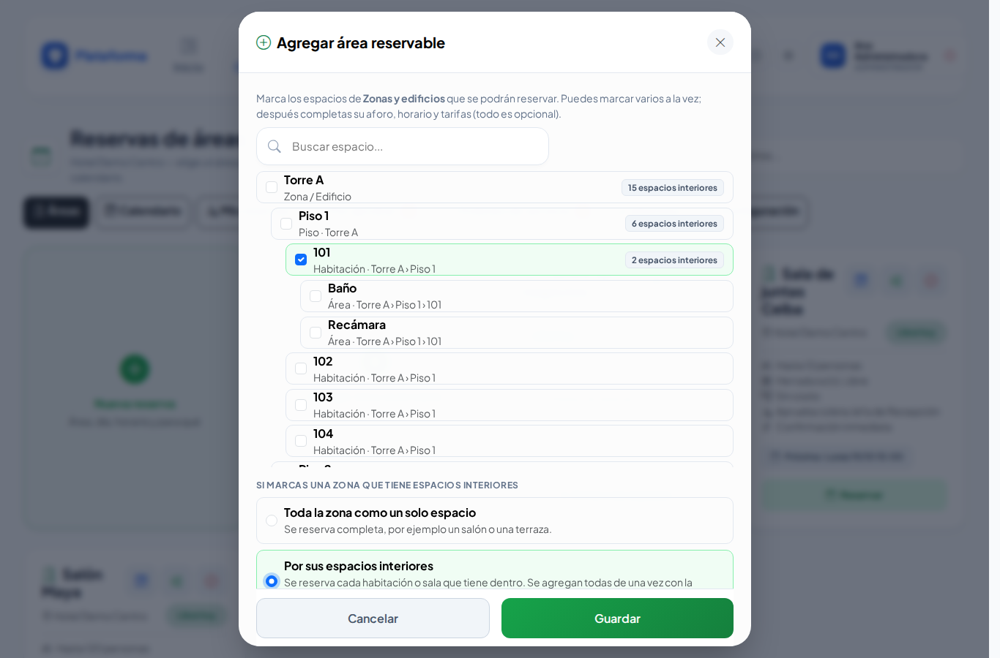

**Qué debes ver:** el aviso verde «… ya se puede reservar …» y las fichas nuevas. Con un solo espacio se abre directo su configuración.

Si el espacio ya estuvo en reservas y lo eliminaste cuando tenía reservas pasadas, aparece con «Se quitó · vuelve con su configuración»: al marcarlo vuelve con todo lo que tenía.

Nada cambia en **Zonas y edificios**: ahí solo se crean los lugares; aquí solo se dice cómo se reservan.

## Cómo editar un área

En cada ficha de área, arriba a la derecha, hay tres botones de ícono (los mismos que en Zonas y edificios):

| Ícono | Botón | Qué hace |
|---|---|---|
| Reloj | **Historial** | Quién cambió qué y cuándo. |
| Lápiz | **Editar** | Abre la configuración del área para cambiar sus datos. |
| Bote de basura | **Eliminar de reservas** | Deja de ofrecerla para reservar (ver «Cómo eliminar un área de reservas»). |

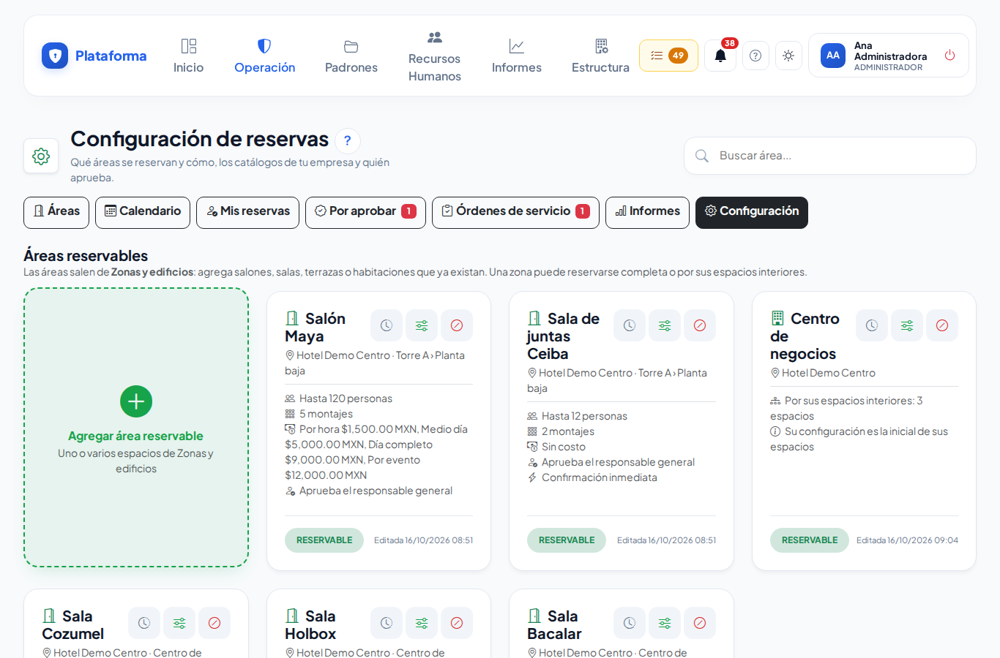

1. En su ficha toca **Editar** (lápiz). También está en las fichas de cada sede o zona en **Áreas**.
2. Todo es opcional; toca **Guardar** al terminar:
   - **Aforo máximo** y **Responsable de aprobación** con su **Suplente** (vacío = el responsable general).
   - **Confirmación inmediata**: la reserva se confirma al momento si no lleva servicios ni costo (ideal para salas de juntas).
   - **Montajes posibles**: marca cada acomodo y cuántas personas caben.
   - **Montaje** y **Desmontaje** en minutos: también ocupan el área.
   - **Solo se reserva en este horario**: marca los días y las horas.
   - **Tarifas para clientes**: por hora, medio día, día completo o por evento.
   - **Foto y descripción**.
   - **Copiar esta configuración a sus espacios interiores** (solo en una zona con espacios interiores): reemplaza la configuración de cada habitación o sala con la de la zona.

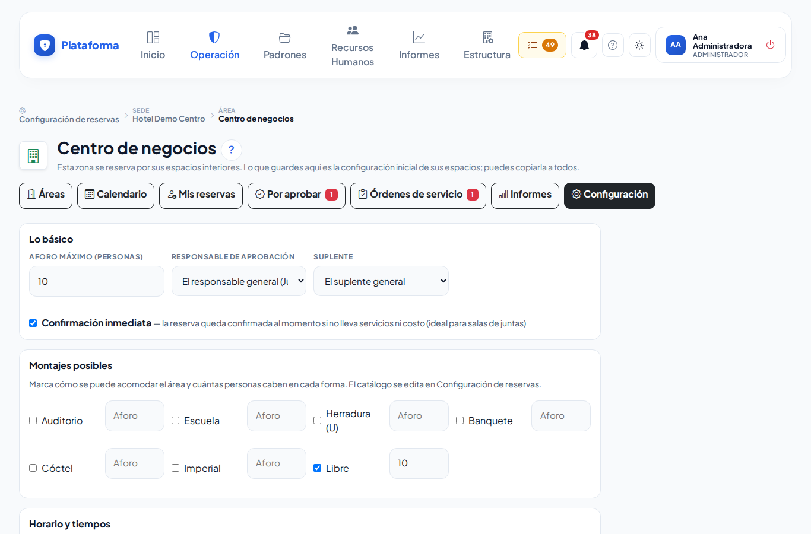

**Qué debes ver:** «Configuración del área guardada.» con el botón **Reservar esta área**.

## Cómo eliminar un área de reservas

Úsalo cuando ya no quieres ofrecer un área ni tenerla a la vista. **Nunca** se borra de Zonas y edificios: ahí sigue existiendo.

1. En la ficha del área toca **Eliminar de reservas** (bote de basura).
2. Lee el mensaje: te dice exactamente qué va a pasar con esa área. Toca **Aceptar** para continuar.
3. Según sus reservas:
   - **Nunca se ha reservado**: se borra su configuración de reserva (aforo, montajes, horario, tarifas y foto) y la ficha desaparece.
   - **Solo tiene reservas que ya pasaron**: deja de ofrecerse y **deja de verse**, pero guardamos su historial y su configuración. La puedes ver con **Mostrar quitadas** (ver abajo).
   - **Tiene reservas próximas** (por aprobar, con cambio pedido o confirmadas): **no se elimina**. Aparece el aviso rojo con el botón **Ver su calendario** para que las canceles o las cambies de horario primero.
   - Una **zona por sus espacios interiores** se elimina junto con sus espacios.

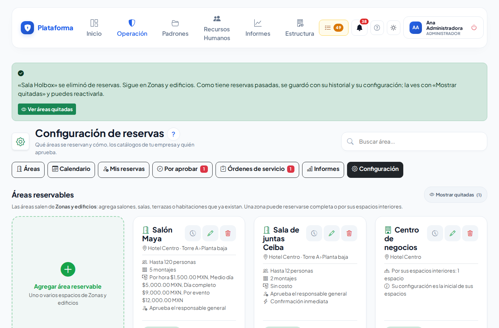

**Qué debes ver:** el aviso verde «… se eliminó de reservas. Sigue en Zonas y edificios.» Si tenía reservas pasadas, el aviso trae el botón **Ver áreas quitadas**.

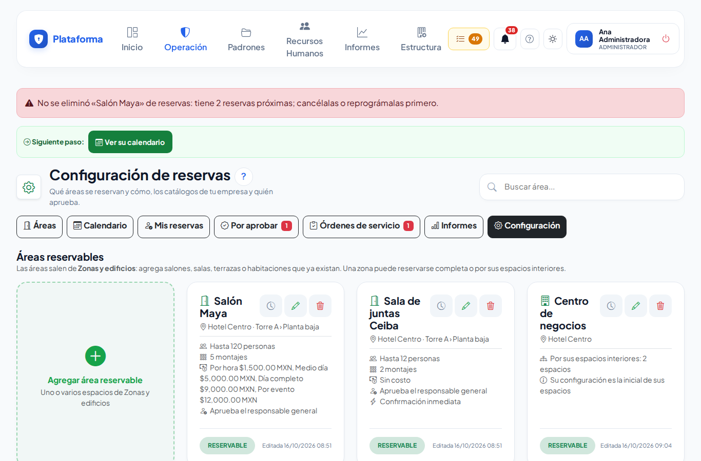

## Cómo ver y reactivar lo quitado o dado de baja

Por omisión, cada sección de Configuración muestra **solo lo activo**: las áreas quitadas y los montajes, tipos de uso o servicios dados de baja no estorban.

1. Junto al título de la sección (**Áreas reservables**, **Montajes**, **Tipos de uso** o **Servicios y requerimientos**) toca **Mostrar quitadas (N)** o **Mostrar dados de baja (N)**. El número dice cuántos hay. Si no hay ninguno, el botón no aparece.
2. Aparecen atenuados, con la etiqueta **QUITADA** o **DE BAJA**. Puedes:
   - Tocar **Editar** (lápiz) para cambiar sus datos sin volver a ofrecerlos.
   - Tocar **Reactivar** (flecha circular) para que vuelvan a ofrecerse con su configuración.
3. Toca **Ocultar quitadas** u **Ocultar dados de baja** para volver a ver solo lo activo.

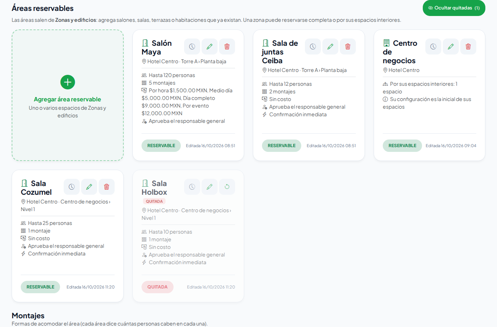

**Qué debes ver:** al reactivar, el aviso verde «… se puede reservar de nuevo.» y la ficha vuelve a la lista normal.

## Cómo editar los catálogos

1. **Montajes**, **Tipos de uso** y **Servicios y requerimientos** son fichas, como los Departamentos. Para agregar toca la ficha **Nuevo montaje**, **Nuevo tipo de uso** o **Nuevo servicio**; para cambiar uno toca **Editar** (lápiz) en su ficha.
2. Para dejar de usar uno tienes dos botones:
   - **Dar de baja** (círculo tachado): ya no se ofrece en las reservas nuevas; las reservas que ya lo usan lo conservan. Lo ves con **Mostrar dados de baja** y lo puedes **Reactivar**.
   - **Eliminar** (bote de basura): lo borra para siempre, **solo si nunca se ha usado** en una reserva (ni, los montajes, en un área). Si ya se usó, el mensaje te explica por qué no se puede borrar y te ofrece **darlo de baja** en su lugar.
3. Un servicio pide: nombre, **Categoría**, **Se cobra / se pide** (por pieza, por persona, por hora o por evento), **Costo para clientes**, **Departamento que lo atiende** y si **El departamento lo aprueba antes de confirmar**. Toca **Guardar**.

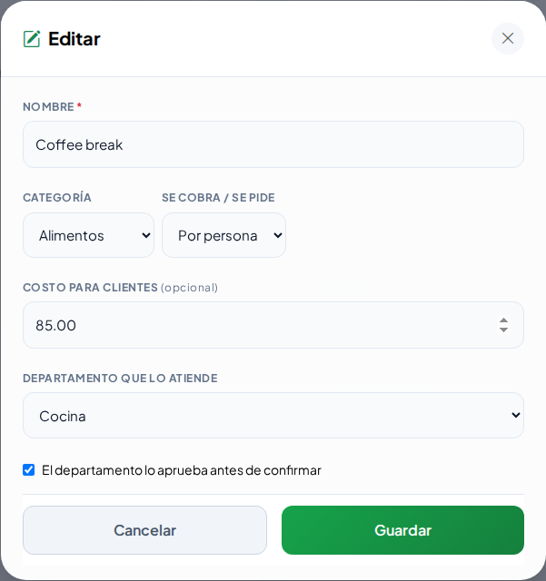

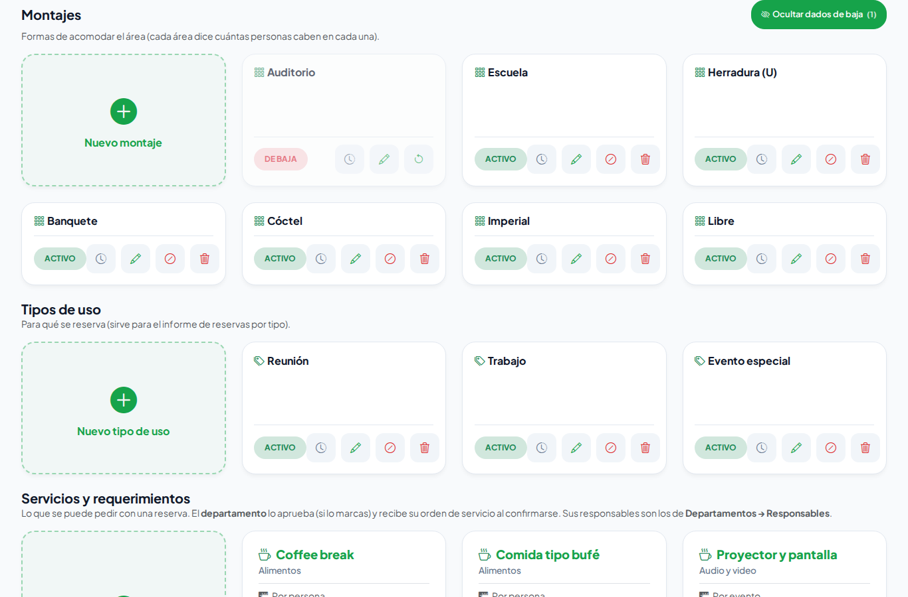

Los responsables de cada departamento son los de **Recursos Humanos → Departamentos → Responsables**.

## Cómo cargar la lista sugerida para hoteles

Si tu empresa es un hotel, puedes llenar el catálogo de una vez con los servicios de una **orden de evento**, sin costo:

1. En **Configuración**, sección **Servicios y requerimientos**, toca **Cargar servicios sugeridos de hotel** y confirma.
2. Se agregan, por departamento:
   - **Steward**: Mantelería, Rotafolio, Podium.
   - **Alimentos y bebidas**: Bebidas, Tipo de servicio, Coffee break.
   - **Cocina**: Desayuno, Comida, Cena, Bocadillos, Pastel, Pan.
   - **Mantenimiento**: Iluminación, Aire acondicionado, T.V., Extensión, Colocación de pantalla.
   - **Áreas públicas**: Bote de basura, Aromatizar, Limpieza antes y después, Planchado de mantelería.
   - **Animación**: Video o cañón, Show, Música / bocina, Micrófono, MC Animador, Pantalla.
   - **Capacitación**: Cañón, Proyector, Lista de asistencia.
   - **Sistemas**: Laptop, Internet.
   - Y los montajes **Tipo U, Tipo Escuela, Tipo Auditorio y Tipo Banquete** si no tienes uno parecido.
3. Cada grupo se asigna al departamento de tu empresa que se llama igual (sin importar acentos ni mayúsculas). **No se crean departamentos**: si no tienes alguno, el aviso dice «Asigna el departamento de N servicios»; toca el lápiz de cada uno y elige quién lo atiende.
4. Lo que ya tengas con el mismo nombre no se duplica, aunque lo hayas dado de baja. Puedes tocar el botón otra vez sin problema.

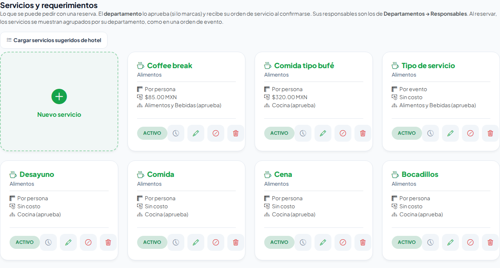

**Qué debes ver:** el aviso verde «Se agregaron N servicios y M montajes sugeridos, sin costo.». Para ofrecer un montaje nuevo, márcalo en cada área con su aforo (**Editar** el área).

## Cómo elegir quién aprueba, los tiempos y el IVA

1. En **Quién aprueba, tiempos e IVA** (o en **Estructura → Configuración → Reservas de áreas**, es el mismo formulario):
   - **Responsable general de reservas** (regularmente el asistente de gerencia) y su **Suplente**.
   - **Recordar a las (horas)** y **Avisar al responsable general a las (horas)**.
   - **Departamento que hace el montaje** (opcional; en un hotel, Steward): el **Tipo de montaje** aparece dentro de su tarjeta al reservar y en la orden de evento, y ese departamento recibe la orden de servicio del montaje aunque no se le pida otra cosa.
   - **IVA de las reservas para clientes** y **Cobrar IVA en las cotizaciones**.
2. Toca **Guardar**.

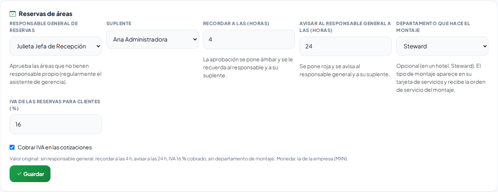

En **Estructura → Configuración → Reservas de áreas** también se encienden o apagan los **avisos por correo** de reservas.

## Cómo ver los informes

En la pestaña **Informes** elige las fechas y la sede: **Ocupación por área**, **Reservas por tipo de uso** e **Ingresos de eventos para clientes**. Con permiso de **exportar**, toca **Descargar en Excel**.

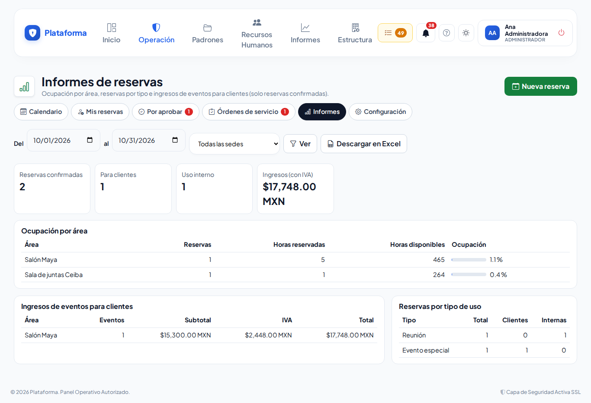

## Si algo sale mal

| Mensaje o síntoma | Qué significa | Qué hacer |
|---|---|---|
| «No se eliminó «…» de reservas: tiene 2 reservas próximas; cancélalas o reprográmalas primero.» | El área todavía tiene reservas por venir. | Toca **Ver su calendario**, cancélalas o cámbialas a otra área y vuelve a tocar **Eliminar de reservas**. |
| «No se eliminó «…»: ya se usó en 3 reservas. Para conservar ese historial no se elimina: dalo de baja y dejará de ofrecerse.» | Ese montaje, tipo de uso o servicio ya aparece en reservas (o en un área). | Toca **Dar de baja** en su ficha. |
| Ya no veo un área o un montaje | Se eliminó con historial o se dio de baja; por omisión solo se ve lo activo. | Toca **Mostrar quitadas** o **Mostrar dados de baja** en esa sección. |
| «Elige un espacio de tu sede.» | Marcaste un espacio de una sede donde no configuras reservas. | Pide a quien configura esa sede que lo agregue. |
| «Marca al menos un espacio.» | Tocaste **Guardar** sin casillas marcadas. | Marca uno o varios espacios. |
| «El aforo de un montaje no puede ser mayor que el aforo máximo del área.» | Un montaje dice más personas que el área. | Corrige el aforo del montaje o el del área. |
| «Revisa el horario del lunes: la hora de cierre debe ser después de la de apertura.» | El horario de ese día está al revés. | Corrige las horas. |
| «Ya existe «…» en el catálogo.» | Ese nombre ya está. | Usa el que existe o cámbiale el nombre. |
| «Asigna el departamento de 11 servicios…» | Cargaste la lista sugerida y tu empresa no tiene algún departamento con ese nombre. | Toca el lápiz de esos servicios y elige el departamento que los atiende, o dalos de baja si no los usas. |
| «El suplente debe ser otra persona.» | Elegiste a la misma persona dos veces. | Elige otro suplente. |
| No ves Catálogos ni Ajustes | Tu permiso de configurar es solo de tu sede. | Pide a quien configura en toda la empresa que los cambie. |

## Preguntas frecuentes

**¿Puedo crear el salón aquí?** No: los lugares salen de Zonas y edificios para no tener dos catálogos. Aquí solo se dice cómo se reserva.

**¿Puedo reservar un salón completo y también sus partes?** Sí. Agrega la zona como **Toda la zona como un solo espacio** y agrega también sus salas. Si alguien reserva la zona completa, sus salas quedan ocupadas en ese horario, y al revés.

**¿Eliminar un área borra sus reservas?** No. Si ya tuvo reservas se guarda con su historial (la ves con **Mostrar quitadas**); si tiene reservas próximas no se puede eliminar.

**¿Eliminar un área la borra de Zonas y edificios?** No, nunca. Solo deja de ofrecerse para reservar.

**¿Cuál es la diferencia entre Dar de baja y Eliminar en los catálogos?** Dar de baja lo oculta y se puede reactivar; Eliminar lo borra para siempre y solo se puede si nunca se usó.

**¿La lista sugerida se carga sola?** No. Solo cuando tocas el botón; si eliminas algo de la lista, no vuelve a aparecer a menos que lo toques otra vez.

**¿Qué pasa si nadie es responsable?** Aprueba quien tenga permiso de **aprobar** reservas en esa sede.

**¿Los cambios afectan reservas ya hechas?** No cambian su costo ni sus servicios; solo aplican a las nuevas y a las que se modifiquen.

## Relacionado

- [Reservas de áreas](reservas-de-areas.md)
- [Zonas y edificios](zonas-y-areas.md)
- [Departamentos y puestos](departamentos-y-puestos.md)
- [Configuración](configuracion.md)
