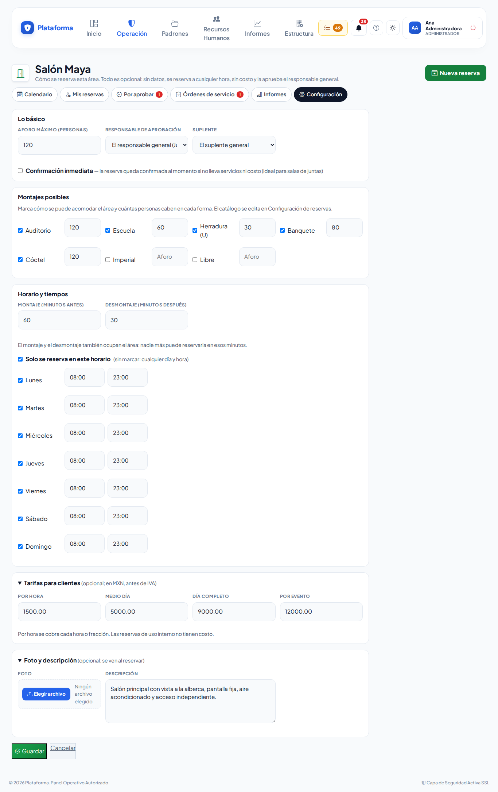

# Configurar las reservas

**¿Para qué sirve?** Para decidir qué salones y salas se pueden reservar, cómo (aforo, montajes, horario, tarifas, foto) y quién los aprueba, y para mantener los catálogos de tu empresa.

**Antes de empezar:** necesitas que tu rol pueda **configurar** en Reservas de áreas. Los catálogos y los ajustes generales piden permiso en **toda la empresa**. Las áreas salen de **Estructura → Zonas y edificios**: si el salón no existe ahí, créalo primero ([Zonas y edificios](zonas-y-areas.md)).

## Cómo marcar un área como reservable

1. Entra a **Operación → Reservas → Reservas de áreas** → pestaña **Configuración**.
2. En **Áreas reservables** toca la ficha **Marcar como reservable**, elige el espacio (por ejemplo «Torre A › Planta baja › Salón Maya») y toca **Guardar**.
3. Se abre la configuración del área. Todo es opcional; toca **Guardar** al terminar:
   - **Aforo máximo** y **Responsable de aprobación** con su **Suplente** (vacío = el responsable general).
   - **Confirmación inmediata**: la reserva se confirma al momento si no lleva servicios ni costo (ideal para salas de juntas).
   - **Montajes posibles**: marca cada acomodo y cuántas personas caben.
   - **Montaje** y **Desmontaje** en minutos: también ocupan el área.
   - **Solo se reserva en este horario**: marca los días y las horas.
   - **Tarifas para clientes**: por hora, medio día, día completo o por evento.
   - **Foto y descripción**.

**Qué debes ver:** «Configuración del área guardada.» con el botón **Reservar esta área**.

Cada área es una ficha con su insignia **RESERVABLE** o **DE BAJA** y sus botones: **Configurar** (deslizadores), **Dar de baja** (círculo tachado; sus reservas ya hechas se conservan) o **Reactivar**.

## Cómo editar los catálogos

1. **Montajes**, **Tipos de uso** y **Servicios y requerimientos** son fichas, como los Departamentos. Para agregar toca la ficha **Nuevo montaje**, **Nuevo tipo de uso** o **Nuevo servicio**; para cambiar uno toca **Editar** (lápiz) en su ficha. **Dar de baja** lo quita de las reservas nuevas.
2. Un servicio pide: nombre, **Categoría**, **Se cobra / se pide** (por pieza, por persona, por hora o por evento), **Costo para clientes**, **Departamento que lo atiende** y si **El departamento lo aprueba antes de confirmar**. Toca **Guardar**.

Los responsables de cada departamento son los de **Recursos Humanos → Departamentos → Responsables**.

## Cómo elegir quién aprueba, los tiempos y el IVA

1. En **Quién aprueba, tiempos e IVA** (o en **Estructura → Configuración → Reservas de áreas**, es el mismo formulario):
   - **Responsable general de reservas** (regularmente el asistente de gerencia) y su **Suplente**.
   - **Recordar a las (horas)** y **Avisar al responsable general a las (horas)**.
   - **IVA de las reservas para clientes** y **Cobrar IVA en las cotizaciones**.
2. Toca **Guardar**.

En **Estructura → Configuración → Reservas de áreas** también se encienden o apagan los **avisos por correo** de reservas.

## Cómo ver los informes

En la pestaña **Informes** elige las fechas y la sede: **Ocupación por área**, **Reservas por tipo de uso** e **Ingresos de eventos para clientes**. Con permiso de **exportar**, toca **Descargar en Excel**.

## Si algo sale mal

| Mensaje o síntoma | Qué significa | Qué hacer |
|---|---|---|
| «El aforo de un montaje no puede ser mayor que el aforo máximo del área.» | Un montaje dice más personas que el área. | Corrige el aforo del montaje o el del área. |
| «Revisa el horario del lunes: la hora de cierre debe ser después de la de apertura.» | El horario de ese día está al revés. | Corrige las horas. |
| «Ya existe «…» en el catálogo.» | Ese nombre ya está. | Usa el que existe o cámbiale el nombre. |
| «El suplente debe ser otra persona.» | Elegiste a la misma persona dos veces. | Elige otro suplente. |
| No ves Catálogos ni Ajustes | Tu permiso de configurar es solo de tu sede. | Pide a quien configura en toda la empresa que los cambie. |

## Preguntas frecuentes

**¿Puedo crear el salón aquí?** No: los lugares salen de Zonas y edificios para no tener dos catálogos. Aquí solo se dice cómo se reserva.

**¿Qué pasa si nadie es responsable?** Aprueba quien tenga permiso de **aprobar** reservas en esa sede.

**¿Los cambios afectan reservas ya hechas?** No cambian su costo ni sus servicios; solo aplican a las nuevas y a las que se modifiquen.

## Relacionado

- [Reservas de áreas](reservas-de-areas.md)
- [Zonas y edificios](zonas-y-areas.md)
- [Departamentos y puestos](departamentos-y-puestos.md)
- [Configuración](configuracion.md)
