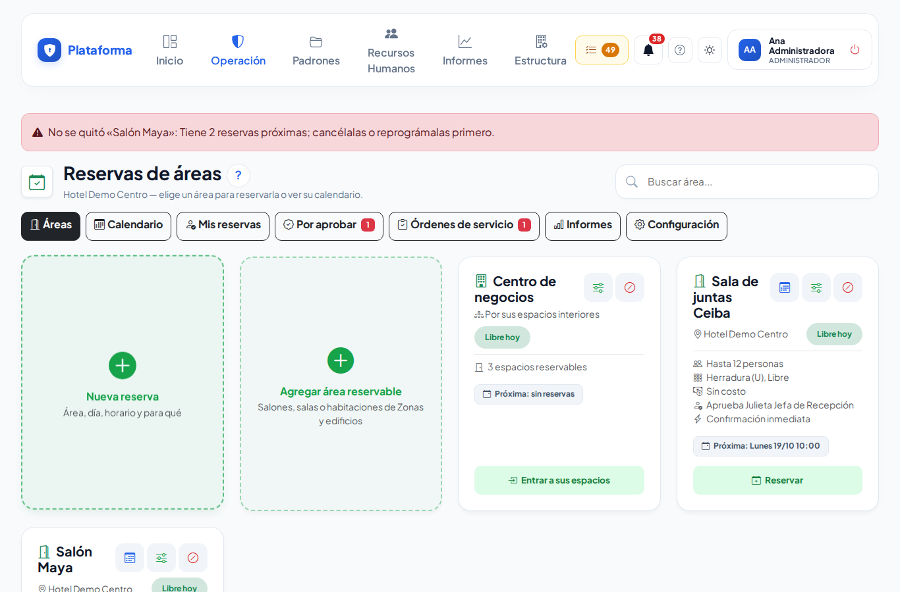

# Configurar las reservas

**¿Para qué sirve?** Para decidir qué salones, salas y habitaciones se pueden reservar (uno por uno o una zona completa con sus espacios), cómo (aforo, montajes, horario, tarifas, foto) y quién los aprueba, y para mantener los catálogos de tu empresa.

**Antes de empezar:** necesitas que tu rol pueda **configurar** en Reservas de áreas. Los catálogos y los ajustes generales piden permiso en **toda la empresa**. Las áreas salen de **Estructura → Zonas y edificios**: si el salón no existe ahí, créalo primero ([Zonas y edificios](zonas-y-areas.md)).

## Cómo agregar áreas reservables

1. Entra a **Operación → Reservas → Reservas de áreas**. Entra a la sede (o ve a la pestaña **Configuración**, sección **Áreas reservables**).
2. Toca la ficha **Agregar área reservable**.
3. Aparece la lista de los espacios de **Zonas y edificios**, en orden: cada zona y, con sangría, lo que tiene dentro (pisos, habitaciones, salas). Escribe en **Buscar espacio…** para encontrarlo.
4. Marca la casilla de cada espacio que se podrá reservar. Puedes marcar **varios a la vez**. Los que ya se reservan aparecen marcados con «Ya se reserva».
5. Si marcaste una **zona que tiene espacios interiores** (dice, por ejemplo, «3 espacios interiores»), elige cómo se reserva:
   - **Toda la zona como un solo espacio**: se reserva completa (un salón o una terraza).
   - **Por sus espacios interiores**: se agregan de una vez sus habitaciones o salas, cada una con la configuración de la zona (aforo, horario, responsable y suplente, montajes, tarifas y minutos de montaje). Después puedes ajustar cada una.
6. Toca **Guardar**.

**Qué debes ver:** el aviso verde «… ya se puede reservar …» y las fichas nuevas. Con un solo espacio se abre directo su configuración.

Nada cambia en **Zonas y edificios**: ahí solo se crean los lugares; aquí solo se dice cómo se reservan.

## Cómo configurar un área

1. En su ficha toca **Configurar** (deslizadores).
2. Todo es opcional; toca **Guardar** al terminar:
   - **Aforo máximo** y **Responsable de aprobación** con su **Suplente** (vacío = el responsable general).
   - **Confirmación inmediata**: la reserva se confirma al momento si no lleva servicios ni costo (ideal para salas de juntas).
   - **Montajes posibles**: marca cada acomodo y cuántas personas caben.
   - **Montaje** y **Desmontaje** en minutos: también ocupan el área.
   - **Solo se reserva en este horario**: marca los días y las horas.
   - **Tarifas para clientes**: por hora, medio día, día completo o por evento.
   - **Foto y descripción**.
   - **Copiar esta configuración a sus espacios interiores** (solo en una zona con espacios interiores): reemplaza la configuración de cada habitación o sala con la de la zona.

**Qué debes ver:** «Configuración del área guardada.» con el botón **Reservar esta área**.

## Cómo quitar un área de reservas

1. En la ficha del área toca **Quitar de reservas** (círculo tachado) y confirma.
2. Según lo que tenga:
   - **Sin ninguna reserva**: deja de ofrecerse y se borra solo su configuración de reserva.
   - **Con reservas que ya pasaron**: deja de ofrecerse, se conserva **QUITADA** con su configuración y su historial.
   - **Con reservas próximas** (por aprobar, con cambio pedido o confirmadas): **no se quita**. Cancélalas o cámbialas de horario primero.
   - Una **zona por sus espacios interiores** se quita junto con sus espacios.

**Qué debes ver:** el aviso verde «… ya no se ofrece para reservar. Sigue en Zonas y edificios.» El espacio **nunca** se borra de Zonas y edificios.

Para volver a ofrecerla, toca **Reactivar** en su ficha (en **Configuración**) o márcala de nuevo en **Agregar área reservable** («Se quitó · vuelve con su configuración»).

## Cómo editar los catálogos

1. **Montajes**, **Tipos de uso** y **Servicios y requerimientos** son fichas, como los Departamentos. Para agregar toca la ficha **Nuevo montaje**, **Nuevo tipo de uso** o **Nuevo servicio**; para cambiar uno toca **Editar** (lápiz) en su ficha. **Dar de baja** lo quita de las reservas nuevas.
2. Un servicio pide: nombre, **Categoría**, **Se cobra / se pide** (por pieza, por persona, por hora o por evento), **Costo para clientes**, **Departamento que lo atiende** y si **El departamento lo aprueba antes de confirmar**. Toca **Guardar**.

Los responsables de cada departamento son los de **Recursos Humanos → Departamentos → Responsables**.

## Cómo elegir quién aprueba, los tiempos y el IVA

1. En **Quién aprueba, tiempos e IVA** (o en **Estructura → Configuración → Reservas de áreas**, es el mismo formulario):
   - **Responsable general de reservas** (regularmente el asistente de gerencia) y su **Suplente**.
   - **Recordar a las (horas)** y **Avisar al responsable general a las (horas)**.
   - **IVA de las reservas para clientes** y **Cobrar IVA en las cotizaciones**.
2. Toca **Guardar**.

En **Estructura → Configuración → Reservas de áreas** también se encienden o apagan los **avisos por correo** de reservas.

## Cómo ver los informes

En la pestaña **Informes** elige las fechas y la sede: **Ocupación por área**, **Reservas por tipo de uso** e **Ingresos de eventos para clientes**. Con permiso de **exportar**, toca **Descargar en Excel**.

## Si algo sale mal

| Mensaje o síntoma | Qué significa | Qué hacer |
|---|---|---|
| «No se quitó «…»: Tiene 2 reservas próximas; cancélalas o reprográmalas primero.» | El área todavía tiene reservas por venir. | Cancélalas o modifícalas a otra área y vuelve a tocar **Quitar de reservas**. |
| «Elige un espacio de tu sede.» | Marcaste un espacio de una sede donde no configuras reservas. | Pide a quien configura esa sede que lo agregue. |
| «Marca al menos un espacio.» | Tocaste **Guardar** sin casillas marcadas. | Marca uno o varios espacios. |
| «El aforo de un montaje no puede ser mayor que el aforo máximo del área.» | Un montaje dice más personas que el área. | Corrige el aforo del montaje o el del área. |
| «Revisa el horario del lunes: la hora de cierre debe ser después de la de apertura.» | El horario de ese día está al revés. | Corrige las horas. |
| «Ya existe «…» en el catálogo.» | Ese nombre ya está. | Usa el que existe o cámbiale el nombre. |
| «El suplente debe ser otra persona.» | Elegiste a la misma persona dos veces. | Elige otro suplente. |
| No ves Catálogos ni Ajustes | Tu permiso de configurar es solo de tu sede. | Pide a quien configura en toda la empresa que los cambie. |

## Preguntas frecuentes

**¿Puedo crear el salón aquí?** No: los lugares salen de Zonas y edificios para no tener dos catálogos. Aquí solo se dice cómo se reserva.

**¿Puedo reservar un salón completo y también sus partes?** Sí. Agrega la zona como **Toda la zona como un solo espacio** y agrega también sus salas. Si alguien reserva la zona completa, sus salas quedan ocupadas en ese horario, y al revés.

**¿Quitar un área borra sus reservas?** No. Si ya tuvo reservas se conserva desactivada con su historial; si tiene reservas próximas no se puede quitar.

**¿Qué pasa si nadie es responsable?** Aprueba quien tenga permiso de **aprobar** reservas en esa sede.

**¿Los cambios afectan reservas ya hechas?** No cambian su costo ni sus servicios; solo aplican a las nuevas y a las que se modifiquen.

## Relacionado

- [Reservas de áreas](reservas-de-areas.md)
- [Zonas y edificios](zonas-y-areas.md)
- [Departamentos y puestos](departamentos-y-puestos.md)
- [Configuración](configuracion.md)
