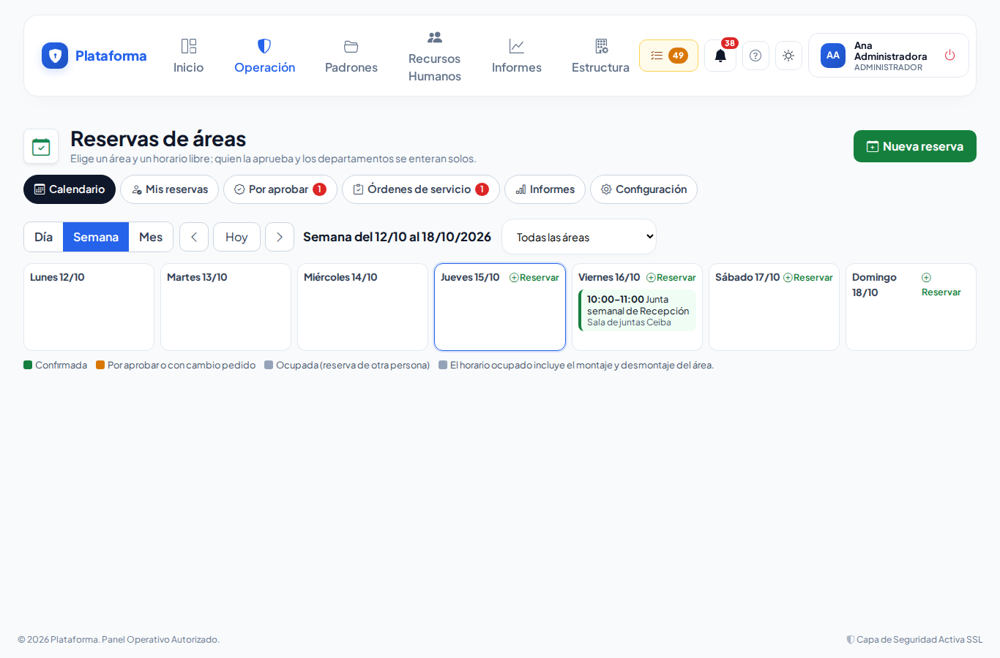
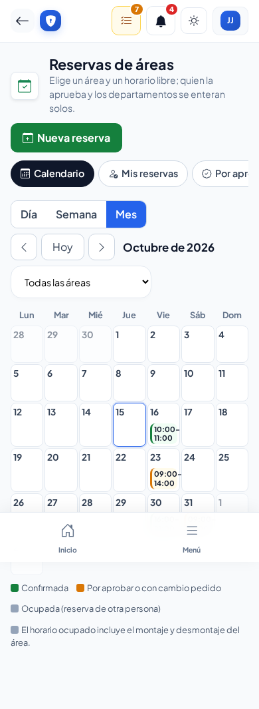
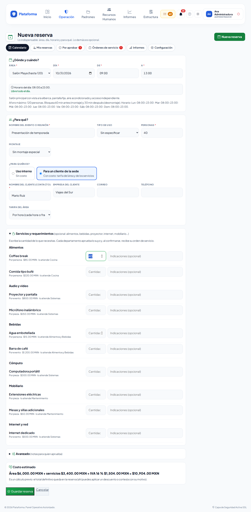
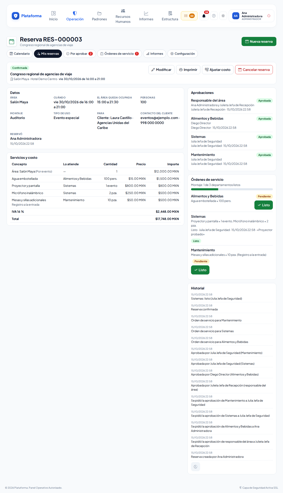

# Reservas de áreas

**¿Para qué sirve?** Para apartar un **salón, sala o terraza** de la sede para una reunión, un trabajo o un evento, con o sin servicios (alimentos, bebidas, proyector, internet, mobiliario…). La plataforma revisa que el horario esté libre, avisa sola a quien debe aprobar y a los departamentos que atienden, y te dice en la campana cuando tu reserva queda confirmada.

**Antes de empezar:** necesitas que tu rol pueda **crear** en Reservas de áreas. Si no ves el botón **Nueva reserva**, pide ayuda a tu administrador. Si no aparece ningún área, pide a quien administra las reservas que marque como «Reservable» el salón o la sala (ver [Configurar las reservas](reservas-configuracion.md)).

## Cómo ver qué está libre

1. Entra a **Operación → Reservas → Reservas de áreas**.
2. Elige la vista **Día**, **Semana** o **Mes** y muévete con las flechas o con **Hoy**.
3. Si quieres ver una sola área, elígela en **Todas las áreas**.

**Qué debes ver:** cada reserva con su horario. En **verde** las confirmadas; en **ámbar** las que esperan aprobación o un cambio; en **gris** «Ocupado» (reservas de otras personas que no puedes abrir). Recuerda que el área también queda ocupada mientras se **monta** y se **desmonta**.

En el celular, la vista **Mes** muestra solo las horas; toca un día para verlo completo.

## Cómo reservar

1. Toca **Nueva reserva** (o **Reservar** en el día que quieras).
2. En **¿Dónde y cuándo?** elige el **Área**, el **Día** y las horas **De** y **A**. Abajo aparecen los horarios ya ocupados de ese día y el horario en que el área se puede reservar.
3. En **¿Para qué?** escribe el **Nombre del evento o reunión**, el número de **Personas** y, si quieres, el **Tipo de uso** y el **Montaje** (auditorio, escuela, herradura…). Cada montaje dice cuántas personas caben.
4. En **¿Para quién es?** elige:
   - **Uso interno**: no tiene costo.
   - **Para un cliente de la sede**: escribe el nombre del cliente (y, si quieres, su empresa, correo y teléfono) y elige la **Tarifa del área**. Abajo verás el **Costo estimado** con IVA.
5. Si necesitas servicios, abre **Servicios y requerimientos** y escribe la **cantidad** de cada uno. Al tocar la cantidad vacía se sugiere sola: por persona, el número de personas; por hora, las horas del evento; por evento o pieza, 1. Puedes agregar **Indicaciones** (por ejemplo «A las 11:00»).
6. Toca **Guardar reserva**.

**Qué debes ver:** el aviso verde «Reserva RES-… enviada. Te avisaremos en la campana cuando la aprueben.» con los botones **Imprimir la hoja** y **Hacer otra reserva**. Si el área es de **confirmación inmediata** y no pediste servicios ni es para un cliente, el aviso dice que ya quedó **confirmada**.

## Cómo seguir tu reserva

1. Entra a **Mis reservas** (pestaña de Reservas de áreas).
2. Cada reserva dice su estado y qué falta: «Falta aprobar: área, Cocina…» o «Servicios listos: 1 de 2».
3. Toca una reserva para ver su ficha: **Aprobaciones** (quién aprueba y cuánto lleva esperando), **Órdenes de servicio** (avance del montaje) e **Historial**.

| Estado | Qué quiere decir |
|---|---|
| **Por aprobar** | Esperan el visto bueno del responsable del área y de cada departamento de los servicios que pediste. |
| **Cambio pedido** | Alguien que aprueba te pide un cambio (dice cuál). Modifícala para enviarla de nuevo. |
| **Confirmada** | Ya es tuya. Los departamentos recibieron su orden de servicio. |
| **Rechazada** | No se pudo (dice el motivo). El horario quedó libre. |
| **Cancelada** | Se canceló (dice quién y por qué). |
| **Terminada** | Una confirmada cuya hora ya pasó. |

## Cómo modificar una reserva

1. En la ficha toca **Modificar**.
2. Cambia lo que necesites y toca **Guardar reserva**.

**Qué debes ver:** si cambiaste el área, el día, la hora, las personas, el montaje o los servicios, se vuelve a pedir la aprobación **solo de lo que cambió** (por ejemplo, si cambias el coffee break, solo Cocina aprueba de nuevo). Si solo cambiaste el nombre o las notas, sigue confirmada.

Solo se modifica antes de que empiece.

## Cómo cancelar una reserva

1. En la ficha toca **Cancelar reserva**.
2. Escribe **¿Por qué se cancela?** y confirma con **Cancelar reserva**.

**Qué debes ver:** la reserva queda **Cancelada**, el horario libre, y se avisa a quien la iba a aprobar y a los departamentos que ya tenían su orden.

## Cómo imprimir la hoja

En la ficha toca **Imprimir**. Se abre la **Orden de evento** (y, si es para un cliente, la **Cotización** con el desglose: área + servicios − descuento + IVA). Toca **Imprimir**.

## Si algo sale mal

| Mensaje o síntoma | Qué significa | Qué hacer |
|---|---|---|
| «El área está ocupada de 09:00 a 12:30 (incluye montaje y desmontaje). Elige otro horario u otra área.» | Otra reserva ocupa ese horario, contando el tiempo de montaje y desmontaje. | Elige otra hora u otra área. Revisa los horarios ocupados que aparecen debajo de la fecha. |
| «Fuera del horario del área. El sábado esta área no se reserva.» | El área solo se reserva ciertos días y horas. | Elige otro día u horario dentro del que se indica. |
| «Son más personas que el aforo del montaje Herradura (U): máximo 30.» | En ese acomodo no caben tantas personas. | Elige otro montaje o un área más grande. |
| «La reserva debe empezar más tarde que ahora.» | La hora de inicio ya pasó. | Revisa el día y la hora. |
| «Escribe el nombre del cliente (persona de contacto).» | Elegiste «Para un cliente» sin su nombre. | Escribe el nombre o cambia a «Uso interno». |
| «No puedes reservar en esa sede.» | Tu rol no reserva en la sede de esa área. | Pide a tu administrador que te dé permiso en esa sede. |
| «Esta reserva ya no se puede modificar…» | Ya empezó, terminó, se rechazó o se canceló. | Haz una reserva nueva. |

## Preguntas frecuentes

**¿Quién aprueba mi reserva?** El responsable del área (o el responsable general de reservas) y, además, cada departamento de los servicios que pediste (por ejemplo Cocina por el coffee break, Sistemas por el proyector). Aprueban al mismo tiempo; cuando todos aprueban, queda confirmada.

**¿Cómo me entero?** Te llega a la **campana** (y por correo, si tu empresa lo tiene encendido). Si te piden un cambio, aparece en **Mis pendientes** como «Reservas con cambio pedido».

**¿Se cobra el uso interno?** No. Solo las reservas «Para un cliente de la sede» llevan costo.

**¿Puedo reservar todas las semanas a la misma hora?** Por ahora cada reserva se hace por separado.

**¿Por qué veo «Ocupado» sin nombre?** Es una reserva de otra persona que tu rol no puede abrir; solo te dice que el horario no está libre.

## Relacionado

- [Aprobar reservas](reservas-aprobar.md)
- [Órdenes de servicio de reservas](reservas-departamentos.md)
- [Configurar las reservas](reservas-configuracion.md)
- [Menús, Mis pendientes y la campana](menus.md)
