# Reservas de áreas

**¿Para qué sirve?** Para apartar un **salón, sala o terraza** de la sede para una reunión, un trabajo o un evento, con o sin servicios (alimentos, bebidas, proyector, internet, mobiliario…). La plataforma revisa que el horario esté libre, avisa sola a quien debe aprobar y a los departamentos que atienden, y te dice en la campana cuando tu reserva queda confirmada.

**Antes de empezar:** necesitas que tu rol pueda **crear** en Reservas de áreas. Si no ves el botón **Nueva reserva**, pide ayuda a tu administrador. Si no aparece ningún área, pide a quien administra las reservas que agregue el salón, la sala o la habitación como área reservable (ver [Configurar las reservas](reservas-configuracion.md)).

## Cómo elegir el área

1. Entra a **Operación → Reservas → Reservas de áreas**.
2. Si tu empresa tiene varias sedes, aparece una **tarjeta por sede** con cuántas áreas se reservan, cuántas reservas hay **hoy** y cuántas esperan aprobación. Toca **Entrar a la sede**. (Con una sola sede entras directo.)

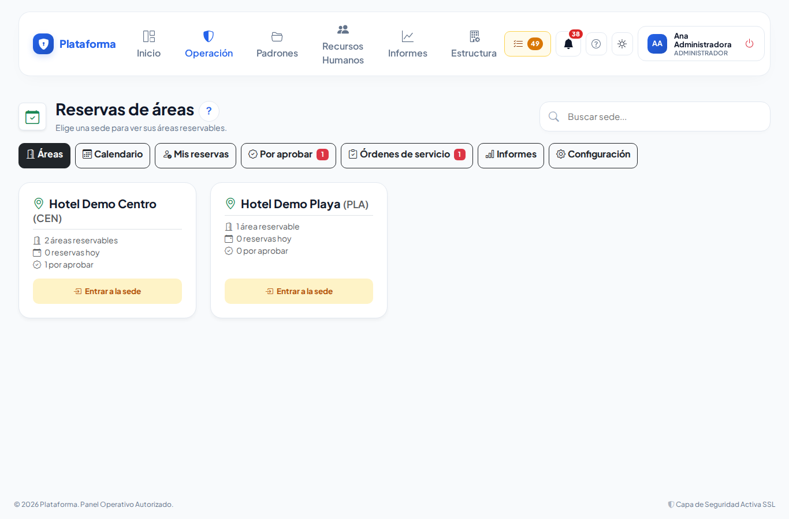

3. Cada área es una **ficha** con su foto (si tiene), el aforo, los montajes, la tarifa o «Sin costo», quién la aprueba, la **Próxima** reserva y la insignia **Hoy: N** (o «Libre hoy»). Escribe en **Buscar área…** para encontrarla.
4. Abajo de cada ficha está su botón principal:
   - **Reservar**: abre la reserva con esa área elegida.
   - **Entrar a sus espacios**: aparece en una **zona** que se reserva por sus espacios interiores (por ejemplo un centro de negocios con varias salas). La ficha dice cuántos **espacios reservables** tiene.
5. En la esquina de la ficha están los botones de ícono:
   - **Calendario del área**: lo que está ocupado por día, semana o mes.
   - **Reservar toda la zona** (calendario con +): solo en una zona que se reserva completa y además tiene espacios interiores.
   - **Editar** (lápiz) y **Eliminar de reservas** (bote de basura): solo si administras las reservas (ver [Configurar las reservas](reservas-configuracion.md)). Son los mismos íconos que en Zonas y edificios.

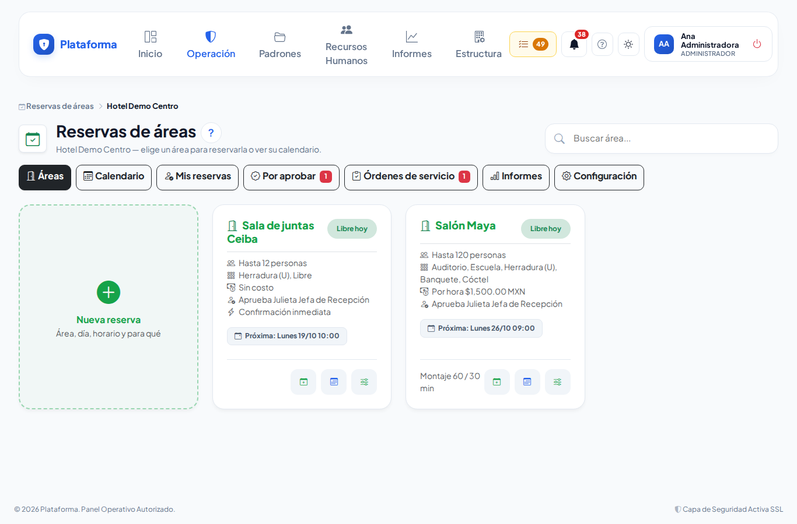

## Cómo llegar a una habitación o sala de una zona

1. En las fichas de la sede toca **Entrar a sus espacios** en la ficha de la zona.
2. Verás una ficha por cada habitación o sala de esa zona, agrupadas por piso. Arriba, la ruta (**Reservas de áreas › Sede › Zona**) te deja regresar con un toque.
3. Toca **Reservar** en la ficha del espacio que quieres.

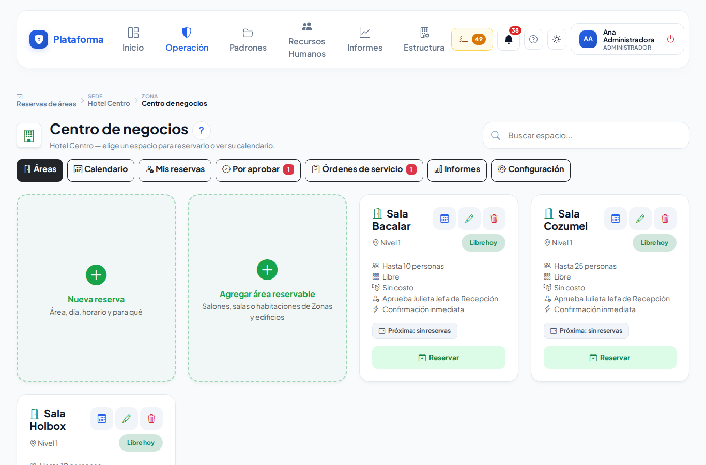

**Qué debes ver:** las fichas de los espacios de esa zona, cada una con su aforo, su horario y su botón **Reservar**.

En el celular las fichas se acomodan una debajo de otra.

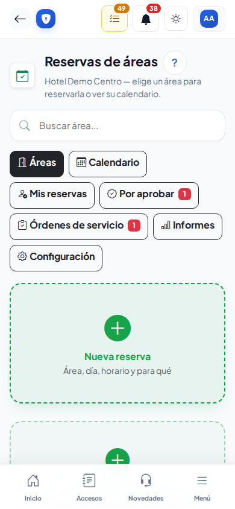

## Cómo ver qué está libre (calendario)

1. Toca **Calendario** arriba (o **Calendario del área** en su ficha).
2. Elige **Día**, **Semana** o **Mes**, muévete con las flechas o con **Hoy**, y elige la sede o el área.

**Qué debes ver:** cada reserva con su horario. En **verde** las confirmadas; en **ámbar** las que esperan aprobación o un cambio; en **gris** «Ocupado» (reservas de otras personas que no puedes abrir). El área también queda ocupada mientras se **monta** y se **desmonta**.

## Cómo reservar

La reserva sigue el formato de una **orden de evento**: dónde, cuándo, cuántas personas, quién la pide y qué tiene que preparar cada departamento.

1. Toca la ficha **Nueva reserva**, el botón **Reservar** de un área o **Reservar** en el día del calendario.
2. En **¿Dónde y cuándo?** elige primero la **Zona o área** y después el **Espacio** (la habitación o sala; si la zona se reserva completa verás «Toda la zona»). Si la zona tiene un solo espacio se elige solo. Luego elige el **Día** y las horas **De** y **A**. Abajo aparecen los horarios ya ocupados de ese día y el horario en que el área se puede reservar.
3. Si necesitas el lugar todo el día, marca **Día completo**: las horas se llenan solas con el horario del área ese día (o de 00:00 a 23:59 si el área no tiene horario).
4. **Montaje antes** y **Desmontaje después** ya traen los minutos del área. Si tu evento necesita más (o menos) tiempo para acomodar o recoger, cámbialos: el área queda ocupada ese tiempo antes y después. En **Indicaciones para el montaje** escribe lo que debe resaltar en la hoja, por ejemplo «Tener montaje listo 30 min antes».

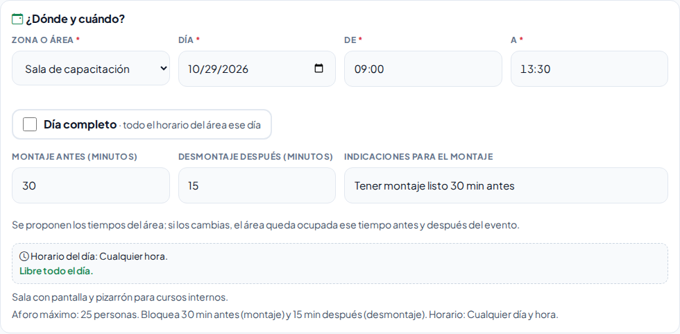

5. En **¿Para qué?** escribe el **Nombre del evento o motivo** y el **Número de personas**. Debajo verás en verde cuántas caben, por ejemplo «20 de 25 permitidos» (cuenta el aforo del **Tipo de montaje** que elijas, o el del área).
6. **Departamento que solicita** ya trae tu departamento; cámbialo si pides para otro (por ejemplo, Capacitación). La fecha de solicitud se guarda sola.
7. Si son **más personas que el aforo**, el texto se pone ámbar («30 de 25 permitidos: excede el aforo») y aparece **Excepción de aforo**: escribe por qué se necesitan más personas. Sin motivo no se guarda. Quien aprueba el área verá la excepción, aunque el área sea de confirmación inmediata.

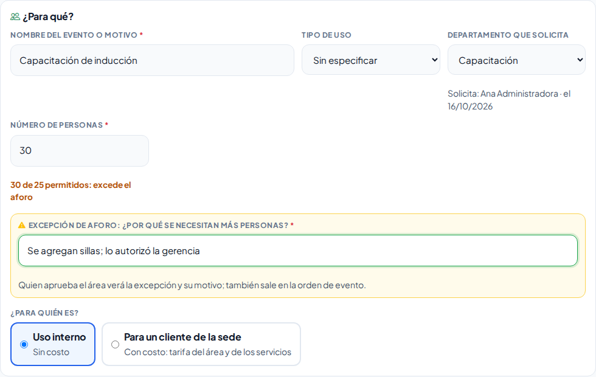

8. En **¿Para quién es?** elige:
   - **Uso interno**: no tiene costo.
   - **Para un cliente de la sede**: escribe el nombre del cliente (y, si quieres, su empresa, correo y teléfono) y elige la **Tarifa del área**. Con **Día completo** se propone la tarifa de día. Abajo verás el **Costo estimado** con IVA.
9. En **Servicios por departamento** hay una tarjeta por departamento (Steward, Alimentos y bebidas, Cocina, Mantenimiento…). Marca la casilla de lo que necesitas: aparecen la **cantidad** (se sugiere sola: por persona, el número de personas; por hora, las horas del evento; por evento o pieza, 1) y una **nota** corta, por ejemplo «Agua» junto a Bebidas.
10. Si tu empresa lo configuró, el **Tipo de montaje** (Tipo U, Escuela, Auditorio, Banquete…) está dentro de la tarjeta del departamento que monta (por ejemplo Steward). Si no, está en **¿Para qué?**.
11. ¿Falta algo en la lista? Toca **+ Otro servicio** en la tarjeta del departamento que lo debe atender y escribe qué es y una nota. En la tarjeta **Otros** también eliges el departamento.

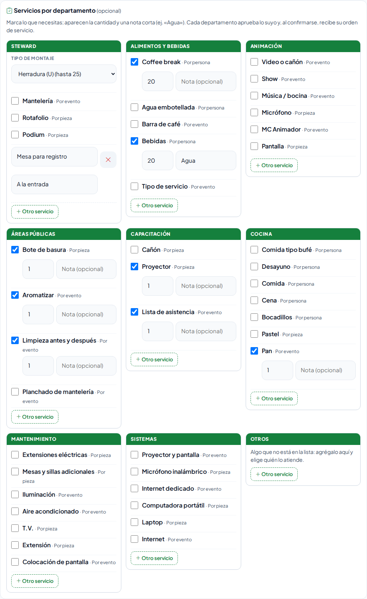

12. Toca **Guardar reserva**.

En el celular las tarjetas de los departamentos se acomodan una debajo de otra.

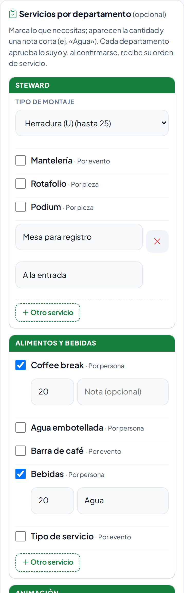

**Qué debes ver:** el aviso verde «Reserva RES-… enviada. Te avisaremos en la campana cuando la aprueben.» con los botones **Imprimir la hoja** y **Hacer otra reserva**. Si el área es de **confirmación inmediata**, no pediste servicios, no es para un cliente y no pasaste el aforo, el aviso dice que ya quedó **confirmada**.

## Cómo seguir tu reserva

1. Toca **Mis reservas** arriba.
2. Cada reserva es una ficha con su **insignia de estado**, el área, el día y lo que falta («Falta aprobar: área, Cocina…» o «Servicios listos: 1 de 2»). Filtra con **Próximas**, **Por aprobar**, **Cambio pedido**, **Confirmada** o **Pasadas**.
3. En la esquina: **Ver** (ojo), **Modificar** (lápiz, antes de que empiece) e **Imprimir**.

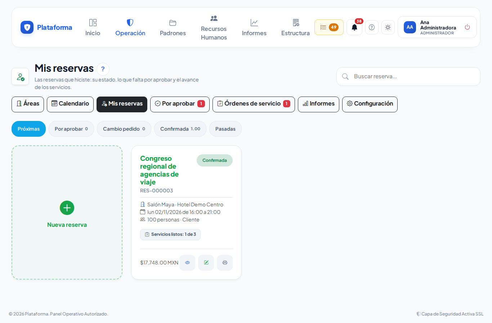

En la ficha de la reserva ves sus **Datos** (con **Solicitado por** y su departamento, la **Fecha de solicitud**, las personas contra el aforo, el montaje y desmontaje, las indicaciones resaltadas y, si la hay, la excepción de aforo), los **Servicios por departamento**, sus **Aprobaciones** (quién aprueba y cuánto lleva esperando), sus **Órdenes de servicio** (avance del montaje) y su **Historial**.

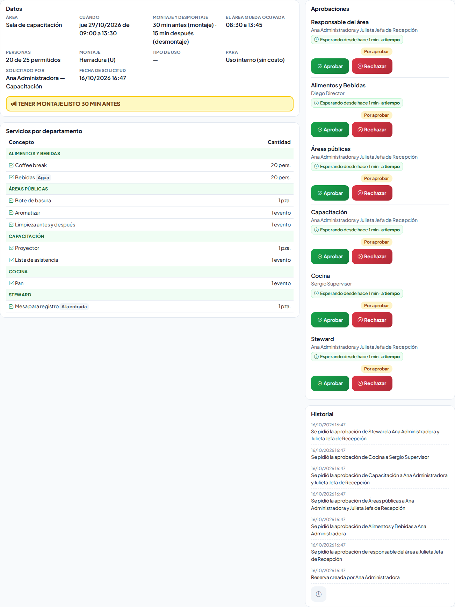

| Estado | Qué quiere decir |
|---|---|
| **Por aprobar** | Esperan el visto bueno del responsable del área y de cada departamento de los servicios que pediste. |
| **Cambio pedido** | Alguien que aprueba te pide un cambio (dice cuál). Modifícala para enviarla de nuevo. |
| **Confirmada** | Ya es tuya. Los departamentos recibieron su orden de servicio. |
| **Rechazada** | No se pudo (dice el motivo). El horario quedó libre. |
| **Cancelada** | Se canceló (dice quién y por qué). |
| **Terminada** | Una confirmada cuya hora ya pasó. |

## Cómo modificar una reserva

1. En la ficha toca **Modificar**.
2. Cambia lo que necesites y toca **Guardar reserva**.

**Qué debes ver:** si cambiaste el área, el día, la hora, las personas, el montaje, los minutos de montaje o desmontaje o los servicios (también sus notas), se vuelve a pedir la aprobación **solo de lo que cambió** (por ejemplo, si cambias la nota del coffee break, solo ese departamento aprueba de nuevo). Si solo cambiaste el nombre o las notas para quien aprueba, sigue confirmada.

Si guardas **sin cambiar nada**, el aviso dice «Cambios guardados: la reserva sigue confirmada.» y nadie recibe avisos nuevos.

Si un servicio que pediste se **dio de baja** después en el catálogo, sigue marcado en tu reserva con la nota «Dado de baja: se conserva en esta reserva». Se queda tal como lo pediste mientras no lo desmarques; si lo desmarcas, ya no podrás volver a pedirlo.

Solo se modifica antes de que empiece.

## Cómo cancelar una reserva

1. En la ficha toca **Cancelar reserva**.
2. Escribe **¿Por qué se cancela?** y confirma con **Cancelar reserva**.

**Qué debes ver:** la reserva queda **Cancelada**, el horario libre, y se avisa a quien la iba a aprobar y a los departamentos que ya tenían su orden.

## Cómo imprimir la orden de evento

1. En la ficha toca **Imprimir**. Se abre la **Orden de evento** en hoja carta:
   - Arriba: **Lugar donde se realizará**, **Núm. de pax** (y cuántos se permiten), **Fecha del evento**, **Horario del evento**, **Solicitado por** con su departamento, **Fecha de solicitud** y el montaje y desmontaje.
   - Resaltadas: las **indicaciones para el montaje** y, si la hay, la **excepción de aforo** con su motivo.
   - Después, una sección por departamento con sus casillas: ☒ lo que se pidió, con su cantidad y su nota.
   - Si es para un cliente, la **Cotización** con el desglose (área + servicios − descuento + IVA), y al final las aprobaciones y las firmas.
2. Por omisión solo salen los departamentos con algo pedido. Toca **Mostrar hoja completa** si quieres también las casillas vacías (por ejemplo, para llenarla a mano). **Solo lo pedido** regresa a la hoja corta.
3. Toca **Imprimir**.

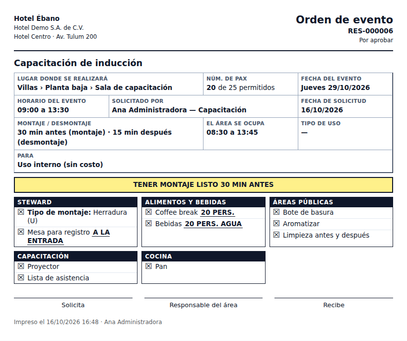

## Si algo sale mal

| Mensaje o síntoma | Qué significa | Qué hacer |
|---|---|---|
| «El área está ocupada de 09:00 a 12:30 (incluye montaje y desmontaje). Elige otro horario u otra área.» | Otra reserva ocupa ese horario, contando el tiempo de montaje y desmontaje. | Elige otra hora u otra área. Revisa los horarios ocupados que aparecen debajo de la fecha. |
| «… está reservado de 09:00 a 12:30 y comparte lugar con esta área (la zona completa o uno de sus espacios interiores).» | Alguien reservó la zona completa (y con eso ocupa sus salas) o una sala de la zona (y con eso la zona completa ya no está libre). | Elige otro horario u otro espacio. Debajo de la fecha verás qué espacio lo ocupa. |
| «Esta zona se reserva por sus espacios interiores: elige uno de ellos.» | Esa zona solo agrupa sus salas o habitaciones. | En **Espacio** elige la sala o habitación. |
| «Fuera del horario del área. El sábado esta área no se reserva.» | El área solo se reserva ciertos días y horas. | Elige otro día u horario dentro del que se indica. |
| «Son 30 personas y el aforo del montaje Tipo U es de 25: escribe el motivo de la excepción (lo verá quien aprueba).» | En ese acomodo no caben tantas personas. | Elige otro montaje o un área más grande, o escribe el motivo en **Excepción de aforo**. |
| «Ese día el área no se reserva: elige otro día.» | Marcaste **Día completo** un día en que el área no abre. | Elige otro día. |
| «Los minutos van de 0 a 1440 (24 horas).» | El montaje o desmontaje tiene un número fuera de rango. | Corrige los minutos. |
| «Elige un departamento de tu empresa.» | El departamento que solicita (o el de un otro servicio) ya no existe. | Elige otro de la lista. |
| «La reserva debe empezar más tarde que ahora.» | La hora de inicio ya pasó. | Revisa el día y la hora. |
| «Escribe el nombre del cliente (persona de contacto).» | Elegiste «Para un cliente» sin su nombre. | Escribe el nombre o cambia a «Uso interno». |
| «No puedes reservar en esa sede.» | Tu rol no reserva en la sede de esa área. | Pide a tu administrador que te dé permiso en esa sede. |
| «Esta reserva ya no se puede modificar…» | Ya empezó, terminó, se rechazó o se canceló. | Haz una reserva nueva. |

## Preguntas frecuentes

**¿Quién aprueba mi reserva?** El responsable del área (o el responsable general de reservas) y, además, cada departamento de los servicios que pediste (por ejemplo Cocina por el coffee break, Sistemas por el proyector). Aprueban al mismo tiempo; cuando todos aprueban, queda confirmada.

**¿Cómo me entero?** Te llega a la **campana** (y por correo, si tu empresa lo tiene encendido). Si te piden un cambio, aparece en **Mis pendientes** como «Reservas con cambio pedido».

**¿Se cobra el uso interno?** No. Solo las reservas «Para un cliente de la sede» llevan costo.

**¿Por qué mi reserva pide aprobación si el área se confirma al momento?** Porque pasaste el aforo: toda excepción la revisa el responsable del área.

**¿El «otro servicio» también se aprueba?** Sí: lo aprueba y lo atiende el departamento de la tarjeta donde lo agregaste. Si lo dejaste sin departamento, solo queda anotado en la hoja.

**¿Puedo reservar todas las semanas a la misma hora?** Por ahora cada reserva se hace por separado.

**Si reservo la zona completa, ¿se pueden reservar sus salas a la misma hora?** No. La zona completa ocupa todos sus espacios en ese horario (con su montaje y desmontaje), y si una sala ya está reservada, la zona completa no se puede reservar a esa hora.

**¿Por qué veo «Ocupado» sin nombre?** Es una reserva de otra persona que tu rol no puede abrir; solo te dice que el horario no está libre.

## Relacionado

- [Aprobar reservas](reservas-aprobar.md)
- [Órdenes de servicio de reservas](reservas-departamentos.md)
- [Configurar las reservas](reservas-configuracion.md)
- [Menús, Mis pendientes y la campana](menus.md)
