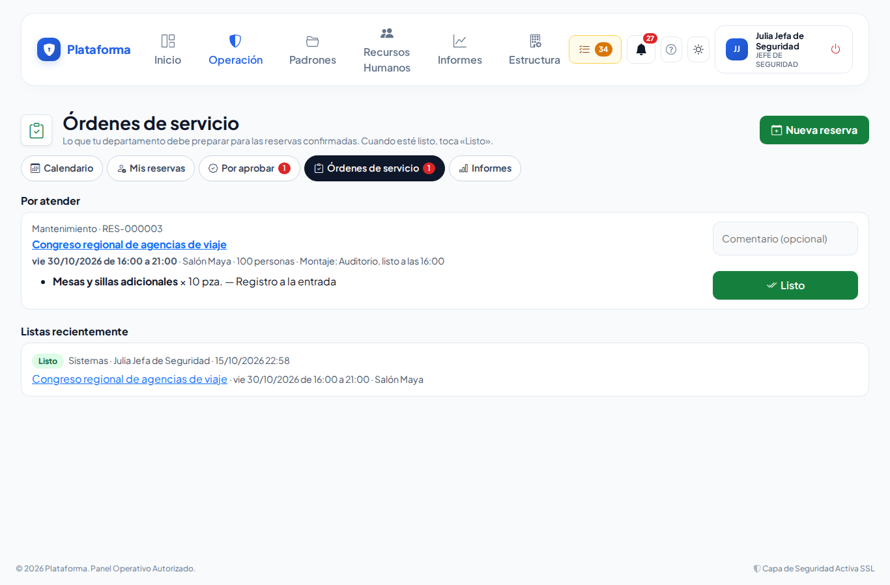

# Órdenes de servicio de reservas

**¿Para qué sirve?** Cuando una reserva con servicios queda **confirmada**, cada departamento recibe su **orden de servicio**: qué preparar, cuánto, para cuándo, dónde y con qué montaje. Al terminar, el departamento toca **Listo** y quien reservó ve el avance.

**Antes de empezar:** ves las órdenes de tu departamento si eres su **responsable o suplente** (Departamentos → Responsables) o su delegado con «No molestar».

## Cómo atender una orden

1. Te llega a la **campana** «Orden de servicio (Cocina): …» y aparece en **Mis pendientes** como **Órdenes de servicio por atender**.
2. Entra a **Operación → Reservas → Reservas de áreas** → pestaña **Órdenes de servicio**.
3. Cada orden es una **ficha** con el día y la hora, el área, las personas, el montaje y la lista de lo que pidieron con sus indicaciones. Filtra con **Por atender** o **Listas**.
4. Cuando esté preparado, escribe un comentario si quieres y toca el botón **Listo** (doble palomita) de la ficha.

**Qué debes ver:** «Marcado como listo…». La ficha queda con la insignia **Listo** y quien reservó y el responsable del área reciben el aviso; cuando todos los departamentos terminan, reciben «Montaje listo».

## Si la orden sigue «Por atender»

Un **día antes del montaje**, si la orden sigue «Por atender», a tu departamento le llega «Mañana: Orden de servicio de …». Si al **empezar el montaje** sigue sin estar lista, el aviso pasa al responsable general de Reservas. Tocar **Listo** apaga los dos.

## Si la reserva cambia o se cancela

- Si cambian **lo de tu departamento**, la hora o el área, te llega «Cambió la orden de servicio» y la orden vuelve a **Pendiente**.
- Si ya no piden nada de tu departamento o la reserva se cancela, te llega el aviso y la orden desaparece de tu lista.

## Si algo sale mal

| Mensaje o síntoma | Qué significa | Qué hacer |
|---|---|---|
| «Esta orden ya no está pendiente.» | Ya se marcó lista o la reserva cambió de estado. | Revisa la ficha de la reserva. |
| No ves órdenes | No eres responsable del departamento en esa sede. | Pide que te nombren en Departamentos → Responsables. |

## Preguntas frecuentes

**¿Mi departamento también aprueba?** Si el servicio está marcado «El departamento lo aprueba», sí: primero te llega para **aprobar** ([Aprobar reservas](reservas-aprobar.md)) y, al confirmarse, la orden.

**¿Puedo imprimir la orden?** En la ficha de la reserva toca **Imprimir**: la hoja trae los servicios por departamento.

## Relacionado

- [Reservas de áreas](reservas-de-areas.md)
- [Aprobar reservas](reservas-aprobar.md)
