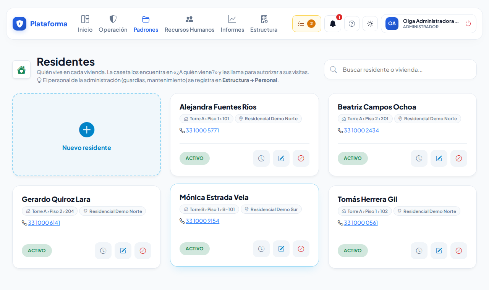
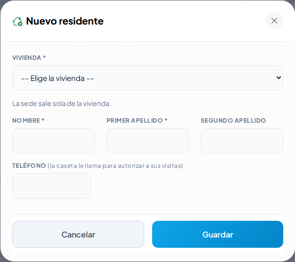

# Residentes

**¿Para qué sirve?** Es la lista de quienes viven en cada vivienda (o casa). La caseta los encuentra en **¿A quién viene?** y les llama para que autoricen a sus visitas y servicios; en Reservas, el área común se reserva a nombre del residente y queda en el historial de su vivienda. Solo existe en condominios y fraccionamientos.

## Antes de empezar

- Para ver la pantalla tu rol debe poder consultar el directorio (*Colaboradores*). Para dar de alta, editar o dar de baja necesitas esos mismos permisos.
- Primero captura las viviendas (o casas) en **Estructura → Zonas y edificios**: el residente se elige con su vivienda.
- El **personal de la administración** (guardias, mantenimiento, oficina) **no** va aquí: se registra en **Estructura → Personal**, con su número, departamento y puesto. Las cuentas de la plataforma solo se vinculan al personal.

## Cómo registrar a un residente

1. Entra a **Padrones → Residentes**.
2. Toca **Nuevo residente**.
3. Elige la **Vivienda** de la lista (sale con su torre y piso, por ejemplo «Torre A › Piso 1 › 101»). La sede se toma sola de la vivienda.
4. Escribe **Nombre**, **Primer apellido** y, si lo tienes, **Segundo apellido**.
5. Escribe el **Teléfono**: la caseta le llama para autorizar a sus visitas.
6. Toca **Guardar**.

**Qué debes ver:** el mensaje verde «Residente «…» registrado. Ya aparece en «¿A quién viene?» de la caseta.» y su tarjeta con la vivienda y el teléfono.

## Cómo cambiar a un residente de vivienda o corregir su teléfono

1. En su tarjeta, toca el lápiz (**Editar**).
2. Cambia la **Vivienda** o el **Teléfono**.
3. Toca **Guardar**.

**Qué debes ver:** la tarjeta con los datos nuevos. Las visitas que ya se registraron conservan la vivienda de ese día.

## Cómo dar de baja a un residente

1. En su tarjeta, toca **Dar de baja** y confirma.
2. Si tenía algo pendiente (por ejemplo un vehículo en el padrón o una visita abierta), la plataforma te lo muestra antes de terminar.

**Qué debes ver:** la tarjeta dice **DE BAJA** y la caseta ya no lo ofrece. Para regresarlo, toca **Reactivar** en la misma tarjeta.

## Si algo sale mal

| Mensaje o síntoma | Qué significa | Qué hacer |
|---|---|---|
| «Elige su vivienda de la lista…» | No elegiste vivienda o no es de tus sedes. | Elige una de la lista; si no aparece, créala en Zonas y edificios. |
| «… ya está registrado en esa vivienda.» | Esa persona ya existe en la misma vivienda. | Búscala en la lista; si está de baja, toca **Reactivar**. |
| La tarjeta dice «Sin vivienda: complétala». | El residente se registró antes sin vivienda. | Toca **Editar** y elige su vivienda. |
| No veo **Residentes** en el menú. | Tu empresa no es condominio ni fraccionamiento, o tu rol no consulta el directorio. | Pide a tu administrador que revise el giro o tu rol. |

## Preguntas frecuentes

- **¿Por qué no pide número de empleado ni puesto?** Porque el residente no trabaja para la administración: solo se necesita su nombre, su vivienda y su teléfono.
- **¿Dónde registro a los guardias y al personal de mantenimiento?** En **Estructura → Personal**.
- **¿Un residente puede tener cuenta en la plataforma?** Todavía no: la caseta le llama. El portal de residentes llegará más adelante.
- **¿Puedo ver quién visitó cada vivienda?** Sí: en **Informes → Tendencias** sale «Viviendas más visitadas» y en la Bitácora de accesos puedes buscar por vivienda.

## Relacionado

- [Bitácora de accesos](accesos.md)
- [Zonas y edificios](zonas-y-areas.md)
- [Colaboradores](colaboradores.md)
- [Reservas de áreas](reservas-de-areas.md)
