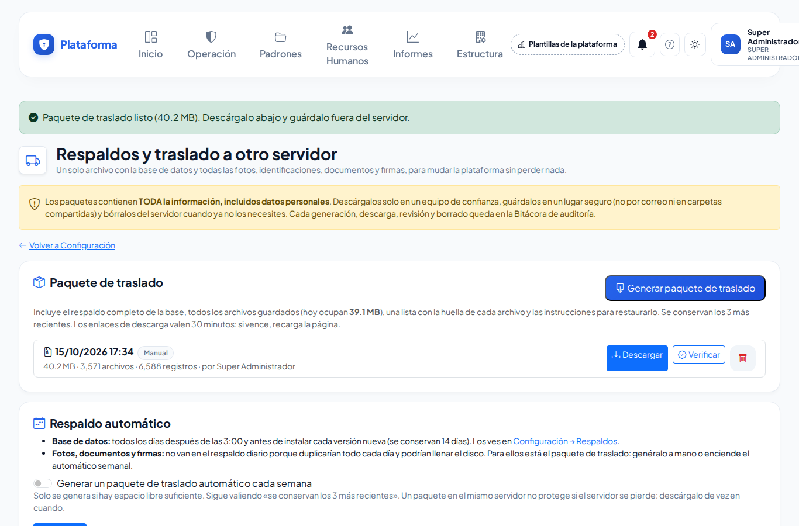
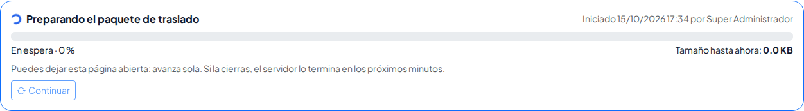
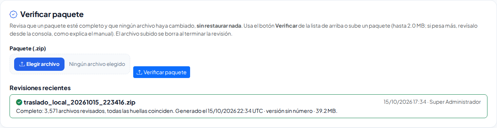
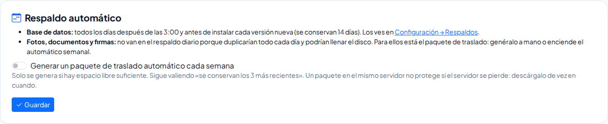
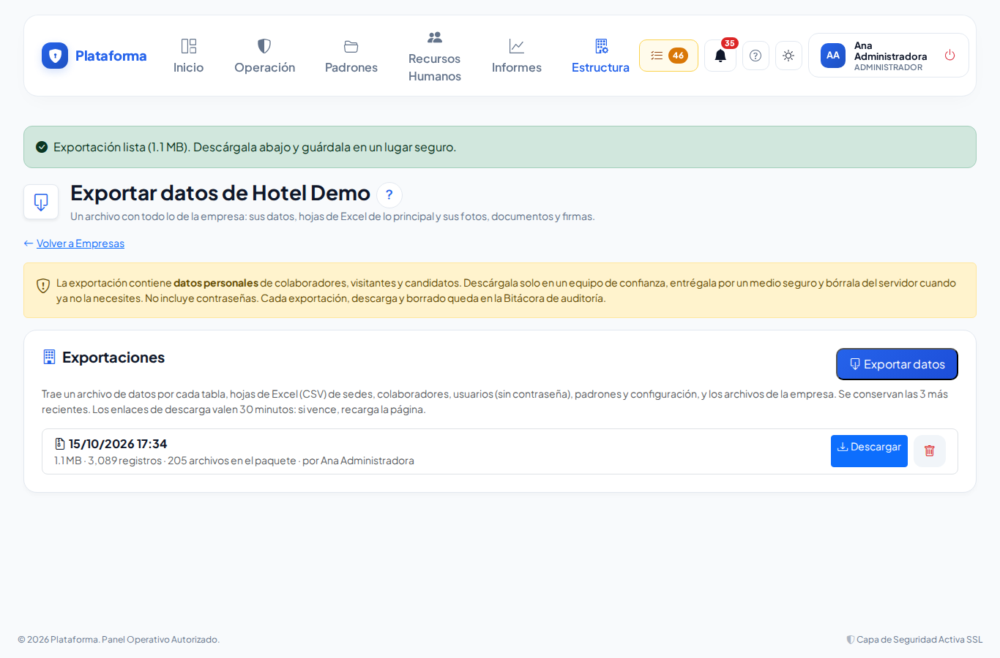

# Respaldos y traslado a otro servidor

**¿Para qué sirve?** Para no perder nada si algún día hay que **mudar la plataforma a otro servidor**. El **paquete de traslado** es un solo archivo con el respaldo completo de la base de datos y **todos** los archivos guardados (fotos de visitantes, identificaciones, documentos de candidatos y colaboradores, firmas, evidencias y logotipos), con una lista que permite comprobar que nada cambió. Además puedes **exportar los datos de una empresa** para entregárselos al cliente.

## Antes de empezar

- **Respaldos y traslado** solo lo ve el **Super Administrador** de la plataforma.
- **Exportar los datos de una empresa** lo hace el Super Administrador con cualquier empresa, o quien tiene el permiso **Exportar** de Empresas con alcance de empresa (de origen, el **Administrador** de la empresa) con la suya. Si no ves el botón, pide el permiso en la [Matriz de permisos](roles-y-permisos.md).
- Los paquetes contienen **datos personales**. Descárgalos solo en un equipo de confianza, guárdalos en un lugar seguro (no por correo ni en carpetas compartidas) y bórralos del servidor cuando ya no los necesites. Cada generación, descarga, revisión y borrado queda en la [Bitácora de auditoría](auditoria.md).

## Cómo generar el paquete de traslado

1. Entra a **Estructura → Configuración** y, en la tarjeta **Respaldos de la base de datos**, toca **Respaldos y traslado a otro servidor**.
2. Toca **Generar paquete de traslado** y confirma con **Aceptar**.
3. Si hay muchos archivos, verás una barra con el avance y el **tamaño hasta ahora**. Puedes dejar la página abierta: avanza sola. Si la cierras, el servidor lo termina en los próximos minutos.

**Qué debes ver:** «Paquete de traslado listo (…). Descárgalo abajo y guárdalo fuera del servidor.» con el botón **Descargar ahora**, y el paquete en la lista con su fecha, tamaño, número de archivos y de registros, y quién lo generó.

## Cómo descargar o borrar un paquete

1. En **Paquete de traslado**, toca **Descargar** en el paquete que quieras. El enlace vale 30 minutos; si ya pasó ese tiempo, recarga la página y vuelve a tocarlo.
2. Guárdalo fuera del servidor (por ejemplo, en un disco externo bajo llave).
3. Para borrarlo del servidor, toca el **bote de basura** y confirma con **Aceptar**. La base y los archivos de la plataforma no se tocan.

**Qué debes ver:** «Paquete borrado del servidor.» Se conservan solo los **3 paquetes más recientes**: al generar uno nuevo, el más viejo se borra solo.

## Cómo verificar un paquete sin restaurarlo

Sirve para comprobar que un paquete está completo y que ningún archivo cambió (por ejemplo, antes de mudarte o después de copiarlo a otro disco).

1. En la lista de paquetes toca **Verificar**, o
2. En **Verificar paquete**, toca **Elegir archivo**, elige el paquete (.zip) y toca **Verificar paquete**. El archivo que subes se borra al terminar la revisión.

**Qué debes ver:** en **Revisiones recientes**, una palomita verde con «Completo: … archivos revisados, todas las huellas coinciden.» Si algo falla, una cruz roja con la lista de problemas (por ejemplo «… no coincide con su huella: el archivo cambió o se dañó.»). Si el paquete pesa más de lo que el servidor deja subir, revísalo desde la terminal (ver «Cómo restaurar en un servidor nuevo», paso 4, con `--solo-verificar`).

## Cómo encender el paquete automático semanal

La base de datos se respalda **sola cada día** (ver [Configuración](configuracion.md)). Las fotos, documentos y firmas **no** van en ese respaldo diario porque duplicarían todo cada día y podrían llenar el disco del servidor. Para ellos está el paquete de traslado:

1. En **Respaldo automático**, activa **Generar un paquete de traslado automático cada semana**.
2. Toca **Guardar**.

**Qué debes ver:** «Listo: cada semana se generará un paquete de traslado automático (si hay espacio en el servidor). …». Viene **apagado**. Solo se genera si hay espacio libre suficiente y siguen valiendo los 3 más recientes. Un paquete que se queda en el mismo servidor no te protege si ese servidor se pierde: **descárgalo** de vez en cuando.

## Cómo restaurar en un servidor nuevo

Esto se hace una sola vez, al mudarte. Necesitas la terminal del panel de tu hospedaje (o pídeselo a quien administre el servidor).

1. Instala en el servidor nuevo la **misma versión** de la plataforma (la ves arriba en **Configuración**, «Versión instalada») y configúrala con una base de datos **nueva y vacía**.
2. Sube el paquete al servidor nuevo, **fuera de la carpeta pública** del sitio.
3. Abre la terminal del panel de tu hospedaje y entra a la carpeta de la plataforma.
4. Para solo revisar el paquete, escribe: `php artisan plataforma:restaurar-traslado RUTA/DEL/PAQUETE.zip --solo-verificar`
5. Para restaurar, escribe: `php artisan plataforma:restaurar-traslado RUTA/DEL/PAQUETE.zip --importar-base` y contesta **yes** a «¿Continuar?».
6. La orden revisa las huellas, copia las fotos y documentos a su lugar, importa la base y compara cuántos registros hay por tabla.

**Qué debes ver:** «Correcto: … archivos revisados, todas las huellas coinciden.», «Base importada…» y «Todas las tablas tienen los mismos registros que el servidor anterior.» Después entra con tu cuenta de Super Administrador y revisa empresas, sedes, usuarios y algunas fotos.

Si prefieres importar la base con la herramienta de bases de datos de tu hospedaje, omite `--importar-base`: la orden copia los archivos y te dice dónde dejó el respaldo de la base (.sql.gz) para importarlo. Al terminar, bórralo del servidor.

## Cómo exportar los datos de una empresa

1. Entra a **Estructura → Empresas**.
2. En la ficha de la empresa toca la **flecha hacia abajo** (Exportar datos).

3. Toca **Exportar datos** y confirma con **Aceptar**. Si tarda, verás la barra de avance.
4. Toca **Descargar** en la exportación.

**Qué debes ver:** «Exportación lista (…). Descárgala abajo y guárdala en un lugar seguro.» El archivo trae:

- **datos:** un archivo por cada tipo de registro de la empresa (sedes, colaboradores, usuarios, bitácoras, padrones…);
- **hojas:** archivos de Excel (CSV) de sedes, colaboradores, usuarios, padrones (personas, vehículos, empresas externas, llaves, gafetes y equipos) y configuración;
- **archivos:** las fotos, documentos y firmas de la empresa.

**No** trae contraseñas, sesiones ni enlaces de acceso del kiosco, ni datos de otras empresas. Se conservan las 3 exportaciones más recientes de cada empresa.

## Si algo sale mal

| Mensaje o síntoma | Qué significa | Qué hacer |
|---|---|---|
| No hay espacio suficiente en el servidor: el paquete ocuparía cerca de … | El disco del servidor no alcanza. | Borra paquetes anteriores o pide más espacio a tu proveedor de hospedaje. |
| La parte que sigue es grande para hacerse desde la pantalla; la tarea automática la terminará en los próximos minutos. | Un archivo o una tabla muy grande no cabe en el tiempo de la página. | Espera unos minutos y recarga; el servidor lo termina solo. |
| El último paquete no se pudo terminar: … | Algo falló a la mitad (por ejemplo, el disco se llenó). | Vuelve a generarlo; si se repite, revisa el espacio libre. |
| El enlace de descarga venció: recarga la página para obtener uno nuevo. | Pasaron más de 30 minutos. | Recarga la página y toca **Descargar** otra vez. |
| … no coincide con su huella: el archivo cambió o se dañó. | El paquete se alteró o se copió mal. | No lo uses para restaurar; descarga o genera otro. |
| El paquete no trae manifest.json: no es un paquete de la plataforma o está incompleto. | Subiste otro archivo o una descarga cortada. | Revisa que sea el archivo correcto y que se haya descargado completo. |
| El paquete pesa más de lo que el servidor deja subir. | El servidor limita el tamaño de lo que se sube. | Revísalo desde la terminal con `--solo-verificar`. |
| La base de datos de destino NO está vacía … | Al restaurar, la base nueva ya tiene información. | Usa una base nueva y vacía; nunca se importa encima. |
| … archivo(s) ya existían con otro contenido y NO se tocaron | En el servidor nuevo ya había archivos distintos con el mismo nombre. | Si estás seguro, repite la orden agregando `--sobrescribir`. |
| Exportar la empresa requiere el permiso «exportar» de Empresas con alcance de empresa. | Tu rol no puede exportar. | Pídelo a tu administrador. |

## Preguntas frecuentes

**¿El paquete reemplaza los respaldos diarios?** No. La base se sigue respaldando sola cada día; el paquete agrega las fotos, documentos y firmas para poder mudarte completo.

**¿Cada cuánto debo generar un paquete?** Antes de cualquier mudanza y, como costumbre, una vez al mes (o enciende el automático semanal) y descárgalo a un lugar seguro.

**¿Puedo restaurar desde esta pantalla?** No. Restaurar se hace una sola vez en el servidor nuevo, desde la terminal, para no reemplazar por error la información del servidor que está funcionando.

**¿El cliente puede subir su exportación a otra plataforma?** Por ahora la exportación de una empresa es para consulta y para entregarla al cliente; todavía no se puede importar en otra instalación.

**¿Qué pasa con lo que se capture mientras se genera el paquete?** El paquete guarda la base tal como estaba al empezar; lo que se capture después irá en el siguiente paquete.

## Relacionado

- [Configuración](configuracion.md)
- [Empresas y sedes](empresas-y-sedes.md)
- [Bitácora de auditoría](auditoria.md)
- [Roles y permisos](roles-y-permisos.md)
