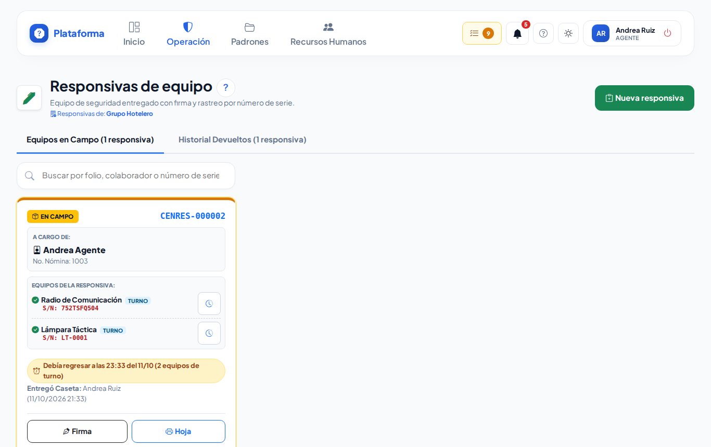
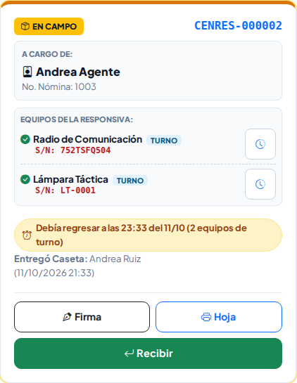
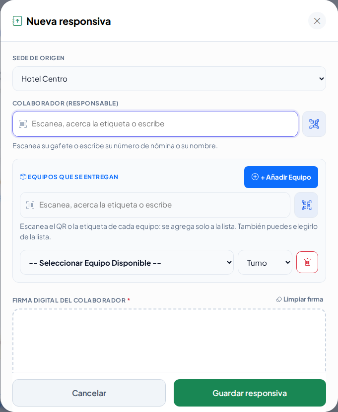
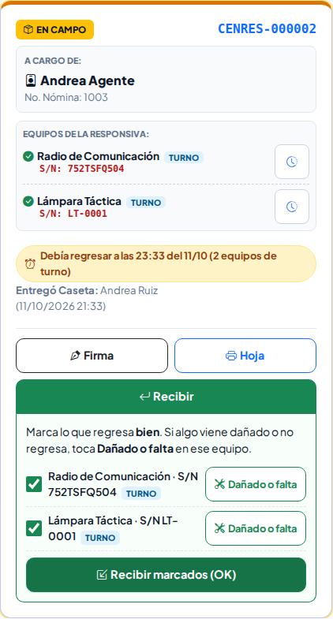
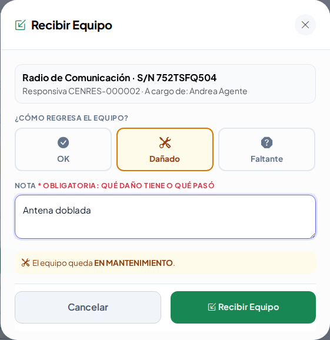
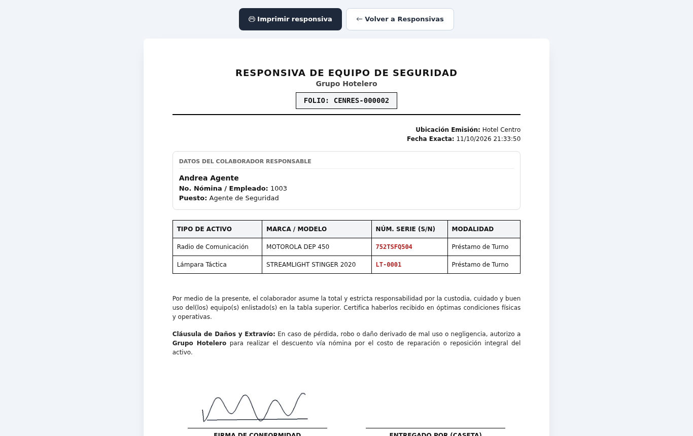
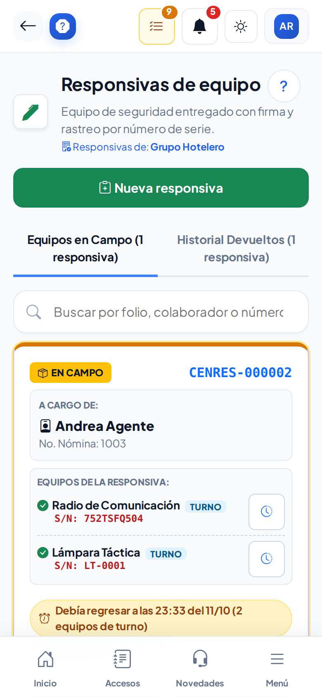

# Responsivas

**¿Para qué sirve?** Aquí la caseta entrega **equipo de seguridad** (radios, lámparas, detectores, chalecos…) a un colaborador o a una persona o empresa externa, **con su firma**, y lo recibe de vuelta. Cada entrega es una **responsiva** con su **folio**, por ejemplo `CENRES-000002`, y puede llevar uno o varios equipos.

**Antes de empezar:** para entregar necesitas que tu rol pueda **crear** y **firmar** en Responsivas; para recibir, **editar**. Los equipos se dan de alta antes en [Equipos de seguridad](equipos.md). Si no ves **Nueva responsiva**, pide a tu administrador que revise tu rol.

## Cómo leer la pantalla

1. Entra a **Operación → Activos → Responsivas**.
2. Tienes dos pestañas:

| Pestaña | Qué ves |
|---|---|
| **Equipos en Campo** | Responsivas abiertas: el colaborador tiene los equipos (**EN CAMPO**, borde ámbar). |
| **Historial Devueltos** | Responsivas ya recibidas (**CERRADA**, borde verde). |

**Qué debes ver:** cada ficha con el folio, **A cargo de** (el colaborador), los equipos con su número de serie (S/N) y si son **Turno** (se devuelven al terminar) o **Fijo** (asignación fija), quién los entregó y cuándo. Usa **Buscar** para un folio, colaborador o número de serie.

Si tu empresa configuró la **hora de regreso de los equipos de Turno**, la ficha dice **Debe regresar a las …**. Si ya pasó la hora, dice **Debía regresar a las …** y la ficha se pone **ámbar**; si pasa más tiempo, **roja**. A la caseta (y después al supervisor) les llega el aviso en la **campana** y en **Mis pendientes → Equipos de turno sin regresar**. Si ya estaba en rojo cuando se revisó, llegan los dos avisos: a la caseta y al supervisor.

## Cómo entregar equipo (nueva responsiva)

1. Toca **Nueva responsiva**.
2. Revisa la **Sede de Origen**.
3. En **Responsable (¿quién se lo lleva?)** elige:
   - **Colaborador:** escanea su gafete o escribe su número de nómina o nombre. En condominio y fraccionamiento esta opción se llama **Residente o personal**.
   - **Persona externa:** por ejemplo, el técnico de un contratista. Escribe su nombre y elígelo del Padrón de personas.
   - **Empresa externa:** cuando el equipo se le entrega a la empresa (por ejemplo, para una obra).
4. En **Equipos que se entregan** escanea el QR o la etiqueta de cada equipo: se agrega solo. También puedes tocar **Añadir Equipo** y elegirlo (solo salen los **DISPONIBLES** de la sede).
5. En cada equipo elige **Turno** o **Fijo**. Con el bote de basura quitas una fila.
6. Pide al colaborador que **firme en el recuadro**. Si se equivoca, toca **Limpiar firma**.
7. Toca **Guardar responsiva**.

**Qué debes ver:** el aviso verde con el **folio** y la ficha nueva en **Equipos en Campo**. Cada equipo queda **EN USO** (si es por **Turno**) o **ASIGNADO** (si es **Fijo**) y su ficha en el inventario dice **A cargo de** quién está.

## Cómo recibir el equipo de vuelta

Hay **un solo botón**, **Recibir**, para todo: regresen todos los equipos o solo algunos.

1. En la ficha toca **Recibir**. Se abre la lista de los equipos que siguen en campo, **todos marcados**.
2. **Desmarca** los que no te entregan todavía.
3. Si alguno viene **dañado** o **no regresa**, toca **Dañado o falta** en ese equipo (ver abajo).
4. Toca **Recibir marcados (OK)**.

**Qué debes ver:** los equipos marcados vuelven a **DISPONIBLE**. Si faltan equipos, el aviso dice cuántos y la responsiva sigue **EN CAMPO**; cuando regresa el último, pasa sola a **Historial Devueltos**.

**Si un equipo viene dañado o falta:**

1. Toca **Dañado o falta** en ese equipo.
2. Elige cómo regresa: **OK**, **Dañado** (escribe el daño; queda en mantenimiento) o **Faltante** (escribe qué pasó; se genera el voucher de reposición).
3. Toca **Recibir Equipo**.

Si tu rol no puede dar de baja con voucher y eliges **Faltante**, la pantalla te dice «Ya le avisamos a tu supervisor para que reciba este equipo faltante.»: a quien da de baja equipos en tu sede le llega el aviso y lo ve en **Mis pendientes → Equipos faltantes por recibir** hasta que lo reciba.

**Tip:** también puedes **escanear el QR del equipo** con la cámara del celular, fuera de esta pantalla: si está en una responsiva, te ofrece **Recibir (OK)** de inmediato (ver [Etiquetas QR](etiquetas-qr.md)).

## Cómo ver la firma e imprimir la hoja

1. Toca **Firma** en la ficha para verla (solo la ven quienes tienen permiso en esa sede).
2. Toca **Hoja** (o **Archivo** en el historial): se abre la **Responsiva de equipo de seguridad** con folio, equipos, texto de responsabilidad y firma.
3. Toca **Imprimir responsiva** o guárdala como PDF.

**Qué debes ver:** la hoja con cómo y cuándo regresó cada equipo.

## Cómo ver el historial de un equipo

1. Toca el **reloj** junto a un equipo.
2. Revisa quién lo ha tenido, cuándo se entregó y cuándo regresó.

## En el celular

## Si algo sale mal

| Mensaje o síntoma | Qué significa | Qué hacer |
|---|---|---|
| «Agrega al menos 1 equipo a la responsiva.» | La responsiva está vacía. | Escanea al menos un equipo. |
| «El equipo … no está DISPONIBLE (está …)» | El equipo está en mantenimiento, de baja o prestado. | Usa otro equipo. |
| «El equipo … sigue en la responsiva … sin recibir.» | Otro colaborador lo tiene. | Recíbelo primero en esa responsiva. |
| «El equipo … es de otra sede…» | El equipo no es de la sede elegida. | Cambia la sede o el equipo. |
| «Escanea el gafete o busca al colaborador responsable.» | Falta el responsable. | Escanea su gafete o busca a la persona o empresa externa. |
| «El equipo … está apartado para el pase …» | El equipo va en un pase de salida que todavía no sale. | Elige otro equipo o escribe el motivo en **Entregar de todos modos** (el pase no podrá salir con él). |
| «… tiene el acceso restringido: no se le puede entregar nada. Llama a tu supervisor.» | La persona o empresa externa tiene prohibido el acceso. | No le entregues el equipo. |
| «Un mismo equipo está en dos filas. Quita la fila repetida.» | Escaneaste dos veces el mismo. | Quita una fila. |
| «Marca al menos un equipo que regresa.» | Tocaste **Recibir marcados (OK)** sin marcar ninguno. | Marca los que te entregan. |
| «Uno de los equipos marcados ya se había recibido…» | Alguien más lo recibió mientras tanto. | Recarga la pantalla y revisa. |
| «Pide a un supervisor que reciba este equipo faltante.» | Tu rol no puede generar el voucher. | Llama a tu supervisor. |
| No se guarda y el recuadro de firma se marca | Falta la firma. | Pide la firma y vuelve a guardar. |

## Preguntas frecuentes

- **¿Qué diferencia hay entre Turno y Fijo?** **Turno** se devuelve al terminar el turno; **Fijo** es una asignación que se queda con la persona y no tiene hora de regreso.
- **¿Quién decide a qué hora deben regresar los equipos de Turno?** El administrador, en **Estructura → Configuración → Caseta y activos** (ver [Configuración](configuracion.md)). Si no lo configura, no hay hora de regreso.
- **¿Qué hago si un equipo se perdió?** Recíbelo como **Faltante** con **Dañado o falta**: se genera el voucher de reposición.
- **¿Puedo entregar equipo de otra sede?** No; solo de la sede elegida.
- **¿Dónde veo quién tiene un radio?** En [Equipos de seguridad](equipos.md) la ficha del equipo dice **A cargo de**.

## Relacionado

- [Equipos de seguridad](equipos.md)
- [Vouchers de reposición](vouchers.md)
- [Préstamo de llaves](prestamo-llaves.md)
- [Configuración](configuracion.md)
