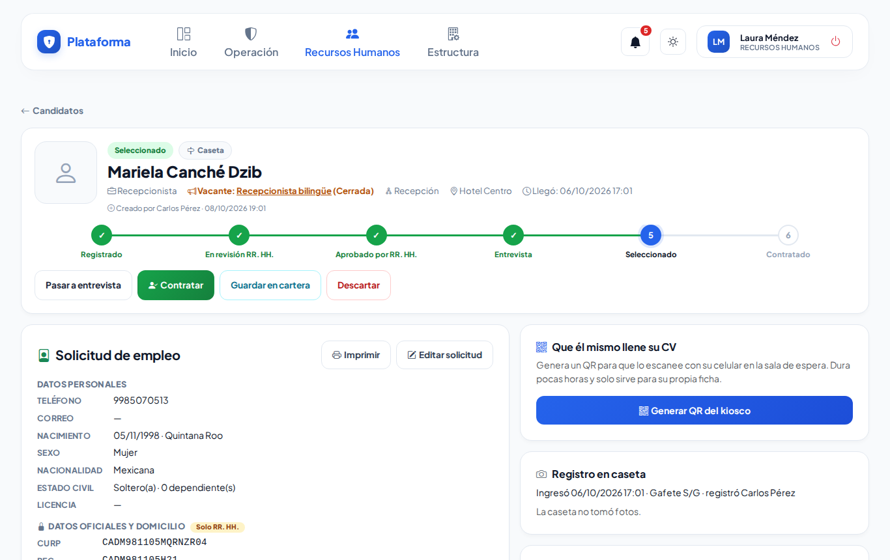
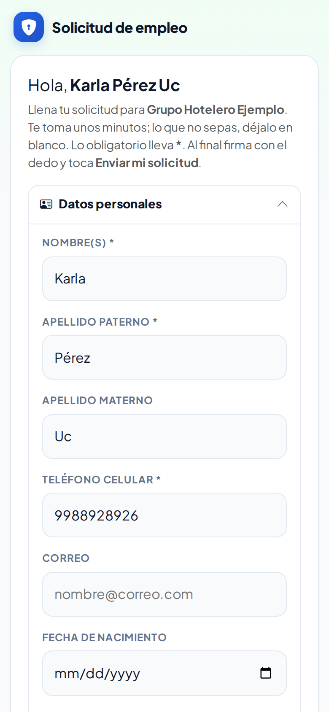
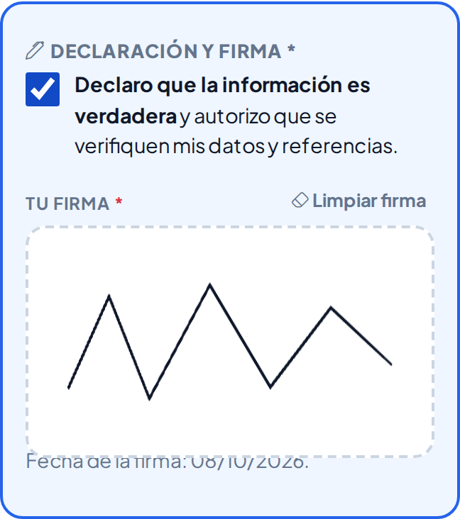
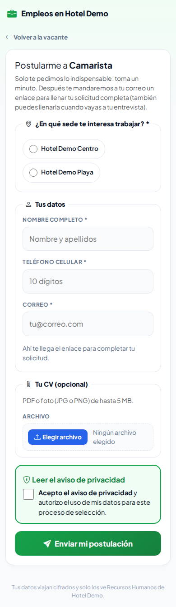
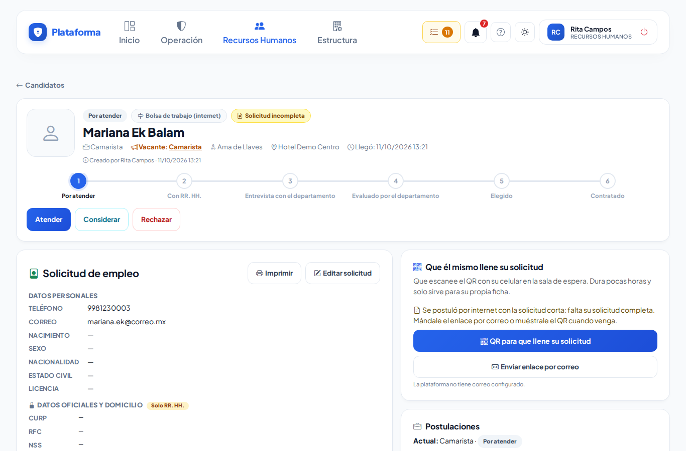
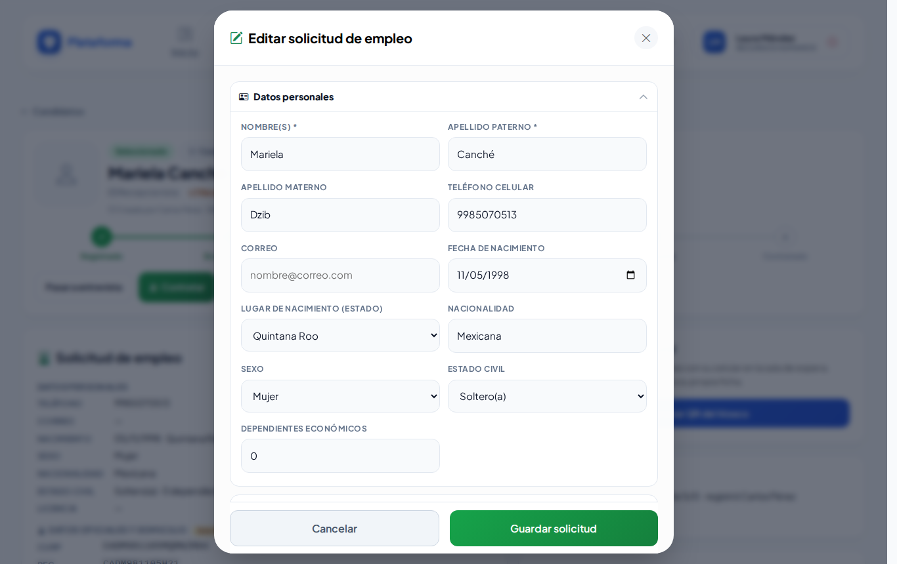
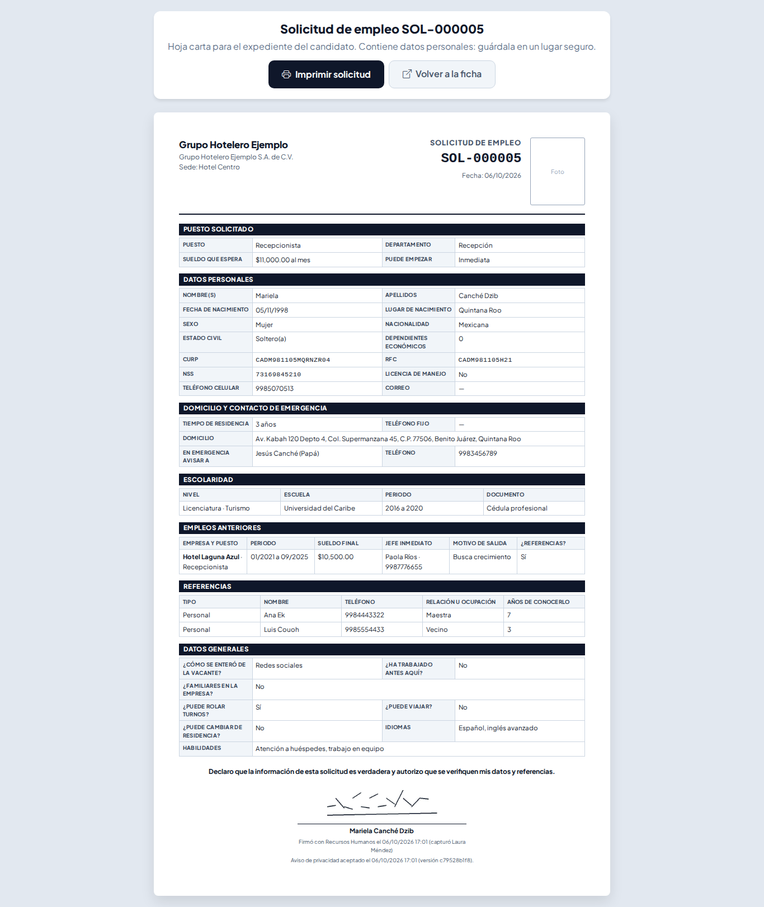

# Solicitud de empleo

**¿Para qué sirve?** Cada candidato tiene su **solicitud de empleo completa** (la de papel de siempre): datos personales, documentos oficiales, domicilio, escolaridad, empleos anteriores, referencias, datos generales y **firma**. Se llena una sola vez —por el candidato en su celular o por Recursos Humanos— y, al contratar, los datos pasan solos a [Colaboradores](colaboradores.md).

## Antes de empezar

- Para ver y editar la solicitud tu rol debe poder consultar y editar *Candidatos* (normalmente Recursos Humanos).
- El bloque **Datos oficiales y domicilio · Solo RR. HH.** (CURP, RFC, NSS, domicilio y contacto de emergencia) solo lo ve Recursos Humanos: no aparece en el resumen del departamento, ni en la campana, ni en los correos.
- Por respeto al candidato no se piden datos de salud, religión, política ni similares.

## Cómo la llena el candidato en su celular (kiosco o internet)

1. Recursos Humanos abre su QR en la ficha (**QR para que llene su solicitud**) o en la tableta de **Recepción → Modo kiosco**, o le manda el enlace con **Enviar enlace por correo** (vale 72 horas). Ver [Candidatos](candidatos.md).
2. El candidato escanea el QR (o escribe el código de 6 letras, o abre el enlace de su correo) y abre **Solicitud de empleo**. Las secciones se abren y se cierran:
   1. **Datos personales:** nombre(s) y apellidos por separado, teléfono celular, correo, fecha y lugar de nacimiento, sexo, estado civil y dependientes.
   2. **Documentos oficiales:** CURP, RFC, NSS y licencia de manejo. Si no los trae, los deja en blanco.
   3. **Domicilio y contacto de emergencia.**
   4. **Puesto al que aplica.**
   5. **Escolaridad:** nivel, escuela, periodo y documento obtenido (certificado, título, cédula o trunco).
   6. **Empleos anteriores:** empresa, puesto, mes de ingreso y de salida, sueldo, jefe y su teléfono, por qué salió y si podemos pedir referencias.
   7. **Referencias:** personales (mínimo 1) y laborales.
   8. **Datos generales:** cómo se enteró de la vacante, familiares en la empresa, si ya trabajó aquí, si puede rolar turnos, viajar o cambiar de residencia, cuándo puede empezar y el sueldo que espera.
   9. **Declaración y firma:** marca **Declaro que la información es verdadera** y firma con el dedo.
3. Al final marca **Acepto el aviso de privacidad** y toca **Enviar mi solicitud**.

 

**Qué debes ver:** una pantalla de agradecimiento. En la ficha del candidato aparece **Por revisar**.

## Cómo se postula por internet (solicitud corta)

Quien entra a la bolsa de trabajo de tu empresa (ver [Vacantes](vacantes.md)) no llena toda la solicitud de golpe:

1. En la vacante toca **Postularme** y escribe solo su **Nombre completo**, su **Teléfono celular** y su **Correo**; si la vacante es de varias sedes, elige la **sede**; si quiere, adjunta su **CV**; marca **Acepto el aviso de privacidad** y toca **Enviar mi postulación**.
2. Ve «¡Listo! Recibimos tu postulación» y recibe en su correo el enlace **Llenar mi solicitud** (vale 72 horas) para llenar la solicitud completa cuando pueda.
3. En Candidatos, su ficha aparece con **Solicitud incompleta** hasta que la llene (o hasta que Recursos Humanos la capture con **Editar solicitud**). Si no la llena desde su casa, la llena en el kiosco cuando venga a su entrevista.

**Qué debes ver:** la campana «Nueva postulación por internet: …» con la nota de solicitud incompleta; en la ficha, el botón **Enviar enlace por correo** para mandárselo otra vez.

**Si ya tenía ficha** (mismo teléfono o CURP): no se crea otra. Se le suma la postulación en su misma ficha y en su **Historial** aparece «Se volvió a postular por internet a «…»». Por seguridad, lo que se escribe en internet **nunca cambia los datos de una ficha que ya existía** (nombre, correo, domicilio, firma): si escribió un nombre o correo distinto, el historial lo dice y la campana avisa «Ojo: escribió un nombre o correo distinto al de su ficha». Confírmalo con la persona y, si cambió algo, corrígelo con **Editar solicitud** o mándale el enlace para llenarla. Si le falta la solicitud completa, el enlace le llega solo al correo que ya tenía su ficha.

 

## Cómo la revisa Recursos Humanos

1. Abre la ficha del candidato en **Recursos Humanos → Candidatos**.
2. La tarjeta **Solicitud de empleo** muestra todo lo capturado.
3. Si dice **Por revisar**, revisa los datos y toca **Ya lo revisé**.

## Cómo editarla o capturarla por el candidato

1. En la tarjeta **Solicitud de empleo** toca **Editar solicitud**. Se abre **Editar solicitud de empleo** con las mismas secciones.
2. Corrige o completa los datos. En **Notas de RR. HH.** puedes anotar lo que solo ve Recursos Humanos.
3. Si el candidato está contigo, puede **firmar en tu pantalla**: marca la declaración y que firme en **Firma del candidato**. Queda anotado que tú capturaste la firma.
4. Toca **Guardar solicitud**.

**Qué debes ver:** la tarjeta actualizada y, en el **Historial** de la ficha, el renglón **Solicitud editada** con las partes que cambiaste (por ejemplo «domicilio») y, si firmó, «El candidato firmó en pantalla». Si algo está mal escrito, el aviso sale dentro de la ventana y la sección con el error se abre sola.

## Cómo imprimirla para el expediente

1. En la tarjeta **Solicitud de empleo** toca **Imprimir**.
2. Se abre la hoja carta con el logo de la empresa, el folio (por ejemplo SOL-000123), la fecha, la foto que tomó la caseta, todas las secciones y la firma.
3. Imprímela o guárdala como PDF.

## Cómo contratar sin volver a escribir

Al tocar **Contratar** en la ficha, el colaborador nuevo ya lleva su CURP, RFC, NSS, nacimiento, nacionalidad, teléfono, correo y domicilio. Solo escribes el **número de empleado**. Si el CURP ya lo tiene otro colaborador, te avisa en la misma ventana. Si aún falta algún documento obligatorio o el contrato firmado, la ventana te lo dice (ver [Candidatos](candidatos.md#cómo-contratar-a-un-candidato)); al contratar, la solicitud y los documentos quedan a la mano en el [expediente del colaborador](colaboradores.md#cómo-ver-el-expediente-de-un-colaborador).

## Cómo exportar las solicitudes

- **Exportar a Excel:** la lista de candidatos sin datos personales.
- **Con datos personales:** agrega teléfono, correo, CURP, RFC, NSS, domicilio y emergencia (columnas marcadas «[DATO PERSONAL]»). Te pide confirmar y queda registrado en la [Bitácora de auditoría](auditoria.md). Guarda el archivo en un lugar seguro.

## Si algo sale mal

| Mensaje o síntoma | Qué significa | Qué hacer |
|---|---|---|
| Para enviar, marca «Declaro que la información es verdadera». | Falta la declaración. | Márcala antes de enviar. |
| Falta tu firma: firma en el recuadro con el dedo antes de enviar. | No se firmó. | Firma con el dedo en el recuadro. |
| Escribe al menos 1 referencia personal (nombre y teléfono). | Faltan referencias. | Agrega una persona con su teléfono. |
| Escribe tu correo: ahí te mandaremos el enlace para completar tu solicitud. | Al postularse por internet no escribió su correo. | Escribir el correo; es donde llega el enlace. |
| Para guardar, marca «Acepto el aviso de privacidad». | No se aceptó el aviso. | Léelo y márcalo. |
| El CURP no tiene el formato correcto: son 18 letras y números (ej. GOMA850101HQRRRN09). | El CURP está incompleto. | Cópialo de su documento o déjalo vacío. |
| El RFC no tiene el formato correcto: son 12 o 13 letras y números (ej. GOMA850101AB1). | El RFC está incompleto. | Corrígelo o déjalo vacío. |
| El NSS (número de seguro social) lleva exactamente 11 números. | Faltan o sobran números. | Corrígelo o déjalo vacío. |
| El código postal lleva exactamente 5 números. | El código postal está incompleto. | Corrígelo. |
| En empleos anteriores, el mes de salida no puede ser antes del de ingreso. | Las fechas están al revés. | Corrige los meses. |
| El teléfono lleva de 10 a 15 números. | Faltan números. | Escribe el celular con lada. |
| Ese código no existe o ya venció. Pide uno nuevo en recepción. | El enlace venció o ya se usó. | Recursos Humanos genera un QR nuevo. |

> Si la solicitud no se envía, arriba aparece en rojo qué falta. El enlace **no se gasta** por un intento fallido.

## Preguntas frecuentes

**¿Por qué no pide datos de salud o religión?** Por ley y por respeto al candidato no se piden datos de salud, religión, política ni similares.

**¿El jefe del departamento ve el CURP o el domicilio?** No. Solo ve un resumen (puesto, escolaridad, experiencia).

**¿Puedo capturar la solicitud yo si el candidato no tiene celular?** Sí, con **Editar solicitud**, y que firme en tu pantalla.

**¿Por qué la postulación por internet pide tan poco?** Para que nadie abandone a la mitad: con nombre, teléfono y correo ya puedes llamarlo; la solicitud completa se le pide después con el enlace de su correo o en el kiosco.

**¿Qué pasa si el candidato ya tenía ficha de antes?** Se conserva. Al editarla, su nombre aparece separado en nombre y apellidos para que lo confirmes.

## Relacionado

- [Candidatos](candidatos.md)
- [Vacantes](vacantes.md)
- [Recepción y autorizaciones](recepcion-y-autorizaciones.md)
- [Colaboradores](colaboradores.md)
