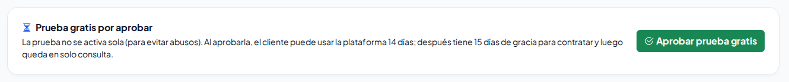
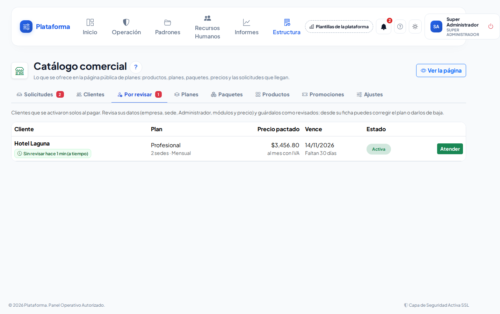
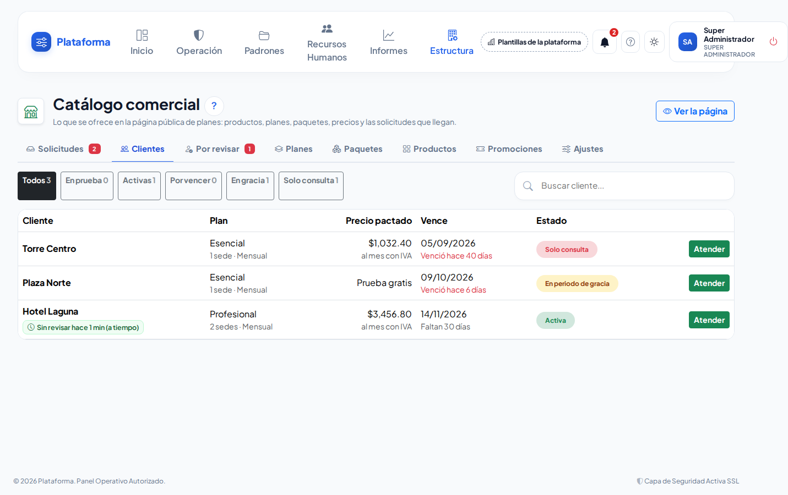
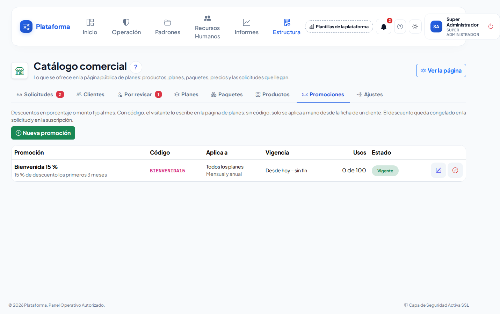

# Suscripciones de los clientes

**¿Para qué sirve?** Aquí ves a **cada cliente que contrató** la plataforma: su plan, sus sedes, cuándo vence y en qué estado está. Desde aquí apruebas las **pruebas gratis**, revisas a los **clientes nuevos**, recibes sus **pagos**, cambias su plan, haces **excepciones** (más usuarios, más sedes, módulos de más o de menos) y das de alta **promociones**.

## Antes de empezar

- Solo el **Super Administrador** usa estas pantallas: **Estructura → Catálogo comercial**, pestañas **Clientes**, **Por revisar** y **Promociones**.
- Las empresas que ya trabajaban en la plataforma **no tienen suscripción**: siguen igual que siempre, sin límites ni vencimiento. En **Empresas** dicen «Sin suscripción: sin límites ni vencimiento».
- Los días de prueba, los días de gracia, el descuento por pago anual y los avisos se configuran en **Catálogo comercial → Ajustes → Suscripciones**.

## Cómo funciona una suscripción

| Estado | Qué significa | Qué puede hacer el cliente |
|---|---|---|
| **En prueba** | Prueba gratis aprobada por ti (14 días si no lo cambias). | Todo lo de su plan. |
| **Activa** | Pagó y está al corriente. | Todo lo de su plan. |
| **Por vencer** | Faltan 7 días o menos. | Todo; recibe avisos. |
| **En periodo de gracia** | Ya venció; tiene 15 días para pagar. | Todo; ve una franja amarilla con la fecha límite. |
| **Solo consulta** | Terminó la gracia sin pago, o la diste de baja. | Ver y exportar; **no** puede registrar ni cambiar nada. |

Al recibir el pago, el cliente vuelve a **Activa** en ese momento.

## Cómo activar a un cliente que pagó

1. Entra a **Estructura → Catálogo comercial → Solicitudes** y toca **Atender** en su solicitud.
2. En **Estado** elige **Pagada**, escribe la **Referencia del pago** y toca **Guardar**.

**Qué debes ver:** se abre la ficha del cliente con el aviso «Solicitud … pagada: «Hotel Centro» quedó activo con sus módulos, su sede principal y su Administrador…». La plataforma creó **solita**: la empresa, una **Sede principal**, al **Administrador** (con el correo de la solicitud; le llega el correo de bienvenida para crear su contraseña), los **módulos de su plan** y los roles base. El cliente queda en **Por revisar** y te llega un aviso a la campana.

> Si tocas **Guardar** dos veces o vuelves a marcarla como pagada, no se duplica nada.

## Cómo aprobar una prueba gratis

Las pruebas gratis **no se activan solas** (así se evitan abusos).

1. En **Solicitudes** toca el filtro **Pruebas por aprobar** y luego **Atender**.
2. Revisa los datos y toca **Aprobar prueba gratis**. Confirma.

**Qué debes ver:** «Prueba aprobada: «Grupo Sol» ya puede entrar hasta el …». Se crean su empresa, su sede, su Administrador y sus módulos igual que al pagar.

## Cómo revisar a un cliente nuevo

1. Toca la pestaña **Por revisar** (el número rojo dice cuántos hay). Cada uno muestra desde hace cuánto espera: verde (a tiempo), amarillo (más de 1 día) y rojo (más de 3 días).
2. Toca **Atender**.
3. Revisa la empresa, la sede, el Administrador, los **Módulos que tiene** y el **Precio pactado**. Si algo no cuadra, corrígelo en esa misma ficha.
4. Escribe tus **Notas internas** si hace falta y toca **Guardar como revisado**.

**Qué debes ver:** «Cliente guardado como revisado.» y el botón para revisar el siguiente.

## Cómo ver a todos los clientes

1. Toca la pestaña **Clientes**.
2. Usa los filtros **En prueba**, **Activas**, **Por vencer**, **En gracia** o **Solo consulta**, o escribe su nombre en **Buscar cliente…**.
3. Toca **Atender** para abrir su ficha: suscripción, módulos, excepciones e historial.

## Cómo recibir un pago o renovar

1. En la ficha del cliente, en **Renovar** (o **Contratar después de la prueba**), escribe la **Referencia del pago**.
2. Toca **Recibir pago** y confirma.

**Qué debes ver:** «Pago recibido: la suscripción vence el …». Se suma un mes (o un año) desde su vencimiento; si ya había vencido, desde hoy. Si estaba en prueba, en gracia o en solo consulta, vuelve a **Activa**. Al cliente le llega el aviso «Recibimos tu pago».

> Cuando el cliente pide renovar desde su pantalla, te llega una solicitud de tipo **Renovar**: al marcarla **Pagada** pasa lo mismo.

## Cómo cambiar su plan, sedes o forma de pago

1. En la ficha, en **Plan, sedes y forma de pago**, elige el **Plan**, las **Sedes contratadas**, la **Forma de pago** (Mensual o Anual) y los **Paquetes al mes**.
2. Escribe el **Motivo** y toca **Guardar**.

**Qué debes ver:** «Plan guardado…». El precio se recalcula con los precios de hoy y los módulos del cliente cambian al momento. Lo que deja de incluir queda en **solo consulta** (su equipo lo ve, exporta e imprime, pero no registra) y su administrador recibe el aviso «Algunos módulos quedaron en solo consulta». Regresa al momento si se vuelve a contratar. Las excepciones del cliente se conservan. La fecha de vencimiento no cambia.

## Cómo hacer una excepción

Para dar a un cliente algo distinto a su plan sin cambiarlo:

1. En la ficha, en **Excepciones**, abre **Agregar una excepción**.
2. Elige **Qué se ajusta**: **Usuarios activos de más**, **Sedes de más**, **Módulo agregado** o **Módulo quitado**.
3. Escribe la **Cantidad** (por ejemplo `5`, o `-2` para menos) o elige el **Módulo**.
4. Escribe el **Motivo** (por ejemplo, lo que acordaste con el cliente) y toca **Guardar**.

**Qué debes ver:** «Excepción guardada: +5 usuarios activos.» Queda en la lista con quién la hizo y cuándo. Para quitarla toca el círculo rojo (**Dar de baja**): se conserva en el historial.

- Un **módulo agregado** se lleva lo que necesita (por ejemplo, Bitácora de transporte trae Rutas).
- No se puede **quitar** un módulo que otro módulo activo necesita: «No se puede quitar Rutas de transporte: lo necesita Bitácora de transporte…».
- Los módulos de un cliente con suscripción **solo** se cambian aquí (con su plan y sus excepciones). En **Empresas → Módulos** se ven en solo consulta.

## Cómo dejar a un cliente en solo consulta (y regresarlo)

1. En la ficha, en **Solo consulta**, escribe el **Motivo** y toca **Dar de baja**. Confirma.
2. Para regresarlo, toca **Reactivar**.

**Qué debes ver:** «Suscripción dada de baja: el cliente queda en solo consulta…». Si su vigencia ya terminó, **Reactivar** te pide recibir su pago primero.

## Cómo crear una promoción

1. Toca la pestaña **Promociones** y luego **Nueva promoción**.
2. Escribe el **Nombre**, el **Código** que escribirá el cliente (por ejemplo `BIENVENIDA15`; vacío = solo la aplicas tú) y el **Descuento**: **Porcentaje** o **Monto fijo al mes**.
3. Si el descuento es solo por un tiempo, escribe **Solo los primeros … meses**.
4. En **Avanzado** elige desde y hasta cuándo vale, el **Límite de usos**, la **Forma de pago** y los **Planes** a los que aplica.
5. Toca **Guardar**.

**Qué debes ver:** «Promoción «…» guardada: el código … ya se puede usar en la página de planes.» Un uso se cuenta cuando el cliente se activa.

Para aplicar una promoción a un cliente que ya existe: en su ficha, en **Promoción**, elígela y toca **Guardar**. Vale desde su siguiente periodo.

## Avisos automáticos

Cada día, después de las 8:00, la plataforma avisa por **campana y correo** al Administrador del cliente y a ti:

- 7 días y 1 día antes de vencer (se cambia en **Ajustes → Avanzado: avisos de vencimiento**);
- el día después de vencer (empieza la gracia);
- a la mitad de la gracia;
- al pasar a solo consulta.

Cada aviso sale una sola vez por vencimiento.

## Si algo sale mal

| Mensaje o síntoma | Qué significa | Qué hacer |
|---|---|---|
| Esta solicitud no es de prueba gratis: márcala como pagada para activarla. | Intentaste aprobar como prueba una solicitud normal. | Cambia su estado a **Pagada**. |
| Su vigencia terminó el …: registra el pago para reactivarla. | El cliente ya pasó su gracia. | Usa **Recibir pago**. |
| Escribe el motivo de la excepción… | Falta el motivo. | Escribe qué se acordó. |
| Los módulos de Dirección (empresa, sedes, usuarios, roles, colaboradores, departamentos…) siempre se quedan. | Intentaste quitar un módulo básico. | Elige otro módulo. |
| No se puede quitar …: lo necesita … | Otro módulo activo del cliente depende de ese. | Quita primero el módulo que lo necesita, o deja los dos. |
| «… tiene suscripción: sus módulos los fijan su plan y sus excepciones.» | Intentaste cambiar sus módulos en **Empresas → Módulos**. | Hazlo con una excepción en su ficha de cliente. |
| Esa promoción solo aplica a … / ya venció / ya se agotó. | La promoción no sirve para ese cliente. | Elige otra o edita la promoción. |
| No se puede sumar al plan elegido: … | Un paquete no se vende con ese plan. | Quita el paquete o cambia de plan. |
| El historial dice «el correo de bienvenida no salió». | El correo de la plataforma no está configurado o el correo es incorrecto. | Configura el correo en **Configuración** y, en **Usuarios** de esa empresa, usa **Restablecer contraseña**. |
| El correo ya tiene una cuenta en la plataforma. | Ese correo ya se usa en otra cuenta. | Da de alta al Administrador con otro correo en **Usuarios**. |

## Preguntas frecuentes

**¿Qué pasa con las empresas que ya existían?** Nada: no tienen suscripción, no tienen límites ni vencimiento.

**¿Qué pasa con la información de un cliente en solo consulta?** Se conserva completa. Sus usuarios pueden verla y exportarla; solo no pueden registrar nada nuevo hasta que pague.

**¿Qué precio se le cobra?** El **precio pactado**: el que tenía su solicitud al pagar (con su descuento anual y su promoción). Si cambias los precios del catálogo, los clientes conservan el suyo hasta que les cambies el plan.

**¿Cuándo se cobran los pagos en línea?** Todavía se acuerdan por fuera. Cuando se conecte el cobro en línea, el pago activará al cliente por el mismo camino que hoy usa «Pagada».

**¿Por qué el Super Administrador no queda en solo consulta?** Solo quedan en solo consulta los usuarios del cliente; tú puedes trabajar en su empresa para ayudarle.

## Relacionado

- [Catálogo comercial y página de planes](catalogo-comercial.md)
- [Tu suscripción (para el Administrador del cliente)](mi-suscripcion.md)
- [Empresas y sedes](empresas-y-sedes.md)
