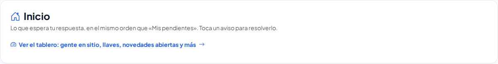
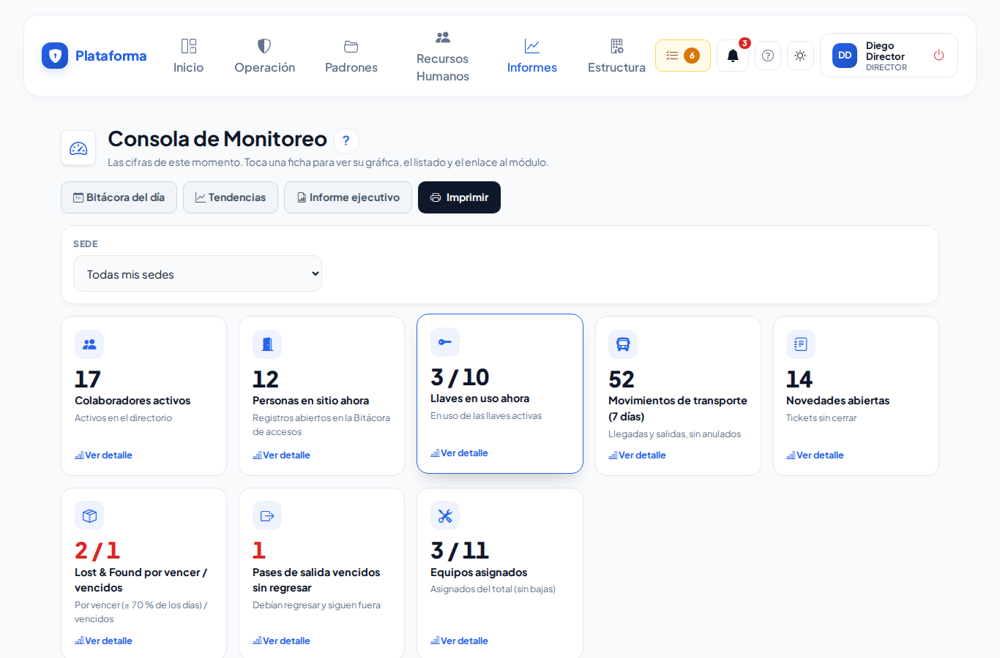
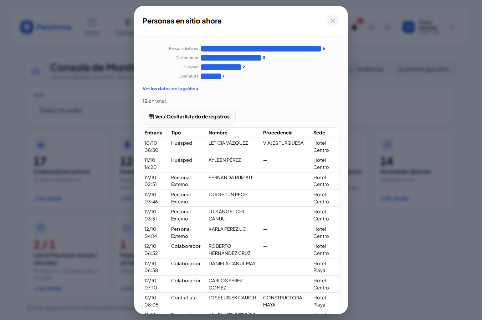
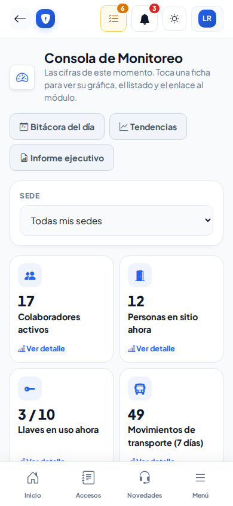
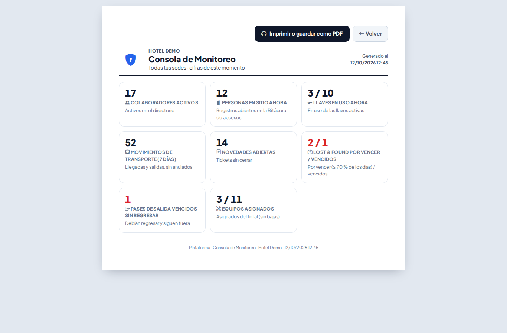

# Tablero (Consola de Monitoreo)

**¿Para qué sirve?** Para saber de un vistazo cómo está la operación **en este momento**: cuántas personas hay en sitio, cuántas llaves están prestadas, cuántas novedades siguen abiertas, qué objetos de Lost & Found están por vencer y qué pases de salida no han regresado. Cada ficha abre su gráfica, el listado de registros y un enlace al módulo ya filtrado.

**Antes de empezar:** necesitas que tu rol pueda **ver** el Tablero. Cada ficha aparece solo si además puedes **ver** el módulo de donde sale el dato (por ejemplo, «Personas en sitio ahora» pide ver la Bitácora de accesos). Las cifras son de tu sede o de toda la empresa, según tu permiso. **Imprimir** pide su propio permiso. Si no ves el Tablero o falta una ficha, pide a tu administrador que revise tu rol.

## Cómo abrir el Tablero

1. Entra a **Informes → Informes → Tablero**. También puedes tocar, en **Inicio**, el enlace **Ver el tablero: gente en sitio, llaves, novedades abiertas y más**.
2. Si trabajas en varias sedes, elige una en **Sede** o deja **Todas mis sedes**.

**Qué debes ver:** una ficha por indicador, con su número grande, su nombre y una nota corta. Abajo dice a qué hora se calculó; vuelve a abrir la pantalla para actualizar.

Las fichas son:

| Ficha | Qué cuenta |
|---|---|
| **Colaboradores activos** | Colaboradores activos del directorio; la gráfica los reparte por departamento (los 8 con más). |
| **Personas en sitio ahora** | Registros abiertos de la Bitácora de accesos, por tipo de acceso. |
| **Llaves en uso ahora** | Llaves prestadas / total de llaves activas. |
| **Movimientos de transporte (7 días)** | Llegadas y salidas de los últimos 7 días, por día, sin los anulados. |
| **Novedades abiertas** | Tickets sin cerrar, por categoría. |
| **Lost & Found por vencer / vencidos** | Objetos en resguardo que ya pasaron el 70 % de sus días de resguardo / los que ya los pasaron. |
| **Pases de salida vencidos sin regresar** | Pases que debían regresar antes de hoy y siguen fuera. |
| **Equipos asignados** | Equipos de seguridad asignados / total (sin los dados de baja). |

## Cómo ver el detalle de una ficha

1. Toca la ficha (por ejemplo **Personas en sitio ahora**).
2. Se abre una ventana con la **gráfica**. Toca **Ver los datos de la gráfica** si prefieres los números en tabla.
3. Toca **Ver / Ocultar listado de registros** para ver los registros (hasta 200).
4. Toca el botón de abajo (por ejemplo **Ir a la Bitácora de accesos**) para ir al módulo con el filtro ya puesto: los urgentes de Lost & Found, los pases vencidos, los reportes de transporte de los últimos 7 días…

**Qué debes ver:** el total, la gráfica y el listado. Para cerrar, toca la **X** o la tecla Esc.

En el celular las fichas salen de dos en dos:

## Cómo imprimir o guardar como PDF

1. Si trabajas en varias sedes, elige primero la **Sede** (o deja **Todas mis sedes**).
2. Toca **Imprimir** (arriba, junto a los otros informes; solo aparece si tu rol puede imprimir el Tablero). Se abre una hoja carta sin menús, con el logo, la empresa, las sedes y la hora.
3. Toca **Imprimir o guardar como PDF** y, en la ventana de impresión, elige tu impresora o **Guardar como PDF**.

**Qué debes ver:** una tarjeta por ficha con su número, su nombre y su nota; en rojo lo que pide atención. La hoja no trae los listados ni las gráficas de cada ficha: para eso abre la ficha en pantalla.

## Si algo sale mal

| Mensaje o síntoma | Qué significa | Qué hacer |
|---|---|---|
| No aparece **Informes** en el menú | Tu rol no puede ver ningún informe. | Pide a tu administrador el permiso **Ver** del Tablero. |
| Falta una ficha | No puedes ver el módulo de donde sale ese dato, o por un momento no se pudo calcular. | Vuelve a abrir la pantalla; si sigue sin salir, pide el permiso del módulo. |
| Las cifras no coinciden con las de otra sede | Solo ves tus sedes. | Es correcto: cada quien ve lo de su alcance. |
| «Elige arriba la empresa de trabajo» | Eres Super Administrador y no elegiste empresa. | Elige la empresa en **Empresa de trabajo**. |
| No aparece **Imprimir** | Tu rol no puede imprimir el Tablero. | Pide el permiso **Imprimir** del Tablero. |
| «No tienes permiso para ver esto» al abrir la hoja para imprimir | Te quitaron el permiso **Imprimir** o abriste un enlace guardado. | Pide el permiso **Imprimir** a tu administrador. |

## Preguntas frecuentes

**¿Se actualiza solo?** No: muestra las cifras del momento en que abriste la pantalla. Vuelve a abrirla para actualizar.

**¿Por qué «3 / 10» en las llaves?** El primer número es lo que está en uso y el segundo el total.

**¿Qué es «por vencer» en Lost & Found?** Un objeto que ya pasó el 70 % de los días de resguardo de su tipo (los días se configuran en Lost & Found).

**¿Por qué el Tablero no está en Inicio?** Inicio muestra lo que espera tu respuesta; el Tablero muestra cifras. Desde Inicio hay un enlace directo.

## Relacionado

[Informe ejecutivo](informe-ejecutivo.md) · [Tendencias](tendencias.md) · [Bitácora general del día](bitacora-del-dia.md) · [Bitácora de accesos](accesos.md) · [Lost & Found y Robo](lost-found-y-robo.md) · [Pases de salida](pases-salida.md)
