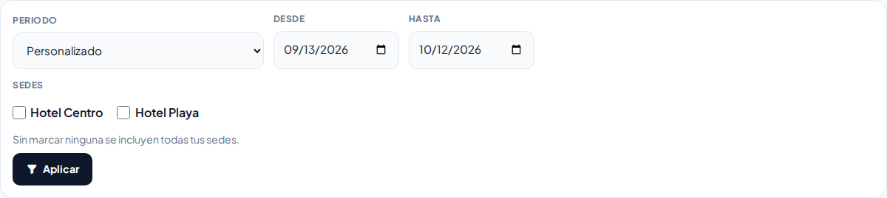
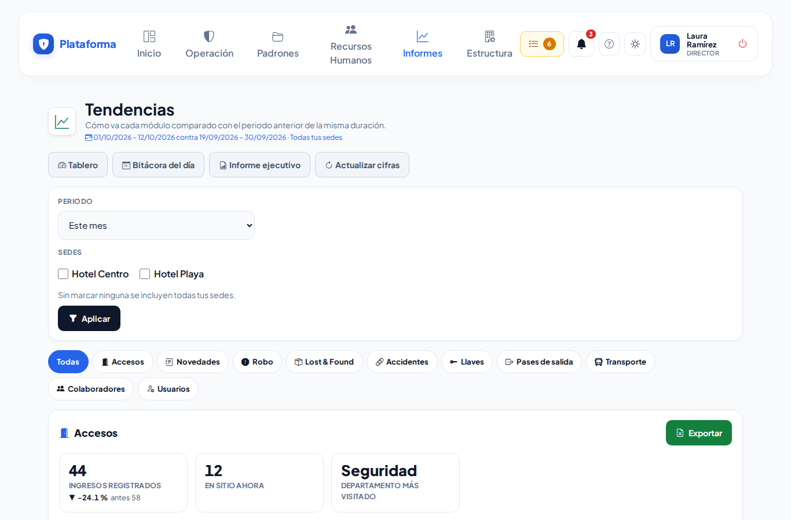
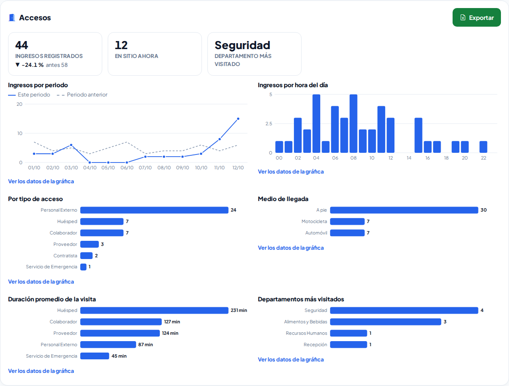

# Tendencias

**¿Para qué sirve?** Para saber si las cosas van mejor o peor: compara el periodo que eliges (esta semana, este mes, este trimestre, este año o unas fechas) contra el **periodo anterior de la misma duración**. Cada cifra muestra una flecha **▲** (subió) o **▼** (bajó) y el porcentaje de cambio.

**Antes de empezar:** necesitas que tu rol pueda **ver** Tendencias. Cada sección aparece solo si puedes ver su módulo (Accesos, Novedades, Robo, Lost & Found, Accidentes, Llaves, Pases de salida, Transporte, Colaboradores, Usuarios y Candidatos). **Exportar** pide su propio permiso.

## Cómo elegir el periodo y las sedes

1. Entra a **Informes → Informes → Tendencias**.
2. En **Periodo** elige **Esta semana** (de lunes a hoy), **Este mes**, **Este trimestre**, **Este año** o **Personalizado**.
3. Si eliges **Personalizado**, escribe **Desde** y **Hasta**.
4. Si trabajas en varias sedes, marca las que quieres en **Sedes** (sin marcar ninguna se incluyen todas las tuyas).
5. Toca **Aplicar**.

**Qué debes ver:** arriba, el periodo contra el anterior (por ejemplo «01/10/2026 – 12/10/2026 contra 19/09/2026 – 30/09/2026») y las sedes.

## Cómo leer una sección

1. Toca **Todas** o una sección (por ejemplo **Accesos**) en la fila de botones.
2. Cada cifra trae su flecha y su porcentaje, y abajo «antes …» con el valor del periodo anterior. «Antes: 0» quiere decir que en el periodo anterior no hubo nada que comparar.
3. La gráfica de línea compara los dos periodos punto por punto: la línea azul es este periodo y la punteada gris el anterior. Pasa el dedo o el ratón sobre un punto para ver su número.
4. Las barras muestran cada desglose (por tipo, por categoría, por zona…). Toca **Ver los datos de la gráfica** para verlos en tabla.

Lo que trae cada sección:

| Sección | Qué compara |
|---|---|
| **Accesos** | Ingresos, gente en sitio ahora, departamento más visitado, por tipo, medio de llegada, duración promedio de la visita y por hora del día. |
| **Novedades** | Tickets abiertos, tiempo promedio de cierre, por estatus y categoría, concentración por zona y carga por guardia. |
| **Robo** | Casos, valor estimado y seguimiento (sospechoso, parte a la policía, canalizados). |
| **Lost & Found** | Objetos encontrados, reportes de pérdida, tasa de recuperación, por estatus y tipo de valor. |
| **Accidentes** | Accidentes, tipo de afectado y si fue acto o condición insegura. |
| **Llaves** | Préstamos, llaves más prestadas y garantía que se dejó. |
| **Pases de salida** | Pases creados, regresos, por motivo y estatus. |
| **Transporte** | Movimientos, monto pagado en taxis, pasajeros y puntualidad. |
| **Colaboradores** y **Usuarios** | Altas en el periodo y activos ahora. |
| **Candidatos** | Registrados, contratados, cómo llegaron y en qué etapa están (sin nombres). |

## Cómo exportar una sección a Excel

1. Toca **Exportar** en la sección (solo si tu rol puede exportar Tendencias).
2. Se descarga un archivo de Excel (CSV) con las cifras, la serie de los dos periodos y los desgloses.

## Si algo sale mal

| Mensaje o síntoma | Qué significa | Qué hacer |
|---|---|---|
| Una cifra no cambió después de capturar algo | Las cifras se guardan 5 minutos. | Toca **Actualizar cifras**. |
| Falta una sección | No puedes ver su módulo, o por un momento no se pudo calcular. | Toca **Actualizar cifras**; si sigue sin salir, pide el permiso. |
| El periodo personalizado se acortó | Un periodo no puede pasar de dos años. | Elige fechas más cercanas. |
| No aparece **Exportar** | Tu rol no puede exportar Tendencias. | Pide el permiso **Exportar**. |

## Preguntas frecuentes

**¿«Esta semana» son los últimos 7 días?** No: es de lunes a hoy, y se compara contra el mismo número de días justo antes.

**¿Por qué la gráfica a veces es por semana o por mes?** Para que se lea: hasta 14 días va por día, hasta 120 por semana y más por mes.

**¿Una flecha ▲ es buena o mala?** Depende de la cifra: más ingresos puede ser bueno; más robos no. La flecha solo dice si subió o bajó.

**¿En qué hora están las cifras?** En la de tu sede (o la de la sede que elegiste si es una sola). Lo dice al final de la pantalla.

## Relacionado

[Tablero](tablero.md) · [Informe ejecutivo](informe-ejecutivo.md) · [Bitácora general del día](bitacora-del-dia.md)
