# Usuarios

**¿Para qué sirve?** Aquí se dan de alta las **cuentas** para entrar a la plataforma: quién es, en qué sede trabaja, qué **rol** tiene (lo que puede hacer), su usuario y su correo. También se restablecen contraseñas, se dan de baja o reactivan cuentas y se desbloquean las que tuvieron demasiados intentos fallidos.

La contraseña es de su dueño: por omisión **la persona la crea** con un enlace que le llega por correo, y tú nunca la conoces. Si la escribes tú, la persona tendrá que cambiarla en su primer acceso.

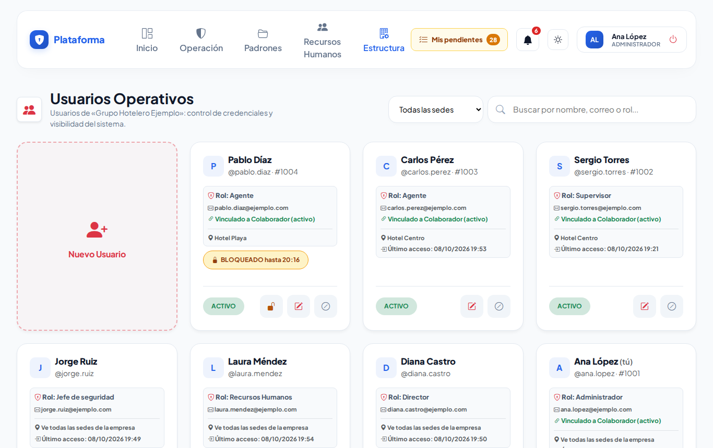

## Antes de empezar

- Para ver la pantalla tu rol debe poder consultar *Usuarios*. Si no aparece en el menú, pide el permiso a tu administrador.
- Solo puedes dar de alta o editar cuentas de **nivel inferior** al tuyo, y solo puedes asignar roles de nivel inferior al tuyo. No puedes editar tu propia cuenta ni la de alguien de tu mismo nivel o superior.
- Cada usuario pertenece a **una empresa** (debajo del título dice «Usuarios de «…»»). La **sede** solo limita lo que ve dentro de esa empresa. El Super Administrador cambia de empresa con el selector **Empresa de trabajo**.
- Antes de dar de alta, conviene que la persona ya esté en [Colaboradores](colaboradores.md) para vincular su cuenta.

## Cómo encontrar una cuenta

1. Entra a **Estructura → Usuarios**. Se abre **Usuarios Operativos**.
2. Escribe en **Buscar por nombre, correo o rol...**. Si hay varias sedes, usa **Todas las sedes**.

**Qué debes ver:** fichas con el nombre, el usuario (@…), el rol, el correo, si está vinculado a un colaborador, la sede y el último acceso.

## Cómo dar de alta una cuenta

1. Toca la tarjeta **Nuevo Usuario**. Se abre **Alta de Usuario**, en tres pasos: **¿Quién es?**, **¿Qué hace y dónde?** y **¿Cómo entra?**.
2. **¿Quién es? → Núm. Colaborador (opcional):** escribe el número o parte del nombre del colaborador y elígelo de la lista (ver «Cómo vincular la cuenta con su colaborador»).
3. Escribe el **Nombre Completo**.
4. **¿Qué hace y dónde? → Rol en el Sistema:** solo aparecen los roles que tú puedes asignar.
5. **Sede:** la sede donde trabaja, o **Todas las sedes de la empresa** si debe ver todas. Si trabaja en dos o más sedes (por ejemplo, un supervisor de dos hoteles), elige una y abre **¿También atiende otras sedes?** para marcar las demás: verá esas sedes y no toda la empresa.
6. **¿Cómo entra?** Escribe el **Usuario** (letras, números, punto, guion y guion bajo; sin espacios) y el **Correo**. Al correo le llegará el enlace para crear su contraseña, así que revisa que esté bien.
   - El correo es **opcional en las cuentas de caseta** (roles que no administran usuarios, roles, permisos ni la configuración, como el Agente). Sin correo, escribe tú la contraseña inicial; cuando la olvide, la persona te lo pedirá con **Pedir a mi administrador** (ver abajo). Su ficha dice **Sin correo: recupera su cuenta contigo**.
   - Quien administra (por ejemplo, el Administrador) **sí necesita correo**: lo usa para recuperar su cuenta y recibir avisos.
7. En **Contraseña** elige cómo la tendrá:
   - **Enviar enlace de bienvenida por correo** (recomendado, viene marcado): la persona recibe el correo **«Bienvenido a … : crea tu contraseña»** con el botón **Crear mi contraseña**. El enlace vale **24 horas**. Nadie más conoce su contraseña.
   - **Escribir la contraseña ahora**: escribe una **Contraseña inicial** (mínimo 8 caracteres, con letras y números) y dísela. Al entrar, la plataforma le pedirá cambiarla antes de usar cualquier pantalla.
8. Toca **Registrar Usuario**.

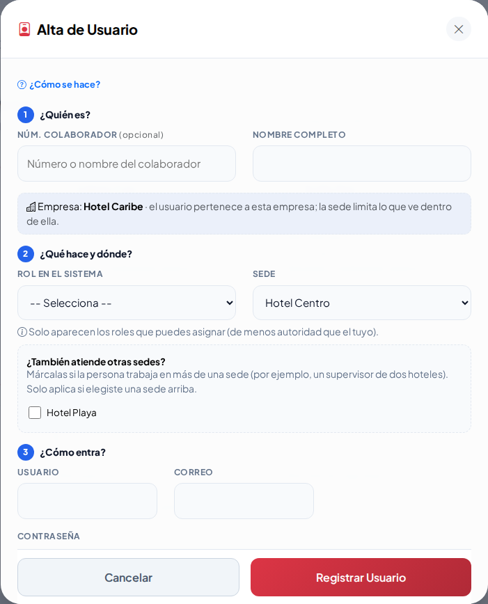

**Qué debes ver:** con enlace: «Usuario «…» creado; le enviamos el correo de bienvenida para que cree su contraseña (vale 24 horas). ¿Quieres dar de alta otro? Toca «Nuevo Usuario».» Con contraseña escrita: «Usuario «…» creado; al entrar tendrá que cambiar la contraseña que escribiste…». En su ficha aparece **Creará su contraseña al entrar** hasta que lo haga.

- Si tu plataforma **no tiene correo configurado**, la ventana lo dice y solo puedes escribir la contraseña.
- Si el correo de bienvenida no se pudo enviar, aparece un aviso amarillo: usa la **llave** (Restablecer contraseña) de su ficha para intentarlo de nuevo o escribirle una contraseña.

> Si cierras la ventana (Cancelar, la X o la tecla Esc), al volver a abrirla aparece vacía. Si al registrar hubo un error, la ventana se vuelve a abrir con lo que capturaste para que lo corrijas.

### Avisos mientras escribes

- **Usuario** y **Correo:** si otra cuenta ya los usa, lo dice al instante («Ese nombre de usuario ya lo usa otra cuenta. Elige otro.»), aunque sea de otra empresa y sin mostrar sus datos. Si está libre: «Nombre de usuario disponible.» / «Correo disponible.»
- **Nombre Completo:** si ya hay una cuenta con ese nombre, te pide confirmar que es otra persona (ver abajo). Si hay un **colaborador con ese nombre que aún no tiene cuenta**, aparece **Vincular**.

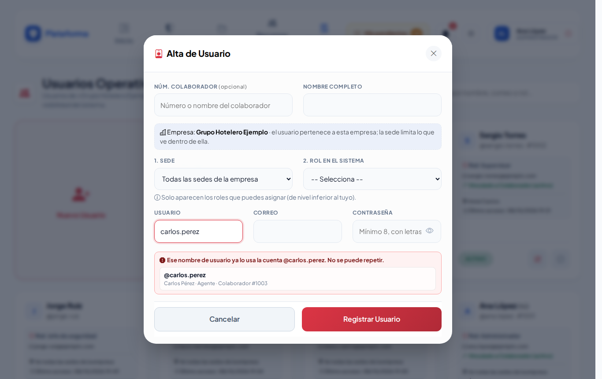

## Cómo vincular la cuenta con su colaborador

**¿Qué es «vincular»?** Decirle a la plataforma «esta cuenta es de este colaborador». Así no capturas su nombre dos veces: **manda su ficha de colaborador**. El nombre y el número de la cuenta se toman de [Colaboradores](colaboradores.md) y se ven en solo lectura; si cambian ahí (o se unen dos registros duplicados), la cuenta se actualiza sola. Si lo dan de baja en Colaboradores, **su cuenta se da de baja sola** (ver «Cómo dar de baja una cuenta»). No es obligatorio: una cuenta de soporte o de un proveedor puede quedarse sin colaborador.

**Ejemplo:** la cuenta de **Daniela Canul May**, colaboradora número **1008**.

1. En **Núm. Colaborador** escribe su número (`1008`) o parte de su nombre (`dani`). Basta con 2 letras o números.
2. En la lista que aparece toca **Daniela Canul May · #1008**. Se llenan solos su número y su **Nombre Completo**, y aparece en verde **Vinculado a Colaboradores**.
3. Otra forma: escribe primero el **Nombre Completo**. Si hay un colaborador con ese nombre sin cuenta, toca **Vincular** en el aviso.
4. Completa lo demás y toca **Registrar Usuario**.

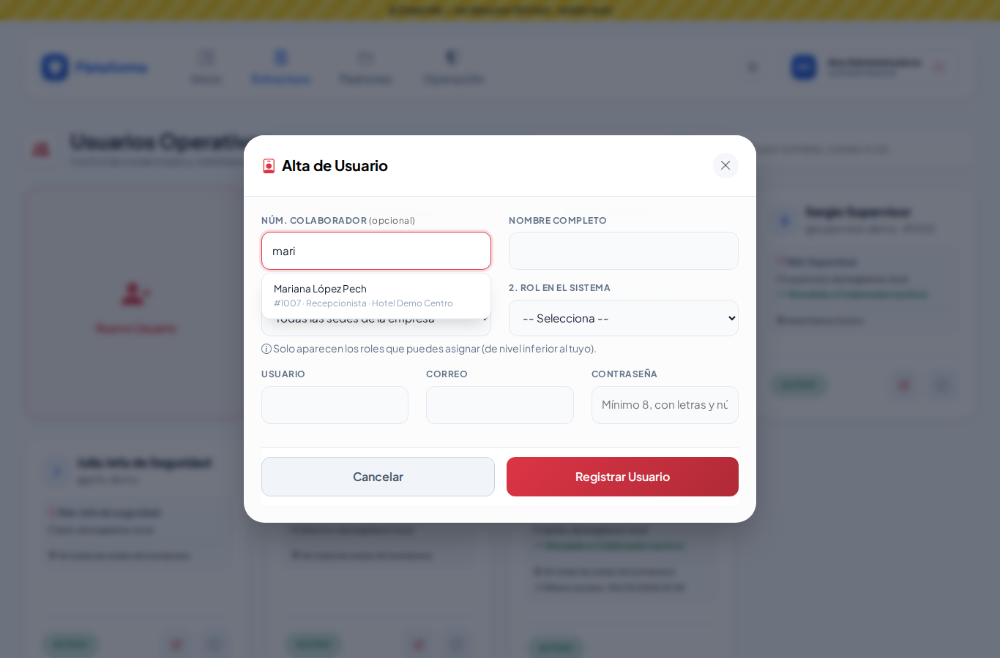

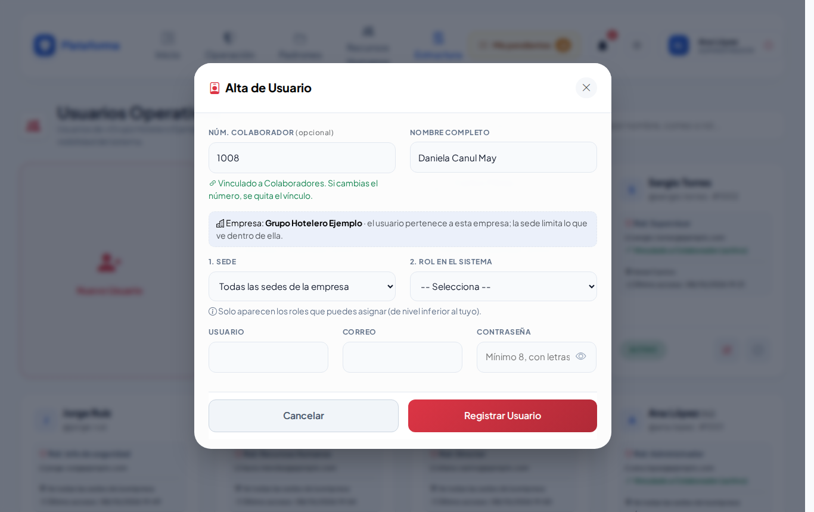

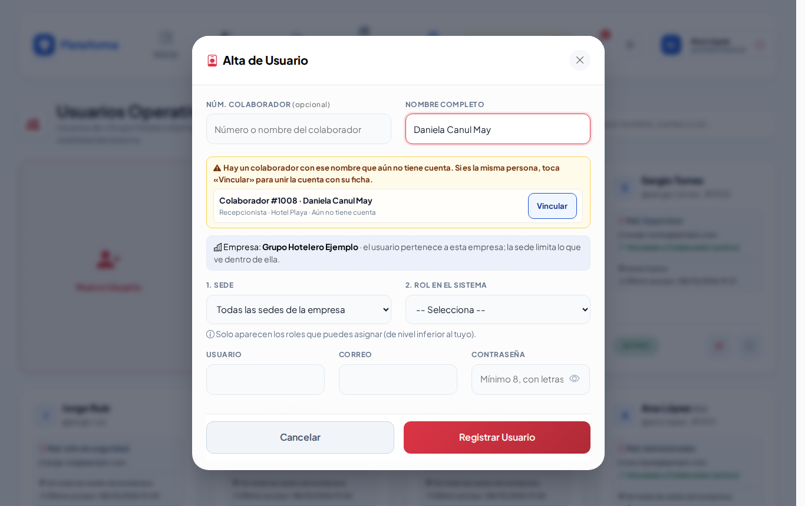

**Qué debes ver:** en la lista, su ficha dice **Vinculado a Colaborador (activo)**. Al elegirlo, si aún no elegiste sede, se propone **la sede del colaborador**. Al editar la cuenta, **Nombre Completo** queda en solo lectura: para cambiarlo toca **cambiar en Colaboradores**.

Si después le cambian la sede en Colaboradores y su cuenta solo entra a otras sedes, te llega a la **campana** el aviso **«¿Mover su cuenta a …?»**: abre su **lápiz** y elige la sede nueva.

- Si cambias o borras el número a mano, el vínculo se quita. Vuelve a elegirlo de la lista.
- Solo aparecen colaboradores **activos** de tu empresa (y de tus sedes, si tu rol es de una sede).
- Para vincular una cuenta que ya existe: toca su **lápiz**, elige al colaborador en **Núm. Colaborador** y toca **Guardar Cambios**.

## Cómo registrar a dos personas con el mismo nombre

Si escribes un **Nombre Completo** que ya tiene otra cuenta (sin importar mayúsculas ni acentos), la ventana avisa: «Ya existe un usuario con ese nombre: @… (Agente). ¿Es la misma persona? …».

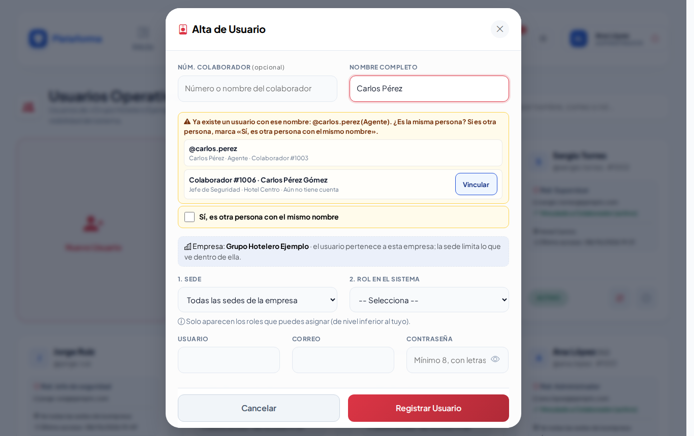

- **Si es la misma persona:** toca **Cancelar** y edita su cuenta en la lista. No hagas una segunda cuenta.
- **Si de verdad es otra persona:** marca **Sí, es otra persona con el mismo nombre** y registra. Sin esa marca no se guarda y el aviso se repite arriba, en rojo.

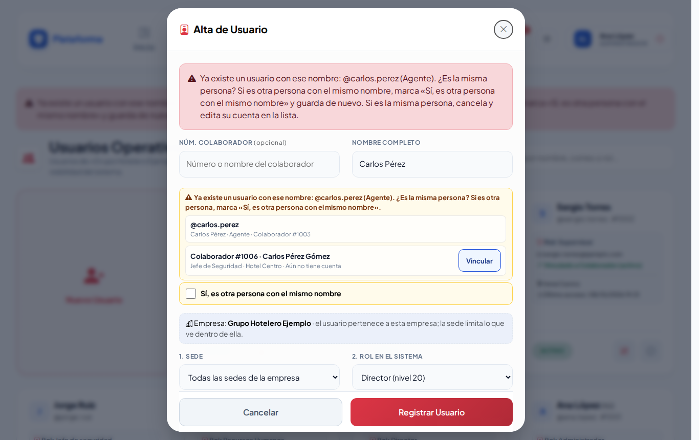

El **usuario** y el **correo** nunca se pueden repetir, aunque el nombre sí.

## Cómo editar una cuenta

1. Toca el **lápiz** (Editar). Se abre **Editar Usuario**.
2. Cambia lo necesario (nombre, colaborador, sede, rol, usuario o correo). Si dejas **Nueva Contraseña** en blanco, no cambia; si la escribes, la persona tendrá que volver a entrar y **cambiarla en su primer acceso**. Para contraseñas, mejor usa la **llave** (ver abajo).
3. Toca **Guardar Cambios**.

**Qué debes ver:** «Usuario actualizado correctamente.»

## Cómo restablecer la contraseña de alguien

Cuando una persona no recuerda su contraseña, lo primero es que use **Olvidé mi contraseña** en la pantalla para entrar: ella sola recibe el enlace por correo. Si no puede (no tiene correo, no le llega, o la plataforma no tiene correo configurado), restablécela tú:

1. Toca la **llave** (Restablecer contraseña) de su ficha. Se abre **Restablecer contraseña** con el nombre de la cuenta.
2. Elige **cómo**:
   - **Enviarle un enlace por correo** (recomendado): le llega **«Crea tu contraseña nueva»**; el enlace vale **60 minutos** y una sola vez.
   - **Escribir una contraseña**: escribe la **Contraseña nueva** y dísela; tendrá que cambiarla al entrar.
3. Toca **Guardar**.

**Qué debes ver:** «Le enviamos a «…» un enlace para crear su contraseña nueva (vale 60 minutos). Su contraseña anterior ya no sirve y sus sesiones se cerraron.» o «Contraseña de «…» restablecida; tendrá que cambiarla al entrar. Sus sesiones se cerraron.»

- En los dos casos su contraseña anterior **deja de servir** de inmediato y se cierran sus sesiones abiertas.
- Tú nunca ves ni puedes ver la contraseña de nadie; la plataforma solo guarda la contraseña cifrada.
- Queda en la [Bitácora de auditoría](auditoria.md) quién restableció a quién y cuándo (nunca la contraseña).

## Cómo atender a quien pide ayuda con su cuenta

Quien no tiene correo (o no le llega) toca **Olvidé mi contraseña → Pedir a mi administrador**; quien perdió su teléfono toca **Perdí mi teléfono: pedir ayuda** en la pantalla del código. Su petición te llega a la **campana** («Pide ayuda con su cuenta: …»), a **Mis pendientes → Cuentas por revisar** y arriba de la lista de Usuarios, en el recuadro **Piden ayuda con su cuenta**.

1. Confirma **en persona** que fue quien lo pidió (con una identificación).
2. Si pidió **restablecer su contraseña**: toca la **llave** de su ficha, elige **Escribir una contraseña** y dísela. Al entrar, la cambiará por una suya.
3. Si pidió **restablecer su verificación en dos pasos**: toca el **teléfono** de su ficha (ver abajo).
4. Si no fue la persona o no procede, toca **Rechazar** junto a su nombre en el recuadro. Le avisamos.

**Qué debes ver:** al restablecer, la petición desaparece sola del recuadro y de **Mis pendientes**. Todo queda en la [Bitácora de auditoría](auditoria.md).

- El número de **Mis pendientes → Cuentas por revisar** es exactamente lo que tú puedes atender en esta pantalla.
- Solo ves las peticiones de las cuentas que puedes administrar (tu alcance y de nivel inferior al tuyo). Las contraseñas las atiende quien puede editar usuarios; los dos pasos, quien puede restablecer la verificación (ver abajo).

## Cómo dar de baja o reactivar una cuenta

1. Toca el **círculo con raya** (Dar de baja) y confirma con **Aceptar** («¿Dar de baja la cuenta de …? No podrá volver a iniciar sesión hasta que la reactives con el mismo botón.»). La persona ya no puede entrar y, si estaba dentro, se le cierra la sesión. Verás «Usuario dado de baja: …» y su ficha dice **DE BAJA**.
2. Para regresarla, toca la **flecha circular** (Reactivar) y confirma («¿Reactivar la cuenta de …? Podrá volver a iniciar sesión.»).

No se borra a nadie, para conservar el historial.

### Cuando Recursos Humanos da de baja al colaborador

Si la cuenta está **vinculada** a un colaborador y Recursos Humanos lo da de baja en [Colaboradores](colaboradores.md), **su cuenta se da de baja sola** en ese momento: ya no puede entrar y se le cierra la sesión. Su ficha dice **Dada de baja junto con su colaborador** con la fecha, y quien administra usuarios de esa sede recibe un aviso en su **campana** («Cuenta dada de baja junto con su colaborador: …») y lo ve en **Mis pendientes → Cuentas por revisar** durante 7 días.

Si el colaborador **reingresa**, su cuenta **no** se reactiva sola: revísala y, si la necesita, toca la **flecha circular** (Reactivar) de su ficha.

## Cómo desbloquear una cuenta

Tras **5 intentos fallidos** seguidos, la cuenta se bloquea 15 minutos. Su ficha muestra **BLOQUEADO hasta HH:MM**.

1. Si la persona ya recordó su contraseña y no puede esperar, toca el **candado** (Desbloquear) de su ficha.
2. Confirma con **Aceptar**.

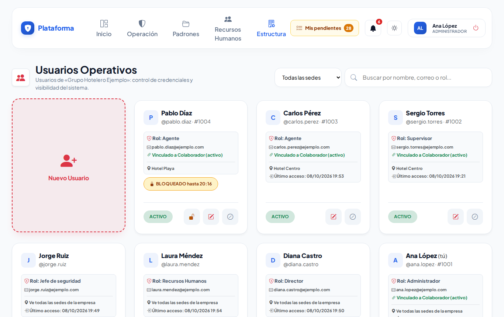

**Qué debes ver:** ««Pablo Díaz» desbloqueado; ya puede entrar.» El desbloqueo queda en la [Bitácora de auditoría](auditoria.md). El candado solo aparece si tu rol tiene el permiso **Desbloquear** y la persona es de nivel inferior y está en tu alcance.

Cada bloqueo te avisa: quien puede editar usuarios de esa sede recibe en su **campana** «Cuenta bloqueada: …» (con los minutos y desde qué red se intentó) y, si en **Configuración → Avisos por correo** está encendido «Seguridad: avisar… cuando una cuenta se bloquea», también por correo; la persona afectada recibe un correo. Las cuentas bloqueadas aparecen en **Mis pendientes → Cuentas por revisar** y arriba de la lista de Usuarios. Si los intentos no son de la persona, conviene que cambie su contraseña en cuanto entre.

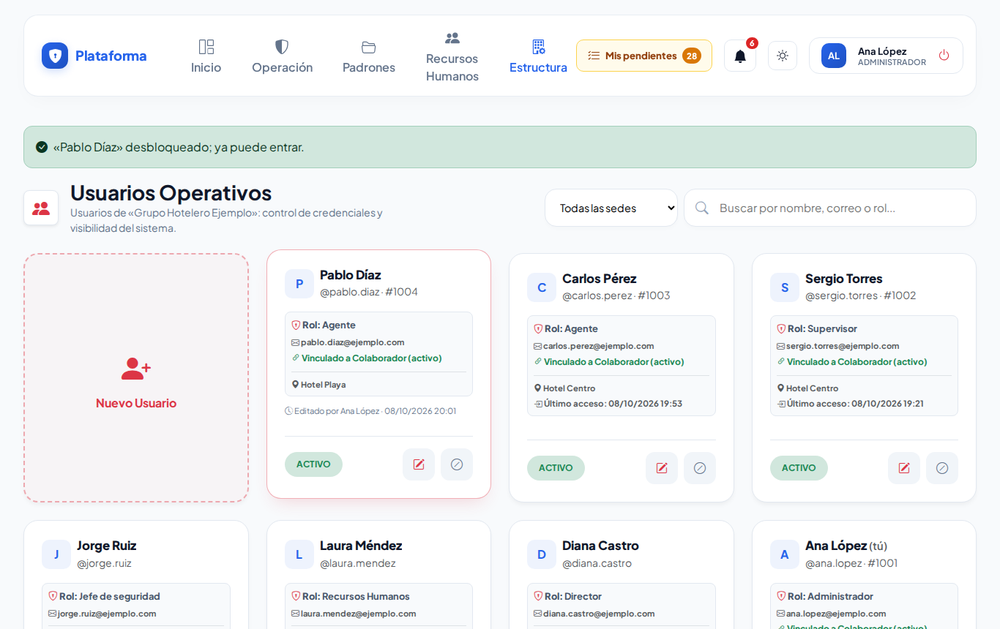

> Si la persona olvidó su contraseña, ella misma puede usar **Olvidé mi contraseña** en la pantalla para entrar; al guardar la nueva la cuenta se desbloquea sola. Si no puede, usa la **llave** (Restablecer contraseña).

## Cómo restablecer la verificación en dos pasos de alguien

Cuando una persona **perdió o cambió su teléfono** y no tiene sus códigos de respaldo, no puede entrar. Tú le quitas la verificación para que la active otra vez con su teléfono nuevo.

1. Busca su cuenta. Su ficha dice **Verificación en dos pasos activa**.
2. Toca el **teléfono** (Restablecer verificación en dos pasos) de su ficha.
3. Lee el mensaje y confirma con **Aceptar**.

**Qué debes ver:** «Listo: quitamos la verificación en dos pasos de «…» y cerramos sus sesiones. Le avisamos; al entrar con su contraseña la activará con su teléfono nuevo.» La persona recibe un aviso en su campana y por correo, y el cambio queda en la [Bitácora de auditoría](auditoria.md).

- El botón solo aparece si tu rol tiene el permiso **Desbloquear** de Usuarios y la persona es de nivel inferior y está en tu alcance (igual que desbloquear).
- Confirma antes que de verdad es la persona quien lo pide (por teléfono o en persona): con esto, quien tenga su contraseña podría entrar.
- Si tu empresa exige la verificación a esa cuenta, al entrar se le pedirá activarla de nuevo.

## En el celular y en los modos Noche y Sol

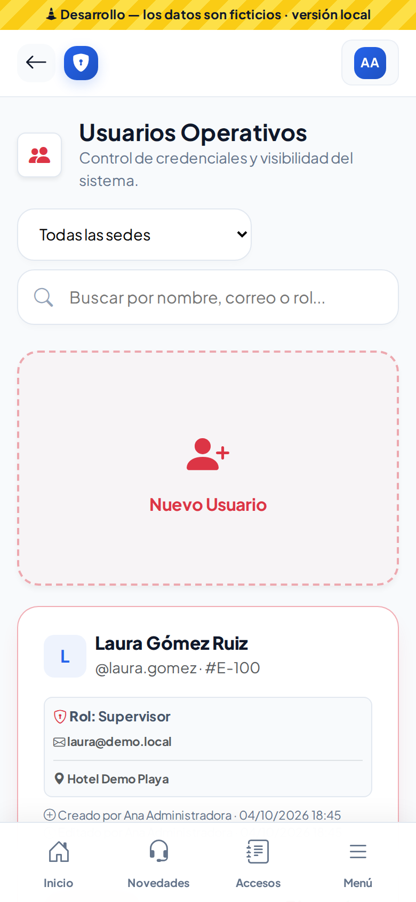

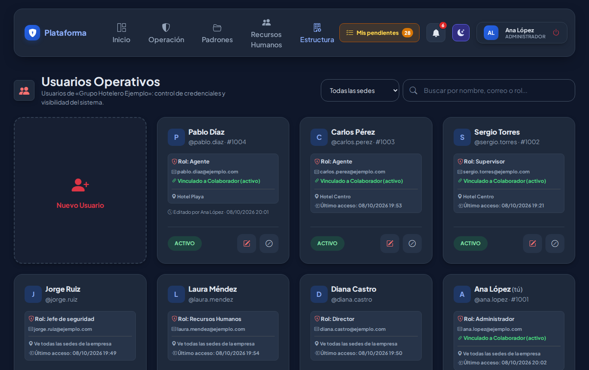

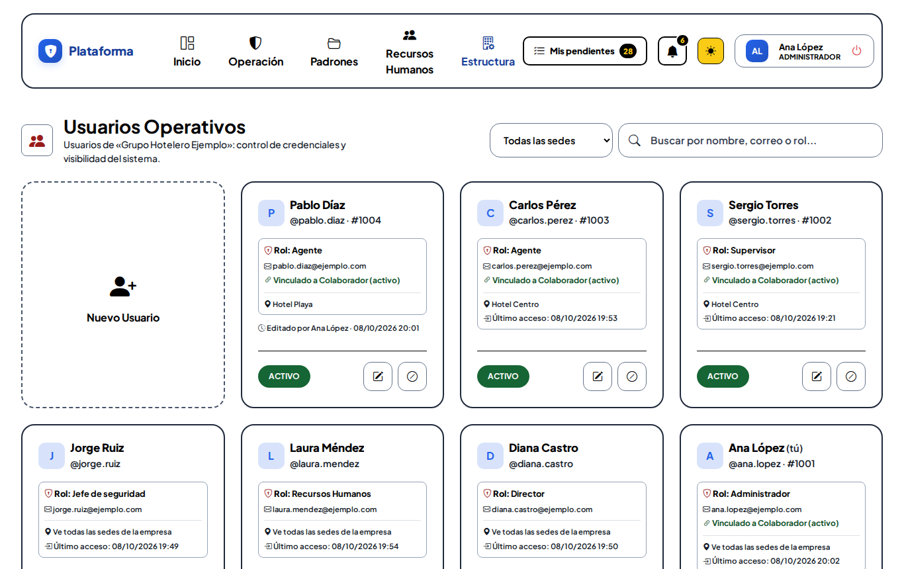

## Si algo sale mal

Los mensajes salen en rojo dentro de la ventana; lo que escribiste se conserva.

| Mensaje o síntoma | Qué significa | Qué hacer |
|---|---|---|
| Ya existe otro usuario registrado con ese nombre de usuario. | El usuario ya lo usa otra cuenta. | Elige otro (por ejemplo `juan.perez2`). |
| Ya existe otro usuario registrado con ese correo. | El correo ya está en otra cuenta. | Usa otro correo o edita la cuenta existente. |
| El nombre de usuario solo puede tener letras, números, punto, guion y guion bajo (sin espacios). | Escribiste espacios o acentos. | Por ejemplo `juan.perez`. |
| Ya existe un usuario con ese nombre: @… ¿Es la misma persona? | Hay otra cuenta con ese nombre. | Edita la existente o marca **Sí, es otra persona con el mismo nombre**. |
| Ese colaborador ya tiene una cuenta de usuario: búscala en la lista en vez de crear otra. | El colaborador ya tiene cuenta. | Edita su cuenta. |
| Ese colaborador está dado de baja. | El colaborador está dado de baja. | Pide a Recursos Humanos que lo reingrese o no lo vincules. |
| Ya existe otro usuario registrado con ese número de colaborador. | Ese número ya está en otra cuenta. | Revisa el número. |
| El campo contraseña es obligatorio. | Elegiste **Escribir la contraseña ahora** (o no hay correo configurado) y la dejaste vacía. | Escríbela, o elige **Enviar enlace de bienvenida por correo**. |
| Usuario «…» creado, pero el correo de bienvenida no se pudo enviar. | La cuenta existe, pero el correo no salió. | Revisa su correo y toca la **llave** para reenviar el enlace o escribirle una contraseña. |
| El correo de la plataforma no está configurado: por ahora solo puedes escribir la contraseña. | No hay correo saliente configurado. | Escribe la contraseña inicial; pide al Super Administrador configurar el correo en **Configuración**. |
| El campo contraseña debe tener al menos un número. | La contraseña solo tiene letras. | Agrega al menos un número (por ejemplo `Hotel2026`). |
| El campo contraseña debe tener al menos una letra. | La contraseña solo tiene números. | Agrega al menos una letra. |
| El campo contraseña debe tener al menos 8 caracteres. | La contraseña es muy corta. | Escribe 8 o más caracteres, con letras y números. |
| Escribe el correo: este rol administra la plataforma y lo necesita… | El rol elegido administra usuarios, roles, permisos o la configuración. | Escribe su correo. Solo las cuentas de caseta pueden ir sin correo. |
| El campo correo debe ser un correo electrónico válido. | Al correo le falta la @ o el dominio. | Escribe un correo completo, por ejemplo `juan.perez@hotelcentro.mx`. |
| «…» no tiene activa la verificación en dos pasos. | Ya se había restablecido o nunca la activó. | No hace falta hacer nada: entra solo con su contraseña. |
| «…» no está bloqueado; ya puede entrar. | La cuenta ya no estaba bloqueada. | No hace falta hacer nada. |
| No veo el lápiz en una cuenta. | Es tu cuenta o es de tu mismo nivel o superior. | Pídelo a alguien de nivel superior. |

## Preguntas frecuentes

**¿La persona puede entrar con su correo?** Sí, con su usuario o con su correo.

**¿Por qué no aparece un rol en la lista?** Solo puedes asignar roles de nivel inferior al tuyo.

**¿Qué rol le doy a alguien de otro departamento que solo pide pases de salida?** El rol **Solicitante**; a su jefe, **Jefe de departamento**. En los dos casos vincula la cuenta con su colaborador. Los pasos están en [Roles y permisos](roles-y-permisos.md).

**¿Qué pasa si doy de baja una cuenta?** La persona ya no puede entrar, pero todo lo que registró se conserva.

**¿Puedo ver la contraseña de alguien?** No, nadie puede. Si la necesita, se le envía un enlace o se le escribe una nueva que cambiará al entrar.

**¿Por qué dice «Creará su contraseña al entrar»?** Porque la cuenta se creó con enlace de bienvenida y aún no lo usa, o porque alguien le escribió la contraseña y todavía no la cambia.

**¿Qué son las «Cuentas por revisar»?** Las bloqueadas por intentos fallidos, las dadas de baja junto con su colaborador en los últimos 7 días, las que piden pases de salida a su nombre (Solicitante, Jefe de departamento) **sin colaborador vinculado** (así no pueden pedir pases ni firmar los de su departamento; vincúlalas con el **lápiz** de su ficha) y las personas que **te piden ayuda** para recuperar su contraseña o su verificación en dos pasos. Aparecen en **Mis pendientes** y arriba de la lista.

**¿Una cuenta de caseta puede ir sin correo?** Sí. Solo las cuentas que administran (usuarios, roles, permisos o configuración) necesitan correo. Sin correo, la persona recupera su cuenta pidiéndotelo a ti.

**¿Qué es el aviso «Administran sin correo»?** Aparece arriba de la lista cuando a un rol se le dieron permisos de administración y algunas de sus cuentas no tienen correo (también lo avisa **Roles y permisos** al guardar). Toca el **lápiz** de cada ficha y escribe su correo: así pueden recuperar su cuenta y recibir avisos.

**¿Una cuenta puede trabajar en dos sedes sin ver toda la empresa?** Sí: elige su sede y marca las demás en **¿También atiende otras sedes?**. Su ficha dice, por ejemplo, «Hotel Centro + Hotel Playa». Si tú solo administras una de esas sedes, al editarla las otras se conservan.

**¿Cómo veo todo lo que se le ha hecho a una cuenta?** Toca el **reloj** (Ver historial) de su ficha: abre la Bitácora de auditoría con solo los movimientos de esa cuenta.

**¿Puedo ver o copiar el código de la verificación en dos pasos de alguien?** No. Solo la persona lo ve en su teléfono. Tú solo puedes restablecerla para que la active de nuevo.

**¿Cuánto dura el bloqueo?** 15 minutos, o hasta que alguien con permiso la desbloquee.

## Relacionado

- [Roles y permisos](roles-y-permisos.md)
- [Colaboradores](colaboradores.md)
- [Mi cuenta](mi-cuenta.md)
- [Entrar y salir de la plataforma](inicio-de-sesion.md)
- [Bitácora de auditoría](auditoria.md)
