# Zonas y edificios

**¿Para qué sirve?** Aquí registras la estructura física de cada sede, de lo general a lo particular:

**Zona / Edificio → Piso → Habitación → Áreas de la habitación → Elementos**

Si tu empresa no es hotel, en lugar de «Habitación» verás Oficina, Vivienda o Casa. La palabra **área** se usa solo para las partes de una habitación (Baño, Terraza, Recámara…). Estos lugares se usan en otras pantallas: lo que abre cada [llave](llaves.md), la ubicación de los [equipos de Protección Civil](equipos-pc.md), los recorridos, la habitación o vivienda y el área de trabajo en la [Bitácora de accesos](accesos.md), el lugar de un incidente en [Novedades](novedades.md) y la vivienda de cada [residente](residentes.md): ahí se eligen de una lista con sugerencias en lugar de escribirse.

Cada sede tiene su propia pantalla: primero eliges la sede con su tarjeta y ahí ves solo sus zonas, edificios y secciones, sin mezclarse con las de otras sedes.

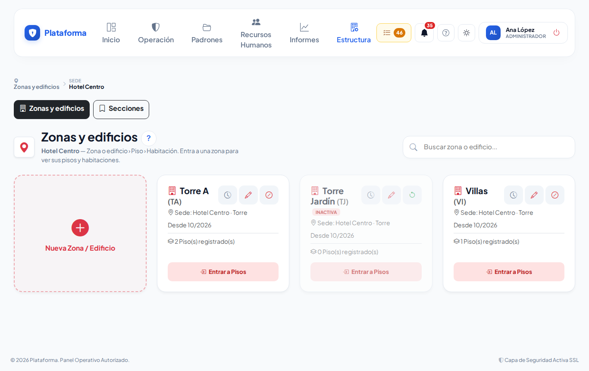

## Antes de empezar

- Para ver la pantalla tu rol debe poder consultar *Zonas y edificios*. Si no aparece en el menú, pide el permiso a tu administrador.
- Para crear, editar, mover o dar de baja necesitas esos permisos.
- Para eliminar definitivamente necesitas el permiso **Eliminar definitivamente** de *Zonas y edificios*.
- La sede debe existir en [Empresas y sedes](empresas-y-sedes.md).

## Cómo elegir la sede

1. Entra a **Estructura → Zonas y edificios**.
2. Verás una tarjeta por cada sede que puedes consultar, con cuántas zonas o edificios, pisos, habitaciones en uso y secciones tiene. Si son muchas, escribe parte del nombre o del código en **Buscar sede...**.
3. Toca **Entrar a la sede** en la tarjeta de tu sede.

**Qué debes ver:** la pantalla de esa sede, con su nombre arriba y sus pestañas **Zonas y edificios** y **Secciones**.

Si solo tienes acceso a una sede, entras directo a su pantalla: no verás las tarjetas.

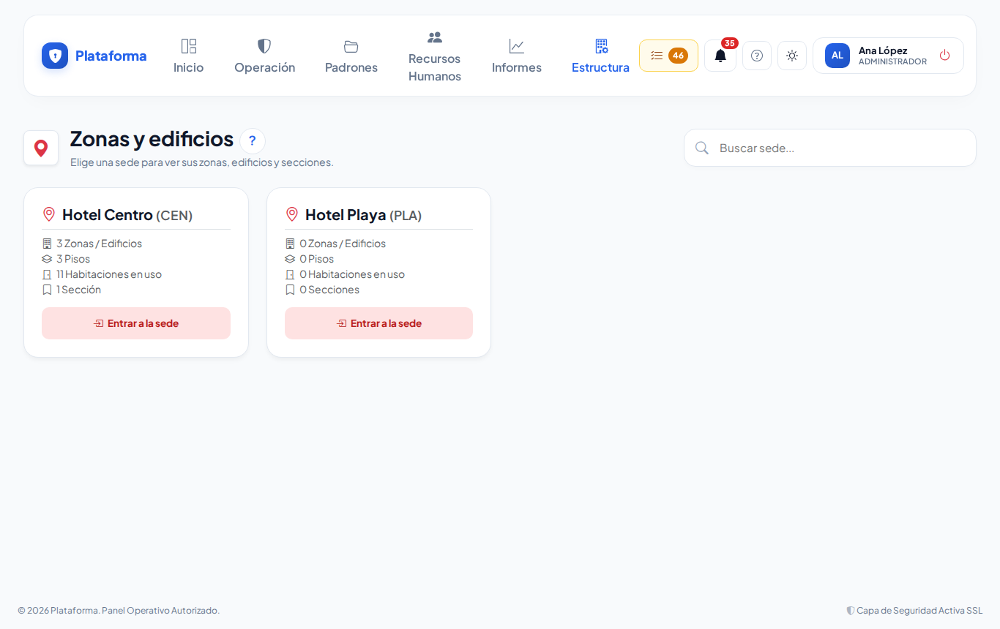

## Cómo crear una zona o edificio

1. Entra a **Estructura → Zonas y edificios** y toca la tarjeta de tu sede (**Entrar a la sede**).
2. Toca la tarjeta **Nueva Zona / Edificio**. Se abre **Alta de Zona / Edificio**.
3. Escribe el **Nombre de la Zona / Edificio**. No tienes que elegir la sede: se guarda en la sede en la que estás. El **Código** es opcional (por ejemplo `TA`).
4. Si quieres, elige el **Tipo**.
5. Toca **Registrar Zona**.

**Qué debes ver:** ««Torre B» agregado correctamente.» y sigues en la pantalla de tu sede. Para seguir bajando toca **Entrar a Pisos**.

### Avisos mientras escribes

- **Rojo:** «Ya existe «Torre A» en este mismo lugar.» No se podrá guardar. Si está desactivada, aparece **Reactivar**: tócalo para recuperarla con todo lo que tenía.
- **Amarillo:** «Se parece a «Torre A (TA)». Revisa que no sea el mismo.» Por ejemplo «Torre-A» y «Torre A».
- **Código parecido:** los espacios y guiones no cuentan: **TB**, **T-B** y **T B** se toman como el mismo código.

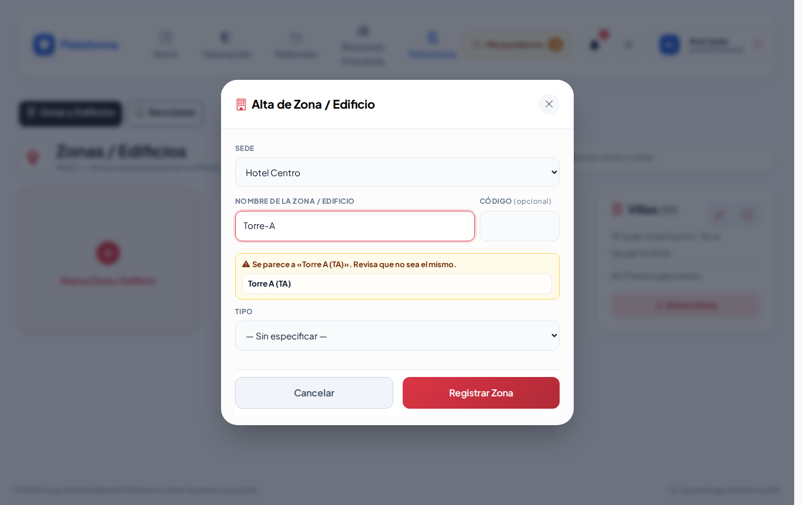

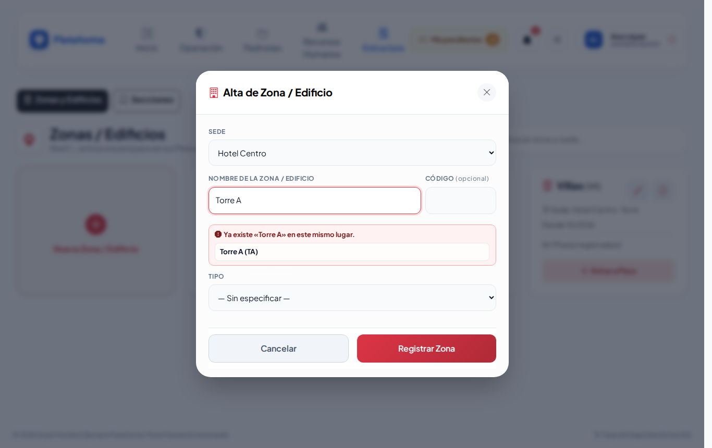

### Para no perderte: la ruta de arriba

Arriba de cada pantalla está la ruta completa, con el nombre de cada nivel: **Zonas y edificios › Sede › Zona / Edificio › Piso › Habitación**. Toca cualquier paso para regresar a él: **Sede** te lleva a la pantalla de esa sede y **Zonas y edificios**, a las tarjetas para elegir otra sede. En el celular la ruta se desliza de lado y se queda arriba al bajar.

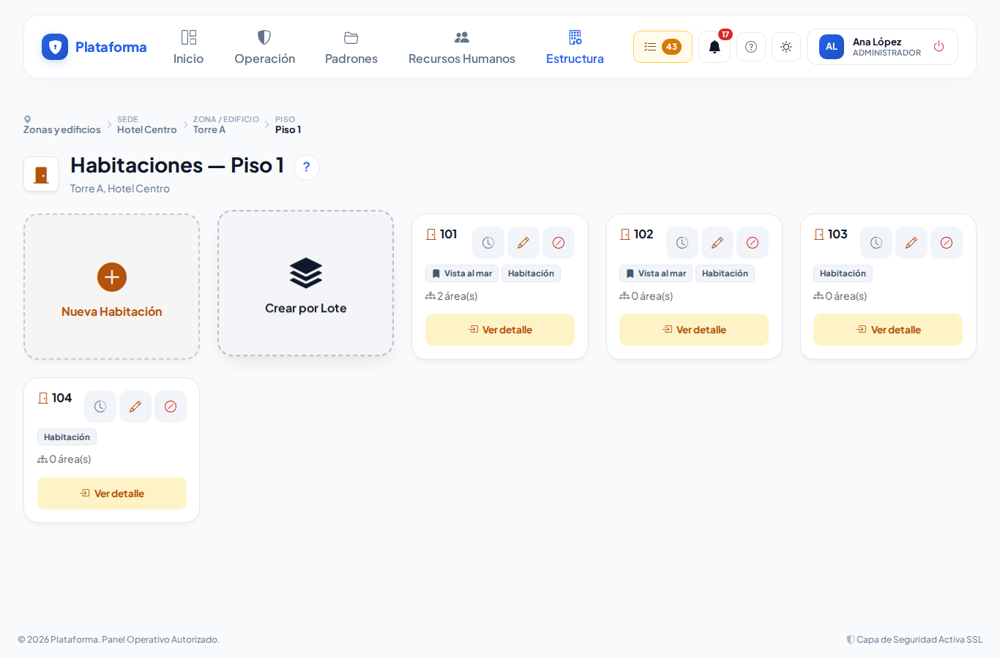

## Cómo agregar pisos

1. En la zona toca **Entrar a Pisos**. Se abre **Pisos de …**.
2. Toca **Nuevo Piso**, escribe el **Nombre del Piso** y toca **Agregar Piso**.
3. Si otro edificio ya tiene los mismos pisos, toca **Copiar estructura de pisos de otra zona**, elige el edificio en **Copiar desde** y toca **Copiar Pisos**. Solo se copian los que faltan.

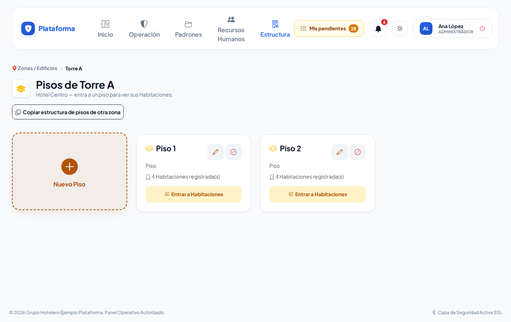

## Cómo agregar habitaciones

1. En el piso toca **Entrar a Habitaciones**.
2. **Nueva Habitación:** una por una; escribe el **Nombre o número (ej. 101)** y, si quieres, su sección y tipo.
3. **Crear por Lote:** muchas de una vez.
   - **Rango numérico:** escribe el **Prefijo** (opcional), **Desde** y **Hasta**. Por ejemplo prefijo `1`, desde 5 hasta 8 → 105, 106, 107, 108. Con **Rellenar con ceros (01, 02…)** quedan 1001, 1002…
   - **Lista de nombres:** un nombre por renglón (o separados por coma), por ejemplo «Suite A, Suite B».
   - Toca **Crear Habitaciones**. Las que ya existen se saltan y te dice cuántas fueron. Máximo 500 por lote.

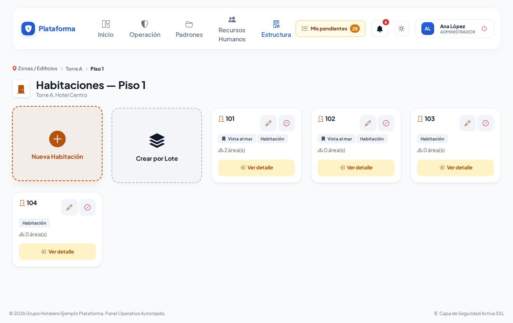

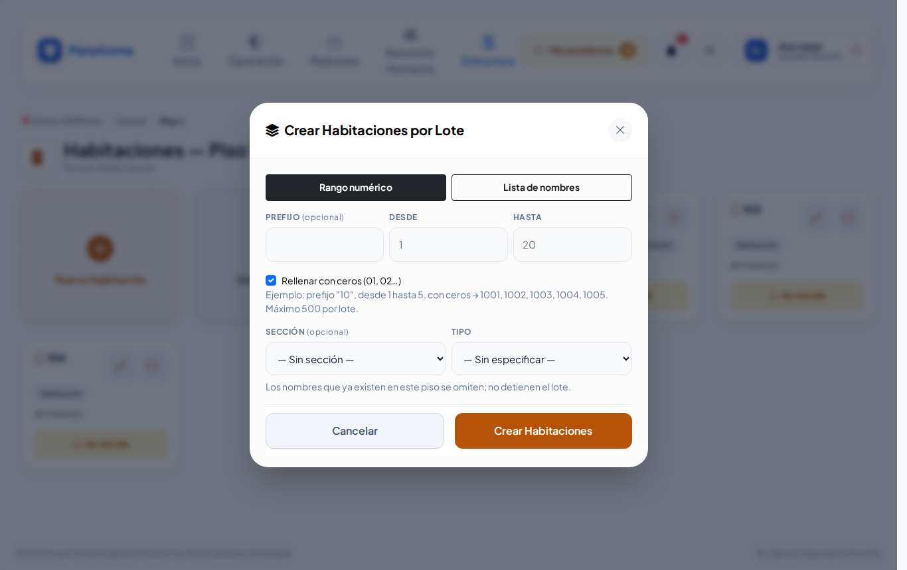

## Cómo cargar zonas, pisos y habitaciones desde Excel

Si tu sede tiene muchas habitaciones (u oficinas), cárgalas desde un archivo:

1. Toca **Importar** (arriba, junto al buscador).
2. Toca **Descargar plantilla** y llénala: una fila por lugar con **Sede**, **Zona o edificio**, **Piso** y **Habitación** (por ejemplo «Sede Centro, Torre A, Piso 1, 101»). Deja vacío el piso si la habitación va directo en la zona.
3. Toca **Elegir archivo**, elige tu archivo, toca **Revisar archivo**, revisa la vista previa y toca **Guardar**.

**Qué debes ver:** la zona y el piso se crean una sola vez aunque se repitan en muchas filas; lo que ya existe se usa tal cual y una fila cuyo lugar ya existe completo sale **Ya existe** y se omite. Ver [Importar desde Excel](importar-desde-excel.md).

## Cómo detallar una habitación (áreas y elementos)

Las áreas y los elementos son **opcionales**: captúralos solo si los vas a usar en llaves, equipos de Protección Civil o recorridos. Si no, la habitación ya está lista (la pantalla te lo recuerda arriba).

1. En la habitación toca **Ver detalle**.
2. Toca **Agregar Área** y elige qué **Es un** (Baño, Recámara, Terraza…). La **Etiqueta** es opcional: si la dejas vacía se usa el tipo y, si se repite, se numera (Baño, Baño 2).
3. Dentro de cada área toca **Agregar Elemento** (Cama, Lavabo, Caja fuerte…).
4. ¿Falta un tipo? Abre **¿No encuentras el tipo…?** al final, escríbelo y toca **Agregar tipo**. Solo lo verá tu empresa.

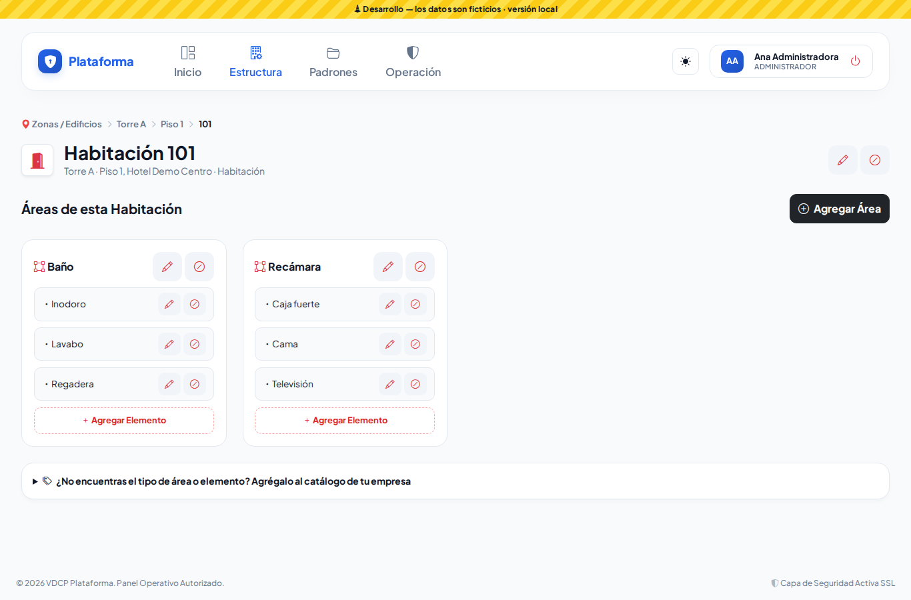

**Qué debes ver:** «Tipo «…» disponible para tu empresa.» Si ese tipo ya estaba: «El tipo «…» ya existía en la lista: no se duplicó y ya puedes elegirlo.»

## Cómo agrupar habitaciones en secciones

Las secciones agrupan habitaciones de una sede, por ejemplo «Vista al mar» o «Torre Norte». Las llaves pueden abrir una sección completa.

1. Entra a **Estructura → Zonas y edificios**, toca la tarjeta de tu sede (**Entrar a la sede**) y arriba toca **Secciones**. Solo verás las secciones de esa sede.
2. Toca **Nueva Sección**, escribe el **Nombre de la Sección** y toca **Crear Sección**. Se crea en la sede en la que estás.
3. En la sección toca **Asignar Habitaciones**, marca las que le pertenecen (solo aparecen las de esta sede; puedes buscar por número o piso) y toca **Guardar**.
4. La forma principal es esta pestaña, porque asignas varias a la vez. Para cambiar la sección de una sola habitación también puedes elegirla al darla de alta o editarla.

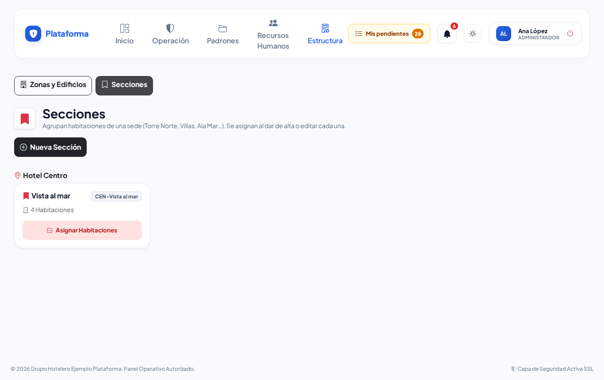

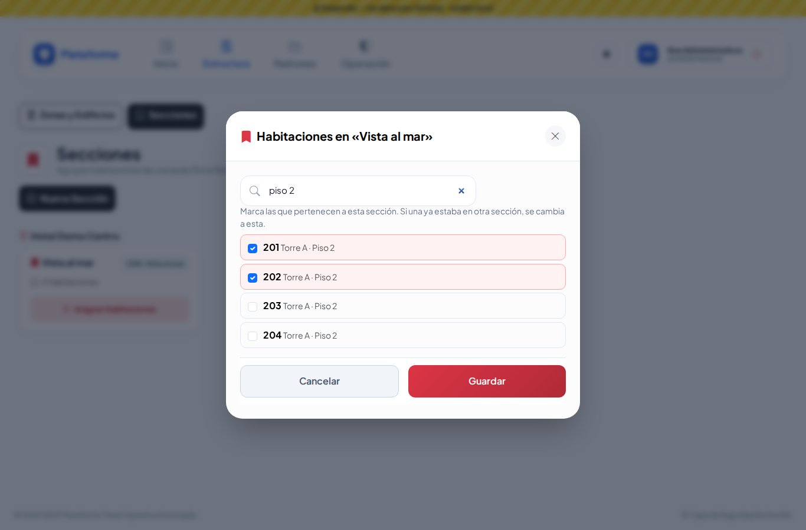

**Qué debes ver:** «Sección «Vista al mar»: 4 asignada(s).»

## Cómo mover un espacio

Sirve cuando capturaste una habitación en el piso equivocado, o cuando un piso pertenece a otra zona. Funciona con pisos, habitaciones, áreas y elementos; las zonas y edificios no se mueven.

1. Entra a la lista donde está; por ejemplo, las habitaciones del piso.
2. En su tarjeta toca **Mover a…** (las flechas en cruz, junto al lápiz).
3. En **Nuevo lugar** elige a dónde va. Solo aparecen los lugares activos de la misma sede donde puede ir: una habitación va dentro de un piso (o directo en una zona), un piso dentro de una zona o edificio, y un área dentro de una habitación.
4. Toca **Guardar**.

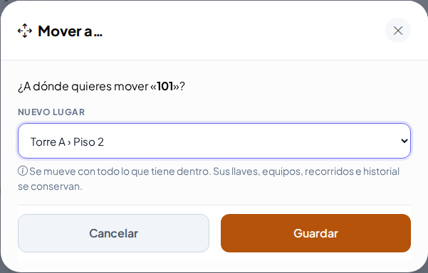

**Qué debes ver:** ««101» se movió a «Piso 2» con todo lo que tiene dentro.» y el botón **Ir a Piso 2**.

Se mueve con todo lo que tiene dentro (sus áreas y elementos). Sus llaves, equipos, recorridos e historial se conservan, y el cambio queda en la Bitácora de auditoría con el lugar de antes y el de después.

## Cómo eliminar varias habitaciones

Úsalo para limpiar lo que capturaste por error (por ejemplo, un lote con el rango equivocado). Solo se borra lo que **nadie ha usado**.

1. En el piso toca **Entrar a Habitaciones**.
2. Marca la casilla junto al nombre de cada habitación, o toca **Marcar todas**. Si usaste el buscador, **Marcar todas** solo marca las que se ven.
3. Toca **Eliminar definitivamente las marcadas**.
4. Escribe la cantidad marcada (por ejemplo `5`) o la palabra `ELIMINAR` y toca **Eliminar**.

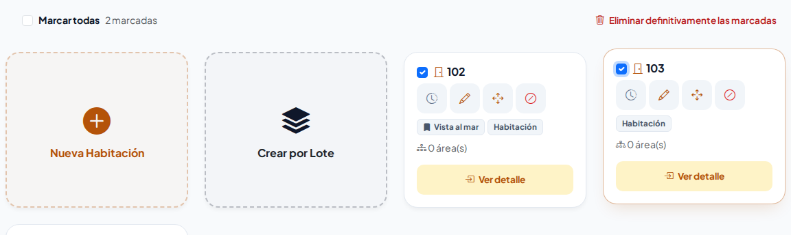

**Qué debes ver:** «Se eliminaron 5. Solo queda su copia en la Bitácora de auditoría.» Si alguna está en uso, no se borra y el aviso dice cuál y por qué, por ejemplo: «Se eliminaron 3; 2 no se pudieron: 101: tiene 1 llave que la abre (HDC-101); …». Esas puedes darlas de baja.

- Cada habitación se borra **con todo lo que tiene dentro** (áreas y elementos), siempre que nada de eso esté en uso.
- Puedes eliminar hasta 200 a la vez.
- En **Pisos de …** funciona igual para eliminar varios pisos.
- Para una sola, también está **Eliminar definitivamente** en su ventana de edición. Ver [Eliminar definitivamente](eliminar-definitivamente.md).

## Cómo dar de baja o reactivar un espacio

1. Toca el **círculo rojo** (Dar de baja). Se desactiva el espacio **y todo lo que tiene dentro**: si lo das de baja en un piso, se desactivan sus habitaciones. El historial se conserva.
2. Para reactivar usa la **flecha circular**. Primero reactiva lo de arriba: no puedes reactivar una habitación si su piso sigue inactivo.

> Si tiene cosas vigentes (reservas futuras o llaves que lo abren), antes de confirmar se abre [Antes de dar de baja](antes-de-dar-de-baja.md) con la lista y lo que pasará con cada una.

## En el celular

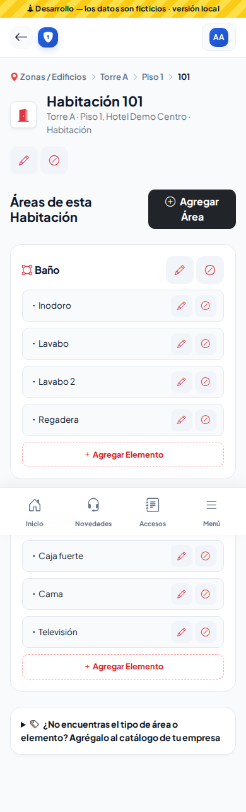

## Si algo sale mal

| Mensaje o síntoma | Qué significa | Qué hacer |
|---|---|---|
| No ves la tarjeta de una sede, o al abrirla aparece «No encontrado». | Tu rol no tiene acceso a esa sede, o la sede está dada de baja. | Pide a tu administrador que te dé acceso a esa sede. |
| Ya existe «…» en este mismo lugar. | Ese nombre ya está en ese nivel. | Usa otro nombre o edita el existente. |
| Escribe un nombre o elige un tipo. | El nombre está vacío. | Escribe el nombre. |
| El código solo puede tener letras, números y guiones (sin espacios ni acentos). | El código tiene espacios o acentos. | Corrige el código. |
| Primero reactiva «…», del que depende. | El espacio de arriba está desactivado. | Reactiva primero el de arriba. |
| «…» está desactivado: reactívalo antes de agregarle espacios. | Intentas agregar dentro de algo inactivo. | Reactívalo primero. |
| La sección elegida no pertenece a esta sede. | La sección es de otra sede. | Elige una sección de la misma sede. |
| Escribe al menos un nombre. / Indica desde qué número. / Indica hasta qué número. | Falta información en **Crear por Lote**. | Completa el rango o la lista. |
| Solo se pueden copiar pisos entre edificios de la misma empresa. | El edificio de origen no es válido. | Elige un edificio de tu empresa. |
| Ya existe la sección «…» en …. | Esa sección ya existe en la sede. | Usa la existente. |
| Ya existe «101» en ese piso. | En el lugar elegido ya hay uno con el mismo nombre (o el mismo código). | Cambia antes el nombre de uno de los dos o elige otro lugar. |
| «…» solo puede ir dentro de: piso o zona / edificio. | El lugar elegido no es del nivel correcto. | Elige un lugar de los que aparecen en la lista. |
| No se puede mover «…» dentro de sí mismo ni dentro de lo que tiene adentro. | Elegiste un lugar que está dentro del mismo espacio. | Elige un lugar fuera de él. |
| «…» está desactivado: reactívalo o elige otro lugar. | El lugar elegido está dado de baja. | Reactívalo primero o elige otro. |
| No hay otro lugar activo del nivel correcto en esta sede. | En **Mover a…** no hay a dónde llevarlo. | Crea primero el piso o la zona de destino. |
| Para confirmar escribe 5 (la cantidad marcada) o ELIMINAR. | Lo que escribiste no coincide. | Escribe la cantidad marcada o `ELIMINAR`. |
| … no se pudieron: 101: tiene 1 llave que la abre … | Esa habitación (o algo dentro de ella) está en uso. | Dala de baja con el círculo rojo; su historial se conserva. |

## Preguntas frecuentes

**¿Por qué ya no veo las zonas de todas las sedes juntas?** Para que no se mezclen: cada sede tiene su pantalla. Toca **Zonas y edificios** en la ruta de arriba para volver a las tarjetas y elegir otra sede.

**¿Tengo que capturar todas las habitaciones?** Solo las que necesites para llaves, recorridos o equipos. Con **Crear por Lote** es rápido.

**¿Puedo borrar un espacio?** Sí, con **Eliminar definitivamente**, siempre que nadie lo haya usado (ninguna llave lo abre, no tiene equipos, recorridos ni registros). Si ya se usó, dalo de baja con el círculo rojo: así se conserva el historial.

**Capturé una habitación en el piso equivocado, ¿la borro y la creo otra vez?** No hace falta: usa **Mover a…**. Conserva sus llaves, equipos e historial.

**¿Por qué «TB» y «T-B» se consideran iguales?** Porque los espacios y guiones no cuentan en el código, para evitar duplicados.

**¿Los tipos que agrego los ven otras empresas?** No, solo tu empresa.

## Relacionado

- [Empresas y sedes](empresas-y-sedes.md)
- [Eliminar definitivamente](eliminar-definitivamente.md)
- [Catálogo de llaves](llaves.md)
- [Equipos de Protección Civil](equipos-pc.md)
- [Importar desde Excel](importar-desde-excel.md)
